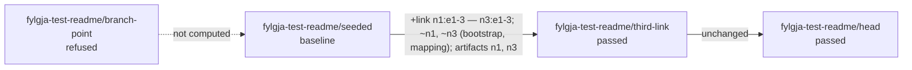

# Fylgja

[](https://github.com/happypathnetworking/fylgja/actions/workflows/ci.yml)

Fylgja builds a **walking twin** of a network from its intent. You name a branch in
[Infrahub](https://github.com/opsmill/infrahub), and optionally a point in time. Fylgja
reads it, compiles it into a deterministic bundle, and boots it as a running
[containerlab](https://containerlab.dev) topology on real network operating system
images. Then it pushes each device's production configuration as Infrahub rendered it.
If the branch changes, the twin rebuilds itself to match. Provisioning runs through
[Temporal](https://temporal.io), so a create that fails or is cancelled cleans up after
itself; state lives in containerlab, a few files and Temporal, and there is no database.
There is one twin at a time, on one lab host. Every command is a request to Fylgja's API,
which `fylgja serve` answers on the lab host, so a shell that holds the API's token alone
can drive the twin, from the lab host or through an SSH tunnel from another machine.
`v0.1.0` is released; [what it built](docs/archive/v0.1-built.md) is recorded milestone by
milestone, and the [roadmap](docs/roadmap.md) says what comes next.


The asciinema cast beside it, [docs/recording/session.cast](docs/recording/session.cast),
plays the same session as text. Both were recorded at `v0.1.0` and show a twin from a
waypoint, which a proposed change's stages have since replaced, until they are remade at
`v0.2.0`.

Today it runs Nokia SR Linux and Arista EOS, alone or mixed in one twin. A vendor is a
YAML file, not code ([psp/README.md](psp/README.md)). A twin built from a stage of a
proposed change can step to another stage of it without a rebuild, and `twin verify`
reports whether the running twin matches its intent. A rehearsal takes a twin through every
stage of a proposed change and destroys it, from the shell or from a check inside Infrahub
that posts the report on the proposed change and fails it when a stage fails.

## Built with an AI agent

Fylgja was built with Claude, an AI agent, working through the
[Spec Kit](https://github.com/github/spec-kit) workflow, with a human deciding every
question of scope and design. The record of how it was built (the specifications, plans,
research and command logs) is private; this repository holds the result.

## What it needs

One Ubuntu 26.04 host on amd64, and a clone of this repository. `scripts/bring-up.sh`
stands the host up: run it from the clone, as the user who will run Fylgja (not root). It
asks for `sudo` once.

```sh
git clone https://github.com/happypathnetworking/fylgja.git && cd fylgja
scripts/bring-up.sh --ceos-tar ~/Downloads/cEOS-lab-4.32.0.2F.tar   # or no flag: SR Linux alone
```

It runs four parts in order. Each item is checked, installed when it is missing and
checked again, and each prints one line, `present`, `installed` or `skipped` with why:

| Part | What it installs, or finds already there |
|---|---|
| `toolchain` | `make`, `git`, `curl`, `jq`, `xz-utils`, `file`; Go (Ubuntu's, which fetches the 1.26 toolchain `go.mod` names); golangci-lint 2.14.0; the Temporal CLI 1.9.1; gnmic 0.49.0; `.venv/` with `infrahub-sdk[ctl]` 1.23.2 |
| `lab` | Docker and containerlab 0.79.0, with you in the groups `docker` and `clab_admins`; the AppArmor lines SR Linux's `rsyslogd` needs; the SR Linux image, pulled; the cEOS image, imported from the tar |
| `infrahub` | Infrahub 1.11.2 on `:8000`, from its published Compose file, under `local/infrahub/`. Fylgja reads intent and each device's configuration from it, and never writes to it. The part prepares its `main`: Fylgja's schema (`schema/`), the empty group `fylgja-devices`, and this repository registered read-only, so that Infrahub renders each device's `device-config` artifact from the template here and runs the two checks of [A proposed change, rehearsed](#a-proposed-change-rehearsed) (`.infrahub.yml`, `infrahub/`); its Compose override gives Infrahub's task workers the API's address and token. Then it seeds the fixture branch `fylgja-fixture` |
| `fylgja` | `make build` → `bin/fylgja`, one static binary: the commands, the worker and the API's server; then three processes, left running and logging under `local/`: Temporal's file-backed dev server on `:7233`, the worker, and the API's server on `127.0.0.1:7650` and on the host's Docker bridge address, where those checks reach it, the last two with `local/` as their state root; then tiers 1 and 2 (see [Tests](#tests)), after the processes since tier 2's check test runs the checks inside Infrahub against this build's server on the bridge |

Before any part, when there is no `local/.env`, it writes one, readable by you alone:
Infrahub's address and an admin token it makes, each platform's node login (the image's
default), the API's token (`FYLGJA_API_TOKEN`), which the server and every command share,
and Infrahub's Compose values. A `local/.env` already there is kept as it is. Fylgja reads
the process environment only, and neither it nor the script prints, logs or stores a
credential anywhere else ([.env.example](.env.example) names every value).

The script ends `bring-up: DONE`, naming the three processes and how to stop them; on a
host it set up, skip the first walk-through's step that starts them. A second run installs
nothing and runs the tiers again, and `--part` runs one part alone. A fresh host took
about 28 minutes with the tar and 20 without, most of it the images' pulls and import. The
host it was proved on had 10 vCPUs and 32 GiB; Infrahub idles at about 5 GiB, and the
script warns under 24 GiB.

**The cEOS image is account-gated.** You download `cEOS-lab-4.32.0.2F.tar` (or `.tar.xz`)
from Arista yourself, and Fylgja never pulls it. The script looks for it at `--ceos-tar`,
then in `local/`, then in the clone's parent directory, never in the clone's root, and
imports it only when its sha256 is the one recorded. Without it the host runs **SR Linux
alone**, and the script says so in its first and last reports. The cEOS image is needed
only for EOS and mixed twins and for tier 3's two EOS cases. Every twin the walk-throughs
on this page boot is SR Linux, and the mixed compile under [Two vendors, one
twin](#two-vendors-one-twin) boots nothing, so each runs on such a host unchanged.

[docs/development.md](docs/development.md#local-environment) describes each component, and
where the cEOS image comes from.

## A walking twin, start to finish

This is a real session on one lab host, with Infrahub running beside it. Each step's
`begins` line is left out, and other trimmed lines are marked `…`. Start the workflow
service, the worker, which runs on the lab host and does everything that touches it, and
the API's server beside it, which every command below talks to. The two roles share one
state root, here `/var/tmp/fylgja`; any absolute directory both can write will do:

```sh
set -a; . local/.env; set +a     # Infrahub, the node logins and FYLGJA_API_TOKEN
make build                       # once: both roles below run this binary
make temporal-dev &              # the workflow service
mkdir -p /var/tmp/fylgja         # the state root: the bundle store and the twin directory
FYLGJA_STATE_ROOT=/var/tmp/fylgja bin/fylgja worker run &   # the lab host worker: prints what it will run, and what's on the host
FYLGJA_STATE_ROOT=/var/tmp/fylgja bin/fylgja serve &        # the API's server on 127.0.0.1:7650: prints where it listens, its state root and packages
```

`make worker` and `make serve` each build first, and use `local/` in the repository as
their state root, so starting both at once runs two builds of `bin/fylgja` side by side,
and the second can replace the binary the first role has just started, leaving it on a
`(deleted)` binary. Build once, then start each role from the binary, as above; restart
both after every rebuild.

Every `bin/fylgja` command after this is a client of that server, and needs nothing from
`local/.env` but the token. A shell that holds only `FYLGJA_API_TOKEN`, and
`FYLGJA_API_ADDRESS` when the server is not at `127.0.0.1:7650`, runs them; from another
machine, open `ssh -N -L 7650:127.0.0.1:7650 <lab host>` first and copy the binary over.
The server makes every refusal and renders every line. The fixture tool is a test tool: it writes to Infrahub itself, with
`local/.env` loaded.

Seed a throwaway branch with the three-node SR Linux fixture. Every device gets its
configuration artifact rendered by Infrahub:

```console
$ go run -tags fixture ./cmd/fylgja-fixture -branch fylgja-test-readme
schema loaded on fylgja-test-readme
three-node fixture seeded on fylgja-test-readme, with every artifact rendered and Ready
```

**Create the twin.** Fylgja reads the branch, compiles it, checks the host, deploys, waits
for every node to answer, pushes each artifact, and records what it built:

```console
$ bin/fylgja twin create --branch fylgja-test-readme --interval 15s
run fylgja-provision 01a112a2-7ee6-7772-a701-af726d528abc
step read: done in 3.0s
step compile: done in 0.0s (bundle_id 777e9899213110875f41da982d2a19f9ba683331da223dd2b418f169dd534bee)
step host check: done in 0.1s
step follow: done in 0.0s
step stage: done in 0.0s
step deploy: done in 41.3s (3 nodes)
step readiness n1: ready in 0.3s
step readiness n2: ready in 0.3s
step readiness n3: ready in 0.4s
step push n2: done in 2.3s
step push n1: done in 2.4s
step push n3: done in 2.5s
step record: done in 0.0s
step follow: done in 0.1s
twin ready: bundle_id 777e9899213110875f41da982d2a19f9ba683331da223dd2b418f169dd534bee
  n1  172.20.20.3
  n2  172.20.20.4
  n3  172.20.20.2
twin directory /var/tmp/fylgja/twin
following branch fylgja-test-readme, checked every 15s (schedule fylgja-follow)
warning host.memory.unbudgeted [step host_check] host: sum 6144 MiB (n1 2048, n2 2048, n3 2048) is not checked against a host budget: FYLGJA_HOST_MEMORY_MB is unset
1 finding(s): 0 rejection, 1 warning, 0 info
```

Nearly all of the time is containerlab booting three SR Linux nodes, and it depends on
how busy the host is. A second `twin create` is refused, naming this twin.

**Look at it.** `twin show` reads containerlab, the record and the workflow service, and
changes nothing:

```console
$ bin/fylgja twin show
twin: lab fylgja present (3 nodes); twin directory present
  n1  clab-fylgja-n1  running  172.20.20.3  nokia_srlinux  device-config f05634801639578ed97c10f9d0265546
  n2  clab-fylgja-n2  running  172.20.20.4  nokia_srlinux  device-config 36667eef6c8a92923957b9549784273b
  n3  clab-fylgja-n3  running  172.20.20.2  nokia_srlinux  device-config 7efd0c0d5f40e5119d75b8b8d31d3e57
record: branch fylgja-test-readme, bundle_id 777e9899213110875f41da982d2a19f9ba683331da223dd2b418f169dd534bee, schema 4d5b37aa0a894aec4cdca69fdb9fe455, contract 0.2
  intent read at 2026-10-06T19:13:21.796364Z; reproducing it with --at that instant is best-effort
  provisioned by run fylgja-provision 01a112a2-7ee6-7772-a701-af726d528abc (source intent), worker 0.1.0-dev, recorded 2026-10-06T19:14:09.579682296Z, 3 nodes
kind: following branch fylgja-test-readme, checked every 15s
  next check: 2026-10-06T19:14:30Z
  a rebuild discards the twin's runtime state
in flight: check fylgja-reconcile-2026-10-06T19:14:15Z at step read
```

The nodes are real. `twin verify` asks each one over its own package's transport whether
it is what intent says: its host name, every cabled port enabled, and every link seen as
an LLDP neighbour from both ends. It also reports what the record says each node holds,
labelled as the record's claim. It needs no worker and changes nothing:

```console
$ bin/fylgja twin verify
twin: branch fylgja-test-readme (bundle 777e9899…), ready; 3 nodes
staged: bundle 777e9899…; 15 assertions over 3 nodes, 0 skipped
n1 (172.20.20.3:57400, nokia_srlinux): host name n1; ethernet-1/1, ethernet-1/2 enabled; neighbours n2 ethernet-1/1, n3 ethernet-1/2; record: holds 777e9899…
n2 (172.20.20.4:57400, nokia_srlinux): host name n2; ethernet-1/1, ethernet-1/2 enabled; neighbours n1 ethernet-1/1, n3 ethernet-1/1; record: holds 777e9899…
n3 (172.20.20.2:57400, nokia_srlinux): host name n3; ethernet-1/1, ethernet-1/2 enabled; neighbours n2 ethernet-1/2, n1 ethernet-1/2; record: holds 777e9899…
skipped: none
in flight: check fylgja-reconcile-2026-10-06T19:14:15Z at step read
held: 3 host names, 6 ports, 6 link ends, 3 record claims (the record's, not read); failed: none; unread: none
```

A port disabled by hand outside Fylgja draws three findings (its own state and both ends'
neighbours) and exit 5, `nonconforming`; `--wait` reads again until the twin settles.

**Change the branch.** Every 15 seconds a check reads and compiles the branch and compares
the result with the twin. While nothing changes, it touches nothing:

```console
  last check: fylgja-reconcile-2026-10-06T19:14:45Z at 19:14:46Z, unchanged
```

Now disable n1's `ethernet-1/2` in Infrahub and have it re-render the artifacts. Infrahub
1.11 doesn't regenerate them on its own, so the fixture tool asks it to:

```console
$ go run -tags fixture ./cmd/fylgja-fixture -branch fylgja-test-readme -disable-port n1:ethernet-1/2 -generate
interface ethernet-1/2 on n1 disabled on fylgja-test-readme
artifacts rendered and Ready on fylgja-test-readme
```

With no further command, a check sees a new `bundle_id` and rebuilds the twin: a destroy
and a create, about as long as the first. The fixture tool can return before Infrahub has
rewritten an artifact, so here the 19:15:00Z check read the disabled port beside n1's old
artifact and rebuilt to that, and the 19:16:00Z check read the new artifact and rebuilt
again. Only n1's artifact moved:

```console
$ bin/fylgja twin show
twin: lab fylgja present (3 nodes); twin directory present
  n1  clab-fylgja-n1  running  172.20.20.4  nokia_srlinux  device-config cf9fe341574d6bd1f8d9a2f721429d6f
  n2  clab-fylgja-n2  running  172.20.20.2  nokia_srlinux  device-config 36667eef6c8a92923957b9549784273b
  n3  clab-fylgja-n3  running  172.20.20.3  nokia_srlinux  device-config 7efd0c0d5f40e5119d75b8b8d31d3e57
record: branch fylgja-test-readme, bundle_id e26f042ab5e63d1e6815544da7639bdc22cfc3fd1343512d10a0757b535faa59, …
…
kind: following branch fylgja-test-readme, checked every 15s
  last check: fylgja-reconcile-2026-10-06T19:16:00Z at 19:16:45Z, rebuilt
…
$ bin/fylgja twin verify
twin: branch fylgja-test-readme (bundle e26f042a…), ready; 3 nodes
staged: bundle e26f042a…; 15 assertions over 3 nodes, 3 skipped
n1 (172.20.20.4:57400, nokia_srlinux): host name n1; ethernet-1/1 enabled; neighbour n2 ethernet-1/1; record: holds e26f042a…
n2 (172.20.20.2:57400, nokia_srlinux): host name n2; ethernet-1/1, ethernet-1/2 enabled; neighbours n1 ethernet-1/1, n3 ethernet-1/1; record: holds e26f042a…
n3 (172.20.20.3:57400, nokia_srlinux): host name n3; ethernet-1/1, ethernet-1/2 enabled; neighbour n2 ethernet-1/2; record: holds e26f042a…
skipped: n1:ethernet-1/2 (intent disables it); link n1:ethernet-1/2|n3:ethernet-1/2 at both ends (intent disables n1:ethernet-1/2)
in flight: check fylgja-reconcile-2026-10-06T19:17:30Z at step read
held: 3 host names, 5 ports, 4 link ends, 3 record claims (the record's, not read); failed: none; unread: none
```

Intent now disables `n1:ethernet-1/2`, and the artifact says so, so verify skips that port
and its link rather than expecting them up, and names what it skipped. Tier 3 makes the same change and reads it to the same
counts.

**Destroy it.** Following stops first. A check in flight is cancelled and waited for;
here none was:

```console
$ bin/fylgja twin destroy
following of branch fylgja-test-readme stopped
run fylgja-destroy 01a112a6-9096-7338-8a2d-a2f03734039f
step plan teardown: done in 0.0s
step teardown: done in 1.9s (3 containers)
step unstage: done in 0.0s
removed lab fylgja (3 containers)
removed twin directory /var/tmp/fylgja/twin
$ bin/fylgja twin show
twin: none: no lab fylgja, no twin directory
kind: none
in flight: none
```

## A stepping twin

A walking twin keeps up with its branch by rebuilding: a destroy and a create, about a
minute each time here. A twin built from a **stage** steps instead. A stage is a moment of
a change under review, as Infrahub holds one: a proposed change, opened from the branch the
change is built on. Every proposed change has two stages of its own, its **branch point**
(`main` as it was when the branch was made) and its **head** (the branch as it is now), and
you mark the moments between, each after the writes it seals
([schema/README.md](schema/README.md) says how). A stage is named `<branch>/<label>`.
`twin step` takes the running twin to another stage of the same proposed change and
changes only what differs: containerlab re-cables the running lab, and only the nodes whose
configuration moved are pushed. The push is a replace, so whatever the new stage drops is
removed from the node. Same host, same services, `begins` lines left out as before.

Start from a fresh fixture, since the walking twin's branch still has the port disabled.
The fixture tool works on test branches (their names begin `fylgja-test-`): `-propose`
opens a draft proposed change from one into `main` and waits for its checks, which render
the branch's artifacts. Mark `seeded`, add a third link, wait for n1's and n3's artifacts
to be re-rendered (their checksums move in Infrahub, here 8 to 10 seconds after `-add-link` returns), then
mark `third-link`:

```sh
go run -tags fixture ./cmd/fylgja-fixture -branch fylgja-test-readme -delete    # its stages, its proposed change, the branch
go run -tags fixture ./cmd/fylgja-fixture -branch fylgja-test-readme            # seed it again
go run -tags fixture ./cmd/fylgja-fixture -branch fylgja-test-readme -propose   # a draft into main; waits for its checks
go run -tags fixture ./cmd/fylgja-fixture -branch fylgja-test-readme -stage seeded -description seeded
go run -tags fixture ./cmd/fylgja-fixture -branch fylgja-test-readme -add-link  # n1:ethernet-1/3 <-> n3:ethernet-1/3
go run -tags fixture ./cmd/fylgja-fixture -branch fylgja-test-readme -stage third-link -description "third link"
```

A stage marked before its artifacts are re-rendered is refused as stale
(`stage.artifact.stale`), naming each device and how to regenerate; mark it again once they
are. If the seed answers `graphql: None` straight after the delete, run it again: Infrahub
1.11.2 can refuse to create a branch just after one of the same name was deleted
([verified facts](docs/verified-facts.md#infrahub-1112)).

**Plan the stages.** `stage plan` reads and compiles every stage of the proposed change, in
order, and shows what each step between them would change. It needs no lab and no worker.
`main` holds no network here, so the branch point is refused at its read and the plan exits
1; the head is the branch as it is now, which the second mark already seals, so it is last
whatever its `at` and the step to it changes nothing:

```console
$ bin/fylgja stage plan --branch fylgja-test-readme
proposed change "fylgja-test-readme" (18df36fe-997f-c213-33b8-c510acd939bd) on branch fylgja-test-readme → main, draft (4 stages)
fylgja-test-readme/branch-point: refused (contract.node.missing)
  rejection contract.node.missing [step read] main: branch defines FylgjaContract but holds no instance of it
step fylgja-test-readme/branch-point → fylgja-test-readme/seeded (— → b63404c3…): not computed (fylgja-test-readme/branch-point was refused)
fylgja-test-readme/seeded: branch fylgja-test-readme at 2026-10-17T04:34:59.424352+00:00 (written), "seeded"
  bundle_id b63404c330b6144f78dc3dae5daf2d675e3ddd71eec11e899cb4af14dfa00efd
  read: 3 devices (nokia_srlinux 3), 12 interfaces, 3 links, 3 artifacts, 0 lossy mappings, 0 shared ports
step fylgja-test-readme/seeded → fylgja-test-readme/third-link (b63404c3… → d05dc990…):
  nodes: ~n1 (bootstrap, mapping); ~n3 (bootstrap, mapping)
  links: +n1:e1-3 — n3:e1-3
  artifacts: n1 device-config f0563480… → a5d72b0d…; n3 device-config 7efd0c0d… → 01125980…
fylgja-test-readme/third-link: branch fylgja-test-readme at 2026-10-17T04:35:09.759424+00:00 (written), "third link"
  bundle_id d05dc990c7f49e6de0755978bc9f4cb75f138fc79e6c5b43ee95c2e541db6daa
  read: 3 devices (nokia_srlinux 3), 14 interfaces, 4 links, 3 artifacts, 0 lossy mappings, 0 shared ports
step fylgja-test-readme/third-link → fylgja-test-readme/head (d05dc990… → 6ecc489c…): unchanged; the ids differ by provenance alone
fylgja-test-readme/head: branch fylgja-test-readme at 2026-10-17T04:35:08.687492+00:00 (head)
  bundle_id 6ecc489c6a38c219abf5b3d84ecbabb57db6b74d1982e409937a060a05d188d2
  read: 3 devices (nokia_srlinux 3), 14 interfaces, 4 links, 3 artifacts, 0 lossy mappings, 0 shared ports
rejection contract.node.missing [step read] main: branch defines FylgjaContract but holds no instance of it
1 finding(s): 1 rejection, 0 warning, 0 info
```

**Create the twin at `seeded`.** It is the same run as the walking twin's, pinned at the
stage's instant, and it never follows:

```console
$ bin/fylgja twin create --stage fylgja-test-readme/seeded
stage fylgja-test-readme/seeded: branch fylgja-test-readme at 2026-10-17T04:34:59.424352+00:00 (written), "seeded"
run fylgja-provision 01a14824-b77c-7ed6-958f-d5b3ad006e5f
…
step deploy: done in 43.2s (3 nodes)
…
twin ready: bundle_id b63404c330b6144f78dc3dae5daf2d675e3ddd71eec11e899cb4af14dfa00efd
…
pinned at 2026-10-17T04:34:59.424352+00:00, stage fylgja-test-readme/seeded; not following
```

**Step it.** With no `--stage`, `twin step` goes to the next stage of the proposed change.
`--dry-run` makes every check the step makes, including containerlab's own plan for the
running lab, and touches nothing:

```console
$ bin/fylgja twin step --dry-run
dry run: no lab, container, twin directory or run is changed
twin: stage fylgja-test-readme/seeded (bundle b63404c3…), pinned at 2026-10-17T04:34:59.424352+00:00; 3 nodes
stage fylgja-test-readme/third-link: branch fylgja-test-readme at 2026-10-17T04:35:09.759424+00:00 (written), "third link"
step fylgja-test-readme/seeded → fylgja-test-readme/third-link (b63404c3… → d05dc990…):
  nodes: ~n1 (bootstrap, mapping); ~n3 (bootstrap, mapping)
  links: +n1:e1-3 — n3:e1-3
  artifacts: n1 device-config f0563480… → a5d72b0d…; n3 device-config 7efd0c0d… → 01125980…
reconcile: live n1 (nokia_srlinux declares live); live n3 (nokia_srlinux declares live)
push: n1 (artifact, bootstrap); n3 (artifact, bootstrap); n2 untouched
wait: after the record, until the twin conforms, at most 2m0s
memory: sum 6144 MiB; host budget 22873 MiB
host: lab fylgja present; twin directory present
verdict: clear
$ bin/fylgja twin step
…
run fylgja-step 01a14825-cf27-77d6-bfeb-00dcaf01d2f4
step inspect: done in 0.2s
step host check: done in 0.2s
step plan reconcile: done in 0.3s (live n1, n3)
step stage: done in 0.0s
step reconcile: done in 0.8s (3 nodes)
step push n1: done in 2.6s
step push n3: done in 2.6s
step record: done in 0.1s
step observe: settled after 6.1s (1 read)
stepped to stage fylgja-test-readme/third-link (bundle d05dc990…) in 4.5s: reconcile 0.8s; push n1 2.5s, n3 2.6s; settled after 6.1s
```

The step took 4.5 seconds where a rebuild takes about a minute. SR Linux takes the new link
live, so no container restarted (each still had the create's start time), n2 was neither
touched nor pushed, and n1 and n3 were pushed their new artifacts by replace. After its
record the run waits, as `twin verify --wait` would, until the twin conforms to its new
intent; here the first read already did. `twin verify` sees the new link from both ends,
and `stage list` marks the twin's stage:

```console
$ bin/fylgja twin verify
twin: stage fylgja-test-readme/third-link (bundle d05dc990…), ready, pinned at 2026-10-17T04:35:09.759424+00:00; 3 nodes
staged: bundle d05dc990…; 19 assertions over 3 nodes, 0 skipped
n1 (172.20.20.3:57400, nokia_srlinux): host name n1; ethernet-1/1, ethernet-1/2, ethernet-1/3 enabled; neighbours n2 ethernet-1/1, n3 ethernet-1/2, n3 ethernet-1/3; record: holds d05dc990…
n2 (172.20.20.2:57400, nokia_srlinux): host name n2; ethernet-1/1, ethernet-1/2 enabled; neighbours n1 ethernet-1/1, n3 ethernet-1/1; record: holds d05dc990…
n3 (172.20.20.4:57400, nokia_srlinux): host name n3; ethernet-1/1, ethernet-1/2, ethernet-1/3 enabled; neighbours n2 ethernet-1/2, n1 ethernet-1/2, n1 ethernet-1/3; record: holds d05dc990…
skipped: none
in flight: none
held: 3 host names, 8 ports, 8 link ends, 3 record claims (the record's, not read); failed: none; unread: none
$ bin/fylgja stage list
proposed change "fylgja-test-readme" (18df36fe-997f-c213-33b8-c510acd939bd) on branch fylgja-test-readme, draft (4 stages)
  fylgja-test-readme/branch-point  main                at 2026-10-17T04:33:44.802096Z      (branch point)  ""
  fylgja-test-readme/seeded        fylgja-test-readme  at 2026-10-17T04:34:59.424352+00:00 (written)       "seeded"
  fylgja-test-readme/third-link    fylgja-test-readme  at 2026-10-17T04:35:09.759424+00:00 (written)       "third link"  ← twin
  fylgja-test-readme/head          fylgja-test-readme  at 2026-10-17T04:35:08.687492+00:00 (head)          ""
```

A step with no `--stage` from here goes to the head, and is `unchanged`: the two bundles
differ in provenance alone, so nothing is pushed and the record moves to the head.

**Step back.** A step can go to any stage of the proposed change, backwards too. The
replace takes the third link's configuration off n1 and n3, and containerlab removes the
link:

```console
$ bin/fylgja twin step --stage fylgja-test-readme/seeded
…
  links: -n1:e1-3 — n3:e1-3
…
stepped to stage fylgja-test-readme/seeded (bundle b63404c3…) in 4.8s: reconcile 0.6s; push n1 2.8s, n3 2.8s; settled after 4.9s
```

`twin destroy` removes the twin as before, and the fixture tool's `-delete` removes the
stages, then the proposed change, then the branch: Infrahub refuses to delete a proposed
change while a stage names it, and a branch deleted first leaves its proposed change behind,
canceled. Not every step is this light. A cEOS node restarts in place when it is
re-cabled, and a changed image or kind recreates a node, so a step that needs either is
refused (`step.restart.required`, exit 1) until you pass `--allow-restart`. A step stays
inside the proposed change the twin was built from: a stage of another is refused
(`step.target.foreign`). A step that fails once it has started leaves the twin up and
`diverged` (exit 4), recorded with what each node was last known to hold, and a diverged
twin accepts only `twin destroy`.

## A proposed change, rehearsed

A stepping twin is driven by hand. A **rehearsal** makes the same moves unattended, through
every stage of a proposed change: it builds a twin at the first stage that compiles, the
**baseline**, and verifies it; steps it to each later stage in turn, verifying each; and
destroys it, whatever happens. A stage **passes** when its step lands and its verify finds
nothing the baseline did not already have, and the rehearsal stops at the first stage that
does not. `twin rehearse --branch <b>` runs one from the shell. Inside Infrahub, two checks
this repository ships run on every proposed change, when it is created and each time its
checks are run again:

- **`fylgja-step`** asks Fylgja for the plan, as `stage plan` prints it, in seconds, draft or
  not. Its message is the plan. It fails when a stage is refused, but for a branch point
  refused because `main` holds no network.
- **`fylgja-twin`** skips a draft. Otherwise it asks Fylgja to rehearse the proposed change,
  posts the report as a comment in a new thread on it, and concludes `success` when the
  rehearsal's status is `ok` and `failure` otherwise, which blocks the merge. Its message
  is the report's text.

Both are Python glue in `infrahub/checks/` and clients of the API: every verdict is the
server's, and Fylgja itself still writes nothing to Infrahub, the thread and its comment
being the check's one write ([D-049](docs/decisions.md#d-049),
[D-052](docs/decisions.md#d-052), [D-053](docs/decisions.md#d-053)).

**What the checks need.** Three things the walk-throughs above did not:

- **The checks, imported.** They reach Infrahub as the template does, through the
  registration `fylgja` in `.infrahub.yml`, from `origin`'s `main`
  ([docs/development.md](docs/development.md#local-environment)). A registration made after
  they were there has them. One made before needs
  `InfrahubReadOnlyRepositoryImportLastCommit` on the registration; both task workers then
  fetch the commit, about 15 seconds after the import's own run, before a re-run sees the
  checks. Read them back as `CoreCheckDefinition`: `fylgja-step`, timeout 300, and
  `fylgja-twin`, timeout 4260. A branch made before the import never runs them, so seed
  after it.
- **The server where the checks reach it.** The checks run in Infrahub's task workers, on
  Infrahub's own Compose network, where `127.0.0.1` is the container itself. So on the lab
  host the API's server also listens on the host's Docker bridge address (`172.17.0.1` by
  Docker's default), and the Compose override (`scripts/infrahub/docker-compose.override.yml`)
  gives the task workers that address, as `host.docker.internal:7650`, and the API's token
  from `local/.env`. The bring-up script starts the server so. The one the first
  walk-through started listens on loopback alone: stop it and start it on both addresses.
  Its report names both, and says the token crosses the bridge unencrypted. Any container on
  the host can reach that address, the twin's nodes included, and the token is what guards
  it; [SECURITY.md](SECURITY.md#the-threat-model) says what that means on a shared host.
- **A source branch named without a `/`.** Infrahub accepts a branch named `feature/x`,
  which a stage's reference cannot name (`stage.ref.invalid`). On such a branch's proposed
  change both checks conclude `failure` with that refusal in their message, `fylgja-step` at
  its creation and `fylgja-twin` once it is ready for review, and nothing is booted. Name a
  branch to rehearse without a `/`.

```sh
FYLGJA_STATE_ROOT=/var/tmp/fylgja bin/fylgja serve --listen 127.0.0.1:7650 --listen "$(docker network inspect bridge -f '{{(index .IPAM.Config 0).Gateway}}'):7650" &
```

Start from a fresh fixture again, and open a draft. Its creation runs both checks:

```console
$ go run -tags fixture ./cmd/fylgja-fixture -branch fylgja-test-readme -delete
deleted 2 stages, 1 proposed change, branch fylgja-test-readme
$ go run -tags fixture ./cmd/fylgja-fixture -branch fylgja-test-readme
schema loaded on fylgja-test-readme
three-node fixture seeded on fylgja-test-readme, with every artifact rendered and Ready
$ go run -tags fixture ./cmd/fylgja-fixture -branch fylgja-test-readme -propose
proposed change 18e01843-9cb0-c335-33b3-c51c6053f556 opened on fylgja-test-readme, draft; 5 validators concluded in 53s
```

In Infrahub, under Proposed changes, open `fylgja-test-readme` and its Checks tab.
`Check: fylgja-twin` succeeded in 8 seconds without asking Fylgja anything, its message
`skipped: proposed change 18e01843-9cb0-c335-33b3-c51c6053f556 is a draft; mark it ready for
review and re-run the checks to rehearse it`. `Check: fylgja-step` succeeded too, in 18
seconds, its `Message` the plan of the two stages a proposed change has before any is
marked, the branch point refused for want of a network on `main`, then its findings:

```text
proposed change "fylgja-test-readme" (18e01843-9cb0-c335-33b3-c51c6053f556) on branch fylgja-test-readme → main, draft (2 stages)
fylgja-test-readme/branch-point: refused (contract.node.missing)
  rejection contract.node.missing [step read] main: branch defines FylgjaContract but holds no instance of it
step fylgja-test-readme/branch-point → fylgja-test-readme/head (— → e26a0e65…): not computed (fylgja-test-readme/branch-point was refused)
fylgja-test-readme/head: branch fylgja-test-readme at 2026-10-20T01:21:59.327451+00:00 (head)
  bundle_id e26a0e6578ce80add8f096da796187d56139f204e08cd13a1c9b32b7744f98ad
  read: 3 devices (nokia_srlinux 3), 12 interfaces, 3 links, 3 artifacts, 0 lossy mappings, 0 shared ports
rejection contract.node.missing [step read] main: branch defines FylgjaContract but holds no instance of it
1 finding(s): 1 rejection, 0 warning, 0 info
```

Mark the two stages as before, then mark the proposed change ready for review, which runs
nothing by itself:

```sh
go run -tags fixture ./cmd/fylgja-fixture -branch fylgja-test-readme -stage seeded -description seeded
go run -tags fixture ./cmd/fylgja-fixture -branch fylgja-test-readme -add-link  # then wait for n1's and n3's checksums, as above (7 seconds here)
go run -tags fixture ./cmd/fylgja-fixture -branch fylgja-test-readme -stage third-link -description "third link"
go run -tags fixture ./cmd/fylgja-fixture -branch fylgja-test-readme -ready
```

**Run the checks again** from the proposed change's Checks tab. `fylgja-twin` takes as long
as the rehearsal and some 15 seconds more, to plan the stages and post the comment (88
seconds here, for a rehearsal of 71). From a shell, the fixture tool asks for the same
re-run and waits until both checks have concluded:

```console
$ go run -tags fixture ./cmd/fylgja-fixture -branch fylgja-test-readme -run-checks user
check fylgja-step: success (message 2,027 characters)
check fylgja-twin: success (message 3,693 characters)
```

The comment is a thread in the proposed change's Overview, where Infrahub renders its table
and its drawing. It is headed by the run and when the stages were resolved, so a later
rehearsal's comment, a new one, is told from it:

````markdown
## Fylgja rehearsed proposed change "fylgja-test-readme" on fylgja-test-readme

Run `fylgja-rehearse 01a156e8-da76-7743-9ca7-53c29d65ddc5`, stages resolved at 2026-10-20T01:24:14Z. Status **ok**. 70.7s of the 1980s deadline (ceiling 3600s).

| stage | at | bundle | step | wait | verify | new findings | verdict |
|---|---|---|---|---|---|---|---|
| fylgja-test-readme/branch-point | 2026-10-20T01:21:38.649050Z | — | | | | | refused (contract.node.missing) |
| fylgja-test-readme/seeded | 2026-10-20T01:23:39.142559+00:00 | f278dcb6… | created | settled after 4.6s | 15 held, 0 failed, 0 skipped | — | baseline |
| fylgja-test-readme/third-link | 2026-10-20T01:23:48.370039+00:00 | 9827fe8f… | stepped 5.1s; push n1, n3 | settled after 5.7s | 19 held, 0 failed, 0 skipped | none | passed |
| fylgja-test-readme/head | 2026-10-20T01:23:46.627087+00:00 | 904addf9… | unchanged | settled after 5.9s | 19 held, 0 failed, 0 skipped | none | passed |



**Stages** (Infrahub's view does not show them):

- `fylgja-test-readme/branch-point` main at 2026-10-20T01:21:38.649050Z (branch point)
- `fylgja-test-readme/seeded` fylgja-test-readme at 2026-10-20T01:23:39.142559+00:00 (written) "seeded"
- `fylgja-test-readme/third-link` fylgja-test-readme at 2026-10-20T01:23:48.370039+00:00 (written) "third link"
- `fylgja-test-readme/head` fylgja-test-readme at 2026-10-20T01:23:46.627087+00:00 (head)

**Warnings**: none

**Baseline findings** (reported, failing nothing): none

*Fidelity is asserted, not measured: the twin's containers forward in software and keep their own timing.*
````

Below the drawing it lists the stages, with each one's branch, instant and description,
since Infrahub's own view of the proposed change shows none; the warnings; the baseline's
own findings, reported and failing nothing; and the caveat that a twin's fidelity is
asserted, not measured. A comment holds at most 4,092 bytes, all Infrahub keeps of one, so
a longer report, a failure's with many findings, names each finding by its identifier and
object alone and says so above the caveat. `fylgja-twin`'s message is the whole report as
text, as `twin rehearse` prints it. **The same rehearsal from the shell** needs no check
and no ready proposed change:

```console
$ bin/fylgja twin rehearse --branch fylgja-test-readme
rehearsal of proposed change "fylgja-test-readme" (18e01843-9cb0-c335-33b3-c51c6053f556) on branch fylgja-test-readme: 4 stages; deadline 33m0s (ceiling 1h0m0s)
fylgja-test-readme/branch-point: refused (contract.node.missing)
  rejection contract.node.missing [step read] main: branch defines FylgjaContract but holds no instance of it
fylgja-test-readme/seeded: branch fylgja-test-readme at 2026-10-20T01:23:39.142559+00:00 (written), "seeded"; baseline
fylgja-test-readme/third-link: branch fylgja-test-readme at 2026-10-20T01:23:48.370039+00:00 (written), "third link"
fylgja-test-readme/head: branch fylgja-test-readme at 2026-10-20T01:23:46.627087+00:00 (head)
run fylgja-rehearse 01a156ea-612c-7982-a098-6825eedadb09
stage fylgja-test-readme/seeded: creating the twin
run fylgja-provision 01a156ea-61f8-75a1-8979-1a531b5ad6aa
…
stage fylgja-test-readme/seeded: verify: settled after 4.9s (1 read)
stage fylgja-test-readme/third-link: stepping
run fylgja-step 01a156eb-29eb-713e-9d3d-fa436e8e2b0e
…
stage fylgja-test-readme/head: stepping
run fylgja-step 01a156eb-555b-79f9-a1ee-517828abde9e
…
destroying the twin
run fylgja-destroy 01a156eb-724d-70c9-a6a1-5be1450ce34b
…
removed lab fylgja (3 containers)
removed twin directory /var/tmp/fylgja/twin
stage fylgja-test-readme/branch-point: refused (contract.node.missing)
stage fylgja-test-readme/seeded: created; settled after 4.9s (1 read); 15 held, 0 failed, 0 skipped; baseline
stage fylgja-test-readme/third-link: stepped in 4.7s (push n1 2.6s, n3 2.7s); settled after 6.2s (1 read); 19 held, 0 failed, 0 skipped; passed
stage fylgja-test-readme/head: unchanged in 1.1s; settled after 6.0s (1 read); 19 held, 0 failed, 0 skipped; passed
rehearsal ok: 3 stages rehearsed, every one passed; the twin is destroyed; 72.1s of the 1980s deadline
```

It took 83 seconds end to end, and wrote nothing to Infrahub: the comment is the check's.

`--markdown` prints the comment's markdown alone, and `--json` the document. There is one
twin at a time: a rehearsal is refused while a run is in flight or a twin stands
(`run.in_flight`, `host.twin.present`), and `fylgja-twin` asks again every 30 seconds while
what remains of its own deadline still covers the rehearsal it would start. A rehearsal's own deadline is the sum of its stages' budgets, under a
ceiling of an hour. A stage that **fails** stops the rehearsal there, its step diverged or its verify
finding what the baseline did not have: the report says why, the stages after it read `not
reached`, the twin is destroyed all the same, and the comment ends with the commands that
reproduce it by hand, one `twin create`, a `twin step` for each stage up to the failed one,
`twin verify` and `twin destroy`. The rehearsal ends `nonconforming`, exit 5, and
`fylgja-twin` fails. Tier 3's case 9 makes one, with a port n1 does not have, refused at the
push.

`-delete` removes the stages first, since Infrahub refuses to delete a proposed change while
a stage names it, then the proposed change, whose threads, their comments and its checks go
with it, then the branch:

```console
$ go run -tags fixture ./cmd/fylgja-fixture -branch fylgja-test-readme -delete
deleted 2 stages, 1 proposed change, branch fylgja-test-readme
```

## Pinned and frozen twins

Following the branch is the default. Three other kinds of twin never rebuild:

- `twin create --branch B --at 2026-09-20T12:00:00Z` builds the branch **as it was at
  that instant**: a pinned twin. Pinned reads are reproducible, so the same reference
  compiles to the same `bundle_id` even after the branch moves on.
- `twin create --branch B --no-follow` builds the branch head **once**, as a frozen twin.
- `twin provision <bundle-dir>` boots a bundle you already have, with no read at all.

`--dry-run` on `create` and `provision` reads, compiles, files the bundle and checks the
host, then stops before starting a run.

## Two vendors, one twin

A platform is a **platform support package**: one YAML file that says how a vendor's
production interface names map onto a lab image, how to tell when a node is ready, and
how to push its configuration. The compiler has no vendor branch
([D-031](docs/decisions.md#d-031)). Here a twin of two cEOS nodes and one SR Linux node
compiles from a snapshot on disk, with no Infrahub and no workflow service: the command
sends the CTM to the API's server, which compiles it and sends the bundle back to be
written on your disk:

```console
$ bin/fylgja twin compile --ctm testdata/ctm/mixed.json --out /tmp/mixed
wrote bundle to /tmp/mixed (3 nodes, 3 links)
bundle_id 391bcb96c39e7e878fa6ba78ac869742b04f517fa914e2fce51c3ea4944dd3cb
warning artifact.interface.unrepresented e1:Management1: artifact device-config names interface Management1 at line 12, which the node calls Management0; the line is pushed as production wrote it
…
$ sed -n '/links:/,$p' /tmp/mixed/topology.clab.yml
  links:
    - endpoints: ["e1:eth1", "s1:e1-1"]
    - endpoints: ["e1:eth2_1", "e2:eth1"]
    - endpoints: ["e2:eth3_1_1", "s1:e1-2"]
```

Production's `Ethernet2/1` and `Ethernet3/1/1` become containerlab's `eth2_1` and
`eth3_1_1`, and the node still calls them by their production names. Where a lab image
can't carry what production has (a port it doesn't have, a management name it spells
differently), the bundle records it as a lossy mapping, an omission or a warning, or the
compile refuses. Nothing is dropped silently. Provisioned, each node is probed, pushed and read back over its own package's
transport: gNMI over TLS and JSON-RPC for SR Linux, plaintext gNMI and eAPI for EOS.
[psp/README.md](psp/README.md) records which packages have passed the conformance suite
against a live twin.

## The stages on their own

`twin create` runs every stage inside one durable run. Each one is also a command, so you
can stop anywhere and look. Like every command, each is a request to a running `fylgja
serve`, and is checked against the server's packages:

```sh
fylgja schema check  --branch B                           # does the branch conform? reads nothing else
fylgja intent read   --branch B [--at T] --out ctm.json   # the validated intent snapshot (CTM)
fylgja twin compile  --ctm ctm.json --out bundle/         # the pure compiler: same CTM, same bytes
fylgja twin provision bundle/                             # boot a bundle
fylgja psp validate  psp/*.yaml                           # check platform support packages
```

The files are yours, on the machine the command runs on. `intent read --out` writes the
CTM the server read, and `twin compile` sends the CTM and writes the bundle the server
compiled to `--out`, on your disk, byte for byte what the golden tests compare.
`twin provision` sends the bundle directory's files, which the server verifies and files
in its store on the lab host before it boots them, and `psp validate` sends each package.
`psp validate` and `twin compile` need neither Infrahub nor the workflow service, but they
do need the server. A bundle a dry run or a plan files stays in the lab host's store.

`fylgja` only ever reads from Infrahub (the fixture tool is the one thing that writes). Every refusal is reported in one pass, each as a
finding with a stable rule name (`device.name.duplicate`, `host.image.absent`, …), and
a refused read or compile writes nothing. Every command takes `--json` for one
machine-readable findings document. Exit statuses:

| Code | Meaning |
|---|---|
| `0` | done: the twin is ready, the destroy is done, or the dry run is clear (warnings allowed) |
| `1` | refused before the host was touched: bad intent, a host check refusal, a twin already there |
| `2` | could not run: bad flags, no workflow service, no worker, Infrahub unreachable, the API unreachable or its token refused (`api.unreachable`, `api.token.refused`, `api.version.unknown`, `api.transfer.too_large`) |
| `3` | the run failed or was cancelled after the host check, and cleaned up completely |
| `4` | the run failed and something remains on the host; the report says what, and how to clear it. A step that failed leaves the twin up, `diverged` |
| `5` | `twin verify` read every node, and the twin does not conform to its intent: `nonconforming` |

## Tests

```sh
make test            # tier 1: unit, golden, workflow and replay tests, every command through a server in the test's process; no infrastructure, seconds
make test-contract   # tier 2: against a real Infrahub; needs local/.env
make test-e2e        # tier 3: nine cases and nine live twins, SR Linux and EOS, every command through a server of its own, and a proposed change rehearsed by the checks inside Infrahub; never in CI
make lint
```

CI ([ci.yml](.github/workflows/ci.yml), the badge above) runs three jobs on GitHub's hosted
Ubuntu 26.04 runner. The **lint** job and the **unit** job run on every push to `main` and
every pull request: the first runs the linter and shellcheck over both scripts, the second
the build and tier 1. The **contract** job runs on pushes to `main` alone, after both: it
brings up a real Infrahub on the runner with the script's Infrahub part, checks the
committed GraphQL client against the committed SDL, and runs tier 2. It needs no secret:
the script makes Infrahub's token on the runner and never prints it.

Tier 3 boots twins, so it is the operator's, on a lab host, and never runs in CI. It needs
the dev server and a worker running from the repository root (the script leaves both),
Docker, containerlab, Infrahub and both images, and for case 9 the two checks imported and
the API's server from the same tree on the Docker bridge, as [A proposed change,
rehearsed](#a-proposed-change-rehearsed) starts it; it refuses before any case without
them. It takes about 26 minutes. Without the cEOS image it refuses before any case too;
`PLATFORMS` narrows it to the packages you name, and on an SR Linux-only host it ends on a
partial pass, exit 0:

```console
$ PLATFORMS=nokia_srlinux make test-e2e
…
E2E-PARTIAL: platforms nokia_srlinux; ran 1 2 3 4 5 7 9; skipped 6 (needs arista_eos: not in PLATFORMS; image ceos:4.32.0.2F absent) 8 (needs arista_eos: not in PLATFORMS; image ceos:4.32.0.2F absent)
```

Cases 6 and 8 build mixed twins, and each skip says why. A narrowed run takes about 17
minutes, leaves the host as clean as a full one, and never prints `E2E-OK` when it skipped
a case.

## Where to read next

- [docs/brief.md](docs/brief.md): what Fylgja is for, and what it deliberately is not
- [docs/architecture.md](docs/architecture.md): the pipeline, the workflows and the contracts between stages, with its diagrams
- [docs/decisions.md](docs/decisions.md): every decision, and the alternatives rejected
- [docs/glossary.md](docs/glossary.md): the terms used above
- [docs/development.md](docs/development.md): environment, layout, conventions, test tiers
- [docs/verified-facts.md](docs/verified-facts.md): how Infrahub, containerlab, the network operating systems and Temporal were found to behave, with versions and dates
- [psp/README.md](psp/README.md): the platform support package format, and which packages are supported
- [schema/README.md](schema/README.md): the schema contract, and how to mark a stage
- [contracts/](contracts/): the CLI, the API and every format, as the tests hold them

## Contributing

This repository is read-only. Issues are welcome; pull requests are not taken.

## License

Apache License 2.0; the text is in `LICENSE`.
