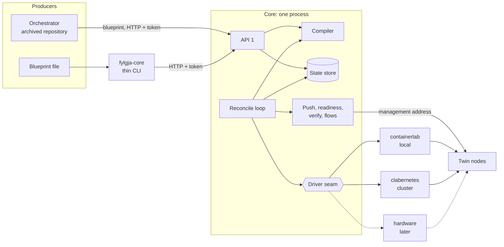

# Architecture

This document describes the Fylgja core: what it is, what is built at this commit, and the
architecture it is being built to. The non-negotiables are in the
[constitution](constitution.md), the reasons in the [decision log](decisions.md), and the
terms in the [glossary](../docs/glossary.md). The full design is [design/core.md](core.md),
and every format is specified under [`formats/`](../formats/README.md).

## 1. What Fylgja is

Fylgja builds a **twin** of a network from its intent. Its input is a **blueprint**: the
network's devices, interfaces and links, each device's configuration as its source of
truth rendered it, and the probes declared beside them. The core compiles the blueprint
into a runtime-neutral **bundle**, binds the bundle to a named twin on a runtime (network
operating system containers on one host or a Kubernetes cluster, and later real hardware),
and pushes each device its configuration unchanged. It can then step the twin to another
blueprint without a rebuild, verify it against its intent, show it and destroy it.

Four rules shape the rest:
- **The blueprint is the core's one input**, and the core knows no source, branch or stage
  ([Constitution III](constitution.md#iii-the-blueprint-is-the-contract)).
- **Fylgja never renders configuration**: it pushes what the source rendered
  ([Constitution IV](constitution.md#iv-fylgja-never-renders-configuration)).
- **Identity is content**: the same intent always gets the same id
  ([Constitution V](constitution.md#v-the-compiler-is-pure-identity-is-content)).
- **Reports are honest**: every compile states its fidelity, asserted and not measured
  ([Constitution X](constitution.md#x-report-honestly)).

## 2. The core and its boundary

This repository builds the **core**. It takes blueprints and knows no source of truth.
Whatever writes a blueprint is a **producer**. The one Fylgja ships is the
**orchestrator**, which reads Infrahub and resolves a branch or a stage of a proposed
change into a blueprint. It lives in the archived repository until it moves here
(section 5). Until then, blueprints come from files: the fixtures under
`testdata/blueprint/`, or any file written to `formats/blueprint-1.schema.json`.

Every client reaches the core through **API 1** alone
([Constitution XI](constitution.md#xi-the-api-is-the-boundary),
[D-025](decisions.md#d-025)): the thin CLI, the orchestrator, and later a web UI or an
agent. The state store and the runtime's resources are the core's internals, and no client
writes them.

## 3. The state at this commit

**Built so far:**
- **The formats**, version 1, under [`formats/`](../formats/README.md). They were designed
  before the code that reads them; a change found while building is made there, in the
  same change.
- **The model package** in `core/` (the Python package `fylgja_core`): a model type for
  every format, one module per schema; the blueprint id, validation against the schema and
  the cross-field rules, and the order rules; and the loaders for platform packages, probe
  packages and probe declarations, each refusing a document with every problem in one pass,
  and each tested by a rejection fixture per fault.
- **The compiler** (section 4.2): pure, held to the facts the frozen Go compiler produced
  for the four fixtures, and refusing an uncompilable blueprint with every fault in one
  pass; its rules are in the catalogue, [`docs/rules.md`](../docs/rules.md).
- **The state store** (section 4.6) as a local directory, held locked for one core
  ([D-041](decisions.md#d-041)), and as objects behind S3's conditional writes, which the
  server opens once it runs under a Lease.
- **The local driver** (section 4.4): containerlab behind the seam, its pure `plan` and
  `changes` and its live `admit`, `apply`, `inspect`, `destroy` and `exec`, with the two
  recovery rules, every behaviour it relies on recorded for containerlab 0.81.0 in
  [verified-facts.md](verified-facts.md); every command it runs gets an environment from an
  allow-list, with no variable of the core's ([D-065](decisions.md#d-065)).
- **Readiness and the push**: the credential provider, a node's push transport answering an
  authenticated request, and the two replace mechanisms, JSON-RPC for SR Linux and eAPI for
  EOS ([D-027](decisions.md#d-027)).
- **The clabernetes driver** (section 4.4): a twin as a Topology in a namespace of its own on
  the three-server k3s cluster, reached through lightkube; its pure `plan` and `changes` and its
  live calls, each behaviour it relies on recorded for clabernetes 0.10.1 on k3s
  ([D-057](decisions.md#d-057), [D-069](decisions.md#d-069)).
- **The reconcile loop** (section 4.5) for a create, a step, a restore and a destroy: runs and
  their events, admission one twin at a time, cancellation, and a resume after a kill at the
  phase after the one recorded ([D-023](decisions.md#d-023), [D-054](decisions.md#d-054)).
  Each driver's `events` kicks the twins whose runtime changed, and a pass on a settled twin
  restores a node replaced behind the core's back and reports one missing, without waiting for
  the resync ([D-058](decisions.md#d-058), [D-067](decisions.md#d-067),
  [D-070](decisions.md#d-070)).
- **Steps and verify**: the bundle diff; a step's refusals before it touches the twin, its
  wait for verify, and a twin left diverged when a step fails or is cancelled after touching
  it ([D-050](decisions.md#d-050), [D-054](decisions.md#d-054)); verify over gNMI, each
  probe's burst and a probe host's readiness, both through the driver's `exec`
  ([D-050](decisions.md#d-050), [D-051](decisions.md#d-051), [D-053](decisions.md#d-053)).
- **API 1 and the thin CLI** (section 4.7): `fylgja-core-server` serves API 1 and runs the
  loop in one process, with per-client tokens, problem documents and watches by server-sent
  events; `fylgja-core` is its client. A twin is created, shown, watched, stepped, verified
  and destroyed end to end, with the server killed at every phase boundary of a create and
  of a step and resumed each time.
- **The Lease** ([D-062](decisions.md#d-062), [D-071](decisions.md#d-071)): a
  `coordination.k8s.io/v1` Lease, taken before the server opens an object store, renewed every
  5 s, and lost 15 s after the last renewal that succeeded was sent, when the server stops at
  once and releases nothing; a core that finds it held waits, binding nothing. The stop comes on
  time only while the event loop runs: the store's calls run on it, and two in a row held a
  holder on the cluster 6.08 s past its deadline (D-071's status note).
- **TLS at the server** ([D-063](decisions.md#d-063)): `fylgja-core-server` ends TLS with the
  pair it is given, and the thin CLI verifies the server against the CA it names or the
  system's trust.
- **The image and the base** ([D-062](decisions.md#d-062)): the core's image, built from the
  `Dockerfile` in the tree and tagged by its commit, and a kustomize base under
  [`deploy/`](../deploy/README.md) that a site's overlay completes.
- **The core deployed on the cluster**: one pod under its Lease on the k3s cluster, its store
  Versity S3 Gateway in its namespace, behind a LoadBalancer over TLS. A twin is created, shown
  and destroyed through it from a workstation; a second pod waits and reconciles nothing; a pod
  deleted mid-create is resumed from the record by the next
  ([verified-facts.md](verified-facts.md)).
- **The driver conformance suite** (`core/tests/conformance/`): one set of scenarios, written
  once, over a harness per driver: locally `fylgja-core-server` run as a process and killed with
  SIGKILL, and on the cluster the deployed core driven over TLS and killed by its pod's deletion
  with no grace, its egress cut and its Lease written first so the release it sends is refused and
  the Lease is left to its duration. A twin is created, stepped through every step fixture with
  verify after each, killed at every phase boundary of a create and of a step and during an apply
  and a destroy, given a node replaced behind the core's back, and destroyed leaving nothing; two
  twins refuse each other where the driver isolates them by the network. It passed on both drivers
  on 2026-11-07, but for the cluster's cEOS scenarios, failed by a site whose deployed core held no
  EOS login. The core's own loop resumed every run a kill found unfinished, on both drivers; on the
  cluster the kill at a create's `pushed` found its run ended, as the kill at a step's `verified`
  does on both ([D-072](decisions.md#d-072), [verified-facts.md](verified-facts.md)).

**Designed, not yet built:** everything else in section 4: the probes' flows, many twins at
once, and the cut-over that moves the orchestrator onto API 1. They are built in the phases of
[design/core.md](core.md#sequence).

**The reference implementation** is the **frozen Go core** in the archived repository
([D-001](decisions.md#d-001)): one twin at a time under a fixed lab name on one lab host,
on Temporal, in the earlier formats. It gets fixes only. It explains behaviour and supplies
test scenarios, and is not translated. The compiler facts under `testdata/compiler/` came
from it, and the new compiler must state the same facts for the same fixtures.

**A clean break** ([D-002](decisions.md#d-002)): every format starts at version 1, and the
core reads nothing older.

## 4. The architecture as designed

### 4.1 The blueprint and its id

A blueprint is the network and its probes, with a source envelope
([`blueprint-1.schema.json`](../formats/blueprint-1.schema.json),
[D-006](decisions.md#d-006), [D-006](decisions.md#d-006)).

- **Network.** Devices, each named by a DNS-1123 label (it becomes the node's host name,
  its container or pod name and its file name; [D-038](decisions.md#d-038)), with a
  platform package id, its interfaces (name, `mgmt_only`, `enabled`) and its configuration
  as one plain string, optional, absent meaning unmanaged ([D-048](decisions.md#d-048)); links, each with ends `a` and `b`.
- **Probes.** Each a name, a probe format and two endpoints, each a device, an uncabled
  port, an IPv4 address and a gateway ([D-008](decisions.md#d-008)).
- **Id.** The SHA-256 of the RFC 8785 (JCS) canonical JSON of `{network, probes}` alone.
  The version and the source are not hashed, so the same topology read from two branches,
  at two times or by two producers has one id. The id is the store's key, not a field.
- **Order.** Every list must arrive sorted and unique by its key. The core rejects one that
  is not (`blueprint.unsorted`, `blueprint.duplicate`, with a JSON pointer) and never sorts
  on the client's behalf.
- **Source envelope.** Where the blueprint came from (source, branch, point in time, scope,
  mapping, when it was read, the reader's fidelity rows) travels as an opaque `source`
  object. The core stores and returns it, and never validates, reads or hashes it
  ([Constitution VI](constitution.md#vi-intent-is-addressed)).

A blueprint is filed once (`POST /v1/blueprints`) and kept by id.

### 4.2 The compiler

The compiler is a pure function from a blueprint and the loaded packages to a bundle. It has
no I/O, no clock and no environment, and a test enforces that
([Constitution V](constitution.md#v-the-compiler-is-pure-identity-is-content),
[D-006](decisions.md#d-006)).

- It maps every interface through its platform package's rules into a mapping row.
- It places each probe's two hosts, checking each endpoint against the mapping.
- It answers a compile result: the bundle id, the manifest, the runtime-independent part of
  fidelity and the findings.
- An interface the platform has no port for (out of its rule's range, or matched by no
  rule) is an omission fidelity reports when nothing touches it, and a refusal when a link
  or a probe does. Ports two interfaces are renamed onto are the driver plan's to find.
- A blueprint that does not compile answers `422` with a problem document, rule
  `bundle.rejected`, carrying every fault found in one pass.

### 4.3 The bundle

A bundle is **runtime-neutral** and holds nothing that belongs to one twin
([`bundle-1.schema.json`](../formats/bundle-1.schema.json), [D-011](decisions.md#d-011)).

- **Layout.** `manifest.json`, as JCS bytes, and `configs/<node>.cfg`, each device's
  configuration verbatim, for a device that has one. Nothing else: no topology file, no lab name, no image and no
  fidelity.
- **Manifest.** The nodes (name, platform, configuration file and hash, where the device has one), one mapping row
  per interface, the links in production names, the probes as placed, and the blueprint id.
- **Id.** The SHA-256 of a listing of every file's hash and path, as `sha256sum` writes it.
  A reworded package moves no bundle id.

So one bundle can back many twins on any driver. Bundles are kept by id and never
overwritten. The difference between two bundles is what a step changes.

### 4.4 The driver seam and its three drivers

A runtime is added by writing a driver, and nothing else
([Constitution XIII](constitution.md#xiii-runtimes-are-drivers),
[D-017](decisions.md#d-017)). Every call but `exec` is idempotent: `exec` runs what it is
given.

| Call | What it does |
|---|---|
| `capabilities()` | Says what the driver can do: provision nodes or claim them, change links on a running twin, forward in software or hardware, reach nodes directly or through a proxy, keep twins apart by names alone or by the network, finish an apply cut short by applying again (`reapply`, [D-068](decisions.md#d-068)). |
| `admit(bundle, twin)` | Reserves what the twin is bound to (a lab name and management subnet, a namespace, a device reservation) into the twin record by compare-and-set, or refuses with the reason; or, for a step, keeps the allocation the twin holds and checks the added demand ([D-049](decisions.md#d-049)). |
| `plan(bundle, twin, allocation)` | Pure. Binds the bundle to the twin and the runtime, and returns a deployment, or refuses a runtime port two cabled interfaces share ([D-045](decisions.md#d-045)) or, on clabernetes, a gated image whose registry the allocation lacks ([D-057](decisions.md#d-057)). |
| `changes(before, after, packages)` | Pure. Answers what the runtime does to each node to go from one deployment to another: `kept`, `added`, `removed`, `recabled`, `restarted`, `recreated` or `unsupported`, each with its reasons, and the links added and removed ([D-049](decisions.md#d-049)). |
| `apply(deployment, files, packages, reconfigure)` | Makes the runtime match the deployment and its rendered files, within its packages' measured deploy timeouts. With `reconfigure`, rebuilds the whole lab: every node is made anew, so every node's incarnation changes and its `holds` is void. That is the loop's remedy for a node that stays silent ([D-023](decisions.md#d-023)), asked only of a driver that does not declare `reapply` ([D-068](decisions.md#d-068)). |
| `inspect(twin)` | Reads what the runtime holds for the twin, each node's incarnation included. |
| `destroy(deployment, files, packages)` | Removes everything the twin holds, the residue of a killed destroy included, within its packages' measured destroy timeouts, and releases its allocation. |
| `endpoints(twin)` | Returns each node's management address. |
| `exec(twin, node, argv, timeout_s)` | Runs an argument vector inside a node and answers its exit code and output, bounded in time and bytes: the one way to reach a node with no management transport, which only probe hosts are ([D-049](decisions.md#d-049)). |
| `events()` | Names, for good, each twin whose runtime may have changed; the name is all the loop is given, since it reads what is true with `inspect`. A driver may also act where only the runtime can mend a node: the clabernetes driver deletes a pod whose container ended or restarted in it before it names the twin, so the cluster makes the node anew ([D-070](decisions.md#d-070)). It never fails: it starts its source again after a backoff and then names every twin its source can name, on clabernetes each twin with a pod, a twin whose every pod went being the resync's ([D-058](decisions.md#d-058)). |

`plan` is the only step that binds a bundle to a twin and a runtime. It is pure, so what it
binds to must exist first: that is why `admit` reserves the allocation.

**The deployment** is what `plan` returns
([`deployment-1.schema.json`](../formats/deployment-1.schema.json)): the driver, the twin,
the allocation, the bundle id, the rendered files with their hashes, the **demand** (nodes,
CPU, memory) admission compares with free capacity, and the fidelity of this twin on this
runtime. Its id hashes the driver, twin, bundle id and files, so the same plan gets the
same id and `apply` is idempotent. Fidelity depends on the runtime, since containers forward
in software and hardware in silicon, so it is computed per deployment and never hashed.

**The drivers:**

| Driver | Use | Isolation unit | Node access |
|---|---|---|---|
| `containerlab` (local) | development, the live tier, a single lab host | a lab named for the twin, with its own management network and subnet | the host's management network |
| `clabernetes` | production, on Kubernetes | a namespace per twin, with a NetworkPolicy | a LoadBalancer per node, `externalTrafficPolicy: Local` ([D-020](decisions.md#d-020), [D-037](decisions.md#d-037)) |
| `hardware` | a later release | a reservation of devices from a pool | the devices' own management addresses |

- Both containerlab drivers render the same containerlab definition, named for the twin,
  with production interface names where the kind has aliases and renamed ports where it
  does not: `topology.clab.yml` locally, with the lab's management network; on clabernetes
  inside a `Topology`, less the `mgmt` block and with each node's declared ports, beside the
  twin's Namespace and NetworkPolicy ([D-057](decisions.md#d-057)).
- Account-gated images, such as cEOS, live in a private registry the cluster trusts
  ([D-021](decisions.md#d-021)). Locally, a gated image is a presence check at admission
  (`admission.image.absent`) and is never pulled; an ungated one is containerlab's to pull
  at deploy ([D-015](decisions.md#d-015)). On clabernetes the plan writes a gated image
  under its registry's prefix and names the pull secrets, which `apply` makes. The
  clabernetes driver is developed on a three-server k3s cluster
  ([D-060](decisions.md#d-060)). The production cluster is three k3s servers with embedded
  etcd on SSD, MetalLB in layer 2, and the registry on a host outside the cluster
  ([D-036](decisions.md#d-036)).
- The hardware driver is not built; its paper shape checks the seam. The local driver
  stays sufficient for development and the live tier, so neither needs Kubernetes.

**Above the seam** sit the push, readiness, verify and the probes' flows. They reach a node
by the management address `endpoints` returns, whatever runtime it runs on. Nothing above
the seam may branch on a runtime; it may branch on a declared capability.

### 4.5 The reconcile loop and its phases

A twin is a record whose desired state is a bundle. The core's own loop drives it there
through its driver ([Constitution VIII](constitution.md#viii-reconcile-to-desired-state),
[D-023](decisions.md#d-023)).

- **Spec and status** ([D-025](decisions.md#d-025)). A client writes the twin's `spec`: the
  blueprint or bundle, the driver, and whether the loop may restart nodes to reach it. Only
  the loop writes `status`. Each change of spec, and a deletion request, raises the twin's
  `generation`. The loop works until `status.observed_generation` reaches it, and the twin
  is what was asked for when the two match and the `Ready` condition is `True`.
- **Phases.** The twin record names them: `compiled`, `admitted`, `planned`, `applied`,
  `ready`, `pushed`, `verified`, `flows`, and `destroyed` for a deletion. The loop records
  each phase before it starts the next, so a restarted core resumes after the last one.
- **Conditions.** `Ready`, `Stepping` and `Diverged`, each with a stable reason. Clients
  branch on them.
- **Incarnation.** Each node's current instance is recorded: the container's start time
  locally, the pod's uid and its container's restart count on clabernetes
  ([D-069](decisions.md#d-069)). A changed incarnation voids what the node holds, and the
  loop pushes it again: in a step, or under a `restore` run when a kick finds it on a settled
  twin, which the loop inspects ([D-067](decisions.md#d-067)).
- **Recovery rules.** On a driver that declares it cannot apply again (`reapply` false), a
  lab present while the record lacks `applied` is probed, and applied again with
  reconfiguration if a node stays silent; on one that can, it is applied again, with no probe
  ([D-068](decisions.md#d-068)). A destroy that finds residue and no lab deploys, then
  destroys. Cleanup runs on every failure and deletion path.

**Runs.** Every long operation (create, step, restore, destroy) is a **run**: a ULID, the
principal who asked (the core's own for a restore), a state, and once ended a verdict. Its
**events** (a sequence number, a time, a phase, an outcome) are read by cursor, and timings
are events. A run can be cancelled. Only one run acts on a twin at a time. The API and the
loop run in one process; on Kubernetes, the core runs as one replica holding a Lease, and
locally it holds a lock on its store.

**Scheduling** ([D-023](decisions.md#d-023)). The loop's work goes through a **work queue**
keyed by twin name, served by a bounded pool of workers.
- **Triggers queue the twin:** a client's write, a change the driver reports through
  `events` (Docker's events for its labs' containers locally, one watch on its twins' pods on
  clabernetes, [D-058](decisions.md#d-058)), a periodic **resync** of every twin, every
  `FYLGJA_RESYNC_S`, and the core's start.
- **Each twin has at most one worker at a time,** and so one run. A name already queued is
  not queued twice, and one that arrives while its twin is busy is queued again afterwards.
- **Waiting releases the worker.** A worker runs phases until the twin converges, must wait
  on the runtime, or fails. A twin that waits goes back on the queue with a delay. A
  transient failure goes back with a growing backoff, as does a failure the loop does not
  class, which is logged with its traceback. A failure only a new spec can clear
  stops until the spec is written again.

**Steps.** A step takes a running twin to another blueprint or bundle without a rebuild.
The core diffs the two bundles and the two deployments. Links change live where the kind
allows (`link_apply_mode: live`), for ports present at boot (`hot_add_ports`). A step that
must restart or recreate a node needs `allow_restart`. Every changed node is pushed by
**replace**: one atomic commit that resets the node to its kind's baseline and applies the
new configuration ([D-027](decisions.md#d-027)). A step that fails after touching the twin
leaves it **diverged** ([D-029](decisions.md#d-029)).

**Verify** reads a running twin against its bundle: each node's host name, each linked
port's state, each link's LLDP neighbours, and each probe's **burst**. It changes nothing
and answers at once. A waiting verify runs only inside a step's run. A step's probes also
run **flows**, whose transient loss is reported and never asserted.

### 4.6 The state store

Twin records, runs and their events, blueprints, bundles and deployments live behind one
store interface ([Constitution IX](constitution.md#ix-state-lives-behind-one-store-no-database),
[D-023](decisions.md#d-023)).

| Store | Where | Use |
|---|---|---|
| `local` | a directory, each twin record in its own file (`twins/<name>.json`) | development and a single lab host |
| `object` | an S3 endpoint that honours conditional writes, proved at start; keys of the local store's shape, a run's events one object each | production |

- Blueprints and bundles are kept by id and never overwritten.
- A twin record changes only by **compare-and-set** on its revision, so concurrent runs on
  two twins never collide ([`twin-record-1.schema.json`](../formats/twin-record-1.schema.json)).
- On the object store the compare-and-set is the endpoint's condition: `If-None-Match: *`
  creates, `If-Match` at the ETag read replaces and deletes. Only a settled refusal, the
  endpoint's 412, is taken as proof that an object exists; an unsettled one, a 409 while
  another write to the key is in flight, is raised ([D-061](decisions.md#d-061)).
- There is no database. One returns only through a decision naming a question only a
  database answers.

### 4.7 API 1 and the thin CLI

The API is resource-oriented ([`api-1.openapi.yaml`](../formats/api-1.openapi.yaml),
[D-025](decisions.md#d-025)). A twin is shaped as Kubernetes shapes a resource, without
Kubernetes ([D-025](decisions.md#d-025)): a client puts its spec, the reconcile loop works
toward it, and the client reads or watches its status. The twin record is the resource as
stored, so there is one representation of a twin.

| Call | What it does |
|---|---|
| `POST /v1/blueprints`, `GET /v1/blueprints/{id}` | File a blueprint, answering its id; read one. |
| `POST /v1/bundles`, `GET /v1/bundles/{id}` | Compile a blueprint; read a bundle. |
| `GET /v1/bundles/{a}/diff/{b}` | The step between two bundles. |
| `POST /v1/packages:validate` | Validate platform and probe packages. |
| `GET /v1/drivers` | The drivers served and their capabilities. |
| `GET /v1/twins`, `GET /v1/twins/{name}` | List twins; show one. With `?watch=true`, a stream of server-sent events, one per change, each carrying the whole record. |
| `PUT /v1/twins/{name}` | Write a twin's spec: create it, or step it to another blueprint. `If-Match` (or `If-None-Match: *` to create only) guards against overwriting another client's write; `412` when it would. The loop starts a run toward the new spec. |
| `PUT /v1/twins/{name}?dry_run=true` | What writing that spec would do: admission and the driver's plan, with nothing written. |
| `POST /v1/twins/{name}/verifications` | Verify a twin: a question about the running twin, so an action, not a spec. |
| `DELETE /v1/twins/{name}` | Ask for deletion; the loop tears the twin down, then the record goes. |
| `GET /v1/runs`, `GET /v1/runs/{id}`, `GET /v1/runs/{id}/events?after=N` | Read runs and their events by cursor, as JSON or server-sent events. |
| `POST /v1/runs/{id}/cancel` | Cancel a run. |
| `GET /v1/version` | The API version, the build and the format versions. |

- **One error model.** Anything malformed, unauthorised, refused or conflicting is an RFC
  9457 **problem document** ([`problem-1.schema.json`](../formats/problem-1.schema.json)).
  Domain verdicts are **findings** documents
  ([`findings-1.schema.json`](../formats/findings-1.schema.json)), with a status of `ok`,
  `rejected`, `failed`, `unclean`, `diverged` or `nonconforming`.
- **Documents only.** The API answers JSON, and clients render it.
- **Runs record every transition.** Each change of spec starts a run, linked from the
  twin's status. Its events tell what happened step by step, and `POST /v1/runs/{id}/cancel`
  stops it.
- **The thin CLI**, `fylgja-core`, is a client like any other: `twin create|step|show|
  verify|destroy|list`, `run get|watch|cancel`, `blueprint push`, `bundle build|get|diff`,
  and `--json`. It exits 0 for ok, 1 for a negative verdict, 2 for a problem or transport
  failure, and 3 for a twin left dirty. A watch the server ends before its end is resumed by
  the client library from the last revision or event it saw, for up to about three minutes
  before it gives up, each try given 5 s to connect.

### 4.8 Credentials and principals

- **Clients.** Each client has its own bearer token, mapped to a **principal**: from
  Secrets on a cluster, or a local file of token hashes in development. Several tokens are
  valid at once, for rotation. `401` and `403` stay distinct, and TLS ends at the server
  ([D-063](decisions.md#d-063)).
  OIDC and roles wait for the first outside user.
- **Audit.** Every request's principal is written to the audit log and to the runs it
  starts, so every change to a twin is attributable.
- **Node logins** come from one **credential provider**: the environment locally, Secrets
  on a cluster. A platform package names its login by a `credentials` name, never a value;
  the provider reads `FYLGJA_CREDENTIAL_<NAME>_USERNAME` and `_PASSWORD`, and `_REGISTRY` too
  for a pull credential ([D-042](decisions.md#d-042), [D-057](decisions.md#d-057)).
- **No credential** appears in a blueprint, bundle, deployment, record, finding or log
  ([Constitution X](constitution.md#x-report-honestly)).

### 4.9 Isolation per twin

Every twin has a name and its own isolation unit
([Constitution VII](constitution.md#vii-twins-are-named-and-isolated),
[D-019](decisions.md#d-019)).

- A **twin name** is a DNS-1123 label of at most 40 characters. It is the record's key, the
  API path, and the name a driver gives the lab or namespace.
- Twins share nothing mutable.
- Every resource a twin uses carries the twin's label and is removed with it. An orphan is
  found by a label sweep: through containerlab locally, and by deleting the namespace on
  clabernetes.
- A twin that cannot fit is refused at admission (`admission.capacity`), with the reason.
- On clabernetes, a NetworkPolicy per namespace keeps other twins' pods out: it admits the
  twin's own pods, clabernetes' namespace, sources outside the pod CIDR and the core's
  namespace ([D-019](decisions.md#d-019), [D-059](decisions.md#d-059)). Each node's
  LoadBalancer is set to `externalTrafficPolicy: Local` so the policy sees the client's own
  address ([D-037](decisions.md#d-037)).
- Locally, two labs' management networks reach each other through the host. That is
  accepted for development and the live tier, and the local driver declares it
  (`isolation: names`).

### 4.10 Platform and probe packages

A platform is added by writing a platform package, and a probe format by writing a probe
package ([Constitution II](constitution.md#ii-platforms-are-data-never-code),
[D-013](decisions.md#d-013), [D-014](decisions.md#d-014), [D-015](decisions.md#d-015)).

- **A platform package**
  ([`platform-package-1.schema.json`](../formats/platform-package-1.schema.json)) states
  only what the runtime's kind does not already know: its interface rules, push, readiness,
  gNMI and conformance paths, fidelity, and a `credentials` name.
- **Its `runtime.containerlab` section** serves both containerlab drivers: the kind, the
  image, per-node resources, measured timeouts, `alias`, `rename`, `link_apply_mode` and
  `hot_add_ports`. A `runtime.hardware` section arrives with that driver.
- **Aliases.** SR Linux's kind accepts production interface names, so its package needs no
  name templates. cEOS's kind has none, so its package keeps one rename rule per data rule.
- **No bootstrap.** The kinds' baselines keep the host name, linked ports, LLDP and gNMI
  through the replace push, so Fylgja adds no configuration
  ([D-007](decisions.md#d-007)).
- **A probe package**
  ([`probe-package-1.schema.json`](../formats/probe-package-1.schema.json)) holds one probe
  format's host image and set-up commands, its readiness, and its flow and burst commands.
  The one shipped format is `ping`.
- A package is held to its schema and to the cross-field rules its schema names when it is
  loaded, and refused with every fault at once; a probe package whose format this build
  has no mechanism for is refused there too ([D-014](decisions.md#d-014)).
- A platform is supported only when its package passes the conformance suite.

The shipped packages, in platform package 1 and probe package 1, are
`psp/nokia_srlinux.yaml`, `psp/arista_eos.yaml` and `probes/ping.yaml`.

## 5. The orchestrator, outside this repository for now

The orchestrator is Fylgja's other deployable ([D-003](decisions.md#d-003)). It is Python on
Prefect, and lives in the archived repository until it moves here, once the new core runs
twins on the local driver.

It owns everything that names a source of truth. It reads a branch of Infrahub, optionally
at a point in time, under a scope, by one documented mapping of the OpsMill schema
library's DCIM ([D-006](decisions.md#d-006)). It resolves a **stage** of a proposed change
(its branch point, a mark the operator records, or its head) to what it reads. It **rehearses** a proposed
change: a twin created at its first stage, stepped and verified through every later stage,
destroyed whatever happened, and a report posted on the proposed change, whose check fails
when a stage fails.

Today it drives the frozen Go core through that core's API and writes snapshot 2. At the
cut-over it will write blueprint 1 and call API 1, in the same change
([D-002](decisions.md#d-002)). It will reach the core through the API alone, never the store
or the runtime, and will render every report itself from the core's documents. This
repository holds no bridge between the two formats ([D-006](decisions.md#d-006)).

## 6. Where things live

| Path | What it holds |
|---|---|
| `core/` | The core, the Python package `fylgja_core`: the model package (a module per format, the blueprint id and rules, the package and declaration loaders), the interface mapping and the compiler; the state store, its local directory and its object store with the S3 signer; the driver seam, its registry, the containerlab driver (`containerlab/`) and the clabernetes driver (`clabernetes/`: its plan and changes, its reach into Kubernetes, and the driver class); the credential provider, readiness and the push; the reconcile loop; the server (`server/`, the console script `fylgja-core-server`); and the client library with the thin CLI (`fylgja-core`). Its tests are under `core/tests/`, the live tier's under `core/tests/live/`, the cluster tier's under `core/tests/cluster/`, and the driver conformance suite's under `core/tests/conformance/`: its scenarios, written once, and a harness for each driver |
| `formats/` | The version-1 formats: the schemas, the API's OpenAPI document, and a README; the wheel carries the schemas and the OpenAPI document as the package's data ([D-066](decisions.md#d-066)) |
| `psp/` | The platform packages, SR Linux and EOS |
| `probes/` | The probe package `ping` |
| `testdata/blueprint/` | The four blueprint fixtures, converted once from the earlier format at the repository's start |
| `testdata/packages/` | Test-only packages, the interface mapping rows each shipped package must decide, and the rejection fixtures for the package loaders |
| `testdata/compiler/` | The facts the frozen Go core's compiler produced for each fixture, which the new compiler must match, and the compiler's rejection fixtures |
| `testdata/probes/` | Probe declaration files, valid and invalid |
| `testdata/deployment/` | The golden deployments, per driver and fixture: the rendered runtime files and the deployment document each plan must reproduce (`scripts/render-goldens.py` writes them); and under `rejected/`, the blueprints a driver's plan must refuse |
| `scripts/` | The link checker (`linkcheck.py`), the renderer of the golden deployments under `testdata/deployment/` (`render-goldens.py`), the check that the wheel validates outside the tree (`wheelcheck.py`), and the check of the core's image as it runs (`imagecheck.py`) |
| `Dockerfile` | The core's image ([D-062](decisions.md#d-062)): two stages on `python:3.14.9-slim` pinned by digest, the newest Python 3.14 release at least two weeks old when it was chosen, the wheel built from `core/` and `formats/`, the packages under `psp/` and `probes/`, `fylgja-core-server` its entry point, run as a user that is not root. Its build context is `.dockerignore`'s allow-list, so nothing under `local/` reaches a layer |
| `deploy/` | The core's kustomize base ([D-062](decisions.md#d-062)): the namespace `fylgja`; the core's service account, its one ClusterRole and the Lease's Role ([D-071](decisions.md#d-071)); the core's Deployment, one replica under `Recreate`, and its LoadBalancer Service; and its store, Versity S3 Gateway over a `local-path` volume, shut to every pod but the core's. It holds no address and no value: a site's overlay under `local/deploy/` sets the image, the Secrets and the addresses, as the README there shows |
| `design/` | How the project is governed and designed: the constitution, the decisions, this architecture, the verified facts, and design documents ([core.md](core.md) is the core's) |
| `docs/` | Documentation for people using Fylgja; today the glossary and the rule catalogue |
| `CONTRIBUTING.md` | How to set up, build, test and change Fylgja |

## 7. Open questions

- A bastion or an ingress per twin, should LoadBalancer addresses run short.
- Whether the 40-character twin name and 63-character device names fit every runtime's own
  limits; clabernetes names a Service per node, and a Service name is a DNS-1035 label,
  which begins with a letter.
- Whether admission needs per-node requests as well as sums.
