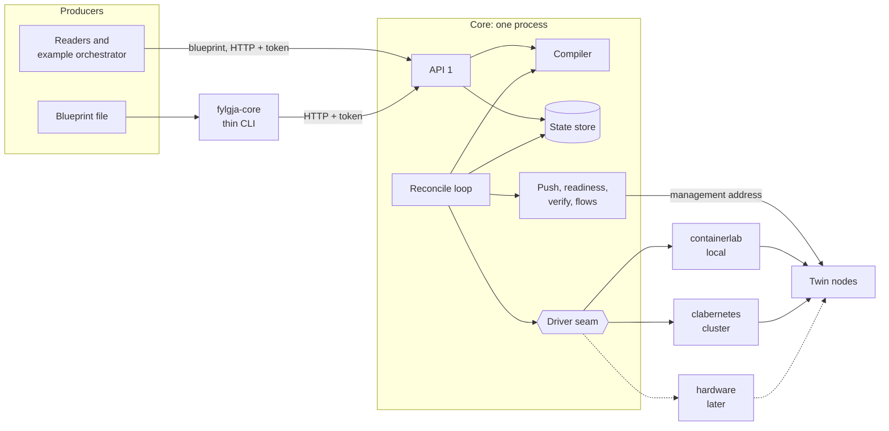

# Architecture

This document describes Fylgja as this repository holds it: the core, at length, and the
pieces beside it, a reader for each source of truth, and the example orchestrator, which is kept in
`fylgja-examples` (section 5; [D-081](decisions.md#d-081), [D-126](decisions.md#d-126)). It says
what each is, what is built at this commit, and the
architecture the core is built to. The non-negotiables are in the
[constitution](constitution.md), the reasons in the [decision log](decisions.md), and the
terms in the [glossary](../docs/glossary.md). The full design is [design/core.md](core.md),
and every format is specified under [`formats/`](../formats/README.md).

## 1. What Fylgja is

Fylgja builds a **twin** of a network from its intent. Its input is a **blueprint**: the
network's devices, interfaces and links, each device's configuration as its source of
truth rendered it, and the probes declared beside them. The core compiles the blueprint
into a runtime-neutral **bundle**, binds the bundle to a named twin on a runtime (network
operating system containers on one host or a Kubernetes cluster, and later real hardware),
and pushes each device its configuration unchanged. It can then step the twin to another
blueprint without a rebuild, verify it against its intent, show it and destroy it.

Four rules shape the rest:
- **The blueprint is the core's one input**, and the core knows no source, branch or stage
  ([Constitution III](constitution.md#iii-the-blueprint-is-the-contract)).
- **Fylgja never renders configuration**: it pushes what the source rendered
  ([Constitution IV](constitution.md#iv-fylgja-never-renders-configuration)).
- **Identity is content**: the same intent always gets the same id
  ([Constitution V](constitution.md#v-the-compiler-is-pure-identity-is-content)).
- **Reports are honest**: every compile states its fidelity, asserted and not measured
  ([Constitution X](constitution.md#x-report-honestly)).

## 2. The core and its boundary

This repository builds three pieces ([D-081](decisions.md#d-081)), and the **core** is the
first. It takes blueprints and knows no source of truth.
Whatever writes a blueprint is a **producer**. Fylgja ships a **reader** for each source of
truth it reads, a library that reads that source, or a branch of it, into a blueprint: the **Infrahub
reader**, under `readers/infrahub/`, the **NetBox reader**, under `readers/netbox/`
([D-095](decisions.md#d-095)), and the **Nautobot reader**, under `readers/nautobot/`, built here and
published from 1.1.0 ([D-118](decisions.md#d-118), [D-121](decisions.md#d-121)), none importing
another. An **example orchestrator**, kept in the repository
[`fylgja-examples`](https://github.com/happypathnetworking/fylgja-examples/tree/v1.1.0/)
([D-126](decisions.md#d-126)),
resolves each stage of a change, a proposed change in Infrahub or a branch in
NetBox, to a blueprint through that source's reader, or, for a mark in NetBox, from the core
that keeps the mark's blueprint, and rehearses the change ([D-081](decisions.md#d-081),
[D-097](decisions.md#d-097)). The readers are in this repository (section 5), written new; the
prototype of the Infrahub reader and of the example, in the archived repository, was the
reference they were written against. A blueprint may equally come from a file: the fixtures
under `testdata/blueprint/`, or any file written to `formats/blueprint-1.schema.json`.

Every client reaches the core through **API 1** alone
([Constitution XI](constitution.md#xi-the-api-is-the-boundary),
[D-025](decisions.md#d-025)): the thin CLI, the example orchestrator, and later a web UI or
an agent. The state store and the runtime's resources are the core's internals, and no client
writes them.

## 3. The state at this commit

**Built so far:**
- **The formats**, version 1, under [`formats/`](../formats/README.md). They were designed
  before the code that reads them; a change found while building is made there, in the
  same change.
- **The model package** in `core/` (the Python package `fylgja_core`): a model type for
  every format, one module per schema; the blueprint id, validation against the schema and
  the cross-field rules, and the order rules; and the loaders for platform packages, probe
  packages and probe declarations, each refusing a document with every problem in one pass,
  and each tested by a rejection fixture per fault.
- **The compiler** (section 4.2): pure, held to the facts the frozen Go compiler produced
  for the four fixtures, and refusing an uncompilable blueprint with every fault in one
  pass; its rules are in the catalogue, [`docs/rules.md`](../docs/rules.md).
- **The state store** (section 4.6) as a local directory, held locked for one core
  ([D-041](decisions.md#d-041)), and as objects behind S3's conditional writes, which the
  server opens once it runs under a Lease.
- **The local driver** (section 4.4): containerlab behind the seam, its pure `plan` and
  `changes` and its live `admit`, `apply`, `inspect`, `destroy` and `exec`, with the two
  recovery rules, every behaviour it relies on recorded for containerlab 0.81.0 in
  [verified-facts.md](verified-facts.md); every command it runs gets an environment from an
  allow-list, with no variable of the core's ([D-065](decisions.md#d-065)).
- **Readiness and the push**: the credential provider, a node's push transport answering an
  authenticated request, and the two replace mechanisms, JSON-RPC for SR Linux and eAPI for
  EOS ([D-027](decisions.md#d-027)).
- **The clabernetes driver** (section 4.4): a twin as a Topology in a namespace of its own on
  the three-server k3s cluster, reached through lightkube; its pure `plan` and `changes` and its
  live calls, each behaviour it relies on recorded for clabernetes 0.10.1 on k3s
  ([D-057](decisions.md#d-057), [D-069](decisions.md#d-069)).
- **The reconcile loop** (section 4.5) for a create, a step, a restore and a destroy: runs and
  their events, admission one twin at a time, cancellation, and a resume after a kill at the
  phase after the one recorded ([D-023](decisions.md#d-023), [D-054](decisions.md#d-054)).
  Each driver's `events` kicks the twins whose runtime changed, and a pass on a settled twin
  restores a node replaced behind the core's back and reports one missing, without waiting for
  the resync ([D-058](decisions.md#d-058), [D-067](decisions.md#d-067),
  [D-070](decisions.md#d-070)).
- **Steps and verify**: the bundle diff; a step's refusals before it touches the twin, its
  wait for verify, and a twin left diverged when a step fails or is cancelled after touching
  it ([D-050](decisions.md#d-050), [D-054](decisions.md#d-054)); verify over gNMI, each
  probe's burst and a probe host's readiness, both through the driver's `exec`
  ([D-050](decisions.md#d-050), [D-051](decisions.md#d-051), [D-053](decisions.md#d-053)).
- **API 1 and the thin CLI** (section 4.7): `fylgja-core-server` serves API 1 and runs the
  loop in one process, with per-client tokens, problem documents and watches by server-sent
  events; `fylgja-core` is its client. A twin is created, shown, watched, stepped, verified
  and destroyed end to end, with the server killed at every phase boundary of a create and
  of a step and resumed each time.
- **The Lease** ([D-062](decisions.md#d-062), [D-071](decisions.md#d-071)): a
  `coordination.k8s.io/v1` Lease, taken before the server opens an object store, renewed every
  5 s, and lost 15 s after the last renewal that succeeded was sent, when the server stops at
  once and releases nothing; a core that finds it held waits, binding nothing. The stop comes on
  time only while the event loop runs: the store's calls run on it, and two in a row held a
  holder on the cluster 6.08 s past its deadline (D-071's status note).
- **TLS at the server** ([D-063](decisions.md#d-063)): `fylgja-core-server` ends TLS with the
  pair it is given, and the thin CLI verifies the server against the CA it names or the
  system's trust.
- **The image and the base** ([D-062](decisions.md#d-062)): the core's image, built from the
  `Dockerfile` in the tree and tagged by its commit, and a kustomize base under
  [`deploy/`](../deploy/README.md) that a site's overlay completes.
- **The core deployed on the cluster**: one pod under its Lease on the k3s cluster, its store
  Versity S3 Gateway in its namespace, behind a LoadBalancer over TLS. A twin is created, shown
  and destroyed through it from a workstation; a second pod waits and reconciles nothing; a pod
  deleted mid-create is resumed from the record by the next
  ([verified-facts.md](verified-facts.md)).
- **The driver conformance suite** (`core/tests/conformance/`): one set of scenarios, written
  once, over a harness per driver: locally `fylgja-core-server` run as a process and killed with
  SIGKILL, and on the cluster the deployed core driven over TLS and killed by its pod's deletion
  with no grace, its egress cut and its Lease written first so the release it sends is refused and
  the Lease is left to its duration. A twin is created, stepped through every step fixture with
  verify after each, killed at every phase boundary of a create and of a step and during an apply
  and a destroy, given a node replaced behind the core's back, and destroyed leaving nothing; two
  twins refuse each other where the driver isolates them by the network. It passed on both drivers
  on 2026-11-07, but for the cluster's cEOS scenarios, failed by a site whose deployed core held no
  EOS login. The core's own loop resumed every run a kill found unfinished, on both drivers; on the
  cluster the kill at a create's `pushed` found its run ended, as the kill at a step's `verified`
  does on both ([D-072](decisions.md#d-072), [verified-facts.md](verified-facts.md)).
- **The Infrahub reader and the example orchestrator** (section 5,
  [D-081](decisions.md#d-081)): the reader under `readers/infrahub/`, which reads a branch of
  Infrahub into a blueprint, and the example, now in `fylgja-examples`, which rehearses a proposed
  change on a twin through its own check `fylgja-twin` and posts its report in the
  change's thread; the check and its stage kind are `fylgja-examples`', and what this repository's
  `infrahub/` gives the development Infrahub is the registration, the schema library, the seed and
  the
  Compose override alone. The two
  acceptance runs were made on 2026-11-12: a proposed change the maintainer created in
  Infrahub's UI was rehearsed through its check, once with the core on the local driver and
  once with the core deployed on the cluster, and each ended `passed`, a twin created at the
  baseline stage, stepped and verified through the two stages after it and destroyed, the
  head skipped as unchanged, and the report posted in the thread
  ([verified-facts.md](verified-facts.md), "Infrahub 1.11.11", "A proposed change created by
  the maintainer in the UI, rehearsed through its own check, on the local driver" and "A
  proposed change created by the maintainer in the UI, rehearsed through its own check, on the
  cluster's core").
- **The NetBox reader and the example's NetBox change source** (section 5,
  [D-095](decisions.md#d-095), [D-096](decisions.md#d-096), [D-097](decisions.md#d-097), and as
  built [D-098](decisions.md#d-098) to [D-101](decisions.md#d-101)): the
  reader under `readers/netbox/`, which reads a branch of NetBox's branching plugin, or `main`,
  as it stands into a blueprint, and the change source in `fylgja-examples`, which marks each
  step of a branch as it is built, rehearses the branch once the tag `fylgja-rehearse` is set on
  it, through NetBox's own event rule and webhook to the edge's Prefect, and files its report as
  one journal entry on the branch; `netbox/` gives the development NetBox the image, the override,
  the seed and the reader's account alone. On
  2026-11-13 a branch built in the development NetBox by the seed's script, in two steps each
  marked, then given its tag, was rehearsed from that tag with the core on the local driver, and
  ended `passed`, a twin created at `main`, stepped and verified through the two marks and
  destroyed, the head skipped as unchanged, and the report filed on the branch's journal
  ([verified-facts.md](verified-facts.md), "NetBox 4.7.5 with netbox-branching 1.2.3", "A
  branch built, marked and tagged by the seed's script, rehearsed from its tag, on the local
  driver"). The same day the acceptance run was made once with each core, each ending `passed`
  with its report on the branch's journal, as the maintainer read it there (the same section,
  "A branch built in steps and marked by the seed's script, tagged by hand, rehearsed from its
  tag on the local driver, built while the maintainer watched, and its report as they read it
  on the Journal tab", and "A branch built in steps and marked by the seed's script through the
  cluster's core, its build's output shown to the maintainer, tagged by them by hand, rehearsed
  from its tag on the cluster's core, and its report as they read it on the Journal tab").

- **The first release** ([core.md](core.md), "Phase 10", and as built
  [D-109](decisions.md#d-109) to [D-117](decisions.md#d-117)): a platform package's versions,
  each with its image, one a package ([D-102](decisions.md#d-102)); the local driver's pool as a
  setting ([D-103](decisions.md#d-103)); one make target a source that shows a rehearsal from
  nothing ([D-104](decisions.md#d-104)); one version for every distribution, `--version` on every
  command, three wheels at 1.0 and the packages inside the core's ([D-106](decisions.md#d-106)); the
  user's reference under `docs/` ([D-107](decisions.md#d-107)); and what 1.0 holds
  ([D-105](decisions.md#d-105)). On 2026-11-17 the second candidate, `1.0.0rc2`, published to
  TestPyPI, was installed from it into an empty environment, and both demonstrations passed from a
  fresh clone at its tag ([D-117](decisions.md#d-117)). 1.0.0 was released on 2026-11-18 (`CHANGELOG.md`).

- **The Nautobot reader** (section 5, [D-118](decisions.md#d-118) to
  [D-121](decisions.md#d-121), and as built [D-122](decisions.md#d-122) to
  [D-125](decisions.md#d-125)): the reader under `readers/nautobot/`, which reads Nautobot's
  devices, interfaces, cables and each device's configuration as Golden Config renders it, as it
  stands, into a blueprint, with what the development Nautobot is given under `nautobot/`. The
  acceptance was met on 2026-11-20: the seed was read into a blueprint, a twin of it created on
  the local driver, verified and destroyed, the maintainer running each command
  ([verified-facts.md](verified-facts.md), "Nautobot 3.2.8 with Golden Config 3.0.8", "The seed
  read by `fylgja-nautobot` into a blueprint, and a twin of it created, verified and destroyed on
  the local driver", the dry run, and "The seed read, and a twin of it made, verified and
  destroyed while the maintainer watched, and the verdict as they read it", the run).

**Designed, not yet built:** everything else in section 4: the flows beyond one burst a probe.
They are left to later releases.

**The Go core is retired** ([D-081](decisions.md#d-081)): the frozen Go core in the archived
repository ([D-001](decisions.md#d-001)), one twin at a time under a fixed lab name on one lab
host, on Temporal, in the earlier formats, gets no more fixes, and nothing tracked here needs
it or the archived repository to build, test or run. It was the reference while this core was
built: it explained behaviour and supplied test scenarios, and was not translated. The
compiler facts under `testdata/compiler/` came from it, and the new compiler must state the
same facts for the same fixtures.

**A clean break** ([D-002](decisions.md#d-002)): every format starts at version 1, and the
core reads nothing older.

## 4. The architecture as designed

### 4.1 The blueprint and its id

A blueprint is the network and its probes, with a source envelope
([`blueprint-1.schema.json`](../formats/blueprint-1.schema.json),
[D-006](decisions.md#d-006), [D-006](decisions.md#d-006)).

- **Network.** Devices, each named by a DNS-1123 label (it becomes the node's host name,
  its container or pod name and its file name; [D-038](decisions.md#d-038)), with a
  platform package id, its interfaces (name, `mgmt_only`, `enabled`) and its configuration
  as one plain string, optional, absent meaning unmanaged ([D-048](decisions.md#d-048)); links, each with ends `a` and `b`.
- **Probes.** Each a name, a probe format and two endpoints, each a device, an uncabled
  port, an IPv4 address and a gateway ([D-008](decisions.md#d-008)).
- **Id.** The SHA-256 of the RFC 8785 (JCS) canonical JSON of `{network, probes}` alone.
  The version and the source are not hashed, so the same topology read from two branches,
  at two times or by two producers has one id. The id is the store's key, not a field.
- **Order.** Every list must arrive sorted and unique by its key. The core rejects one that
  is not (`blueprint.unsorted`, `blueprint.duplicate`, with a JSON pointer) and never sorts
  on the client's behalf.
- **Source envelope.** Where the blueprint came from (source, branch, point in time, scope,
  mapping, when it was read, the reader's fidelity rows) travels as an opaque `source`
  object. The core stores and returns it, and never validates, reads or hashes it
  ([Constitution VI](constitution.md#vi-intent-is-addressed)).

A blueprint is filed once (`POST /v1/blueprints`) and kept by id.

### 4.2 The compiler

The compiler is a pure function from a blueprint and the loaded packages to a bundle. It has
no I/O, no clock and no environment, and a test enforces that
([Constitution V](constitution.md#v-the-compiler-is-pure-identity-is-content),
[D-006](decisions.md#d-006)).

- It maps every interface through its platform package's rules into a mapping row.
- It places each probe's two hosts, checking each endpoint against the mapping.
- It answers a compile result: the bundle id, the manifest, the runtime-independent part of
  fidelity and the findings.
- An interface the platform has no port for (out of its rule's range, or matched by no
  rule) is an omission fidelity reports when nothing touches it, and a refusal when a link
  or a probe does. Ports two interfaces are renamed onto are the driver plan's to find.
- A blueprint that does not compile answers `422` with a problem document, rule
  `bundle.rejected`, carrying every fault found in one pass.

### 4.3 The bundle

A bundle is **runtime-neutral** and holds nothing that belongs to one twin
([`bundle-1.schema.json`](../formats/bundle-1.schema.json), [D-011](decisions.md#d-011)).

- **Layout.** `manifest.json`, as JCS bytes, and `configs/<node>.cfg`, each device's
  configuration verbatim, for a device that has one. Nothing else: no topology file, no lab name, no image and no
  fidelity.
- **Manifest.** The nodes (name, platform, configuration file and hash, where the device has one), one mapping row
  per interface, the links in production names, the probes as placed, and the blueprint id.
- **Id.** The SHA-256 of a listing of every file's hash and path, as `sha256sum` writes it.
  A reworded package moves no bundle id.

So one bundle can back many twins on any driver. Bundles are kept by id and never
overwritten. The difference between two bundles is what a step changes.

### 4.4 The driver seam and its three drivers

A runtime is added by writing a driver, and nothing else
([Constitution XIII](constitution.md#xiii-runtimes-are-drivers),
[D-017](decisions.md#d-017)). Every call but `exec` is idempotent: `exec` runs what it is
given.

| Call | What it does |
|---|---|
| `capabilities()` | Says what the driver can do: provision nodes or claim them, change links on a running twin, forward in software or hardware, reach nodes directly or through a proxy, keep twins apart by names alone or by the network, finish an apply cut short by applying again (`reapply`, [D-068](decisions.md#d-068)). |
| `admit(bundle, twin)` | Reserves what the twin is bound to (a lab name and management subnet, a namespace, a device reservation) into the twin record by compare-and-set, or refuses with the reason, a shortfall of the runtime's room among them, and the allocation carries the demand it reserved ([D-073](decisions.md#d-073)); or, for a step, keeps the allocation the twin holds and checks the added demand ([D-049](decisions.md#d-049)), and the record gets that allocation with the target's `demand` at `admitted` ([D-073](decisions.md#d-073)). |
| `plan(bundle, twin, allocation)` | Pure. Binds the bundle to the twin and the runtime, and returns a deployment, or refuses a runtime port two cabled interfaces share ([D-045](decisions.md#d-045)) or, on clabernetes, a gated image whose registry the allocation lacks ([D-057](decisions.md#d-057)). |
| `changes(before, after, packages)` | Pure. Answers what the runtime does to each node to go from one deployment to another: `kept`, `added`, `removed`, `recabled`, `restarted`, `recreated` or `unsupported`, each with its reasons, and the links added and removed ([D-049](decisions.md#d-049)). |
| `apply(deployment, files, packages, reconfigure)` | Makes the runtime match the deployment and its rendered files, within its packages' measured deploy timeouts. With `reconfigure`, rebuilds the whole lab: every node is made anew, so every node's incarnation changes and its `holds` is void. That is the loop's remedy for a node that stays silent ([D-023](decisions.md#d-023)), asked only of a driver that does not declare `reapply` ([D-068](decisions.md#d-068)). Locally one `containerlab deploy` at a time ([D-074](decisions.md#d-074)): another twin's apply waits its turn, outside its deploy's timeout; a destroy is not held. |
| `inspect(twin)` | Reads what the runtime holds for the twin, each node's incarnation included. |
| `destroy(deployment, files, packages)` | Removes everything the twin holds, the residue of a killed destroy included, within its packages' measured destroy timeouts, and releases its allocation. |
| `endpoints(twin)` | Returns each node's management address. |
| `exec(twin, node, argv, timeout_s)` | Runs an argument vector inside a node and answers its exit code and output, bounded in time and bytes: the one way to reach a node with no management transport, which only probe hosts are ([D-049](decisions.md#d-049)). |
| `events()` | Names, for good, each twin whose runtime may have changed; the name is all the loop is given, since it reads what is true with `inspect`. A driver may also act where only the runtime can mend a node: the clabernetes driver deletes a pod whose container ended or restarted in it before it names the twin, so the cluster makes the node anew ([D-070](decisions.md#d-070)). It never fails: it starts its source again after a backoff and then names every twin its source can name, on clabernetes each twin with a pod, a twin whose every pod went being the resync's ([D-058](decisions.md#d-058)). |
| `capacity(reserved)` | The runtime's room as `admit` would read it now: each host's total and free CPU and memory, and the demand of every twin of `reserved`, the other twins' allocations, whose pods or containers are not yet up, less what the runtime already holds for it. `admit` is written over it, passing its own `reserved`, and `GET /v1/capacity` answers it, passing every twin record's allocation ([D-073](decisions.md#d-073), [D-076](decisions.md#d-076)). |

`plan` is the only step that binds a bundle to a twin and a runtime. It is pure, so what it
binds to must exist first: that is why `admit` reserves the allocation.

**The deployment** is what `plan` returns
([`deployment-1.schema.json`](../formats/deployment-1.schema.json)): the driver, the twin,
the allocation, the bundle id, the rendered files with their hashes, the **demand** (nodes,
CPU, memory) admission compares with the runtime's free room, which the driver reads at
`admit` ([D-073](decisions.md#d-073)), and the fidelity of this twin on this
runtime. Its id hashes the driver, twin, bundle id and files, so the same plan gets the
same id and `apply` is idempotent. Fidelity depends on the runtime, since containers forward
in software and hardware in silicon, so it is computed per deployment and never hashed.

**The drivers:**

| Driver | Use | Isolation unit | Node access |
|---|---|---|---|
| `containerlab` (local) | development, the live tier, a single lab host | a lab named for the twin, with its own management network and subnet, a /24 of the driver's pool, which is the server's setting ([D-043](decisions.md#d-043), [D-103](decisions.md#d-103)) | the host's management network |
| `clabernetes` | production, on Kubernetes | a namespace per twin, with a NetworkPolicy | a LoadBalancer per node, `externalTrafficPolicy: Local` ([D-020](decisions.md#d-020), [D-037](decisions.md#d-037)) |
| `hardware` | a later release | a reservation of devices from a pool | the devices' own management addresses |

- Both containerlab drivers render the same containerlab definition, named for the twin,
  with production interface names where the kind has aliases and renamed ports where it
  does not: `topology.clab.yml` locally, with the lab's management network; on clabernetes
  inside a `Topology`, less the `mgmt` block and with each node's declared ports, beside the
  twin's Namespace and NetworkPolicy ([D-057](decisions.md#d-057)).
- Account-gated images, such as cEOS, live in a private registry the cluster trusts
  ([D-021](decisions.md#d-021)). Locally, a gated image is a presence check at admission
  (`admission.image.absent`) and is never pulled; an ungated one is containerlab's to pull
  at deploy ([D-015](decisions.md#d-015)). On clabernetes the plan writes a gated image
  under its registry's prefix and names the pull secrets, which `apply` makes. The
  clabernetes driver is developed on a three-server k3s cluster
  ([D-060](decisions.md#d-060)). The production cluster is three k3s servers with embedded
  etcd on SSD, MetalLB in layer 2, and the registry on a host outside the cluster
  ([D-036](decisions.md#d-036)).
- The hardware driver is not built; its paper shape checks the seam. The local driver
  stays sufficient for development and the live tier, so neither needs Kubernetes.

**Above the seam** sit the push, readiness, verify and the probes' flows. They reach a node
by the management address `endpoints` returns, whatever runtime it runs on. Nothing above
the seam may branch on a runtime; it may branch on a declared capability.

### 4.5 The reconcile loop and its phases

A twin is a record whose desired state is a bundle. The core's own loop drives it there
through its driver ([Constitution VIII](constitution.md#viii-reconcile-to-desired-state),
[D-023](decisions.md#d-023)).

- **Spec and status** ([D-025](decisions.md#d-025)). A client writes the twin's `spec`: the
  blueprint or bundle, the driver, and whether the loop may restart nodes to reach it. Only
  the loop writes `status`. Each change of spec, and a deletion request, raises the twin's
  `generation`. The loop works until `status.observed_generation` reaches it, and the twin
  is what was asked for when the two match and the `Ready` condition is `True`.
- **Phases.** The twin record names them: `compiled`, `admitted`, `planned`, `applied`,
  `ready`, `pushed`, `verified`, `flows`, and `destroyed` for a deletion. The loop records
  each phase before it starts the next, so a restarted core resumes after the last one.
- **Conditions.** `Ready`, `Stepping` and `Diverged`, each with a stable reason. Clients
  branch on them.
- **Incarnation.** Each node's current instance is recorded: the container's start time
  locally, the pod's uid and its container's restart count on clabernetes
  ([D-069](decisions.md#d-069)). A changed incarnation voids what the node holds, and the
  loop pushes it again: in a step, or under a `restore` run when a kick finds it on a settled
  twin, which the loop inspects ([D-067](decisions.md#d-067)).
- **Recovery rules.** On a driver that declares it cannot apply again (`reapply` false), a
  lab present while the record lacks `applied` is probed, and applied again with
  reconfiguration if a node stays silent; on one that can, it is applied again, with no probe
  ([D-068](decisions.md#d-068)). A destroy that finds residue and no lab deploys, then
  destroys. Cleanup runs on every failure and deletion path. After a create the core cancelled,
  the teardown looks again for what the runtime went on to make: the local driver lists the lab
  until it has stayed empty for 5 s, removing what appears, and the clabernetes driver reads the
  twin's namespace again for 5 s. The mark that a create was cancelled is held in memory, and a
  core restarted loses it ([D-055](decisions.md#d-055), [D-110](decisions.md#d-110)).
- **A deployment the loaded packages cannot account for is kept**
  ([D-054](decisions.md#d-054), [D-102](decisions.md#d-102)). A driver's `destroy` takes the
  packages, so a deployment whose bundle names a package this core has not loaded, or one of
  whose nodes runs an image no loaded package lists, is not torn down by it: its step and its
  deletion are each refused once in the core's life, `bundle.rejected`, no pass raises, and the
  lab waits with its record for a core whose packages account for it; a create's teardown and a
  resumed apply that meet such a node are refused alike ([D-109](decisions.md#d-109)). The
  first the loop reads from the bundle; the second only the driver can say, by an error of the
  seam's from its `changes`, `apply` and `destroy`, the last two before they touch the runtime.

**Runs.** Every long operation (create, step, restore, destroy) is a **run**: a ULID, the
principal who asked (the core's own for a restore), a state, and once ended a verdict. Its
**events** (a sequence number, a time, a phase, an outcome) are read by cursor, and timings
are events. A run can be cancelled. Only one run acts on a twin at a time. The API and the
loop run in one process; on Kubernetes, the core runs as one replica holding a Lease, and
locally it holds a lock on its store.

**Scheduling** ([D-023](decisions.md#d-023)). The loop's work goes through a **work queue**
keyed by twin name, served by a bounded pool of workers.
- **Triggers queue the twin:** a client's write, a change the driver reports through
  `events` (Docker's events for its labs' containers locally, one watch on its twins' pods on
  clabernetes, [D-058](decisions.md#d-058)), a periodic **resync** of every twin, every
  `FYLGJA_RESYNC_S`, and the core's start.
- **Each twin has at most one worker at a time,** and so one run. A name already queued is
  not queued twice, and one that arrives while its twin is busy is queued again afterwards.
- **Admission is one at a time** across twins, over the driver's reading of the runtime's
  free room less the demand of every twin admitted whose pods or containers are not yet up;
  a twin that does not fit is refused, never queued ([D-073](decisions.md#d-073)).
- **Waiting releases the worker.** A worker runs phases until the twin converges, must wait
  on the runtime, or fails. A twin that waits goes back on the queue with a delay. A
  transient failure goes back with a growing backoff, as does a failure the loop does not
  class, which is logged with its traceback. A failure only a new spec can clear
  stops until the spec is written again.

**Steps.** A step takes a running twin to another blueprint or bundle without a rebuild.
The core diffs the two bundles and the two deployments. Links change live where the kind
allows (`link_apply_mode: live`), for ports present at boot (`hot_add_ports`). A step that
must restart or recreate a node needs `allow_restart`. Every changed node is pushed by
**replace**: one atomic commit that resets the node to its kind's baseline and applies the
new configuration ([D-027](decisions.md#d-027)). A step that fails after touching the twin
leaves it **diverged** ([D-029](decisions.md#d-029)).

**Verify** reads a running twin against its bundle: each node's host name, each linked
port's state, each link's LLDP neighbours, and each probe's **burst**. It changes nothing
and answers at once. A waiting verify runs only inside a step's run. A step's probes also
run **flows**, whose transient loss is reported and never asserted.

### 4.6 The state store

Twin records, runs and their events, blueprints, bundles and deployments live behind one
store interface ([Constitution IX](constitution.md#ix-state-lives-behind-one-store-no-database),
[D-023](decisions.md#d-023)).

| Store | Where | Use |
|---|---|---|
| `local` | a directory, each twin record in its own file (`twins/<name>.json`) | development and a single lab host |
| `object` | an S3 endpoint that honours conditional writes, proved at start; keys of the local store's shape, a run's events one object each | production |

- Blueprints and bundles are kept by id and never overwritten.
- A twin record changes only by **compare-and-set** on its revision, so concurrent runs on
  two twins never collide ([`twin-record-1.schema.json`](../formats/twin-record-1.schema.json)).
- On the object store the compare-and-set is the endpoint's condition: `If-None-Match: *`
  creates, `If-Match` at the ETag read replaces and deletes. Only a settled refusal, the
  endpoint's 412, is taken as proof that an object exists; an unsettled one, a 409 while
  another write to the key is in flight, is raised ([D-061](decisions.md#d-061)).
- There is no database. One returns only through a decision naming a question only a
  database answers.

### 4.7 API 1 and the thin CLI

The API is resource-oriented ([`api-1.openapi.yaml`](../formats/api-1.openapi.yaml),
[D-025](decisions.md#d-025)). A twin is shaped as Kubernetes shapes a resource, without
Kubernetes ([D-025](decisions.md#d-025)): a client puts its spec, the reconcile loop works
toward it, and the client reads or watches its status. The twin record is the resource as
stored, so there is one representation of a twin.

| Call | What it does |
|---|---|
| `POST /v1/blueprints`, `GET /v1/blueprints/{id}` | File a blueprint, answering its id; read one. |
| `POST /v1/bundles`, `GET /v1/bundles/{id}` | Compile a blueprint; read a bundle. |
| `GET /v1/bundles/{a}/diff/{b}` | The step between two bundles. |
| `POST /v1/packages:validate` | Validate platform and probe packages. |
| `GET /v1/drivers` | The drivers served and their capabilities. |
| `GET /v1/capacity` | The running driver's reading of the runtime's room: each host's total and free CPU and memory, and the admitted twins' pending demand ([D-076](decisions.md#d-076)). |
| `GET /v1/twins`, `GET /v1/twins/{name}` | List twins; show one. With `?watch=true`, a stream of server-sent events, one per change, each carrying the whole record. |
| `PUT /v1/twins/{name}` | Write a twin's spec: create it, or step it to another blueprint. `If-Match` (or `If-None-Match: *` to create only) guards against overwriting another client's write; `412` when it would. The loop starts a run toward the new spec. |
| `PUT /v1/twins/{name}?dry_run=true` | What writing that spec would do: admission and the driver's plan, with nothing written. |
| `POST /v1/twins/{name}/verifications` | Verify a twin: a question about the running twin, so an action, not a spec. |
| `DELETE /v1/twins/{name}` | Ask for deletion; the loop tears the twin down, then the record goes. |
| `GET /v1/runs`, `GET /v1/runs/{id}`, `GET /v1/runs/{id}/events?after=N` | Read runs and their events by cursor, as JSON or server-sent events. |
| `POST /v1/runs/{id}/cancel` | Cancel a run. |
| `GET /v1/version` | The API version, the build and the format versions. |

- **One error model.** Anything malformed, unauthorised, refused or conflicting is an RFC
  9457 **problem document** ([`problem-1.schema.json`](../formats/problem-1.schema.json)).
  Domain verdicts are **findings** documents
  ([`findings-1.schema.json`](../formats/findings-1.schema.json)), with a status of `ok`,
  `rejected`, `failed`, `unclean`, `diverged` or `nonconforming`.
- **Documents only.** The API answers JSON, and clients render it.
- **Runs record every transition.** Each change of spec starts a run, linked from the
  twin's status. Its events tell what happened step by step, and `POST /v1/runs/{id}/cancel`
  stops it.
- **The thin CLI**, `fylgja-core`, is a client like any other: `twin create|step|show|
  verify|destroy|list`, `run get|watch|cancel`, `blueprint push`, `bundle build|get|diff`,
  `capacity show`, `--json`, and `--version`, which prints the version and the commit it was
  built from, as `build` does ([D-106](decisions.md#d-106)). It exits 0 for ok, 1 for a
  negative verdict, 2 for a problem or transport failure, and 3 for a twin left dirty. A watch the server ends before its end is resumed by
  the client library from the last revision or event it saw, for up to about three minutes
  before it gives up, each try given 5 s to connect. Following the run a write started to its
  verdict is the client library's `follow`, which the CLI and every other client call
  ([D-084](decisions.md#d-084)).

### 4.8 Credentials and principals

- **Clients.** Each client has its own bearer token, mapped to a **principal**: from
  Secrets on a cluster, or a local file of token hashes in development. Several tokens are
  valid at once, for rotation. `401` and `403` stay distinct, and TLS ends at the server
  ([D-063](decisions.md#d-063)).
  OIDC and roles wait for the first outside user.
- **Audit.** Every request's principal is written to the audit log and to the runs it
  starts, so every change to a twin is attributable.
- **Node logins** come from one **credential provider**: the environment locally, Secrets
  on a cluster. A platform package names its login by a `credentials` name, never a value;
  the provider reads `FYLGJA_CREDENTIAL_<NAME>_USERNAME` and `_PASSWORD`, and `_REGISTRY` too
  for a pull credential ([D-042](decisions.md#d-042), [D-057](decisions.md#d-057)).
- **No credential** appears in a blueprint, bundle, deployment, record, finding or log
  ([Constitution X](constitution.md#x-report-honestly)).

### 4.9 Isolation per twin

Every twin has a name and its own isolation unit
([Constitution VII](constitution.md#vii-twins-are-named-and-isolated),
[D-019](decisions.md#d-019)).

- A **twin name** is a DNS-1123 label of at most 40 characters. It is the record's key, the
  API path, and the name a driver gives the lab or namespace.
- Twins share nothing mutable.
- Every resource a twin uses carries the twin's label and is removed with it. An orphan is
  found by a label sweep: through containerlab locally, and by deleting the namespace on
  clabernetes.
- A twin that cannot fit is refused at admission (`admission.capacity`), with the reason:
  the runtime's free room read then, less the admitted twins' pending demand, against the
  twin's demand and its largest node ([D-073](decisions.md#d-073)).
- On clabernetes, a NetworkPolicy per namespace keeps other twins' pods out: it admits the
  twin's own pods, clabernetes' namespace, sources outside the pod CIDR and the core's
  namespace ([D-019](decisions.md#d-019), [D-059](decisions.md#d-059)). Each node's
  LoadBalancer is set to `externalTrafficPolicy: Local` so the policy sees the client's own
  address ([D-037](decisions.md#d-037)).
- Locally, two labs' management networks reach each other through the host. That is
  accepted for development and the live tier, and the local driver declares it
  (`isolation: names`).

### 4.10 Platform and probe packages

A platform is added by writing a platform package, and a probe format by writing a probe
package ([Constitution II](constitution.md#ii-platforms-are-data-never-code),
[D-013](decisions.md#d-013), [D-014](decisions.md#d-014), [D-015](decisions.md#d-015)).

- **A platform package**
  ([`platform-package-1.schema.json`](../formats/platform-package-1.schema.json)) states
  only what the runtime's kind does not already know: its interface rules, push, readiness,
  gNMI and conformance paths, fidelity, and a `credentials` name.
- **Its `runtime.containerlab` section** serves both containerlab drivers: the kind, an
  image for each version the package lists, by the version's name, per-node resources,
  measured timeouts, `alias`, `rename`, `link_apply_mode` and `hot_add_ports`. A package
  lists one version in this build, and the core runs it: a second is refused when the
  package is loaded, until a device can name the version it runs
  ([D-102](decisions.md#d-102)). A `runtime.hardware` section arrives with that driver.
- **Aliases.** SR Linux's kind accepts production interface names, so its package needs no
  name templates. cEOS's kind has none, so its package keeps one rename rule per data rule.
- **No bootstrap.** The kinds' baselines keep the host name, linked ports, LLDP and gNMI
  through the replace push, so Fylgja adds no configuration
  ([D-007](decisions.md#d-007)).
- **A probe package**
  ([`probe-package-1.schema.json`](../formats/probe-package-1.schema.json)) holds one probe
  format's host image and set-up commands, its readiness, and its flow and burst commands.
  The one shipped format is `ping`.
- A package is held to its schema and to the cross-field rules its schema names when it is
  loaded, and refused with every fault at once; a probe package whose format this build
  has no mechanism for is refused there too ([D-014](decisions.md#d-014)).
- A platform is supported only when its package passes the conformance suite.

The shipped packages, in platform package 1 and probe package 1, are
`psp/nokia_srlinux.yaml`, `psp/arista_eos.yaml` and `probes/ping.yaml`.

## 5. The readers and the example orchestrator

Beside the core Fylgja ships a reader for each source of truth, in this repository: under
`readers/infrahub/`, `readers/netbox/` and `readers/nautobot/`, the last published from 1.1.0. The
example orchestrator ([D-081](decisions.md#d-081)) was built here and now lives in
`fylgja-examples`,
which keeps this repository's paths ([D-126](decisions.md#d-126)). The Infrahub reader and the
example
were designed in [core.md](core.md), "Phase 8", and built in phase 8.

**The Infrahub reader** is a library with a command of its own
([D-082](decisions.md#d-082), [D-083](decisions.md#d-083)). It reads a branch of Infrahub at
a point in time, under a scope, by one documented mapping of the OpsMill schema library's
DCIM ([D-006](decisions.md#d-006)), over plain HTTP. It answers a blueprint, or the faults
that refused it: a list it could not read whole, a device with no ready configuration, a
configuration older than the intent it is read with. It sends no mutation and knows no
stage, proposed change or twin. It is held to what a production workflow needs.

**The example orchestrator**, in `fylgja-examples` and no part of this repository, shows how to join
the core and a reader to a system that
already exists ([D-085](decisions.md#d-085)). It resolves a **stage** of a change to a
blueprint: in Infrahub, a proposed change's branch point, a mark the operator records on the
branch, or its head ([D-088](decisions.md#d-088)), each to what the reader reads; in NetBox,
`main` as it stands, a mark taken as the branch is built, or the branch as it stands
([D-097](decisions.md#d-097)). It **rehearses** a change: a twin created at its first stage,
stepped and verified through every later stage, destroyed whatever happened, and a report
posted on the change, whose check, in Infrahub, fails when a stage fails
([D-086](decisions.md#d-086), [D-087](decisions.md#d-087)). Its rehearsal is a library that
names no source and no workflow engine; each source's side is behind a seam, and Prefect
serves only the two deployments that Infrahub's checks start, `twin-rehearse` of which NetBox's
webhook starts too. It is an example, and is not hardened.

**A NetBox reader and a NetBox change source** were designed in [core.md](core.md),
"Phase 9", and built. The reader, `fylgja-netbox`, under `readers/netbox/`, reads a branch of
NetBox's branching plugin as it stands, its lists over REST and each device's configuration as
NetBox renders it, and refuses a read its bracket finds moved: the changelog read from, or the
branch itself, synced or no longer ready ([D-095](decisions.md#d-095),
[D-096](decisions.md#d-096), [D-098](decisions.md#d-098)). The change
source, `fylgja_orchestrator.netbox`, in `fylgja-examples`, is the example's for NetBox
([D-097](decisions.md#d-097), [D-100](decisions.md#d-100)): a change is a branch, found by its
name; a mark is taken by the example's command `stage mark` when its step exists, its blueprint
given to the core and named by a journal entry on the branch, so a mark is read through a core
that holds a blueprint of its id, the core it was given to or one given the same intent; a tag
on the
branch asks for the rehearsal, through NetBox's own event rule and a webhook to Prefect's API,
and the edge takes it off before it rehearses; and the report is one journal entry on the
branch, its kind the verdict, which gates nothing. The webhook carries Prefect's credential,
which an account that may view NetBox's changelog reads there: the example's known limit
([D-100](decisions.md#d-100)).

**The Nautobot reader** is designed in [core.md](core.md), "Phase 11", and built
([D-118](decisions.md#d-118) to [D-124](decisions.md#d-124)). `fylgja-nautobot`, under
`readers/nautobot/`, reads free Nautobot as it stands, which has no branch to read. Its lists are
read over REST and each device's configuration as Golden Config renders it at the read. It refuses
a read its bracket finds moved: the changelog's newest row or its count, or a template
repository's head, moved or no longer listed. It refuses one, too, where a Golden Config setting's
group stores, of the scoped devices, other members than its filter lists, since a device renders
under the setting its stored membership names ([D-122](decisions.md#d-122)). It is built in this
repository and published from 1.1.0. No change of Nautobot is rehearsed, and the example has no
Nautobot source.

The example reaches the core through the API alone, never the store or the runtime, and
renders every report itself from the core's documents, and the core and the readers import
nothing of it, nor Prefect, which each reader's import test holds, and the core depends on
neither. The prototype of the Infrahub reader and
of the example, the orchestrator in the archived repository, did both jobs against the frozen Go
core's API, writing snapshot 2; it was the reference for their behaviour, and none of its code
or formats is here. This repository holds no bridge between the two formats
([D-006](decisions.md#d-006)).

## 6. Where things live

| Path | What it holds |
|---|---|
| `core/` | The core, the Python package `fylgja_core`: the model package (a module per format, the blueprint id and rules, the package and declaration loaders), the interface mapping and the compiler; the state store, its local directory and its object store with the S3 signer; the driver seam, its registry, the containerlab driver (`containerlab/`) and the clabernetes driver (`clabernetes/`: its plan and changes, its reach into Kubernetes, and the driver class); the credential provider, readiness and the push; the reconcile loop; the server (`server/`, the console script `fylgja-core-server`); and the client library with the thin CLI (`fylgja-core`). Installed alone it is the model package, the client library and the thin CLI, and the server's libraries are the extra `server` ([D-084](decisions.md#d-084)). Its tests are under `core/tests/`, the live tier's under `core/tests/live/`, the cluster tier's under `core/tests/cluster/`, and the driver conformance suite's under `core/tests/conformance/`: its scenarios, written once, and a harness for each driver |
| `readers/infrahub/` | The Infrahub reader, the Python package `fylgja_infrahub` ([D-082](decisions.md#d-082), [D-083](decisions.md#d-083)), a library and the command `fylgja-infrahub` (`cli.py`): its rows, Infrahub's answers as typed values, with the rule that every list is whole (`rows.py`); the reader document each read is given and its loader (`document.py`); Infrahub's times (`times.py`); the transport, the one module that speaks to Infrahub, over httpx (`transport.py`), with every GraphQL document a file under `queries/`; the schema check's table (`schema.py`); the mapping (`mapping.py`); each device's configuration from its artifact (`artifacts.py`); the stale rule and `head`'s arithmetic (`stale.py`); the probes (`probes.py`); and the read, `head` and the schema check (`read.py`). Its wheel carries its format, `infrahub-reader-1`, by the list in `setup.py`, and its queries. Beside the package: the kind `FylgjaProbe` (`schema/fylgja-probe.yml`), the mapping (`mapping.md`), the rule catalogue (`rules.md`), and a README with the Infrahub versions it passed on and the upgrade procedure. It imports the core's base install and httpx alone, which a test over its imports holds. Its tests, under `readers/infrahub/tests/`, build the rows they read, and its contract tier's, under `tests/contract/`, read the development Infrahub (`make contract`) |
| `readers/netbox/` | The NetBox reader, the Python package `fylgja_netbox` ([D-095](decisions.md#d-095), [D-096](decisions.md#d-096)), a library and the command `fylgja-netbox` (`cli.py`): its rows, NetBox's answers as typed values, with the rule that every list is whole, and the calls a read makes of NetBox (`rows.py`); the reader document each read is given and its loader (`document.py`); the transport, the one module that speaks to NetBox, over httpx, every row held to what was asked (`transport.py`); the mapping (`mapping.py`); the bracket, the changelog read from marked at the read's open and its close and a branch read again at the close (`bracket.py`); each device's configuration as NetBox renders it (`renders.py`); the probes, from the configuration context the reader document names (`probes.py`); and the read and the check (`read.py`). Its wheel carries its format, `netbox-reader-1`, by the list in `setup.py`. Beside the package: the mapping (`mapping.md`), the rule catalogue (`rules.md`), and a README with the versions of NetBox and of the branching plugin it passed on and the upgrade procedure. It imports the core's base install and httpx alone, httpx in `transport.py` alone, which a test over its imports holds. Its tests, under `readers/netbox/tests/`, build the rows they read, and its contract tier's, under `tests/contract/`, read the development NetBox (`make contract-netbox`) |
| `readers/nautobot/` | The Nautobot reader, the Python package `fylgja_nautobot` ([D-118](decisions.md#d-118), [D-121](decisions.md#d-121)), a library and the command `fylgja-nautobot` (`cli.py`): its rows, Nautobot's answers as typed values, with the rule that every list is whole, and the calls a read makes of Nautobot (`rows.py`); the reader document each read is given and its loader (`document.py`); the transport, the one module that speaks to Nautobot, over httpx, every row held to what was asked (`transport.py`); the mapping (`mapping.py`); the bracket, the changelog's newest row and count and each template repository's head marked at the read's open and its close (`bracket.py`); a Golden Config setting's dynamic group, its stored members held to its filter (`groups.py`); each device's configuration as Golden Config renders it (`renders.py`); the probes, from the configuration context the reader document names (`probes.py`); and the read and the check (`read.py`). Its wheel carries its format, `nautobot-reader-1`, by the list in `setup.py`. Beside the package: the mapping (`mapping.md`), the rule catalogue (`rules.md`), and a README with the versions of Nautobot and of Golden Config it passed on and the upgrade procedure. It imports the core's base install and httpx alone, httpx in `transport.py` alone, which a test over its imports holds. Its tests, under `readers/nautobot/tests/`, build the rows they read, and its contract tier's, under `tests/contract/`, read the development Nautobot (`make contract-nautobot`) |
| `pyproject.toml`, `uv.lock` | The uv workspace, no distribution, over `core/`, `readers/infrahub/`, `readers/netbox/` and `readers/nautobot/`, and its lock, which `make venv` syncs `core/.venv` from ([D-108](decisions.md#d-108)) |
| `formats/` | The version-1 formats: the schemas, the API's OpenAPI document, and a README; the core's wheel carries the core's schemas and the OpenAPI document as the package's data, by the list in `core/setup.py`, the core's validator reading a pattern's `$` as the end of the text ([D-112](decisions.md#d-112)), and a format another distribution reads is carried by that distribution's wheel, `infrahub-reader-1` by the Infrahub reader's, `netbox-reader-1` by the NetBox reader's and `nautobot-reader-1` by the Nautobot reader's ([D-066](decisions.md#d-066), [D-084](decisions.md#d-084)) |
| `psp/` | The platform packages, SR Linux and EOS, each listing the one version it was measured on; the core's wheel carries them under `fylgja_core/shipped/`, which the server reads where `FYLGJA_PACKAGES` is unset or empty ([D-106](decisions.md#d-106), [D-113](decisions.md#d-113)) |
| `probes/` | The probe package `ping`, carried by the core's wheel beside the platform packages |
| `testdata/blueprint/` | The four blueprint fixtures, converted once from the earlier format at the repository's start |
| `testdata/packages/` | Test-only packages, the interface mapping rows each shipped package must decide, and the rejection fixtures for the package loaders |
| `testdata/compiler/` | The facts the frozen Go core's compiler produced for each fixture, which the new compiler must match, and the compiler's rejection fixtures |
| `testdata/probes/` | Probe declaration files, valid and invalid |
| `testdata/deployment/` | The golden deployments, per driver and fixture: the rendered runtime files and the deployment document each plan must reproduce (`scripts/render-goldens.py` writes them); and under `rejected/`, the blueprints a driver's plan must refuse |
| `scripts/` | The link checker (`linkcheck.py`), the renderer of the golden deployments under `testdata/deployment/` (`render-goldens.py`), the check of the core's wheel outside the tree, installed with the `server` extra and alone at the floors of the base's ranges, the Infrahub reader's wheel beside the base alone, the NetBox reader's beside the base alone, and the Nautobot reader's beside the base alone, each wheel's version, commit and metadata held, and the core's server started from its wheel with no `FYLGJA_PACKAGES` (`wheelcheck.py`), the check of the core's image as it runs (`imagecheck.py`), the development Infrahub's Compose project, its secrets generated into `local/.env` and the project started, stopped and purged (`infrahub_dev.py`, `make infrahub-up` and `make infrahub-down`), the development NetBox's Compose project, its secrets generated into `local/.env`, a project network of another subnet than the override's recreated with the volumes kept, its image built with the branching plugin, the project started, stopped and purged, and the superuser's token provisioned into `local/.env` (`netbox_dev.py`, `make netbox-up` and `make netbox-down`), the development Nautobot's Compose project, its secrets and the superuser's token generated into `local/.env`, its image built with Golden Config, the project started, stopped and purged, and waited for on Nautobot's own health and status (`nautobot_dev.py`, `make nautobot-up` and `make nautobot-down`), and the release check that holds the wheels to the tag before any upload, with the notes a release is given (`publish.py`, [D-113](decisions.md#d-113)) |
| `Dockerfile` | The core's image ([D-062](decisions.md#d-062)): two stages on `python:3.14.9-slim` pinned by digest, the newest Python 3.14 release at least two weeks old when it was chosen, the build stage alone holding uv, copied from its image pinned by digest ([D-108](decisions.md#d-108)), the wheel built from `core/`, `formats/`, `psp/`, `probes/`, `VERSION`, `LICENSE`, `README.md` and `readme_links.py`, with the commit given by the build argument `FYLGJA_BUILD_COMMIT` to the build stage alone, and installed with its `server` extra, the packages the wheel's and no copy of the image's own ([D-113](decisions.md#d-113)), `fylgja-core-server` its entry point, run as a user that is not root. Its build context is `.dockerignore`'s allow-list, so nothing under `local/` reaches a layer |
| `deploy/` | The core's kustomize base ([D-062](decisions.md#d-062)): the namespace `fylgja`; the core's service account, its one ClusterRole and the Lease's Role ([D-071](decisions.md#d-071)); the core's Deployment, one replica under `Recreate`, and its LoadBalancer Service; and its store, Versity S3 Gateway over a `local-path` volume, shut to every pod but the core's. It holds no address and no value: a site's overlay under `local/deploy/` sets the image, the Secrets and the addresses, as the README there shows |
| `infrahub/` | What the development Infrahub is given from this repository, and what writes to it ([D-083](decisions.md#d-083)): the OpsMill schema library's DCIM at one commit, six of its files and its licence as the library holds them, never edited, and the commit in `COMMIT` (`schema/dcim/`, [D-082](decisions.md#d-082)); the query and the Jinja2 template `.infrahub.yml` registers (`queries/`, `templates/`); the Compose override `make infrahub-up` starts Infrahub with, two read-only mounts, a cap on Neo4j's memory, a start period of 180 s for the database's health check, and every published port bound to loopback (`dev/`, [D-116](decisions.md#d-116)); every write to Infrahub, run by `core/.venv`'s Python (`seed/`), the seed importing one Fylgja package, the reader, for its `head`: one transport, which waits out a request Infrahub sheds, and the bounded wait, with `infrahubctl` as a child (`hub.py`), the library, the group and the registration, its commit's tree on each task worker (`register.py`, `make infrahub-register`), the fixture network on `main` and the seeded branch with its two staged edits, each regenerated and timed by the reader's `head` into `local/infrahub/seed.json` (`seed.py`, `make infrahub-seed`), from the object files under `main/` and `stages/`; the reader document for the fixture (`seed/reader.yaml`); and the pure tier's tests of these files, of `seed/`, of `scripts/infrahub_dev.py` and of the names and addresses the tracked tree holds (`tests/`), the contract tier's against the running instance (`tests/contract/`, `make contract`), with pytest's settings for them (`pyproject.toml`) |
| `.infrahub.yml` | The repository's registration in Infrahub ([D-081](decisions.md#d-081)): the query `device_config`, the Jinja2 transform of that name, which renders one device's SR Linux configuration, and the artifact definition `device-config`, which generates it for each member of the group `fylgja-devices`. An import loads these and nothing else, no schema and no object. A branch runs what was imported before it was made |
| `netbox/` | What the development NetBox is given from this repository, and what writes to it ([D-096](decisions.md#d-096)): the image's one layer adding the branching plugin at the version it is given, the Compose override `make netbox-up` starts netbox-docker's release with, which builds that image for both of NetBox's services, publishes NetBox on loopback and gives the project's network a documentation range of its own, off the local driver's lab pool, and the plugin's configuration it mounts over the release's (`dev/`); every other write to NetBox than the superuser's token `scripts/netbox_dev.py` provisions, run by `core/.venv`'s Python over httpx alone (`seed/`): the one transport, its lists held to the `count` NetBox answers, and the wait for a branch (`box.py`), the fixture network on `main` from one data file, `main.yaml`, with the configuration template that renders it (`template.j2`) and the probes' inactive configuration context, `main` read back and refused where it is not the fixture (`seed.py`, `make netbox-seed`), the reader's account `fylgja-reader` at its least permissions, with its token's line in `local/.env` (`account.py`, `make netbox-seed`); the example's half of the account, the trigger that asks the edge's Prefect for a rehearsal and the seeded change are `fylgja-examples`' ([D-097](decisions.md#d-097)); the reader document for the fixture (`seed/reader.yaml`); and the pure tier's tests of these files, of `seed/` over a fake of NetBox's REST API, of `scripts/netbox_dev.py`, of the contract tier's own branches and of the names and addresses `netbox/` holds (`tests/`), the contract tier's against the running instance (`tests/contract/`, `make contract-netbox`), with pytest's settings for them (`pyproject.toml`) |
| `nautobot/` | What the development Nautobot is given from this repository, and what writes to it ([D-119](decisions.md#d-119)): the image's one layer adding Golden Config at the version it is given, the Compose file `make nautobot-up` starts, which builds that image for Nautobot and its worker beside Postgres, Redis and a service that serves the templates' repository, publishes Nautobot on loopback and gives the project's network a documentation range of its own, off the local driver's lab pool, and the configuration Nautobot loads with the two plugins (`dev/`); every other write to Nautobot than the secrets and the superuser's token `scripts/nautobot_dev.py` generates into `local/.env`, run by `core/.venv`'s Python over httpx alone (`seed/`): the one transport, its lists held to the `count` Nautobot answers (`box.py`), the fixture network from one data file, `main.yaml`, with the template that renders it, the query and the probes' inactive configuration context, Golden Config's installed setting pointed at them and Nautobot read back and refused where it is not the fixture (`seed.py`, `make nautobot-seed`), the reader's account `fylgja-reader` at its least `view` grants, under which a render is the superuser's, with its write-disabled token's line in `local/.env` (`account.py`, `make nautobot-seed`), and the reader document for the fixture (`reader.yaml`); and the pure tier's tests of these files over a fake of Nautobot's REST API (`tests/`), the contract tier's against the running instance (`tests/contract/`, `make contract-nautobot`), with pytest's settings for them (`pyproject.toml`) |
| `design/` | How the project is governed and designed: the constitution, the decisions, this architecture, the verified facts, and design documents ([core.md](core.md) is the core's) |
| `docs/` | Documentation for people using Fylgja: the user's reference, each page held to the code by a test, from its index ([README.md](../docs/README.md)): installing, running the server, the `fylgja-core` command, API 1, the client library, what 1.0 holds and the demonstrations ([D-107](decisions.md#d-107), [D-114](decisions.md#d-114)); the glossary, the rule catalogue, and how to integrate Fylgja with a source of truth and a platform of one's own ([integrating.md](../docs/integrating.md)) |
| `VERSION`, `CHANGELOG.md` | The one version of every distribution, which each build reads, and what each release changed for a user with its known limits ([D-106](decisions.md#d-106), [D-113](decisions.md#d-113)) |
| `readme_links.py`, `build-constraints.txt` | What each published build shares: the function that writes a README's relative links into the tag's tree for its description on PyPI ([D-114](decisions.md#d-114)), and the backend's version `make wheels` builds with ([D-113](decisions.md#d-113)) |
| `.github/workflows/` | CI (`ci.yml`): lint, the pure tier, the link check, the wheel check and the image check on each push to `main` and each pull request; and the publishing (`publish.yml`), which a version's tag starts: the gates and the four wheels, an upload job for each behind an environment the maintainer approves, and for a release its GitHub release ([D-113](decisions.md#d-113)) |
| `CONTRIBUTING.md` | How to set up, build, test and change Fylgja |

## 7. Open questions

- A bastion or an ingress per twin, should LoadBalancer addresses run short.
- Whether the 40-character twin name and 63-character device names fit every runtime's own
  limits; clabernetes names a Service per node, and a Service name is a DNS-1035 label,
  which begins with a letter.
- Whether admission needs per-node requests as well as sums.
