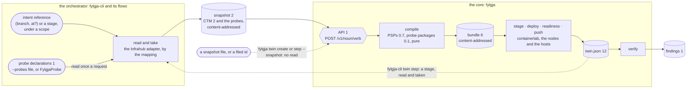
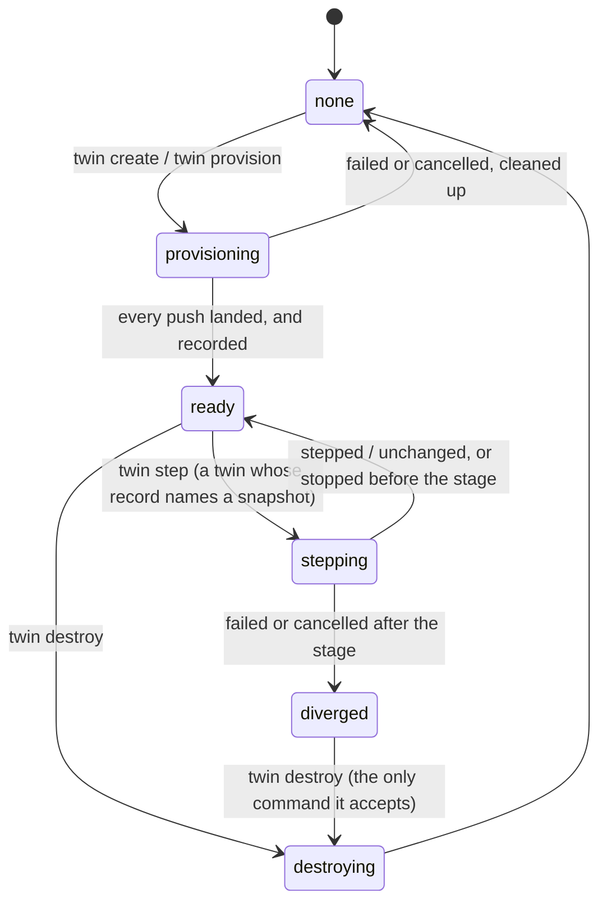
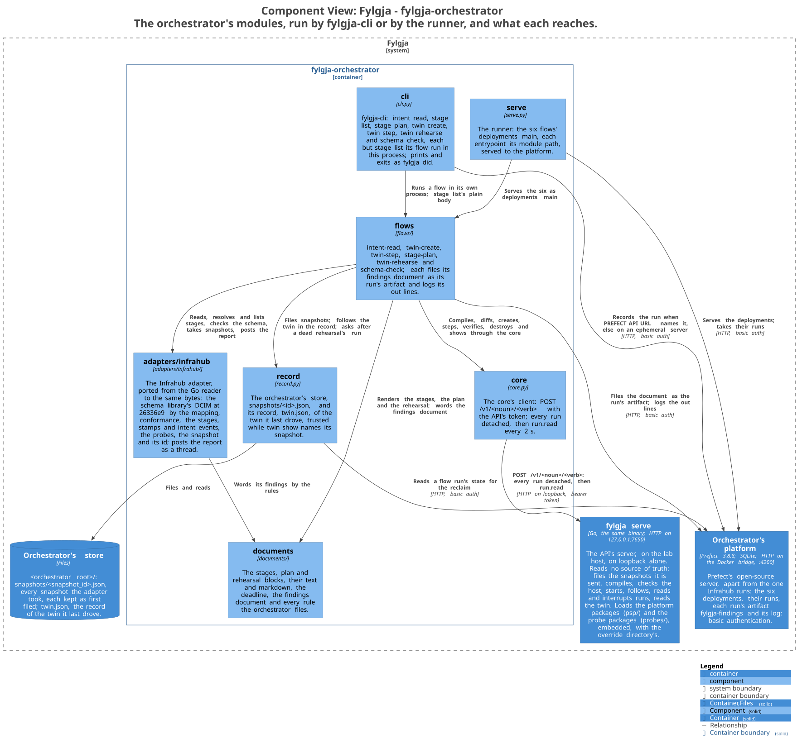

# Fylgja — Architecture

Fylgja reads network intent from [Infrahub](https://opsmill.com/) and builds a
**walking twin** of it: a running virtual topology on real network operating system
images, provisioned with containerlab, built from one Infrahub branch at an optional
point in time. It is two deployables ([D-065](decisions.md#d-065)): the **core**, the
`fylgja` binary, which runs a twin from a snapshot, with [Temporal](https://temporal.io/)
for durable provisioning; and the **orchestrator**, a Python project on
[Prefect](https://www.prefect.io/), which reads the source of truth, resolves a proposed
change's stages, rehearses them, and drives the core through its API alone. Fylgja runs
one twin at a time.

> Every decision is recorded, with the options it rejected, in the
> [decision log](decisions.md); terms are in the [glossary](glossary.md); conventions in
> the [development guide](development.md).

---

## 1. Claims that shape everything

**Two deployables, one boundary** ([D-065](decisions.md#d-065)). The core builds, steps,
destroys, shows and verifies a twin from a **snapshot**, the content-addressed wrap of
intent that is its one input ([D-061](decisions.md#d-061)), compiles one, validates a
package and answers the step between two snapshots; it knows no branch, proposed change,
stage or source of truth, holds no Infrahub credential, and its server listens on loopback
alone. The orchestrator owns everything that knows a source: its adapters read one source
each to a snapshot file, the Infrahub adapter first; its flows read, create, step, plan,
rehearse and check a schema; it posts the rehearsal's report back to the source; and it
reaches the core as any client does, through the API, never starting a workflow of the
core's. Temporal stays in the core, where mid-flight durability matters; Prefect is the
orchestrator's platform, the one Infrahub's own checks run on. Until 020 the core's server
read Infrahub, resolved stages and ran the rehearsal as a workflow of its worker
([D-051](decisions.md#d-051), superseded by D-065).

**The unit of intent is a branch at a point in time.** Infrahub versions the source
of truth itself, so intent has an address: the **intent reference** `(branch, at?)`,
or a **stage** that names one. With `at`, the reference is pinned and its twin reproducible
bit for bit. Without it, the adapter reads the branch head and records when it looked
([D-012](decisions.md#d-012)). A stage is a moment of an Infrahub proposed change,
`<branch>/<label>`, named by its source branch, and it always resolves to a pinned
`(branch, at)`. Every proposed change has two stages derived, its branch point and its
head, and the operator marks the moments between; a mark's `at` is either the one written
on it or the moment Infrahub recorded its writing. So a proposed change's stages tell the
change as a story whose every chapter can be built again ([D-045](decisions.md#d-045)).
Whatever the source, **a stage resolves to a snapshot** ([D-066](decisions.md#d-066)):
where the source replays time, as Infrahub does, by a read pinned at the stage's `at`,
taken again at each request; where it cannot, as NetBox's branches cannot, the snapshot the
adapter took when the operator marked it, kept in the orchestrator's store. The flows that
consume stages take snapshot ids and do not know how each was got, and the core sees the
snapshot alone.

**A walking twin is an environment, not a verdict.** The product is the running
topology. Verification, reporting and proposed-change integration are consumers of it,
and nothing in the core acts on them. From M12 `twin verify` reads the running twin
against the intent it was built from and reports what it found, and no Fylgja operation
reads that report ([D-039](decisions.md#d-039)). From 015 a **rehearsal** builds a proposed
change's stages on one twin in turn, verifies each and destroys the twin; from 020 it is a
flow of the orchestrator, which posts its report on the proposed change, and a check of
Infrahub's starts it and concludes from its status alone ([D-052](decisions.md#d-052),
[D-065](decisions.md#d-065)). Its verdicts are advisory too, and only the check's
conclusion, which Infrahub's own merge rule reads, gates anything. There is one twin at a
time, and its state lives where it already is — in containerlab and on disk — not in a
database of Fylgja's own ([D-013](decisions.md#d-013), [D-014](decisions.md#d-014)); the
orchestrator keeps files and Prefect's own run history, with one record of the twin it
drove.

**A walking twin walks by stepping.** A twin is frozen at the snapshot it was built from,
and nothing rebuilds it but the operator. It walks when the operator steps it from one
snapshot to another, through a proposed change's stages or to a snapshot of any branch,
without a rebuild ([D-062](decisions.md#d-062)): for a stage the orchestrator resolves and
takes the target, and the core steps to its snapshot. That is the behaviour the name
promises: a fylgja is the spirit that accompanies a person. From M4 until 019 a twin built
from a branch with no `at` also followed it, rebuilt by a scheduled check whenever its
`bundle_id` moved ([D-026](decisions.md#d-026), superseded by D-062); following has left
the core, and the orchestrator, which does not follow a branch, could bring it back as
take, compare, step.

**Fylgja never renders configuration.** A twin fed by a Fylgja-owned template tests a
different artifact than the one production receives. Per-node bootstrap — hostname,
cabled ports enabled, discovery on — comes from the platform support package;
everything else a node runs is an artifact Infrahub rendered for the branch under test
([D-009](decisions.md#d-009)). Those artifacts enter the bundle at read time, so
`bundle_id` covers configuration ([D-028](decisions.md#d-028)). A probe's host is no
device of production: its address and its route are two `exec` lines its probe package's
templates render from the declaration, and the device side of its link is intent's, the
interface's address Infrahub's template renders ([D-064](decisions.md#d-064)).

**Platforms are data, and any single twin is heterogeneous.** A slice of a real
network spans vendors. Adding a platform is a data change — a Platform Support
Package — never a compiler change, and no component may assume all nodes share a
vendor ([D-016](decisions.md#d-016)).

**Intent is not reality; the control plane is faithful and the hardware data plane is
not.** Infrahub describes what the network *should* be; hardware drifts. Containerized
NOS images run the real routing stack and reproduce no silicon. Every bundle carries a
**fidelity manifest** — modelled exactly, approximated, stubbed, omitted, and
software- versus hardware-forwarding per platform — and every result carries the
unstated precondition "assuming production matches intent"
([D-022](decisions.md#d-022), [§6](#6-known-limitations)). The manifest asserts
forwarding per platform, one entry for each package in the bundle, so a twin of two
vendors states each vendor's answer ([D-025](decisions.md#d-025)).

---

## 2. The pipeline

**Who touches what.** The operator edits intent in Infrahub, opens proposed changes and
marks their stages there, tags the devices a twin is of, and runs Fylgja's commands:
`fylgja-cli`, the orchestrator's, for anything that names a branch, a stage or a
rehearsal, and `fylgja`, the core's, for a twin from a snapshot and for everything a twin
does once it stands. The orchestrator's Infrahub adapter reads intent, the tagged devices
of the schema library's DCIM by one documented mapping ([§4.1](#41-intent-reader)), and the
rendered artifacts from Infrahub over GraphQL and REST, into a snapshot it sends the core;
the core boots the walking twin, probes it, pushes each node its artifact and reads it
back. Infrahub renders each artifact from the artifacts template, which it clones from the
artifacts repository: this repository, registered there read-only
([§4.1](#41-intent-reader), [D-044](decisions.md#d-044)). From the same registration its
task workers run this repository's two checks on every proposed change, clients of the
orchestrator's platform that start the plan's flow and the rehearsal's, and the rehearse
flow posts its report on the proposed change ([§4.7](#47-the-orchestrator),
[D-053](decisions.md#d-053), [D-065](decisions.md#d-065)).


*The system context, derived from [`c4/workspace.dsl`](c4/workspace.dsl) by `make diagrams`.*

**The pipeline's stages and their formats.** A twin's reference is read under its scope,
by the adapter's mapping, into a CTM, which the adapter takes as a **snapshot**,
content-addressed, and files in the orchestrator's store. The snapshot crosses the API as
a file, and the core, which files it again in its own store under the same id
([D-061](decisions.md#d-061)), compiles its CTM into a bundle, provisions the bundle into a
twin recorded in `twin.json`, and `twin verify` reads the twin against it. From 016 a
request's probe declarations, read once from a file or from Infrahub's `FylgjaProbe`, ride
in every snapshot it takes beside the CTM, and the compile places two synthesized hosts for
each ([D-064](decisions.md#d-064)). A twin can also be built from a snapshot alone, by its
id or as a file, with no read, which is the core's own command. Every command's answer,
either deployable's, ends in the findings document. Each format carries its version; a
step takes a twin whose record names a snapshot to another snapshot, a stage's the
orchestrator took or one given, then reconciles and pushes instead of rebuilding; and the
core answers the step between two snapshots with nothing built (`twin diff`).



| Stage | Input | Output | Pure? |
|---|---|---|---|
| Read | intent reference and scope | CTM, with provenance, the reader's fidelity list and each device's configuration artifact; or findings and no CTM | no — the orchestrator's adapter reads Infrahub |
| Take | CTM and the request's probe declarations | snapshot: the CTM wrapped with the probe list (`[]` when the request has none), its `snapshot_id` the hash of that body without the read's `observed_at`; filed by id in the orchestrator's snapshot store, then sent to the core, which files it by the same id in its own; neither store overwrites | the id is; the filing writes the stores |
| Compile | a snapshot's CTM and probes + PSPs and probe packages | bundle: deployable topology, bootstrap and configuration artifact per node, two synthesized hosts per probe, manifest | **yes** |
| Provision | bundle | a ready twin on the lab host, each node running its artifact | no — drives containerlab, pushes to the nodes |
| Operate | the twin | show, destroy; step from M11, to another snapshot's bundle without a rebuild, and from 019 to a stage of any proposed change, which the orchestrator takes, or a snapshot of any branch; verify from M12, which reads the twin against intent and changes nothing; from 020 a run read or interrupted by its identity, and the step between two snapshots (`twin diff`); rehearse from 015, the orchestrator's flow from 020: a proposed change's stages built, stepped and verified in turn on one twin, which is then destroyed | no |

Every stage is runnable on its own: the read and the take by `fylgja-cli intent read`, or
by the adapter as a tool ([§4.7](#47-the-orchestrator)), and the rest by `fylgja`
([§4.6](#46-operator-surface)) through the API's server, each on the same code path as its
tests.

---

## 3. Core objects

```
 intent reference ──read──▶ CTM ──take──▶ snapshot ──compile──▶ bundle ──provision──▶ walking twin
   (branch, at?)             (envelope:    (the CTM and its      (manifest:            (lab "fylgja" +
   under a scope              branch, at?,  probe declarations;   branch, at?,          twin directory:
                              observed_at,  snapshot_id =         schema_hash,          twin.json adds
                              schema_hash,  hash without          scope, mapping;       observed_at and
                              scope,        observed_at)          bundle_id = hash)     snapshot_id)
                              mapping,
                              fidelity)
```

| Object | Identity | Reproducible from | Lives in |
|---|---|---|---|
| Intent reference | `(branch, at?)` as given, or as a stage resolves it | — | CTM and manifest; a stage's name only in the orchestrator's record ([§4.7](#47-the-orchestrator)) |
| Scope | `tag:<name>`, the request's or `FYLGJA_DEFAULT_SCOPE` where the orchestrator runs | — | CTM, manifest and `twin.json`, beside the reference |
| CTM | its envelope: `(branch, at?, observed_at, schema_hash, scope, mapping)` and the reader's fidelity list | Infrahub, when pinned | a snapshot's body |
| Snapshot | `snapshot_id`, the hash of its body's canonical bytes without the read's `observed_at` | Infrahub, when pinned, while the branch's history stands | the orchestrator's snapshot store and the core's, each `snapshots/<snapshot_id>.json` |
| Bundle | `bundle_id`, hash of canonical bytes | its snapshot's CTM and probes, the PSPs and the probe packages, always | bundle store, `bundles/<bundle_id>/` |
| Walking twin | there is one; `fylgja twin show` describes it | never — it is live | containerlab (lab `fylgja`) + the twin directory |
| Lab host | the machine running the worker | — | — |

Rules that follow:

- **A twin is of a scope** ([D-057](decisions.md#d-057)): `tag:<name>`, every device on the
  branch carrying the tag of that name, whatever its status; its ports and cables follow it, and no
  device outside the scope is read. The request names it (`--scope`), or
  `FYLGJA_DEFAULT_SCOPE` where the orchestrator runs does when it names none; every stage a
  command resolves, reads or plans is read under that one scope, and `fylgja-cli twin step`
  reads under the scope the twin's record carries: a twin's scope and mapping are fixed for
  its life, and the core refuses a step to another ([D-062](decisions.md#d-062)).
- **A snapshot is the core's one input** ([D-061](decisions.md#d-061)). Every create
  from a branch or a stage, every stage the orchestrator plans, steps to or rehearses, and
  every `fylgja-cli intent read --out` is taken as a snapshot by the adapter and filed in
  the orchestrator's store, and the core is sent the file, which it files again before
  anything is compiled, so every workflow the core runs is started with a snapshot id and a
  bundle id, never a branch. The same
  intent read twice, or one stage resolved twice, has one id while the branch's history
  stands ([§6](#6-known-limitations)). A twin is **frozen at its snapshot**
  ([D-062](decisions.md#d-062)): nothing rebuilds it, and only `twin step` moves it, to
  another snapshot, as 018 made a twin built from a snapshot frozen by rule.
- **A probe is a declaration beside intent, never intent** ([D-064](decisions.md#d-064)).
  It names two uncabled ports of the scope's devices and the address and gateway each of
  its hosts takes; the operator writes it in a file or in `FylgjaProbe` on the default
  branch, a request reads it once, and every snapshot the request takes carries it beside
  the CTM, which it never enters. The compile turns it into two synthesized hosts, and a
  stage that cables, removes or deletes a probe's port is refused; nothing drops a probe.
- **A bundle is deployable as emitted.** It carries the fixed lab name and relies on
  containerlab's default management network; nothing host- or twin-specific is added
  after compilation ([D-011](decisions.md#d-011)).
- **The twin is what containerlab says it is.** Its provenance is the manifest staged
  in the twin directory beside it. There is no registry to fall out of sync
  ([D-014](decisions.md#d-014)).
- **Bundles accumulate; twins do not.** The bundle store keeps every compile by hash,
  so the compile-time diff between two references is always available without a
  second twin. `twin diff` prints it between two snapshots, `fylgja-cli stage plan` between
  each pair of consecutive stages of a proposed change through it, and `twin step` applies
  it to a running twin whose record names a snapshot.

---

## 4. Components

### 4.1 Intent reader

The Infrahub adapter, `fylgja_orchestrator.adapters.infrahub` under `orchestrator/`, is the
orchestrator's ([D-065](decisions.md#d-065)): a Python package on `infrahub-sdk` 1.23.2's
sync client, and a tool of its own with three commands, `read`, `stages` and
`schema-check`, which the flows call as functions ([§4.7](#47-the-orchestrator)). It is a
port of the Go reader the core carried until 020 (`internal/intent`, `internal/stages` and
`internal/stage`), which left the core once a compare test had held the adapter's files to
the Go reader's byte for byte, on the fixture and on a throwaway branch: the same mapping,
rules and words, every identifier kept, and the same snapshot, `0940db93…` for the
fixture. The Go reader's query strings are carried over and sent through the SDK's
`execute_graphql` to `POST /graphql/<branch>`, with `at` appended as a query-string
parameter, verbatim, only when the operator supplied one, directly or through a stage: the
SDK's own rewrite of `at` into UTC is undone, and so is its habit of dropping a failure's
HTTP status, so every failure is worded as the Go reader worded it. It never prints its
token, and writes nothing to Infrahub but the rehearsal's report
([§4.7](#47-the-orchestrator)).

**The mapping** ([D-057](decisions.md#d-057)). The CTM is the contract between a source
of truth and the compiler ([§4.2](#42-canonical-topology-model-ctm)), and a reader maps
one source's model onto it by one documented mapping: which kinds and fields it reads,
what each becomes, with what fidelity, what it refuses and what it omits. It reads nothing
the mapping does not name, and names the reader and the model version in every CTM's
envelope. The Infrahub reader, `infrahub-dcim`, reads OpsMill's
[schema library](https://github.com/opsmill/schema-library)'s DCIM at commit `26336e9`,
vendored byte for byte under `schema/dcim/` with its licence
([`schema/README.md`](../schema/README.md)), by the mapping in
[`specs/017-dcim-reader/contracts/mapping.md`](../specs/017-dcim-reader/contracts/mapping.md).
Nothing is added to anyone's model to key a package or a scope: a DCIM user loads nothing
of Fylgja's but the stage kind. The mapping, in short:

| CTM | Read from | Fidelity |
|---|---|---|
| the scope | every `DcimDevice` carrying the `BuiltinTag` the scope names, whatever its `status` | — |
| a device's name | `DcimDevice.name` | exact |
| its package | the platform's `DcimPlatform.name` and its manufacturer's `OrganizationManufacturer.name`, matched exactly against each package's `platform.matches` ([§4.8](#48-platform-support-packages)) | exact |
| its platform's version | nothing: the library's platform carries none | omitted |
| its artifact | its artifacts, through `CoreArtifactTarget` (below) | exact |
| its ports | every `InterfacePhysical` of the device, by name; an `InterfaceVirtual` is never read | exact |
| a port's `mgmt_only` | its `role` is `management` | approximated |
| a port's `enabled` | its `status` is not `disabled` | approximated |
| a link | a `DcimCable` with exactly two ends, each an `InterfacePhysical` of a device in the scope | exact |

Two queries read the scope, paged by 100: `Devices`, the `DcimDevice`s by the tag's name,
with their platform, its manufacturer and their artifacts; then `Ports`, the
`InterfacePhysical`s by those devices' ids, each with its `role`, its `status` and its
cable through its `connector`, whose `connected_endpoints` give the far ends. The tag is
read by that filter alone, never selected. A cable reached from a port in the scope is
judged once, by its id, and is a link only with exactly two ends, each a physical port of a
device in the scope; any other cable, and any connector that is not a `DcimCable`, is
omitted, never refusing the read, with the first reason that applies: a connector that is
not a `DcimCable` (`omit.cable.kind`), other than two ends (`omit.cable.ends`), an end not
on a physical port (`omit.cable.endpoint`), an end outside the scope
(`omit.cable.outside_scope`). Each is an `info` finding naming the ends it knows, and a
row of the envelope's **fidelity list**, beside three rows every read writes: the two
approximations above and the platform's absent version. The compiler copies the list into
the manifest unchanged and holds no table of any source's rows (Constitution III). What
survives of [D-003](decisions.md#d-003) and [D-004](decisions.md#d-004), which D-057
superseded with
[D-002](decisions.md#d-002)'s generics contract: wiring is derived by the compiler from
what the reader mapped, never declared in a schema ([§4.3](#43-compiler)), and a reader
never claims a meaning the source does not carry, and says so where it approximates.

**Read validates two things before projecting.** Schema conformance: `GET /api/schema`
holds every kind and field the mapping reads as the pinned commit loads them, per kind and
per field (an attribute's kind and optionality, a relationship's peer, kind, cardinality
and optionality, the dropdown choices `management` and `disabled`, the generic
`DcimConnector`'s own `connected_endpoints`, which the read selects through it, and the
generics' `used_by`), each difference a rejection naming the commit (`schema.kind.missing`,
`schema.field.missing`, `schema.field.mismatch`, `schema.choice.missing`,
`schema.used_by.missing`), and nothing beyond the table reported, so a branch may carry
kinds and fields of its own. Then data completeness, strict inside the scope: a scope that
selects no device (`scope.empty`), a device with no platform or a platform with no
manufacturer (`platform.missing`), and one whose pair no package names
(`platform.unmatched`). Every finding comes in one pass, and a failing read produces no
CTM. `fylgja-cli schema check`, the adapter's `schema-check`, runs the conformance half
alone and, on success, says
`conformant with opsmill/schema-library@26336e9: DcimDevice, DcimPlatform,
OrganizationManufacturer, InterfacePhysical, DcimCable, DcimConnector`, the last the generic
whose `connected_endpoints` the read selects through its interface.

**The read fetches each device's configuration artifact** ([D-028](decisions.md#d-028)).
The `Devices` query lists the device's artifacts through a fragment on the
`CoreArtifactTarget` interface, which conformance holds the device kind to inherit. The
device's support package names the one artifact
that is its configuration and the content types it accepts. The read takes the one
artifact of that name, requires it `Ready`, fetches its bytes from
`GET /api/storage/object/<storage_id>`, and verifies them against Infrahub's own
checksum, the MD5 of the content. A device with no such artifact, with several, with
one not `Ready`, of a type the package does not accept, not served, or whose bytes do
not match is refused, naming the device and the artifact and never a byte of the
content. Fylgja never generates an artifact: that is a write to Infrahub. Infrahub
1.11.2 regenerates nothing on its own either, so whoever changes the branch generates, and a change not yet generated is invisible to the read.

**Time semantics** ([D-012](decisions.md#d-012)). With `at`: passed verbatim on
every query, the artifact listing and the content fetch included; the reference is
pinned, and a pinned read fetches each artifact as it stood at `at` or refuses. Without: no `at` is sent — Infrahub filters on
`created_at <= at`, and pinning a read to a second-granularity local "now" silently
hides objects written that second, a lesson verified against Infrahub 1.11.2.

`observed_at` (UTC, local clock, read start) is recorded on **every** read, pinned or
not, in the CTM file's envelope and, later, in `twin.json` — never in the bundle, so
that the same intent hashes the same whenever it was read
([D-023](decisions.md#d-023), constitution VI). It is informational in every case and
governs nothing when `at` is supplied; on an unpinned read it is the only record of
when the intent was seen, and reproducing that reference via `--at <observed_at>` is
best-effort, which `fylgja twin show` says. The bundle manifest's provenance block records branch,
`at` if supplied, the schema hash Infrahub reports for the branch
(`GET /api/schema/summary`, field `main`), the scope, and the mapping
(`{reader, model, version}`), which is what the retired contract version became
([D-057](decisions.md#d-057)).

**Stages** ([D-045](decisions.md#d-045), [D-046](decisions.md#d-046)). A stage is a
moment of a proposed change, the one unit of change in Infrahub 1.11.2 that a user kind
may relate to. `FylgjaStage` (`schema/fylgja-stage.yaml`) is a Fylgja-owned kind beside
the library, not read by the mapping, loaded on `main`: branch-agnostic, so a mark lands in no branch's
diff; related to its `CoreProposedChange`, required; with a `label` unique within it,
holding no `/` and no whitespace, an optional `as_of` and an optional description. An
extension gives `CoreProposedChange` its `fylgja_stages`. A stage has no branch of its
own: its branch is the proposed change's source, and since Infrahub allows one open
proposed change per source branch, `<branch>/<label>` finds it. Only an open proposed
change's stages are read, draft or not. The operator marks stages; Fylgja only reads them.
Stages replaced M10's waypoints, a branch-agnostic kind that named its branch by free text,
in a series of its own ([D-032](decisions.md#d-032), superseded by D-045).

The adapter's stage reader uses the default branch's unnamed endpoints, and every read
of it names no branch but the intent events', which reads the source branch's event log
(`InfrahubEvent(branches:)`) and that branch's schema (`GET /api/schema?branch=`), to map
each event's kind: `GET /api/schema` first, to check the kind, its attributes and the extension, then
`POST /graphql`. Beside Fylgja's own kind and the mapping's, the stages read five roots
that are Infrahub's and nobody's model, each by a query: `CoreProposedChange` (the open
ones, with their stages), `Branch` (`branched_from` and `created_at`),
`CoreArtifactValidator` (the proposed change's artifact validation, pinned at a mark's or
the branch point's `at` and unpinned for the head), as Constitution III allows from 1.2.1,
`InfrahubEvent` (the source branch's event log since `branched_from`, pinned to nothing),
as it allows from 1.3.0 ([D-048](decisions.md#d-048)), and `CoreGraphQLQueryGroup` (the
template query's internal groups, read on the stamps' branch at their `at`, for the
account that created them: the source branch, or `main` for the branch point and for
`stage.main.moved`, as [mapping.md](../specs/017-dcim-reader/contracts/mapping.md) §6
says), as it allows from 2.1.0 ([D-060](decisions.md#d-060)); the
adapter's tests name each with its reason, and every operation is still a query.
An event is intent's when its primary node's kind is one the stamps read (`DcimDevice`,
an implementer of `DcimInterface` or of `DcimConnector`, mapped through the branch
schema's `used_by` and never queried, `DcimPlatform` or `OrganizationManufacturer`), and
it creates or deletes the node or changes any attribute, or any relationship but
Infrahub's own (`member_of_groups`, `subscriber_of_groups`, `artifacts`, `profiles`,
`object_template`), which it writes after every generation, its own churn and never
intent; an event with no primary node is skipped.

**The stamps** ([D-058](decisions.md#d-058), [D-060](decisions.md#d-060)). A device's
**intent stamp** is the latest node stamp among the device, every one of its interfaces,
virtual ones included, its platform, its platform's manufacturer and every cable one of
its physical ports is an end of, read under the scope by two queries shaped like the
read's, which select stamps and ids and no value of intent but the names that pick the
package. A node's stamp is its `node_metadata.updated_at`, the latest write among its
current attributes and edges, or its `created_at` when the account that wrote it last is
Infrahub's own: the account that created the internal `CoreGraphQLQueryGroup`s of the
queries the scope's artifacts render through, read by a third query at the stamps'
branch and `at`, and with no such group nothing is left out. A generation adds every node
it reads for the first time to its query's group as that account, seconds after the
checksum moves, and that join is never intent. An intent write by any account, Infrahub's
own included, is still seen by the events. A branch whose schema lacks the kind cannot query
it at all, so the stages are read from `main` and every other read stays on its branch.

A proposed change's stages, in order: the **branch point**, `main` read pinned at the
source branch's `branched_from`, verbatim; the **marks**, each at its `as_of` as written
(`given`) or, when none is written, its label's `updated_at` as Infrahub returned it
(`written`), ordered by `at`; and the **head**, the branch pinned one microsecond after
the later of the latest of every device's intent stamp and every artifact's
`checksum.updated_at`, and the `occurred_at` of its latest intent event, in
Infrahub's own layout, since a read pinned at exactly a stamp sees the node and not the
value. A cable re-ended, a port deleted and a relationship unset move no stamp, and a
cable's delete stamps its two end ports ([verified facts](verified-facts.md)); the event is how the
head moves past the rest ([D-048](decisions.md#d-048)). An event lands in
the log a few seconds after its write, a varying time (half a second to over six were
seen), so a head read in that window is the stamps' and does not see the removal yet; a
mark is judged by each event's `occurred_at` against its `at`, whenever the event lands. `branch-point` and `head` are reserved labels. Every
stage is pinned, and no `at` is composed from a clock of Fylgja's own: each is a stamp
Infrahub returned, or the first instant after one (Constitution VI).

`--stage <branch>/<label>` is resolved before anything is sent to the core, by the
adapter at step `resolve`, to a pinned `(branch, at)` and where the `at` came from. The read that follows
is the pinned read above, unchanged, with that `at` verbatim on every query. A refused
resolution reads stamps and never a value of intent: the kind or its extension absent
(`stage.kind.absent`); no open proposed change on the branch, or no such stage of it
(`stage.unknown`); a branch whose schema does not conform, the source branch or the
destination, with the read's own findings (`schema.*`), each branch checked once per command
before its stamps are first read, since they select the library's kinds; a mark carrying a
reserved label (`stage.label.reserved`); the head of a scope that selects no device on its
branch, with no intent event to name its `at` (`scope.empty`); a stage with no `at` at all
(a mark with neither `as_of` nor its label's stamp, a head whose devices carry no stamp and
no intent event, a branch point with no `branched_from`), or a given one later than now
(`stage.at.unresolved`); more than six fractional digits (`intent.at.precision`); an `at`
before the branch point (`stage.at.before_branch_point`), which names the rebase when
`branched_from` has moved past the mark while `created_at` has not, since a rebase
re-stamps the branch, discards its history from pinned reads and so refuses every earlier
mark at once. The adapter's
clock is read once per resolution and compared with a given `as_of` alone, never with a
stamp Infrahub returned, and never sent.

**A stale stage is refused** ([D-046](decisions.md#d-046), [D-048](decisions.md#d-048),
[D-058](decisions.md#d-058)), per device: a device is stale at a stage when its intent was
written later than its generation stamp. Its intent was written at the later of its intent
stamp (above), pinned at the stage's `at`, and the latest intent event no later than the
`at` that names it (by the id of the device, one of its interfaces, its platform, its
manufacturer or one of its cables as read at the stage, as the event's node or a peer of
its relationships). Its generation stamp is the later of its artifact's
`checksum.updated_at` (the artifact its package's `config.artifact_name` names) and the
proposed change's artifact validator's `completed_at` value. `stage.artifact.stale` names each such device and both remedies, a
generate or the proposed change's checks, and says to mark again. The validator counts
because a regeneration to identical bytes moves no checksum, while a run-check completes
the validator either way. Two warnings refuse nothing: `stage.main.moved`, when `main`'s
latest stamp is later than `branched_from`, read as the head is; and `stage.orphaned`, a
stage that names no proposed change. On a `main` that holds the library and no device
carrying the scope's tag, as the development host's does, the branch point is refused
`scope.empty`, like any read whose scope selects no device, and a plan goes on. A stage's name enters neither the CTM
nor the bundle. Without the kind, only the stage surfaces refuse, and `schema check`
reports whether the default branch has the kind and its extension.

**What an install loads.** On a greenfield Infrahub, the fixture tool's `-prepare-main`
loads the stage and probe kinds, then the vendored library on a `main` that holds none of
its kinds; a `main` that already holds any of the library's kinds is its operator's, and
is refused, loading nothing of the library, though the two kinds load on it where
absent. `fylgja-cli schema check` says whether a branch's DCIM is the one the adapter
reads. The library calls itself experimental, so the commit is pinned, and moving it is a
change to the mapping's table, verified against the running Infrahub; a DCIM that has
diverged from the commit needs a reader of its own ([D-057](decisions.md#d-057)).

### 4.2 Canonical Topology Model (CTM)

The body of the core's input, the snapshot (below), and, from 017, **the contract**
between a source of truth and the compiler ([D-057](decisions.md#d-057)): a thin,
branch-addressed projection of intent,
versioned by `ctm_version`, `2` from 017, which a reader fills by its mapping
([§4.1](#41-intent-reader)). A device is its name, its platform as a package (the
package's `platform.id`, and a version the Infrahub reader never writes), its ports (name,
`mgmt_only`, `enabled`, `link`) and its artifact; a link is two ends, each a device and a
port. The envelope carries `(branch, at?, observed_at, schema_hash, scope, mapping)` and
the reader's fidelity list, every approximation and omission the mapping made, which the
compiler copies into the manifest unchanged. `twin compile --snapshot`, and `twin create
--snapshot` at `resolve`, refuse a CTM of another version, or declaring none
(`ctm.version.unsupported`, naming both, its object the snapshot file), and nothing converts
a `1`; one leaving out its fidelity list, its links or a device's interfaces is refused
naming the field, prefixed `ctm.` (`data.required.missing`), never read as `[]`. Two jobs
justify it ([D-010](decisions.md#d-010)): **synthesized nodes** — boundary stubs, service
mocks, later traffic generators are not in any source and cannot live in types generated
from one — and **insulation** of the compiler from each source's model. Every
object carries **provenance**: `intent`, `observed`, or `synthesized`. Until 016 everything
was `intent`, as D-010 put it then; from 016 a probe's two hosts, their links and the
device ports those links cable are `synthesized` ([D-064](decisions.md#d-064)), placed in
the compiler's own copy of the CTM ([§4.3](#43-compiler)), so the first synthesized nodes
are the traffic hosts D-010 foresaw. A reader writes `intent` alone, and the CTM a snapshot
stores holds no host. From M5 each device carries
its configuration artifact: name, content type, Infrahub's checksum and the content,
but no Infrahub identifier or generation time, so a regeneration to identical bytes
moves nothing. The artifact reaches the compiler only this way, which keeps it pure.

**The snapshot** ([D-061](decisions.md#d-061)). From 018 the CTM travels wrapped, CTM `2`
unchanged inside a snapshot, version `2` from 016 ([`snapshot.schema.json`](../contracts/snapshot.schema.json)):
`snapshot_version`, `snapshot_id`, the take's `observed_at`, equal to the CTM's, the `ctm`,
and `probes`, the request's probe declarations ([D-064](decisions.md#d-064)), a list
required and `[]` when there are none. Each element is a declaration file's probe without
the file's wrapper ([`probes.schema.json`](../contracts/probes.schema.json), version `1`):
a name, a format and two endpoints, each a device, an interface, the address its host takes
with its prefix length and its gateway. The
**snapshot id** is the SHA-256 of the body's canonical bytes, `{"ctm": …, "probes": […]}`
with the CTM normalised and its envelope's `observed_at` left out, the probes in the order
taken, indented two spaces and
ending in a newline, by the rule the manifest uses for `bundle_id`
([D-023](decisions.md#d-023)). Nothing else is left out: the branch, the `at`, the schema
hash, the scope, the mapping, the fidelity list, every artifact and the probe list are
hashed, so two reads of one intent with one list share an id whenever they were read, and
any change of intent or of the list moves it. The version is not hashed, so a `1`, which
018 wrote with its list empty, hashes to the id it was filed under, and is read wherever a
snapshot is read as a `2` with no probe; nothing converts it, and every snapshot written
is a `2`. The bytes hashed are not the bytes stored, which carry the id and
`observed_at`; the schema gives the recipe that recomputes the id by hand. A snapshot is
read strictly, its version first: one of another version than `1` or `2`, or declaring
none, is `snapshot.version.unsupported`; an unknown key, a missing `ctm`, a `1` whose
`probes` is not empty, or an element that is not a probe or breaks one of the
declaration's rules that read no CTM (at `probes[<i>].<field>`) is
`snapshot.invalid`; a declared id the body does not hash to is `snapshot.id.mismatch`,
naming both; and the inner CTM is refused under its own rules, `ctm.version.unsupported`
at the file and `data.required.missing` at the field prefixed `ctm.`, and for its
`observed_at`, none recorded (`data.required.missing`) or one not of its form
(`snapshot.invalid`), before anything is filed, since the id leaves `observed_at`
out and such an entry could not be read back. A file `twin create --snapshot` sends is
then held, still before it is filed, to the rules validation applies that read no
package: the envelope's, the device list's, each device's and interface's name and the
links'. Each refusal is at `compile`, under the rule and object the compile gives it, and
a file they refuse is filed nowhere. A refusal that needs the server's packages, such as a
platform no package matches, comes at the compile after the filing, as a read's does. The server files each snapshot under its id in the **snapshot store**
(`snapshots/<snapshot_id>.json`, [§4.5](#45-lab-host-containerlab-and-the-twin-directory)),
behind an interface of the bundle store's shape that never overwrites: two takes of one
intent keep one document, the first. `fylgja-cli intent read --out` writes the
adapter's read as a snapshot and files it in the orchestrator's store, the core filing it
in its own only once it is sent; a bare CTM is compiled by wrapping it by hand, `{"snapshot_version":
"2", "ctm": …, "probes": []}`, its id and `observed_at` left for the server to fill. A
snapshot holds the configuration artifacts its CTM holds, so it lives in the store and
crosses as a file, never in a finding, a log line or a document, which name its id alone.

### 4.3 Compiler

A snapshot's CTM → bundle. **A pure function**: no I/O, no clock, no environment, enforced by a
test ([D-011](decisions.md#d-011)). It compiles the CTM inside the snapshot and its
probes, and nothing else of the wrap, so the three fixture CTMs, wrapped under
`testdata/snapshot/` with no probe, compile to the three goldens byte for byte, as the bare
CTMs do, and the three-node CTM wrapped with one probe (`three-node-probed.json`) compiles
to the fourth. Purity is what makes the highest-risk logic
in the system — interface mapping — golden-file testable with zero infrastructure.

A bundle is one directory:

| File | Contents |
|---|---|
| `topology.clab.yml` | lab name `fylgja`; every node with platform and image; from 016 each probe's two hosts, of the probe package's containerlab kind and image, each with its `exec` lines (its address on `eth1`, a host route to the far host via its gateway) and no startup configuration; every cabled link between node ports, a host's to its device's port among them; containerlab's default management network |
| `configs/<node>.<startup_format>` | bootstrap per node from the PSP: hostname, cabled ports enabled, link-layer discovery on, under the package's comment marker. No addresses, no production configuration. From M7 the package says how it reaches the node — containerlab applies it at deploy, or the push sends its lines ahead of the artifact's ([§4.4](#44-provisioner--temporal)) |
| `configs/<node>.<artifact_name>` | from M5, the node's configuration artifact as Infrahub rendered it, bytes unchanged (`configs/n1.device-config`). Pushed after boot; never rendered or reordered by Fylgja |
| `manifest.json` | bundle format version (`6` from 016, `5` from 017, `4` from M12, `3` from M7); the provenance block `(branch, at?, schema_hash, scope, mapping)` — never `observed_at`; platform per node, its `artifact` entry (name, content type, checksum, size, file) and its `bootstrap` entry (the file, and whether it is applied at deploy or pushed); the interface mapping table (production name → node port, the node's own name for the port as `node_name` on every row and `null` on a row with no port, `mgmt_only`, from M12 intent's `enabled`, disposition: cabled / management / configured-not-cabled / omitted); the fidelity manifest, which states that fidelity is asserted, not measured, and carries `production_forwarding` as one entry per platform in the bundle; everything omitted and why; `fidelity.lossy`, every lossy mapping and every shared port with the rule that decided it and the interfaces it shares with; from 017 `fidelity.read`, the reader's fidelity list copied from the CTM unchanged; from 016 `provenance: synthesized` on each host, its links and their rows (left out when `intent`), each host's `probe` (name, endpoint, format and package) with its `platform`, `psp`, `artifact` and `bootstrap` written `null`, the top-level `probes[]`, each probe as compiled (its format, package, each host with its endpoint, device, interface, port, address and gateway, and the package's `fidelity`, software forwarding and container timing), and `fidelity.synthesized`, every synthesized node |

The bundle is **deterministic** (same CTM and PSPs → byte-identical files, stable
ordering everywhere), **self-describing** (provisioning needs nothing outside the
directory), **deployable as emitted** (no binding step), and therefore
**content-addressed**: `bundle_id` is the hash of its canonical bytes, and a changed
`bundle_id` is the drift signal between two references. The artifacts are among those bytes, so a
configuration change moves `bundle_id` as a topology change does. `twin provision`
refuses a bundle of any other format than `6` (`bundle.version.unsupported`, naming both):
a `1` carries no artifacts, a `2` asserts one forwarding value for every node in it and
names no bootstrap entry, a `3` carries no `enabled`, so `twin verify` would assert a
port intent disables, a `4` names the retired contract version where a `5` names the
scope and the mapping, and a `5` marks nothing synthesized, where a `6` names each probe's
hosts. A probe-less snapshot compiles to what it compiled to as a `5` but for the version,
`probes: []` and `fidelity.synthesized: []`. Every mapping row carries `node_name`,
`fidelity.lossy`, `fidelity.read`, `fidelity.synthesized` and `probes` are always present,
and an empty list is written `[]`; `fidelity.production_forwarding` has one entry
per platform ([D-025](decisions.md#d-025)), and each node a `bootstrap` entry naming its
bootstrap file and how that file reaches the node.

Sub-problems, in the order they kill projects like this:

- **Interface mapping** (M6). Production `Ethernet1/49/1` on a chassis with breakouts
  must become a port on a container with no linecards. The PSP's Interfaces facet is a
  declarative **mapping profile**: an ordered list of named rules, each a `match`
  pattern over the production name with per-placeholder `ranges`, the containerlab
  `port` it renders, the `node_name` the node's operating system calls that port, a
  `lossy` flag checked against the placeholders `port` drops, and optionally a
  `breakout.parent` naming the parent from the child's values. One rule is the
  management rule; it decides the `mgmt_only` interface whatever it is called. The
  first rule whose `match` fits decides, and a value outside a range is out of range
  under that rule, never passed to a later one. One-to-one, one-to-one under another
  name, many-to-one, spreading and collapsing breakout and management are all data.
  The lossy paths are proved by a test-only package with EOS-style naming
  (`testdata/psp/lossy/chassisos.yaml`): cEOS is **not** the lossy case, since it
  carries production's names one to one, so neither shipped platform is lossy
  ([D-021](decisions.md#d-021)).
  - The compiler applies the profile per device in one function that validation calls
    too, so both word every refusal alike, and branches on nothing a package is; a test
    greps its sources for platform names.
  - Interfaces of one device that render one port share it. With one of them cabled
    the others are omitted (`omit.interface.shared`); with none cabled they all keep
    the port; two cabled is `interface.port.collision`. A cabled breakout parent
    beside a cabled child is `interface.breakout.parent_cabled`. A name no rule matches
    is refused (`interface.rule.unmatched`, or `interface.unmappable.linked` when it
    terminates a link); a name matched out of range is omitted when uncabled
    (`omit.interface.unmappable`) and refused when cabled. Every refusal comes in one
    pass with every other, and no bundle is written.
  - Every interface a lossy rule decided and every shared port is recorded in
    `fidelity.lossy`. Bootstrap's `{interface}` renders the node's own name for the
    port. Unmappable interfaces are reported, never dropped.
- **Wiring derivation** ([D-057](decisions.md#d-057)). Every interface is a port, since
  the reader reads physical ports alone: cabled when it terminates a link,
  configured-not-cabled otherwise, and the `mgmt_only` one maps onto the PSP's management
  interface name, a second omitted (`omit.mgmt.extra`). A link with a `mgmt_only`
  endpoint is omitted and recorded (`omit.link.mgmt_only`). No interface kind reaches the
  CTM, so nothing is rejected for one: the `iftype` discriminator, its loopback, SVI and
  subinterface values and their rejections were retired at 017 with
  [D-003](decisions.md#d-003).
- **Image selection.** The device's package → image reference with a fidelity rating
  (*exact*, *near*, *approximated*, *stub*) from the PSP; the platform's version, which the
  Infrahub reader leaves out, selects nothing. A locally imported image is
  supplied through the PSP override directory, not through a bundle parameter.
- **Synthesized nodes** ([D-064](decisions.md#d-064)). A probe's hosts, the first. The
  compile's first step, `PlaceProbes`, a pure function validation calls too, so both word
  every refusal alike, returns a copy of the CTM with, for each probe in name order and
  each endpoint in order, one device `<probe>-a` or `<probe>-b` whose one interface is
  `eth1`, its package the probe's format, and one link from that `eth1` to the endpoint's
  device interface, all `synthesized`; the stored CTM moves nothing. It refuses, naming the
  probe, the endpoint and the cause, and writing no bundle, a device the snapshot lacks
  (`probe.device.unknown`), an interface the device lacks (`probe.interface.unknown`), one
  intent cables (`probe.interface.cabled`), the `mgmt_only` one
  (`probe.interface.mgmt_only`), one another probe took (`probe.port.taken`), a format no
  probe package declares (`probe.format.unknown`) and a host name a device has
  (`probe.host.collision`), every refusal in one pass. The compiler then surveys the placed
  CTM as before, reading a host's package from the probe registry by its provenance, never
  by what the format or the kind is: no `linux`, `alpine` or `ping` stands in its sources,
  which `TestCompilerNamesNoPlatform` greps for. A host has no artifact and no bootstrap,
  and its device's port is cabled by the synthesized link, so bootstrap enables it. Every
  synthesized node is in `fidelity.synthesized`.
- **Secrets.** No credential appears in a bundle or a finding. Infrahub's token is the
  orchestrator's, from its process environment, never the core's, and is never persisted.
  A configuration artifact's bytes are treated as a secret outside the places they must be:
  the snapshot (either store's, and the file `fylgja-cli intent read --out` writes), the
  bundle store, the staged bundle and the node. No finding, log line,
  workflow payload, `twin.json` or `twin show` output carries them.

### 4.4 Provisioner — Temporal

Provisioning is long, multi-step, and holds real resources: containers, veth pairs,
host memory. A run that dies at step five of eight must resume, and what it created
must be reclaimed. Temporal supplies durability, retries, heartbeats and history
([D-006](decisions.md#d-006)). The core uses it for exactly that and no more: **short
workflows with fixed IDs** ([D-007](decisions.md#d-007)): `fylgja-provision` and
`fylgja-destroy`, and `fylgja-step`, which waits for the twin to settle after its record.
From 015 until 020 a fourth, `fylgja-rehearse`, ran the other three as its children under a
deadline ([D-051](decisions.md#d-051)); it is the orchestrator's flow `twin-rehearse` now,
a client of the three ([§4.7](#47-the-orchestrator), [D-065](decisions.md#d-065)). From M4
until 019 a fifth, the `reconcile` check that a Schedule started, followed a branch
([D-062](decisions.md#d-062)).

**The twin's states.** There is one twin or none, and what a command may do depends on
which state it is in:



`twin create` and `twin provision` start only from `none`, and are refused otherwise,
naming the twin, the lab or the run that holds the host. `twin show` and `twin verify`
answer in every state; with no twin, `verify` refuses as `verify.twin.absent`. `twin step`
starts only from `ready`, and only on a twin whose record names a snapshot. `twin destroy`
takes a `ready` or `diverged` twin down, and during `provisioning` or `stepping` cancels the
run and waits for its cleanup or its record first. No workflow of the core starts on a
timer of its own. A rehearsal is the orchestrator's: to the core its create, its steps and
its destroy are runs like an operator's, and its twin is a twin like any other.
`twin show` names the state: a `ready` twin by its kind
(`snapshot`, naming the snapshot it was built from or stepped to, or `from_bundle`), a
diverged one as kind `diverged`, no twin as `none`, and a run in flight by its step.

```
 provision  (workflow ID fixed: fylgja-provision; started by twin create with the snapshot sent or named, compiled and filed)
   CheckHost ─▶ StageBundle ─▶ DeployLab ─▶ AwaitReadiness ─▶ PushConfig ─▶ RecordTwin
        (every run starts already compiled, at CheckHost: a create's from a snapshot, with its
         snapshot id and bundle id; twin provision <bundle-dir>'s with the stored bundle. An
         input with no bundle id ends operation.failed at the host check, nothing scheduled;
         AwaitReadiness and PushConfig run once per node, concurrently)
        on failure or cancellation from StageBundle on: DestroyLab + UnstageTwin on a disconnected context

 destroy    (workflow ID fixed: fylgja-destroy)
   PlanTeardown ─▶ DestroyLab ─▶ UnstageTwin

 step       (M11; workflow ID fixed: fylgja-step; started by twin step with the target snapshot,
             sent or named, compiled and filed)
   InspectTwin ─▶ CheckHost on the target (presence refusals dropped) ─▶ PlanReconcile
     ─▶ StageStep ─▶ StartFlows ─▶ ReconcileLab ─▶ AwaitReadiness ─▶ PushConfig ─▶ RecordStep
     ─▶ VerifyTwin ─▶ ReadFlows
        (ReconcileLab skipped when containerlab's plan is empty or the step is unchanged;
         AwaitReadiness once per node it restarted, recreated or created; PushConfig once
         per node of the push plan, concurrently)
        from StageStep on, on failure or cancellation: RecordStep on a disconnected context,
        the record diverged; nothing is torn down
        VerifyTwin (M12, under GetVersion("verify")): after every record, stepped,
        unchanged or diverged, on the run's own context; skipped when the run was
        cancelled before it; never changes the step's outcome
        StartFlows and ReadFlows (016, under GetVersion("flows")): the flow of every probe
        both bundles carry, started before the first change and read after the wait, the
        read on the record's disconnected context whatever happened after the stage
```

**Inside the worker.** `internal/provision` holds the three workflows and the worker's
registration. It schedules every activity by the name `internal/lab/wire` gives it and
registers the seventeen host-bound activities `internal/lab` holds, fifteen until 016 added
`StartFlows` and `ReadFlows`, and nothing else: every
run starts with a snapshot id and a bundle id the server compiled, and the worker reads no
source of truth ([D-061](decisions.md#d-061), [D-062](decisions.md#d-062)). Until 019 it
also held following's five control activities (`ReadIntent`, `Compile`, `RunsInFlight`,
`StartFollowing`, `StopFollowing`), which read and compiled a branch through
`internal/stage` for the `reconcile` check, and until 020 the rehearse workflow, which
classified each stage through `internal/rehearsal`; both packages left the core with the
reader ([D-065](decisions.md#d-065)). The host-bound activities take and return wire's
payloads, the only types that cross the task queue, and `VerifyTwin` waits on the twin
through `internal/verify`, which reads the record's types from wire. A probe's host is
planned, readied, given its flow and its burst from its probe package, which
`internal/lab` and `internal/verify` read through `internal/probe`, as they read a
platform's through `internal/psp`; the worker's start-up report names the probe packages
beside the platform packages.


*The worker's components, derived from [`c4/workspace.dsl`](c4/workspace.dsl) by `make diagrams`.*

- **Singleton by construction.** The fixed workflow IDs mean a second concurrent
  `provision` is refused, naming the run in flight, and a second `destroy` attaches to
  the one in flight and reports its result. `CheckHost` refuses when lab `fylgja` already
  exists — provisioned or orphaned — and says how to clear it
  ([D-013](decisions.md#d-013)).
- **Cleanup survives everything.** Teardown runs on a disconnected context from every
  failure and cancellation path. There is no sweeper: an orphan lab is detected at
  `create` and at worker start, and `fylgja twin destroy` clears it whether or not a
  twin directory exists. For a step, cleanup is the record, not a teardown: a step that
  fails or is cancelled after its stage leaves the twin up and records it diverged
  ([D-036](decisions.md#d-036)). A rehearsal's destroy is its flow's, from a `finally`
  ([§4.7](#47-the-orchestrator)).
- **Activities are idempotent and small.** `DeployLab` checks for the lab before
  deploying; `DestroyLab` tolerates absence; activities pass paths and hashes, never
  bundle bytes — Temporal caps payload size.
- **Slow activities heartbeat.** `DeployLab` and `AwaitReadiness` run for minutes,
  with start-to-close budgets and readiness timeouts from the PSP, never a global
  constant. `PushConfig` heartbeats too, under the package's push budget.
- **Workflow code is deterministic.** No I/O, no `time.Now`, no randomness.
- **One task queue, `fylgja`,** until the host move. Host-bound activities live in
  their own package so the boundary stays visible in code
  ([D-015](decisions.md#d-015)).

**Readiness** ([D-029](decisions.md#d-029)). Each node is probed on its
management plane by the probe its package declares — gNMI, with or without TLS, on the
port and under the encoding the package names. A package may also declare that
readiness waits for the transport its push will use: once the probe answers, the step
opens a connection to `<scheme>://<address>:<port>` and closes it. Only a scheme and a
port cross the wire for that, never a login. cEOS asks for it because its gNMI server
answers a second before its eAPI endpoint does, and on that platform the push is how
bootstrap reaches the node at all; SR Linux does not, because its push transport is up
when its probe answers. Both waits live inside the package's one readiness timeout, and a
transport that never opens fails under `readiness.timeout`, naming which of the two did
not come up. A probe's host (016) is ready by its probe package's `readiness`, whose one
mechanism is `exec`: `docker exec <host> <command>` once a second until its output holds
the address the topology's `exec` lines gave it, under the package's timeout, with no login
(`ip -4 -o addr show dev eth1` expecting `10.1.10.2/24` for `ping`). A host has no artifact
and no bootstrap, so no push reaches it: its configuration is the topology's.

**The push** ([D-028](decisions.md#d-028), [D-033](decisions.md#d-033)). Once every node is ready, the run pushes each node its
artifact from the staged bundle, all nodes at once. The activity takes the twin
directory, the node's address and the artifact's file and checksum, never the bytes. It
re-verifies the staged file's checksum, then delivers it by the mechanism, commit style
and mode the node's package declares, under the package's `push_timeout_s`. Two
mechanisms are implemented, each keyed by the package's `delivery` value and by nothing
else the package is, and both shipped packages declare `mode: replace`. A **replace**
resets the candidate to the baseline containerlab left on the node, sends the bundle's
bootstrap, then the artifact, asks the device for its diff and commits, in one request
with one atomic commit; the device computes the difference, and Fylgja reads none of the
node's configuration back:

- SR Linux (`json_rpc`): one JSON-RPC `cli` request over HTTPS — `enter candidate
  private`, `load startup`, the bootstrap's lines, the artifact's lines, `diff flat`,
  `commit now`.
- EOS (`eapi`): one eAPI `runCmds` request over HTTPS, `format: text`, in a named
  configuration session — `enable`, `configure session`, `rollback clean-config`, `copy
  startup-config session-config`, the bootstrap's lines, the artifact's lines, `show
  session-config diffs`, `commit` — with the session aborted before the next attempt
  when a line is refused.

At create the node holds only its baseline, so a replace lands what a merge would. A
package on `merge` (the artifact merged over bootstrap) still creates, but cannot step. The device's diff is the push
activity's result and lives in the run's history alone: no record, finding, document or
log line carries it. A replace on `json_rpc` whose refusal is cut before its reason asks
the node once more with `commit validate`, which commits nothing
([D-034](decisions.md#d-034), [D-035](decisions.md#d-035)). The twin is `ready` only
when every push succeeded, and `twin.json` records each node's artifact and how long its
push took. A push the node refuses (`push.refused`, not
retried: the same bytes would be refused again) or one that could not be made
(`push.failed`, three attempts in all where a retry can help) fails the run at step
`push`. It names
every node's outcome, then runs the same cleanup as any failure after the host check. A
cancellation during a push waits for it (`WaitForCancellation`), and a push that
finishes after its run's cancellation still ends the run cancelled. The step was added
under `workflow.GetVersion("push")`, so histories recorded before M5 replay without it.

**Following**, from M4 until 019, is gone ([D-062](decisions.md#d-062), superseding
[D-026](decisions.md#d-026) and [D-027](decisions.md#d-027)): a `--branch` create with no
`at` and no `--no-follow` ended its run by creating Schedule `fylgja-follow`, which started
the `reconcile` check every interval to read and compile the branch and, when its
`bundle_id` had moved, rebuild the twin by a destroy and a provision. No command makes a
Schedule now, and `--interval` and `--no-follow` are unknown flags. A Schedule an earlier
build left starts a workflow no worker of this build serves, and this build carries no code
to clear it, so a following twin is destroyed before its host is upgraded.

`CheckHost` also sums the PSP memory budgets of the bundle's nodes against the host
budget the operator configured (`FYLGJA_HOST_MEMORY_MB`) and refuses with a reason
rather than failing slowly at boot; with no budget set it reports the sum as a warning
and proceeds. The budget is never derived from the host's free memory.

**How a run ends.** A provisioning run always completes, including when provisioning did
not. It returns an outcome — `ready`; `rejected`, refused before the host was touched
(the host check, or a bundle that fails verification; until 019 also read or compile
findings, in a run recorded before 018, which read and compiled itself); `failed`,
after it; `cancelled`; or `error`, a step that could not run — together with every
finding and the cleanup's status: teardown and unstage each `done`, `nothing`, `failed`
or `skipped`, and anything that remains. Temporal records the run as completed, and the
outcome becomes the document's status, by which the CLI exits. A destroy run reports the
same cleanup status.

**A create, end to end.** The server makes the command's refusals, fetches the snapshot
from the store or files the one sent once its CTM passes the rules that read no package,
compiles and files the bundle, and starts `fylgja-provision` with the two ids; the worker
runs every step from the host check. A compile refusal is the server's document before any
run. A create from a branch or a stage is the orchestrator's `twin-create` flow: the
adapter resolves and reads it and takes the snapshot, and the flow sends it as this
request's file, detached, then reads the run by its identity
([§4.7](#47-the-orchestrator)). After each step the workflow
looks at its own context, since `CheckHost`,
`StageBundle` and `RecordTwin` do not heartbeat and finish even when the run was cancelled
while they ran. A failure or a cancellation before the stage ends the run with nothing
touched; one from the stage on runs the cleanup:

```mermaid
sequenceDiagram
    participant C as client (fylgja, or a flow of the orchestrator's)
    participant S as fylgja serve
    participant T as workflow service
    participant W as worker
    participant L as containerlab
    participant N as nodes
    C->>S: POST /v1/twin/create (a snapshot file, or a filed id)
    S->>S: guards
    S->>S: file the snapshot sent, or fetch the one named; compile and file the bundle
    S->>T: start fylgja-provision (snapshot id, bundle id)
    S-->>C: start, run frames (under detach: the run's identity, and the answer ends)
    T->>W: the run's tasks
    W->>L: CheckHost (inspect, images)
    Note over W: context checked: a cancellation ends the run here, nothing touched
    W->>W: StageBundle (twin directory)
    Note over W: context checked. From here a failure or a cancellation is cleaned up
    W->>L: DeployLab
    L->>N: create and cable
    Note over W: context checked
    par each node
        W->>N: AwaitReadiness (gNMI)
    end
    Note over W: context checked
    par each node
        W->>N: PushConfig (the replace)
    end
    Note over W: context checked
    W->>W: RecordTwin (twin.json)
    Note over W: context checked
    alt failed or cancelled after the stage
        W->>L: DestroyLab, on a disconnected context
        W->>W: UnstageTwin, on a disconnected context
    end
    W-->>T: outcome, findings, cleanup status
    T-->>S: the run's result
    S-->>C: events, then the findings document (or, detached, run.read's answers)
```

**Two start options, both silent when missing.** `fylgja-provision` starts with
`WorkflowExecutionErrorWhenAlreadyStarted`: without it the Go SDK swallows the server's
already-started error, and a second `create` would wait on the first run and report that
run's result as its own. `fylgja-destroy` starts with the `USE_EXISTING` conflict policy,
which is what makes a second destroy attach. A destroy that finds a provision in flight
cancels it and waits for its cleanup first. Cleanup waits for a cancelled activity to
stop (`WaitForCancellation`) before tearing anything down. Tier-1 tests pin all three
options; the ordering itself shows only against a live service, because the SDK's test
suite ignores `WaitForCancellation`; each default was seen to misbehave against a live
service. `fylgja-step` starts as `fylgja-provision` does, with
`WorkflowExecutionErrorWhenAlreadyStarted`, pinned by the same kind of test.

**Stepping** ([D-036](decisions.md#d-036), [D-062](decisions.md#d-062)). `twin step
--snapshot <id|file>` takes a twin whose record names a snapshot to another snapshot, one
the store holds or a file sent, without a rebuild. With no `--snapshot` it is refused
`step.target.unknown` before any connection, once its record has passed the refusals that
record alone decides (a diverged twin, M10's waypoint, a scope or mapping no step reads
under, no snapshot), each given first in its own words. A step to a stage is the
orchestrator's `twin-step` flow, which chooses and resolves the stage, reads and takes it,
and sends its snapshot here ([§4.7](#47-the-orchestrator)); to the core it is a snapshot
like any other. A twin's scope and mapping are its for life: a target whose envelope names
another scope or mapping than the twin's filed snapshot is `step.twin.unsteppable`, naming
both pairs, before any run, and its bundle is then never filed. A twin `twin provision`
built, a record of `11` or earlier and a record naming no snapshot do not step, each
`step.twin.unsteppable` saying `fylgja twin destroy` clears it. The command's request does
everything that touches nothing first, in the API's server: it reads the host, fetches the
target's snapshot from the store or files the one sent, compiles it on `twin compile`'s
code path, files it, computes the step (`step.Diff`) and the push plan,
runs the host check on the target with the presence refusals dropped, and reads
containerlab's plan (`clab deploy --dry-run --format json` on the store's copy of the
target, with `CLAB_LABDIR_BASE` at the twin directory, which reads containerlab's state
there and writes nothing). Every refusal is made there, before any connection to the
workflow service. Then it starts `fylgja-step`, which re-applies the host-bound rules
as second locks and runs:

1. **`inspect`, `host check`, `plan reconcile`**: reads only. A refusal is `rejected`,
   exit 1, and a cancellation is `cancelled`, exit 2; nothing is recorded.
2. **`stage`**: the twin directory's bundle is swapped to the target's. From here the
   host is touched, and every failure or cancellation is **diverged**.
3. **`flows`** (016, [D-064](decisions.md#d-064)): `StartFlows` starts, before the first
   change, the flow of every probe both snapshots carry, in its first host:
   `docker exec -d <host> sh -c 'pkill -x ping; exec <flow.command> > /run/flow.log 2>&1'`,
   the package's command rendered with the far host's address and its interval, killing a
   stray flow first, under the package's `start_timeout_s`. A flow that cannot start is no
   failure of the step but an entry of its loss, `not_started`, under the warning
   `flow.start.failed`; only the activity's own error or a cancellation stops the step at
   the phase `flows`.
4. **`reconcile`**: `clab deploy` on the target topology, without `--reconfigure`, so
   containerlab applies the change to the running lab: SR Linux re-cables live, a cEOS
   node restarts in place, a node whose image or kind changed is recreated, a new node is
   created. Skipped when the plan is empty or the step is unchanged.
5. **`readiness`**: the readiness probe for every node containerlab restarted, recreated or
   created, a probe's host among them, all at once, under each node's package's budget.
6. **`push`**: the replace on every node whose artifact or bootstrap changed and every
   node containerlab restarted, recreated or created, all at once. Every push is awaited,
   so the record names each node's outcome.
7. **`record`**: `twin.json`, on a disconnected context,
   whatever happened after the stage.
8. **`observe`** ([D-039](decisions.md#d-039)): the **wait**. `VerifyTwin` reads the
   twin as `twin verify` does, once a second, until every assertion read from a node
   holds (**settled**) or the budget is spent (`expired`, or `incomplete` when a node was
   still unread), and writes how it ended into the record's `step.wait`. The budget runs
   from the record's time: 120s by default, `twin step --wait <duration>` otherwise. It
   runs after every record, a diverged one included, and never waits on the record's
   claims. A `twin destroy` during it cancels it (`cancelled`, recorded), and a run
   cancelled before it skips it. It was added under `workflow.GetVersion("verify")`, so
   M11's step histories replay without it. From 016 every read also runs each probe's
   **burst**, whose failure the twin has not settled from ([§4.6](#46-operator-surface)).
9. **`flows`**, read: `ReadFlows`, on the record's disconnected context, after the wait or
   wherever the step stopped once its flows had started: `docker exec <host> sh -c 'pkill
   -INT -x ping; …; cat /run/flow.log'`, the output parsed by `internal/probe` into the
   packets sent, those lost and the longest gap, the longest run of unanswered sequence
   numbers times the interval. The **loss** block it writes into the record's `step.loss`,
   on basis `container`, names each probe's outcome: `measured`; `not_started` or
   `not_read` (`flow.read.failed`, a warning); or `interrupted`, every flow of a step that
   failed or was cancelled after its stage, read until the stop. A host only the twin's
   snapshot carries is a node the reconcile deletes, read for nothing and listed under
   `dropped`; one only the target carries is created by the reconcile, with no flow, and
   listed under `added`. A step that stopped before its stage, and a dry run, carry
   `loss: null`. Both flow activities were added under `workflow.GetVersion("flows")`, so
   the seven recorded histories replay without them.

A step ends `stepped` or `unchanged` (exit 0), `rejected` (1), `cancelled` before the
stage (2), or `diverged` (4): the twin stays up, the record keeps where it came from and
names where it was going, the phase, and which nodes the push reached, and it accepts only
`twin destroy`. A step whose plan restarts or recreates a node needs `--allow-restart`. No
step tears anything down. **The wait never changes the outcome, exit, status, phase or
timings**: a wait that did not settle adds the warning `verify.wait.unsettled` and nothing
else, and the timings stop at the record. **Nor does the loss**: what a flow lost is
measured and reported, never asserted, and only a failed burst in the wait, read as any
assertion is, says that the twin did not recover. A `ReadFlows` that fails outright, after a
step that had ended `stepped` or `unchanged`, ends it `diverged` at `flows`: the twin is up
at the target and its record says it is ready there, but the loss is not recorded. The
phases reuse the existing budgets: the
deploy budget for the reconcile, `readiness.timeout_s` for each awaited node,
`push_timeout_s` for each replace, the probe package's `start_timeout_s` and
`read_timeout_s` for the flows, each with a 15s margin; the wait's is the operator's, and
its activity is bounded by it plus 30s.

**A step, end to end.** Before the stage a cancellation ends the run `cancelled` with
nothing recorded; from the stage on, every failure or cancellation is recorded diverged,
and nothing is torn down:

```mermaid
sequenceDiagram
    participant C as client
    participant S as fylgja serve
    participant T as workflow service
    participant W as worker
    participant L as containerlab
    participant N as nodes
    C->>S: POST /v1/twin/step (a snapshot file, or a filed id)
    S->>S: file the target's snapshot sent, or fetch the one named; compile and file it, diff, push plan, host check
    S->>L: clab deploy --dry-run (containerlab's plan)
    S->>T: start fylgja-step
    S-->>C: start, run frames
    T->>W: the run's tasks
    W->>L: InspectTwin
    W->>L: CheckHost (presence refusals dropped)
    W->>L: PlanReconcile
    Note over W: context checked after each. A refusal is rejected, a cancellation cancelled, and nothing is recorded
    W->>W: StageStep (twin directory swapped to the target)
    Note over W: context checked. From here a failure or a cancellation is diverged
    opt a probe both bundles carry (016)
        W->>N: StartFlows (docker exec -d, each probe's first host)
    end
    opt containerlab's plan not empty, the step not unchanged
        W->>L: ReconcileLab (clab deploy)
        L->>N: re-cable, restart, recreate, create
        Note over W: context checked
    end
    par each node containerlab restarted, recreated or created
        W->>N: AwaitReadiness
    end
    par each node of the push plan
        W->>N: PushConfig (the replace)
    end
    W->>W: RecordStep (twin.json), on a disconnected context, whatever happened
    opt the run not cancelled before it
        W->>N: VerifyTwin (the wait and its bursts, which never change the outcome)
    end
    opt the flows started
        W->>N: ReadFlows (the loss, into twin.json), on a disconnected context
    end
    Note over W,N: nothing is torn down
    W-->>T: outcome, phase, findings
    T-->>S: the run's result
    S-->>C: events, then the findings document
```

**The long operation** ([D-065](decisions.md#d-065)). A run is followed by the request that
started it, an open stream of its events, which is how `fylgja` prints it; from 020 it can
also be left and reached again by its identity, which is how the orchestrator drives the
core. Under the argument `detach`, `twin create`, `twin provision`, `twin step` and `twin
destroy` answer once the run has started, with its identity and the finding
`run.detached`, and leave it running; `run.read` reads a run by its workflow id, one of the
three fixed ones, and its run id, the latest when none is given: its state, every event so
far and, once it has closed, its document, each rebuilt from the run's history as the
stream builds them, so the server keeps nothing between two requests
([D-014](decisions.md#d-014)); and `run.interrupt` asks a running run to cancel, as a
stream's first interrupt does. `detach` beside `dry_run` is `run.flags.conflict`, an
identity no run has `run.unknown`, and an interrupt of a closed run `run.ended`. A flow of
the orchestrator's starts every run detached and reads it every 2 s, so a flow run again
after its platform restarts reads the run it started rather than starting a second into
`run.in_flight`.

**Rehearsing**, from 015 until 020 a workflow of the worker, `fylgja-rehearse`, the parent
of a provision, a step for each later stage and a destroy under a deadline
([D-051](decisions.md#d-051)), is the orchestrator's flow `twin-rehearse` from 020: the same
plan, baseline rule, deadline, verdicts, reclaim and report, made over the core's
operations ([§4.7](#47-the-orchestrator), [D-065](decisions.md#d-065)). With the parent
gone no workflow of the core starts a child, and a follow of the history an earlier build's
rehearsal left reads its own events alone, never a child's, so no read of a run can wait on
a child its parent abandoned, the defect 015 left.

### 4.5 Lab host, containerlab, and the twin directory

The lab host is a machine with Docker, containerlab, the NOS images it needs, one
`fylgja worker run` process and, from M13, one `fylgja serve` process beside it
([D-041](decisions.md#d-041)), and from 020 the orchestrator's platform and runner
([§4.7](#47-the-orchestrator)). The development host is the only lab host until M9
([D-020](decisions.md#d-020)). Fylgja **drives the `clab` CLI with structured
output and does not link containerlab** ([D-008](decisions.md#d-008)).

The core's state lives in containerlab, in three directories under the state root, and
in Temporal, and nowhere else; the orchestrator's is its own
([§4.7](#47-the-orchestrator)). There is no database ([D-014](decisions.md#d-014)):

**What runs, and what each part reaches.** The operator runs the core's client, `fylgja`,
whose every command is one request to `fylgja serve`: `POST /v1/<noun>/<verb>` over HTTP
with the bearer token, answered in NDJSON frames; and the orchestrator's, `fylgja-cli`,
which runs a flow in its own process ([§4.7](#47-the-orchestrator)). The server reads no
source of truth ([D-065](decisions.md#d-065)): it starts, follows, reads, interrupts and
cancels runs on the workflow service (gRPC); files each snapshot it is sent, and reads back
each one it is named, in the snapshot store; files bundles in the bundle store and reads
them back; reads the record and the staged bundle in the twin directory; asks containerlab
to inspect the lab and for its dry runs; and reads the nodes over gNMI for `twin verify`,
and runs each probe's burst in its first host by `docker exec`. The worker polls the
workflow service's task queue `fylgja` (gRPC); reads no source of truth, since every run it
serves starts compiled ([D-062](decisions.md#d-062)); files and
reads bundles in the store; stages and records in the twin directory; has containerlab
deploy, reconcile and destroy lab `fylgja`; probes each node over gNMI, pushes it its
artifact over JSON-RPC or eAPI, and waits on it after a step; and, in each probe's host by
`docker exec`, awaits its address, starts and reads a step's flow and runs the burst in the
wait. containerlab creates the nodes and the probes' hosts, cables them, and runs each
host's `exec` lines. The orchestrator's flows, run by `fylgja-cli` or by its runner, read
intent, artifacts, stages and probes from Infrahub (GraphQL, REST) through the adapter,
file each snapshot in the orchestrator's store, reach the server on loopback as a client of
the API, and post a rehearsal's report on its proposed change; its platform, a Prefect
server, records their runs. The operator also edits intent in Infrahub and marks stages
there. Infrahub's task workers run this repository's two checks on every proposed change,
and each reaches the orchestrator's platform over the host's Docker bridge with the
platform's basic-auth credential, and the core's server not at all
([§4.7](#47-the-orchestrator)).


*Fylgja's containers, derived from [`c4/workspace.dsl`](c4/workspace.dsl) by `make diagrams`.*

| | Holds | Read by |
|---|---|---|
| containerlab | whether lab `fylgja` exists, its nodes, their state | `fylgja twin show`, `CheckHost`, `twin verify` |
| the twin directory (`<state root>/twin/`) | the staged bundle, containerlab's working directory, and `twin.json` | `fylgja twin show`, `twin step` (and containerlab's dry run, for its own state), `twin verify` and the step's wait |
| the bundle store (`<state root>/bundles/<bundle_id>/`) | every bundle ever compiled or provisioned | `fylgja twin provision`, diffing |
| the snapshot store (`<state root>/snapshots/<snapshot_id>.json`) | every snapshot sent, each as first filed | `fylgja twin create --snapshot <id>`, `twin step --snapshot <id>`, `twin diff`, and the step's scope and mapping rule, which reads the twin's own |
| Temporal | run history | the Temporal UI, `fylgja twin show` (runs in flight), `fylgja run read` |

No database. The bundle store and the snapshot store are directories, each behind a
small interface of one shape, so that object storage can replace them at M8.

The three directories live under one **state root**: `FYLGJA_STATE_ROOT`, by default `local/`
under the working directory, resolved to an absolute path once at start. The worker
prints its root, and from M13 so does the server, so two roles started from different
directories are visibly apart rather than silently looking at different stores. A client
has no state root: it reads no store and no twin directory of its own.

```
<state root>/
├── bundles/
│   └── <bundle_id>/            a bundle exactly as compiled; hashes to <bundle_id>
├── snapshots/                  made by the first snapshot filed, never at start
│   └── <snapshot_id>.json      a snapshot as first filed, never overwritten; its body hashes to <snapshot_id>
└── twin/                       present exactly while a twin is provisioned or being provisioned
    ├── bundle/                 a copy of the stored bundle, verified to hash to its bundle_id before deploy;
    │                           a step swaps it for the target's (through .bundle.next and .bundle.prev)
    ├── clab-fylgja/            containerlab's working directory, placed here with CLAB_LABDIR_BASE; root-owned;
    │                           its .state.clab.yaml is what containerlab's plan for a step reads
    └── twin.json               written last (version 12): provenance (the reference read, its
                                schema hash, the scope and the mapping that read it), observed_at
                                (or why it is unknown), snapshot_id (or null), bundle_id, the run,
                                the worker's version, each node's address, its artifact (name,
                                content type, checksum, size; never the bytes), how long its push
                                took and the bundle it holds, or for a probe's host its probe in
                                place of a package and an artifact; the state (ready or
                                diverged), the last step (or null), the step's wait (or null until
                                it ran) and its loss (or null until its flows were read); no stage
                                and no rehearsal, which are the orchestrator's (020)
```

**Where each role runs.** The client runs on the operator's machine with
`FYLGJA_API_TOKEN`, and reaches the server at `FYLGJA_API_ADDRESS` or through an SSH
tunnel to the lab host. The lab host (Ubuntu, Docker, containerlab and the NOS images) runs
five processes. Three are the core's: `fylgja serve` on `127.0.0.1:7650` alone, holding
the API's token and both node logins and reading no Infrahub variable
([D-065](decisions.md#d-065)); `fylgja worker run`, holding both node logins and no API
token, and reading no Infrahub variable ([D-062](decisions.md#d-062)); and the workflow
service, Temporal's development server (`temporal server start-dev`) on `:7233`, its UI on
`:8233`. Two are the orchestrator's ([§4.7](#47-the-orchestrator)): its platform, `prefect
server start` on the host's Docker bridge, `172.17.0.1:4200` by Docker's default, with
basic authentication and its database under `local/orchestrator/prefect`; and its runner,
`fylgja-orchestrator serve`, which serves the six flows to the platform and whose flows
hold Infrahub's token, the API's and the platform's credential. The state root
(`FYLGJA_STATE_ROOT`) holds `bundles/`, `snapshots/` and `twin/`, the orchestrator's root
(`FYLGJA_ORCHESTRATOR_ROOT`, `local/orchestrator`) its own `snapshots/`, its `twin.json` and
the platform's home, and containerlab runs as a command. Docker runs lab
`fylgja`'s privileged containers, `clab-fylgja-<node>`, each with gNMI on `:57400` over
TLS (SR Linux) or on `:6030` in plaintext (EOS), and JSON-RPC or eAPI on `:443`, and from
016 each probe's two hosts, `clab-fylgja-<probe>-a` and `-b`, which listen on nothing and
are reached by `docker exec` alone. Infrahub
runs under Docker Compose on `:8000`, on the lab host or another machine; the checks need
it on the lab host, where its task workers, on Compose's own network, reach the
orchestrator's platform on the bridge as `host.docker.internal:4200`, a name the Compose
override's `host-gateway` entry resolves to the bridge's address, given them with the
platform's credential by that override. From 015 until 020 they reached the core's server
there instead, on `:7650` with the API's token ([D-050](decisions.md#d-050), superseded in
its listener by D-065); the core's token no longer crosses the bridge.


*The deployment, derived from [`c4/workspace.dsl`](c4/workspace.dsl) by `make diagrams`.*

A snapshot holds the artifacts' content, as the bundle does; `twin.json` names them and
holds none. The CTM sidecar, `<bundle_id>.ctm.json`, which every create, dry run and plan
filed beside its bundle until 018, is retired ([D-061](decisions.md#d-061)): no build
writes one, and those already on disk are never read. Nor does any build write
`bundles/.reads/`, where following's check kept its read's CTM until 019
([D-062](decisions.md#d-062)). Stage creates `twin/bundle/`; deploy adds
`clab-fylgja/`; the push reads the staged artifacts; record writes `twin.json`.
Teardown (`clab destroy --cleanup`) leaves nothing root-owned behind, so unstage removes
the directory whole without privileges. A twin directory present in any state is a host
check refusal, except to a step's host check, which drops the two presence refusals
because the twin is there by design.

**A step moves the record** ([D-014](decisions.md#d-014)). Its stage swaps
`twin/bundle/` for the target's, so after a stepped or unchanged step the staged manifest
and `twin.json`'s top level (`bundle_id`, provenance, `observed_at`, `snapshot_id`) are
the target's, and `run` is still the create's. After a diverged step the top level stays the
previous record's, the `step` block names the target, the run and the phase, and each
node's `holds` says which bundle it is last known to run: the target's where its push
landed, `null` for a node containerlab restarted, recreated or created whose push did not
land, and the previous everywhere else. That is not a claim that a push which did not
land left the node untouched. Only `refused` is the node's own answer, and a refused
replace is atomic. A `failed` push (no answer within the budget, a lost heartbeat, a
cancellation) may have committed, as a replace that darkens a node does. So a later
rollback reads each node's `step.pushed[].outcome` beside its `holds`; none is built. A
`3` record reads as a ready twin that has not stepped.

**The record names each host and the step's loss** ([D-064](decisions.md#d-064)).
`twin.json` `11` lists a probe's host among the nodes, with its `probe` (name, endpoint,
format and package) where a device names its package and its artifact, both `null`; a
host containerlab created or recreated holds the staged bundle, since its configuration is
the topology's and no push reaches it. The step block carries `loss`, the block `ReadFlows`
writes ([§4.4](#44-provisioner--temporal)), or `null` until it wrote one, as `VerifyTwin`
writes `wait`. A record of `10` or earlier reads with no host and no loss.

**The record says how the step's wait ended** ([D-014](decisions.md#d-014)).
`twin.json` `5`'s step block carries `wait`: its outcome, budget, reads, `after_s` (seconds
from the record to the end of the read that settled, or of the last read), when it began
and ended, and the assertions still failing, or `null` until `VerifyTwin` writes it. The
activity writes it only when the record's step names its own run, and leaves the rest of
the record as `RecordStep` wrote it. A `4` record reads with its wait unknown.

**The record named the stage, from 014 until 020** ([D-045](decisions.md#d-045)).
`twin.json` `6` carries
`stage` where `5` carried M10's reference, an object or `null`: the proposed change's id
and branch, the label, the description and `at_source` (`given`, `written`,
`branch_point` or `head`), on a pinned, intent-sourced record alone; the step's two sides
carry the same shape. `provenance.at` is the `at` itself and `provenance.branch` the
branch read, `main` for a twin built from a branch point. A record of `5` or earlier reads
as before with no stage: `twin show` gives it the kind `snapshot`, naming none, and `twin step` refuses it as
unsteppable, saying `fylgja twin destroy` clears it. One that stepped or diverged names each
stage of its step, in `twin show`, `twin verify` and `step.twin.diverged`, as the waypoint
it was, in the refusal's words, never `none`. From 020 the core names no stage at all
(below).

**The record named the rehearsal, from 015 until 020** ([D-051](decisions.md#d-051)).
`twin.json` `7` carries
`rehearsal`, `{workflow_id: fylgja-rehearse, run_id}` or `null`: the rehearsal whose
provision child built the twin, kept by each step's record. `twin show` named it on its
kind line and `twin verify` on its first, with the workflow service down too, and it was
how a rehearsal told a twin its own dead run left, which it reclaimed, from the
operator's, which refused it; the orchestrator's record does that from 020
([§4.7](#47-the-orchestrator)). A record of `6` or earlier reads with no rehearsal.

**The record names its scope** ([D-057](decisions.md#d-057)). `twin.json` `8` carries the
bundle `5` manifest's provenance verbatim: the branch, the `at` when pinned, the schema
hash, the scope the read was made under and the mapping that read it, `{reader, model,
version}`, in place of the retired contract version. `twin show` ends its record line with
both, and `twin create` prints the same line for the twin it made; a step to a stage is
resolved, judged and read under the record's scope, by the orchestrator from 020, and from
019 the core refuses a target of another scope or mapping, since a twin keeps both for
life. A record of `7` or earlier reads with no scope and no mapping: `twin show`
shows its scope unknown, `twin step` refuses it `step.twin.unsteppable`, `twin destroy`
clears it, and until 020 `twin rehearse` reclaimed it when its own dead run left it. An `8` whose scope
is not `tag:<name>`, which no build writes, is read alike for `twin show` and `twin step`,
naming the value; one whose mapping `twin.json` 8 cannot hold, which no build writes
either, `twin show` shows read by an unknown reader, naming each field it fails, and `twin
step` refuses alike, since a step that diverges keeps the record's mapping in the record it
writes.

**The record names its snapshot** ([D-061](decisions.md#d-061)). `twin.json` `9` carries
`snapshot_id`, the snapshot the twin was built from, or `null` for a twin `twin provision`
built from a bundle, which takes none, or for one an earlier build's following check
rebuilt, which took none either ([D-062](decisions.md#d-062)); its `source` is `intent`
for a create from a branch or a stage, `snapshot` for `twin create --snapshot`, and
`bundle` for `twin provision`. `observed_at` is the run's
input's read time: a create's own read, or the stored first take for a twin from a
snapshot. A step's record names the target's snapshot at its top level, and each side of
its `step` block names its own. A record of `8` or earlier reads with no snapshot: `twin
show` says `snapshot none (record <version>)`, `(record 8)` for an `8`, and `twin destroy`
clears it. From 019 `twin step` refuses it, as it refuses a record naming no snapshot,
`step.twin.unsteppable` ([D-062](decisions.md#d-062)); 018 stepped an `8` naming a stage,
its from side naming none.

**A step keeps how the twin was created** ([D-062](decisions.md#d-062)). `twin.json` `10`
changes one rule: a stage needs `provenance.at` alone, where `9` also held it to `source:
intent`. `source` says how the twin was created, and a step keeps it, so a twin
created from a snapshot and stepped to a stage is `snapshot` with a stage, and one created
from a stage and stepped to a snapshot is `intent` with none. A record of `9` reads as 018
wrote it.

**The record names no stage** ([D-065](decisions.md#d-065)). `twin.json` `12` drops `11`'s
`stage`, the step sides' `stage` and `rehearsal`: the core knows no stage, and the stage a
twin was built from or stepped to is the orchestrator's record's
([§4.7](#47-the-orchestrator)). Every create is sent its snapshot, so every new record's
`source` is `snapshot`, or `bundle` for `twin provision`; the step's rule compares the
twin's filed snapshot's envelope with the target's. A record of `11` or earlier is shown
with its version and the note that this build no longer steps it, refused a step
`step.twin.unsteppable`, and cleared by `twin destroy`.

**What `twin verify` reads** ([D-038](decisions.md#d-038)). It reads containerlab, the
record and the staged manifest, and writes nothing. Its assertions are derived from the
manifest, whose mapping rows carry intent's `enabled` from bundle `4`: a port intent
disables is still cabled and still enabled by bootstrap, since intent's disabling reaches
the node through the artifact, so verify skips that port and its link and records the
skip rather than asserting either. A node's address is the record's, else containerlab's.
What the record says each node holds is reported as the record's claim, never as a read.
A `3` manifest staged under a twin built before M12 reads with every row enabled. From
016 a probe's host is read by its burst alone ([§4.6](#46-operator-surface)): it has no
host name, port or neighbour to assert, and a synthesized link's neighbour assertions are
skipped at both ends, since a host speaks no discovery protocol, while the device port's
`port_enabled` stands.

Image acquisition varies by vendor — public registry, account-gated download plus
`docker import`, licensed, VM-based via vrnetlab — and the PSP records the method
alongside the image. SR Linux is first because its image is public
([D-021](decisions.md#d-021)).

**That method has a run-time meaning.** `public_registry` means the deploy may pull,
under the deploy budget. Any other value says
the image cannot be fetched, so the host check asks the host whether it is there
(`docker image inspect`, once per distinct reference) and refuses the run before
anything is staged when it is not — `host.image.absent`, a rejection naming the
reference, the package, the nodes that need it, how the image is obtained and that
Fylgja will never pull or tag it. **Nothing is ever pulled or tagged on the operator's
behalf**: an imported image is the operator's to place, under exactly the reference the
package names, and the same image under another tag is absent. The worker says at start
whether each such image is present and serves either way, so the state is visible before
a create rather than at the deploy. A bundle whose packages all say `public_registry`
makes no call at all. **A probe package's image is asked for whatever its acquisition**
(016): a host's deploy budget is sized for a container that starts in a second, and a pull
inside a step's reconcile would be timed as the step's, so `alpine:3.24.2`, public as it
is, must be on the host (`docker pull` it), or the run is refused `host.image.absent` with
that remedy. A host whose probe package is not on the worker is `host.probe_package.missing`.

### 4.6 Operator surface

CLI first, noun-verb, every stage exposed ([D-019](decisions.md#d-019)). Each deployable
has its CLI. `fylgja`, the core's, is a client of the API, and the API is the boundary of
the core ([D-040](decisions.md#d-040), Constitution XI). `fylgja-cli`, the orchestrator's,
holds every command that names a branch, a stage or a rehearsal, and is a client of the
same API ([§4.7](#47-the-orchestrator), [D-065](decisions.md#d-065)):

```
fylgja serve         [--listen <host:port>]... [--psp-dir <dir>]
                                                  # the API's server, on the lab host beside the worker; serves
                                                  #   every fylgja command below but worker run; on loopback
                                                  #   alone unless --listen says otherwise
fylgja twin create   --snapshot <id|file> [--dry-run] [--detach]
                                                  # all stages from a snapshot, a filed one by its id or a file
                                                  #   sent, with its own probes; no read; refused while a twin
                                                  #   exists; the twin is frozen at its snapshot until it is
                                                  #   stepped; --detach ends at the run's start (020)
fylgja twin step     --snapshot <id|file> [--allow-restart] [--wait <duration>] [--dry-run] [--detach]
                                                  # a twin whose record names a snapshot to another snapshot,
                                                  #   without a rebuild; --allow-restart when containerlab would
                                                  #   restart or recreate a node; --wait bounds the wait for the
                                                  #   twin to settle after the record (2m0s by default; 0 reads
                                                  #   once); --dry-run changes nothing; the twin's scope and
                                                  #   mapping are its for life; measures each probe's loss
                                                  #   across it (016)
fylgja twin verify   [--wait[=<duration>]]        # reads the twin against intent: host names, cabled ports,
                                                  #   adjacencies, each probe's burst (016), and the record's
                                                  #   claim of what each node holds;
                                                  #   --wait reads again until it conforms (2m0s bare); no run, no
                                                  #   worker; changes nothing; exit 5 when it does not conform
fylgja twin show                                  # the host, twin.json, the kind (the snapshot it was built from or
                                                  #   stepped to, from a bundle, diverged), the step that brought
                                                  #   it there with how its wait ended, each node's artifact, runs
                                                  #   in flight; changes nothing
fylgja twin destroy  [--detach]                   # cancels a step and waits for its record, then removes the twin
fylgja twin diff     --from <id|file> --to <id|file>
                                                  # the step between two snapshots, each compiled and filed;
                                                  #   builds nothing (020)
fylgja twin compile  --snapshot snapshot.json --out <bundle-dir>
                                                  # the pure function on the snapshot's CTM, same code path as the
                                                  #   golden tests; files nothing (--ctm retired at 018)
fylgja twin provision <bundle-dir> [--detach]     # starts the provision workflow from an existing bundle
fylgja run read      --workflow <id> [--run <id>] # a run's progress so far and, once it has closed, its result (020)
fylgja run interrupt --workflow <id> [--run <id>] # asks a running run to cancel (020)
fylgja psp validate  <file>...
fylgja worker run    [--psp-dir <dir>]

fylgja-cli intent read   --branch <b> [--at <ts>] [--stage <branch>/<label>] [--scope tag:<name>] [--probes <file>] --out snapshot.json
fylgja-cli twin create   --branch <b> | --stage <branch>/<label> [--scope tag:<name>] [--probes <file>] [--dry-run]
fylgja-cli twin step     [--stage <branch>/<label>] [--scope tag:<name>] [--probes <file>] [--allow-restart] [--wait <duration>] [--dry-run]
fylgja-cli twin rehearse --branch <b> [--scope tag:<name>] [--probes <file>] [--markdown]
fylgja-cli stage list    [--branch <b>] [--scope tag:<name>]
fylgja-cli stage plan    --branch <b> [--scope tag:<name>] [--probes <file>]
fylgja-cli schema check  --branch <b>
                                                  # the orchestrator's seven (§4.7), each but stage list a flow
                                                  #   run in fylgja-cli's own process
```

**Where each command runs.** One binary carries the core's three roles
([D-018](decisions.md#d-018)). `fylgja serve` and `fylgja worker run` run on the lab
host, each a process of its own, from one state root and one environment, to which the
server adds the API's token ([D-041](decisions.md#d-041)). Every other `fylgja` command is
a **client's command**: one request to the server, `POST /v1/<noun>/<verb>`, which
prints what comes back and exits by the document's status. A client's whole
environment is `FYLGJA_API_ADDRESS` (default `127.0.0.1:7650`) and `FYLGJA_API_TOKEN`
([D-042](decisions.md#d-042)). It reads no Infrahub variable, no login, no state root and
no package directory, and `--psp-dir` is a flag of the two roles alone. The package that
holds the client's commands, `internal/cli`, links `internal/api`, `internal/findings`
and `internal/tree` and nothing else of the module, and
`TestClientReachesTheCoreThroughTheAPIAlone` holds it so, as `TestTheCoreLinksNoReader`
holds that nothing `cmd/fylgja` links reads a source of truth. So no flag or variable can
make a client run the core, or the core read a branch. `fylgja-cli` runs wherever it
reaches Infrahub and the API, with Infrahub's two variables, the API's two and the
orchestrator's own ([§4.7](#47-the-orchestrator)). The five commands it took from `fylgja`
at 020, `intent read`, `stage list`, `stage plan`, `twin rehearse` and `schema check`, are
unknown commands of the core's CLI, and their flags `--branch`, `--at`, `--stage`,
`--scope` and `--probes` unknown flags of every command left there.

- **The server does the work.** Each handler holds a command's logic: the guards, the
  snapshot's filing or fetch, the compile and the filing, the host check, containerlab's
  dry run, the start, the follow, a run's read and interrupt, and the closing report.
  Every refusal is the server's, and one made "before any connection" is made before the
  server connects to the workflow service. The server reads containerlab, the twin
  directory, the bundle store and the nodes in its own process, not through the task
  queue, until M9 moves the host. It loads the packages and dials the workflow service per
  request, and keeps nothing between two requests.

  **Inside the server.** The handlers, `internal/server`, decode each request and write
  each frame through `internal/api`, which carries the document `internal/findings`
  defines; they word every refusal and write that document through `findings`, and load
  the packages through `internal/psp` and the probe packages through `internal/probe`
  (016). They validate and file each snapshot sent with `internal/snapshot`, which imports
  the CTM, `internal/probe` for the declarations it carries and `findings`, and nothing
  else of the module, and hold a sent snapshot's CTM to `internal/validate`'s rules that
  read no package before they file it. Every compile, `twin compile`'s, a create's, a
  step's and each side of `twin diff`, goes through `server.Compile` (`compile.go`), which
  validates with `validate`, compiles with `internal/compiler` and identifies the bundle
  with `internal/bundle`. The handlers diff a step and plan its push with `internal/step`,
  verify and file a bundle with `bundle`, read manifests from `compiler`, check the host,
  inspect the lab and run containerlab's dry run with `internal/lab`, read the twin with
  `internal/verify`, and start, follow, read and interrupt runs with `internal/provision`'s
  client. `lab` verifies the staged bundle with `bundle`,
  reads the manifest from `compiler` and reads the nodes through `verify`'s readers;
  `verify` derives its assertions from the manifest, `validate` surveys each device as the
  compiler does, `step` compares two manifests, and the compiler applies each package's
  mapping profile from `psp`. `internal/probe`, which imports `findings`, the embedded files
  and the standard library alone, is the one definition of a probe that the compiler, the
  snapshot, the lab and verify share without importing one another: the
  declaration and its rules, the probe packages and the reading of a flow's output; the
  compiler and `validate` place the hosts through it, and `lab` plans each host and runs
  its burst from its package. Every arrow in the view below is an import but `lab`'s to a
  probe's host, which is the burst it runs there by `docker exec`. `findings`, `psp` and
  `probe`, which nearly every package imports, are drawn from the few that lean on them
  most, and `provision`'s own imports serve the workflows the worker runs; the
  [development guide](development.md#repository-layout)'s import graph has every edge.
  Until 020 the server also read and compiled through `internal/stage`, which read with
  `internal/intent`, resolved, listed and planned stages through `internal/stages`, and
  built a rehearsal's report with `internal/rehearsal`: the four packages left the core
  with the reader, the adapter and the documents taking their place in the orchestrator
  ([D-065](decisions.md#d-065)). On the client's side of the boundary, `internal/cli`
  links `api`, `findings` and `tree` and nothing else.

  

  *The server's components, derived from [`c4/workspace.dsl`](c4/workspace.dsl) by `make diagrams`.*
- **A read is made under a scope** ([D-057](decisions.md#d-057)), the orchestrator's
  ([§4.7](#47-the-orchestrator)). The core takes none: a snapshot carries its own, named in
  its envelope, and `twin step` refuses a target of another scope or mapping than the
  twin's, since both are fixed when the twin is created ([D-062](decisions.md#d-062)). The
  server reads no `FYLGJA_DEFAULT_SCOPE` from 020, and `scope` is an argument no operation
  of the core takes.
- **A request's probes are read once** ([D-064](decisions.md#d-064)), by the orchestrator
  ([§4.7](#47-the-orchestrator)). The core takes no `--probes`: a snapshot carries its own
  list, and the compile places its hosts.
- **An answer is frames**: one JSON object a line (`application/x-ndjson`), the last
  always the findings document. With nothing asked, a command that is one answer is the
  document alone, after the `files` frame that `twin compile` sends first; a run is its
  `start`, its `run`, its `event`s and its document, and `twin destroy` its `start`, its
  `event`s and its document, with no `run`. The CLI asks the server to render the text as
  well, and prints each line as it arrives. `render` `markdown`, which only the rehearsal
  answered until 020, is still accepted and answers as the text does. A command that
  ran is a success of the transport, whatever it decided. The transport's own statuses are
  for its own faults: `401` for the token, `404` for a version, a stream, a path under
  `/v1/` that names no operation (the five the orchestrator took among them) or is asked
  with another method than `POST`, a path not in its clean form (`//v1/twin/show`) or `/v1`
  without its slash, never a redirect, `413` for the bound, `400` for a request the server
  cannot read or an argument its operation does not take, `409` for a stream already open.
- **A run is two requests.** A create, a provision or a step is one request that starts
  the run and stays open as its progress: a `start` frame, the run's identity, its events
  and its document. The operator's interrupt is the second request,
  `POST /v1/streams/{stream}/interrupt`, delivered to the open one. The first abandons a
  start still waiting for a worker or cancels the run, and the second stops waiting.
  While that request is open, the server holds the channel its interrupts arrive on, and
  nothing else ([D-014](decisions.md#d-014)). A client that goes
  away, or a server that stops, leaves the run running, a start still waiting for a worker
  included. The client then says the API stopped answering and that the run was not
  cancelled, or was asked to cancel once an interrupt had been delivered, and `twin show`
  names the run.
  `twin destroy` is followed the same way and takes no interrupt: its `start`, written
  just before the destroy run is started, opens no stream. From 020 a run may also be left
  at its start, `--detach`, and reached by its identity from any client, `fylgja run read`
  and `fylgja run interrupt` ([§4.4](#44-provisioner--temporal)), which is how every flow
  of the orchestrator drives one.
- **The pipeline's stage commands need a server.** `psp validate`, `twin compile` and
  `twin diff` need no workflow service, but the server checks and compiles what the client
  sends it, against the server's packages ([D-019](decisions.md#d-019)). The operator's
  files cross whole, as base64, under a 32 MiB bound. `twin compile --out` writes what comes
  back to the operator's own disk: the bundle the server compiled and did not file. `twin
  compile --snapshot`, `twin create --snapshot <file>`, `twin step --snapshot <file>` and
  `twin diff` send the snapshot file, which the last three file. `twin provision
  <bundle-dir>` sends the directory's regular files, which the server verifies and files
  in its store. `psp validate` sends each package. A dry run or a diff files its snapshots
  and its bundles in their stores on the lab host, and nothing fetches either back; `twin
  create --snapshot <id>` reads a filed snapshot there.
- **A client has failures of its own**: `api.unreachable`, `api.token.refused` and
  `api.version.unknown` between it and the server, and `api.transfer.too_large` for a
  request over the server's bound or a frame of the answer over the client's. Each is status `error`, exit 2, with no step. A client whose
  build differs from the server's says so in one line on stderr and goes on.

`twin show` runs in the server's process on the lab host: containerlab and `twin.json` as
the host check reads them, then the workflow service, best-effort under a five-second
budget. With the service unreachable it still reports the host and the record, says
whether a run is in flight is unknown (`show.service.unreachable`), and exits 0. Its
record line names the snapshot the twin was built from beside its bundle, `snapshot none`
for a twin `twin provision` built or an earlier build's following rebuild made, and
`snapshot none (record <version>)` for a record of `8` or earlier, naming its version.
Every twin built from intent or a snapshot and not diverged is of the kind `snapshot`
([D-062](decisions.md#d-062)), and its kind line names the snapshot and what it was read
from: `kind: snapshot 0940db93… (branch fylgja-fixture, read at …)` with no `at`, `(branch
… at …)` with one, then the step that took it there; a record naming
none reads `snapshot none`, with the note that `twin step` refuses it and `twin destroy`
clears it. A twin from a bundle is `from a bundle`. `pinned`, `frozen` and `following`,
kinds from M4 until 019, are gone; "pinned" still names a reference with an `at`. From 016
it lists each probe's host among the nodes, a `ping host` with its probe and endpoint in
place of a package and an artifact.

`twin step` prints the twin it starts from, a `target:` line naming the snapshot and
what it was read from, the step, then
containerlab's plan with each touched node's package declaration beside it (`reconcile:
restart e1 (added link; arista_eos declares restart); live s1 (added link; nokia_srlinux
declares live)`, or `nothing to apply`) and the push plan with each node's reasons. Its
dry run prints the same lines, the host check's `memory:` and `host:` lines and a verdict,
and changes no lab, container, twin directory or run; like every dry run it files the
target's snapshot and bundle. Every refusal it can make, it makes before any connection to the
workflow service; the record is read first, so that a step given no target is refused
before any connection (019). `twin show` keeps the kind
`snapshot` for a stepped twin, naming the target's snapshot, and names the
step on its kind line and in its record block (`stepped from snapshot 576933ec… by run
fylgja-step …; reconcile 3.9s (restart e1); readiness e1 54.8s; push e1 1.6s, s1 2.4s`). A
diverged twin is the kind `diverged`, in one line: where it was going, the run, the phase,
the nodes landed and not landed, where it is, and `fylgja twin destroy clears it`. A step
in flight is named on the kind line, with the snapshot it is stepping towards. A step's
sides are named alike everywhere, a snapshot by its id's first eight characters,
`snapshot 0940db93…`, and a bundle so, `bundle c3872f5c…`; a record of `11` or earlier
names its stages as it did. From M12 the step line
ends with how its wait ended (`; settled after 2.4s`, `; wait expired after 120.0s (3
failing)`, `; wait not run`), and a step at `observe` is listed under `in flight:` alone,
since its record is already written. `twin step` prints `step observe: settled after 2.4s
(1 read)` after `step record:`, and its closing line ends with the same clause; the dry
run prints the budget (`wait: after the record, until the twin conforms, at most 2m0s`).
From 016 a step with a probe prints `step flows:` after `step stage:`, naming each flow
started or why one did not start, and `step loss:` after the wait, one figure per probe
labelled the container's (`step loss: n1-loop 0/312 lost, longest gap 0.0s (container
timing)`), and its closing line ends with the loss; a step whose loss names no probe prints
what 019's did. Its dry run lists each host among the nodes with its memory.

`twin verify` ([D-037](decisions.md#d-037)–[D-039](decisions.md#d-039)) runs in the
server's process on the lab host, as `twin show` does, with no run and no worker. It reads
the twin, asks the workflow service best-effort for runs in flight, refuses before any
node is read when there is no twin (`verify.twin.absent`, in the host check's phrase), when a
package cannot be read (`host.psp.missing`, `verify.package.unreadable`) or when a probe
login is unset, then derives its assertions from the staged manifest and reads each path
once, over each node's own package's transport. From 016 it then runs one **burst** per
probe of the staged manifest ([D-038](decisions.md#d-038)'s assertion kinds gaining
`burst`): the probe package's burst command in the probe's `a` host by `docker exec`, at
the `b` host's address (`ping -c 5 -i 0.2 -W 2 <far address>` for `ping`), held when every
reply came back and failed when one did not (`verify.burst`, its object the probe); a burst
that could not be run leaves its host unread. A host is never dialled and asserts nothing
else. The step's wait runs the same bursts on every read, so a twin whose probe has not
recovered does not settle, and a rehearsed stage whose wait ends with a failed burst the
baseline did not have fails, by 015's rule unchanged ([D-052](decisions.md#d-052)). It
reports one finding per failed
assertion and per record claim not held, counts the held ones and names the skips. It
ends `ok` (0), `nonconforming` (5) when every node was read and something failed, or
`operation.failed` (2) when a node could not be read. A diverged twin is verified against
its staged bundle, the target, with its divergence on the first line. `--wait` reads
again every second until every assertion read from a node holds or the budget expires.
Nothing acts on the report: no command, check or step reads it.

The API exposes what its clients need and nothing more: no listing of runs, no fetch of
a filed snapshot or bundle, and a run reached again by its identity alone. A UI is item 21
of the roadmap's [backlog](roadmap.md#backlog), and another client of the same API.
Infrahub's proposed-change integration is the orchestrator's: the two checks and the
rehearse flow's report ([§4.7](#47-the-orchestrator)), consumers of the twin outside the
core.

### 4.7 The orchestrator

The orchestrator is Fylgja's second deployable ([D-065](decisions.md#d-065)): a Python
project under `orchestrator/`, the package `fylgja_orchestrator` on Python 3.14, with its
own venv (`orchestrator/.venv`, made by `make orchestrator-venv`), tests (`pytest`) and
linter (`ruff`), in this repository beside the core. It owns what knows a source of truth,
the adapter, the stages, the plan and the rehearsal, with every document that names them,
and it reaches the core as a client of the API alone, never starting a workflow of the
core's (Constitution VIII, XI). Its contract is
[`contracts/orchestrator.md`](../contracts/orchestrator.md), and the checks'
[`contracts/checks.md`](../contracts/checks.md).



*The orchestrator's components, derived from [`c4/workspace.dsl`](c4/workspace.dsl) by `make diagrams`.*

**Its parts.** `adapters/infrahub/` is the Infrahub adapter ([§4.1](#41-intent-reader)), a
tool of its own (`python -m fylgja_orchestrator.adapters.infrahub read | stages |
schema-check`) whose functions the flows call, and the one part that speaks to Infrahub.
`documents/` holds the `stages`, `plan` and `rehearsal` blocks with their text and
markdown, the deadline, the findings document and every rule the orchestrator files
(`rules.py`), each renderer held byte for byte to goldens captured from the Go renderers
before they left the core (`orchestrator/tests/golden/`). `flows/` holds the six flows.
`core.py` is its client of the core's API, on `FYLGJA_API_ADDRESS` with
`FYLGJA_API_TOKEN`, reading the frames as `fylgja` does. `record.py` keeps the record and
the store (below). `cli.py` is `fylgja-cli`, and `serve.py` the runner.

**The platform** is a Prefect 3.8.8 server of the orchestrator's own (`make
prefect-server`), apart from the Prefect Infrahub runs for its own task workers, which
publishes no port. It listens on the host's Docker bridge at `PREFECT_API_URL`
(`http://<bridge>:4200/api`), one listener that the host's processes and Infrahub's task
workers both reach, keeps its run history in SQLite under `local/orchestrator/prefect`, and
takes basic authentication, `PREFECT_API_AUTH_STRING`'s `<user>:<password>`. Nothing of
Prefect's beyond the open-source server is used: no automation, event, pause or work pool.
Prefect 3.9.0 was verified first and 3.8.8 pinned, with `fastapi` 0.150.0 beside it, since
3.9.0 and `infrahub-sdk` 1.23.2 need disjoint ranges of one dependency.

**The six flows**, each a `@flow` of its name with a deployment `main`: `intent-read`,
`twin-create`, `twin-step`, `stage-plan`, `twin-rehearse` and `schema-check`. The
**runner**, `fylgja-orchestrator serve` (`make orchestrator-serve`), serves all six to the
platform from one process, each deployment's entrypoint the flow's module path, with no
schedule. `fylgja-cli` runs the flow in its own process instead, recorded on the platform
`PREFECT_API_URL` names once it has answered the credential (`platform.unreachable`
otherwise), or on Prefect's ephemeral server under `PREFECT_HOME` when none is named, so a
hand command needs no runner; its seventh command, `stage list`, is a plain body recorded
nowhere. Every flow files its findings document as its run's artifact of type
`fylgja-findings` and logs each out line under the logger `prefect.flow_runs.fylgja`,
apart from Prefect's own lines; a check reads both. `fylgja-cli` prints and exits as
`fylgja` printed and exited for the same command, but where its contract records a
departure, and its document keeps the operation's name (`twin.rehearse`, `stage.list`,
`stage.plan`, `intent.read`, `schema.check`), so a check's conclusions read unchanged.

**How a flow drives the core.** Every run is started under `detach` and read by
`run.read` every 2 s to its document ([§4.4](#44-provisioner--temporal)); a dry run is
never detached. A create or a step is sent its snapshot as the store entry's file, and its
document is composed from the core's answers under the flow's subject (the branch, the
`at`, the stage and the scope). `stage plan` asks `twin.compile` of each stage's snapshot
and `twin.diff` of each consecutive pair, so the plan's steps are the core's, and reads
each stage's lossy mappings and shared ports from its compiled manifest.

**The record and the store.** Under `FYLGJA_ORCHESTRATOR_ROOT` (default
`local/orchestrator`), files and no database (Constitution IX): `snapshots/<id>.json`,
every snapshot the orchestrator takes, filed once and never overwritten, as the core's
store files them, and the stage store's seed ([D-066](decisions.md#d-066)); and
`twin.json`, record `1`, the one record of the twin it last drove: the stage resolved
(`branch`, `label`, `at`), its proposed change, the snapshot id, the flow run and the flow,
written by the create, step and rehearse flows once `twin show` names the twin at the
snapshot sent, and removed after a create from a branch, whose twin names no stage. The
core's `twin.json` `12` names no stage, so this record is what the stage list's twin row,
the step's default target, `stage.twin.moved` and the reclaim read, and it is **trusted
only while `twin show`'s record names its snapshot**: otherwise `stage list` says
`record.twin.stale` and marks no row, and a step given no `--stage` is refused
`step.target.required`.

**A read is made under a scope** ([D-057](decisions.md#d-057)). The commands that read
intent from a reference, `twin create`, `twin rehearse`, `intent read`, `stage plan` and
`stage list`, take `--scope tag:<name>`; not given, `FYLGJA_DEFAULT_SCOPE` where the
command runs stands. A value that is not `tag:<name>` is `scope.invalid`, a default of
that kind naming the variable, and a request naming none beside no default `scope.unset`,
both at `start` and before anything is read. Every stage one request resolves, reads or
plans is read under that one scope, and the document's `subject.scope` names it. `twin
step` reads a stage under the scope the twin's record carries, and the default when no twin
is recorded. The checks send none, so theirs is the default where the runner runs.

**A request's probes are read once** ([D-064](decisions.md#d-064)). The commands that take
a snapshot from a reference, `intent read`, `twin create`, `twin step`, `stage plan` and
`twin rehearse`, take `--probes <file>`. The adapter reads the list once, after the guards
and before any stage resolves or any branch is read: the file when one is given, else
`FylgjaProbe` on the default branch, unpinned (`probe.kind.absent`, naming
`schema/fylgja-probe.yaml`, when the kind is missing there), else none, with no warning.
Every take of the request carries that one list, so a rehearsal's or a plan's stages share
it. A file is held to the declaration's rules at `start` and the kind's objects at
`resolve`, each refusal naming the probe and the field. The checks send none, so theirs are
the kind's.

**Stages, listed and planned.** `stage list` reads every open proposed change's stages, or
the one of the branch `--branch` names, each with the `(branch, at)` it resolves to and
where its `at` came from, or a warning beside it when nothing names its `at`; it marks the
twin's row from the trusted record, lists orphaned stages after, and refuses nothing but
the kind's absence and a reserved label. `stage plan` resolves, reads and takes each stage
of one proposed change, has the core compile it on the code path `twin create` uses and
file its bundle, and prints each `snapshot_id` and `bundle_id`; a stage that is refused, a
stale one among them, is reported with its reason and the plan goes on. Between each
consecutive pair it prints the **step**: the nodes, links, bootstraps and artifacts that
differ, by presence and checksum, with `provenance` left out of the comparison. So two
stages of an unchanged branch read `unchanged`, although their ids differ by their `at`s,
as the step from a mark made after the last regenerate to the head always does
([D-045](decisions.md#d-045)); two stages at one `(branch, at)`, two marks with one
`as_of`, share one snapshot and one bundle, since the label enters neither, and read
`unchanged; the two are one bundle`. A step beside a refused stage is not computed. Neither
command needs a lab, a worker or the workflow service.

**A step to a stage.** `fylgja-cli twin step` takes the twin to the stage `--stage` names,
of any proposed change, forward or back, the head included once it has moved since the
record; with none, to the next stage after the record's in its proposed change's order,
which the record must be trusted to name. Within the record's own proposed change, the
marks the step passes over are the warning `step.stage.skipped`, and a record whose stage
has moved under it `stage.twin.moved`, neither refusing the step; a stage that resolves to
the record's own `(branch, at)` is `step.target.current`. Then the flow sends the target's
snapshot to the core's `twin step` ([§4.4](#44-provisioner--temporal)), whose refusals are
the core's.

**The rehearse flow** ([D-051](decisions.md#d-051), [D-052](decisions.md#d-052),
[D-065](decisions.md#d-065)). `fylgja-cli twin rehearse --branch <b>`, or a check, builds an
open proposed change's stages on one twin in turn, verifies each, and destroys the twin, in
one flow run, re-made at 020 over the core's operations from 015's workflow:

1. **The plan**, `stage plan`'s: the first compiled stage is the **baseline stage**, a
   branch point refused `scope.empty` alone passed over, as on a `main` with no device in
   the scope, and any other refused stage refusing the rehearsal; one compiled stage
   alone warns `rehearsal.steps.none`.
2. **The deadline** (below), refused over the ceiling (`rehearsal.deadline.unfit`).
3. **The host**: a run of the core's in flight refuses it (`run.in_flight`); a twin its own
   dead run left is reclaimed (below); then the core's dry run of the baseline's create,
   whose host check refuses any other twin, lab or orphan.
4. **The run**: the baseline by `twin.create` of its snapshot, then `twin.verify --wait`
   under its default budget, whose failing assertions are the **baseline findings**, the
   twin before the change, reported as warnings and failing nothing. Each later stage by
   `twin.step` of its snapshot with `allow_restart` and the default wait; its **verdict**
   is a pure function of the step's document and its wait's failing assertions against the
   baseline's, by rule and object: `passed` when it stepped or was unchanged and its wait
   found nothing the baseline did not; `failed` when it diverged or its wait found
   something new; `error` when the step could not run, was refused by its locks or
   cancelled before its stage, or its wait left a node unread, since nothing was then
   learned about the change. The run stops at the first stage that does not pass, and the
   stages after it are `not reached`. The record follows the twin after each create and
   step.
5. **The destroy**, `twin.destroy`, from the flow's `finally`, whatever happened, but when
   the baseline's create could not start because another run holds its identity, which
   touched nothing and whose lab the destroy would tear down.

The **deadline** is the stages' budgets summed from the packages each compiled manifest
names, each the largest of its package's deploy, readiness, push and destroy budgets over
the stage's nodes, plus the mechanism constants that already bound each step and the
wait's default, and from 016 a stepped stage's flows' two budgets: 1,950 s for the three SR
Linux stages the fixture tool composes. The **ceiling**, 3,600 s, is a constant of
Fylgja's own and only refuses a rehearsal before any run. The flow keeps the deadline on its
own clock from its start: once it passes, the core's run in progress is interrupted
(`run.interrupt`) and read to its end, the stage is `error`, `rehearsal.deadline.cut`, and
the destroy follows, which nothing cuts. The flow's `timeout_seconds` is 4,020 s, the
allowance before the start (300 s), the ceiling and the destroy (120 s); a timeout or a
cancellation reaching the flow is the cut or the cancellation of the stage in progress, and
the destroy and the report still follow. The runner kills a cancelled flow's process 30 s
after its SIGTERM, fixed in Prefect's source; that cannot reach the twin, whose destroy is a
run of the core's, started at once and ended by the core's worker, so the flow reads the
destroy for 20 s and bounds the post to what is left. The document's status is `ok` when
every rehearsed stage passed, `nonconforming` (5) when one failed, `error` (2) for an
`error` verdict, the deadline or a cancellation, `failed` (3) when the baseline could not
be built, `unclean` (4) when the destroy left something, whatever the stages did, and
`rejected` (1) for a refusal before the run, a baseline whose create another run's identity
held among them.

**The reclaim.** A twin standing whose snapshot the record names, the record's flow
`twin-rehearse`, and whose flow run the platform reads `FAILED`, `CRASHED` or `CANCELLED`,
or no longer knows, is its own dead rehearsal's: it is destroyed before the dry run, and
said so (`rehearsal.twin.reclaimed`, naming the dead run). Any other twin, lab or orphan, a
record the flow does not trust, and a platform that cannot be asked leave it to the host
check, which refuses the rehearsal.

**The report.** The text prints the plan's stage lines with the baseline named, the run
`fylgja-rehearse <flow run id>`, each stage's run lines under a `stage <ref>:` line and the
destroy's under `destroying the twin`, then one line per stage with its verdict and a
closing line; on a failure, the commands that reproduce it by hand, from a create of the
baseline's stage under the scope every stage was read under, through each step to the
failed stage, then a verify and a destroy. Its document carries a `rehearsal` block: the
proposed change, when its stages were resolved, the deadline and the time used, the
reclaim, the run, the baseline findings, each stage's role, snapshot, bundle, step, wait,
verify counts, new findings, loss (016) and verdict, the destroy's cleanup and the
reproduce commands. Its **markdown** is rendered from the document and the plan's steps: a
heading naming the proposed change and the run, a table of the stages, whose column `new
verification failures` holds the wait's failing assertions the baseline's did not have,
and whose column `loss` holds each stepped stage's figure per probe, `<probe>
<lost>/<sent>, gap <s>s`, or `—` for a stage that measured none, a Mermaid drawing, top to
bottom, with one box per stage, a failed or erred one outlined red by a class, and one
edge per step naming what it changed and never a line of configuration, the stages, the
warnings, the baseline findings, the reproduce commands and the fidelity caveat, which says
a loss figure is the container's, never a hardware forwarder's. It is never longer than the
4,092 bytes Infrahub keeps of a comment: a longer report names each finding by its
identifier and object alone, then leaves whole sections out by rank, and says what it
shortened. **The flow posts it** on the proposed change as one new thread
(`CoreChangeThread`, labelled `Conversation`, holding one `CoreThreadComment`), which the
proposed change's overview shows, on the default branch through the adapter's SDK client,
deleting a thread whose comment cannot be saved ([D-053](decisions.md#d-053), its thread
kept by D-065). A refusal because the host is held is not posted, since a check asks again
while it is held; a post that fails is `rehearsal.report.unposted`, a warning, the status
kept.

**The checks, inside Infrahub** ([D-049](decisions.md#d-049), [D-052](decisions.md#d-052),
[D-065](decisions.md#d-065)). Beside the artifacts template this repository registers two
checks (`.infrahub.yml`, `infrahub/checks/`), and Infrahub's task workers run both on
every proposed change, draft or not, at its creation and on a re-run of its user checks.
Each is Python glue on Infrahub's runtime and, from 020, a client of the orchestrator's
platform, run in no process of Fylgja's: it finds the open proposed change by its source
branch, triggers its flow's deployment over plain `httpx` at
`FYLGJA_ORCHESTRATOR_ADDRESS` with `FYLGJA_ORCHESTRATOR_AUTH`'s basic authentication, both
from the task worker's environment, asking once more on a `503`; reads the flow run every
5 s to a terminal state; takes its artifact `fylgja-findings` as the document and its out
lines from its log; and concludes from the document's status. It never uses the Prefect
client the task worker carries, which points at Infrahub's own server, and holds neither
the API's token nor Infrahub's. **`fylgja-step`** (timeout 300 s) runs `stage-plan` and
logs its text as its message. It fails when a stage is refused as intent, a branch point
refused `scope.empty` excepted, the one rule the Python holds, when the stages cannot be
listed, when the source branch has no open proposed change, when the platform cannot be
asked (a variable unset, the platform unreachable, its credential refused, no deployment),
and when the plan has not ended by the check's own deadline, 120 s before its timeout. It
writes nothing. **`fylgja-twin`** (timeout 4,260 s) passes a draft, saying it skipped it,
and triggers nothing. Otherwise it runs `twin-rehearse` with the branch alone, passes on
`ok` and fails on every other status, with the report's text as its message either way,
and writes nothing either: the flow posted the report. A host held by a run or a twin
(`run.in_flight`, `host.lab.present`, `host.twin.present`) is asked again every 30 s until
the check's own deadline nears. When it nears, or Infrahub cuts or cancels the check, the
check cancels the flow run by a blocking call, without `force`, and reads the document
the flow files from its `finally`; its timeout exceeds the flow's by a margin of 240 s, so
the flow's destroy ends inside it. Infrahub's merge rule reads the conclusion, so a failed
stage blocks the merge, and nothing in Fylgja acts on the rehearsal. The platform listens
on the host's Docker bridge so that the task workers reach it
([§4.5](#45-lab-host-containerlab-and-the-twin-directory)); the core's server listens on
loopback alone, and the core's token never crosses the bridge. From 015 until 020 each
check was a client of the core's API on the bridge and `fylgja-twin` posted the report
itself ([D-050](decisions.md#d-050), [D-053](decisions.md#d-053), superseded there by
D-065).

<a id="47-platform-support-packages"></a>
### 4.8 Platform Support Packages

A **PSP** is the declarative bundle that makes one platform supported
([D-016](decisions.md#d-016)). The format is `0.7`, and [`psp/README.md`](../psp/README.md)
documents each field:

| Facet | Contents |
|---|---|
| Identity | vendor, platform family, OS versions covered (the boot half checks the version a node reports against them); and `platform.matches`, the manufacturer and platform name pairs the package is, which the adapter's read matches each device against exactly ([§4.1](#41-intent-reader)) |
| Image | containerlab node kind, image reference, acquisition method (read at run time by the host check, [§4.5](#45-lab-host-containerlab-and-the-twin-directory)), memory budget, deploy and destroy budgets |
| Interfaces | the mapping profile ([§4.3](#43-compiler)): ordered named rules (`match`, per-placeholder `ranges`, `port`, `node_name`, a checked `lossy`, optional `breakout.parent`) and exactly one management rule; and the declared mappings, one per kind the profile handles, that the conformance suite holds it to |
| Config | bootstrap template and the `comment_prefix` its generated header is written under; how a deploy delivers the bootstrap (`bootstrap_via`: `startup_config`, containerlab applies it, or `push`, its lines go ahead of the artifact's; under `mode: replace` the push sends it after the reset either way); the artifact that is a device's configuration (`artifact_name`, `artifact_content_types`); how it is pushed after boot (`delivery`, `commit`, `mode`, `push_timeout_s`, and `push`: scheme, port and the names of the login's environment variables). `mode` is `replace`, [D-033](decisions.md#d-033)'s reset to the node's baseline for the delivery, then the bootstrap and the artifact, in one atomic commit, which both shipped packages declare; or `merge`, which creates but cannot step |
| State | collection transport and model mapping (later verification work) |
| Readiness | how to tell the node answers on its management plane: probe, path, encoding, port, `tls` (`false` is plaintext gRPC, which cEOS serves), the names of the login's environment variables; timeout; and `await_push_transport`, whether readiness also waits for the push's endpoint to accept a connection ([D-029](decisions.md#d-029)) |
| Conformance | optional: what the suite's boot half, `twin verify` and the step's wait read over the readiness probe's transport, and the values it expects: the host name and version paths, and per cabled port the admin state, the discovery state and the neighbour list with the leaves naming the far node and port, the port given by its node name. A neighbour leaf may be a path relative to one neighbour entry, and a checked value may declare what the node means by reporting nothing at all (`absent`), since OpenConfig reports no default. Never reaches a bundle |
| Capabilities | what this container can and cannot do relative to hardware |
| Fidelity | declared approximations; software- or hardware-forwarding; `link_change`, required: what containerlab's reconcile does to a node of the kind when a link of its is added or removed, `restart` (restarted in place, its push lost) or `live` (re-cabled, its push kept). Asserted by the package, measured by containerlab's plan at each step, both recorded, and a difference warned (`step.restart.undeclared`); the step acts on containerlab's plan |

**A device's package is the one that names its pair** ([D-057](decisions.md#d-057)). The
read takes each device's platform name and its platform's manufacturer's name, and the
package whose `platform.matches` names that pair exactly, letter case and spacing
included, is the device's; the CTM then names the package (`platform.package`), not the
source's names. No package naming it is `platform.unmatched`, which names the pair and
every package's pairs; a device with no platform, or a platform with no manufacturer, is
`platform.missing`. The pairs are data, so a platform added is a package added, never an
arm in the reader. A package with no pair, or a pair with an empty name, is
`psp.matches.missing`, and two packages naming one pair are `psp.matches.duplicate`,
which also refuses `serve` and `worker run` at start, as two declaring one `platform.id`
(`psp.identity.duplicate`) do, since the CTM names a package by id; the suite's pure half
holds every package meant to load to pairs of its own.

Readiness, the budgets and the probe login are consumed from the worker's own packages
at provision time, looked up by each node's manifest `psp.id`, and never reach the
bundle, so a package change that moves a timeout does not move `bundle_id` (a
node whose package is not on the worker is a host check refusal). The Config
facet's push fields are consumed the same way, on the worker at provision time: a
change to the mode or the push budget moves no `bundle_id`, and neither does
`fidelity.link_change`, which travels on the wire beside them. Its artifact name and
content types are consumed by the read, wherever it runs, and a change to the name
moves `bundle_id` on the next read, because the name is in the bundle and selects the
bytes. A package whose
`delivery` names a mechanism this build does not push by is refused at load
(`psp.config.delivery.unimplemented`, naming the ones there are), never skipped at push
time; `json_rpc` and `eapi` are the two implemented.

**A mechanism is code keyed by a format value; a platform is data**
([D-031](decisions.md#d-031)). The driver implements a fixed, named set of ways to reach
a node — two push mechanisms, each with its reset under `mode: replace`, a probe that
dials with TLS or without, a bootstrap that is applied at deploy or sent in the push, a
presence check for an image that cannot be pulled — and a package selects among them by
declaring a value. Nothing in
`internal/compiler`, `internal/psp`, `internal/lab`, `internal/provision`,
`internal/bundle`, `internal/validate`, `internal/step` or `internal/verify` may branch on
a platform's id,
vendor, kind or image reference; a test greps every non-test source in those
packages for the platform names the tree knows, comments included. A platform that needs
a mechanism this build lacks is a format change and a new arm, never a branch — and
until that arm exists the package is refused at load rather than silently skipped.

The declared mappings are read by the suite alone, and the Conformance facet by the suite,
by `twin verify` and by the step's wait, so a change to them moves no
`bundle_id`; a change to a rule that alters a port, a node name or a
rule's lossiness does, and a running twin keeps the bundle it was built from until the
operator steps it or creates it again ([D-062](decisions.md#d-062)).

**A probe package is a second package kind, beside the PSP** ([D-064](decisions.md#d-064),
016). A probe's host is of no platform, so its package is not a PSP facet: it is a
mechanism keyed by a format value, as D-031 has it, in [`probes/`](../probes/), format
`0.1` ([`probes/probe.schema.json`](../probes/probe.schema.json)), one file per format:
`format`, the value a probe declaration names and that keys the mechanism; `image`
(containerlab kind, reference, acquisition, resources, deploy and destroy budgets, the
PSP's shape); `host` (the interface, and the templates of the `exec` lines that address it
and route it to the far host); `readiness` (`exec`, a command and what its output must
hold); `flow` (the interval, the command, its start and read budgets); `burst` (the count,
the wait and the command); and `fidelity` (`forwarding: software`, `timing: container`,
the approximations). The one shipped package is `ping`: `alpine:3.24.2`, busybox's `ping`
and `ip`, 32 MiB, a flow every 0.2 s, a burst of five. The packages load into a probe
registry in both roles, the embedded `probes/*.yaml` first and then the override
directory's `probes/` subdirectory, an override shadowing by format, so no flag is added;
an invalid one refuses `serve` and `worker run` at start, and two declaring one format are
`probe.package.format.duplicate`. The start-up reports name each beside the platform
packages. Only the package's identity, its containerlab kind, its image and the rendered
`exec` lines reach a bundle, so a budget, an interval or a count moves no `bundle_id`. The
code that runs
a host, `internal/lab`'s flows and burst and `internal/verify`'s derivation, reads every
command, count and budget from the package and branches on nothing it names; the
compiler's grep holds `linux`, `alpine` and the `ping` literal out of its sources.

PSPs, the probe packages and the schema (the vendored library, the stage kind and the probe
kind) are embedded in the binary, the packages with a runtime override directory
([D-018](decisions.md#d-018)). The orchestrator's adapter reads the same `psp/*.yaml` as
files from the repository's `psp/` (or `FYLGJA_PSP_SHIPPED`), with `FYLGJA_PSP_DIR`'s
overrides, for each package's `platform` alone, so the two deployables read one set of
packages and cannot drift. A platform is supported only when its PSP passes
the **conformance suite** (M6): `go test` in `internal/conformance`, a package no product
code imports, in two halves.

- **The pure half** runs in tier 1 on every package meant to load, shipped or test: the
  package validates, it declares at least one pair and shares none with another, every
  declared mapping maps as declared and round-trips back to its production name, and
  bootstrap renders for it. From 016 its check `probe_package` holds every shipped probe
  package too: it validates as the probe registry validates an override, and each of its
  templates renders from its own field's placeholders with nothing left unrendered.
- **The boot half** runs inside tier 3's run, against case 1's ready twin, and reads each
  node once over the readiness probe's transport, by the paths the Conformance facet
  declares, through the readers in `internal/verify`, which product code shares with it
  ([D-037](decisions.md#d-037)). It checks that the node booted, that readiness came within the package's
  budget, that bootstrap applied (the host name; every cabled port enabled and
  discovering), that every cabled port sees the far node and port the bundle's link
  names, under the far node's own name for it (the round trip through a booted node),
  and that the node's version is one the package lists. It boots, pushes and retries
  nothing. A package without the facet, or whose probe is not gNMI, cannot pass it, and
  the suite says so.

`psp/README.md`'s Supported packages table records each pass: the version read and the
tier-3 run whose twin the boot half read. A shipped package without a row is not
supported. Nothing at run time consults the table, and `twin verify` changes nothing about
what supported means: it holds a twin to intent, where the suite holds a package to what
it declares. If a new platform needs a compiler
change, the abstraction is wrong and the change is rejected until the abstraction is
fixed.

---

## 5. Stack

| Layer | Choice | Why |
|---|---|---|
| The core | **Go**, one static binary of three roles: the client's commands, the worker and, from M13, the API's server | one toolchain, one test framework, one artifact per host; no second runtime in the core ([D-005](decisions.md#d-005), [D-018](decisions.md#d-018), each the core's since [D-065](decisions.md#d-065)) |
| The orchestrator | **Python 3.14** on **Prefect 3.8.8**, with `fastapi` 0.150.0 pinned beside it, `infrahub-sdk` 1.23.2, `httpx` and `pydantic`; tested by `pytest` 9.2 and linted by `ruff` 0.17; from 020 | the ecosystem's language, and the next adapter's (F-025's NetBox); flows as code on an open-source server with basic authentication and no Kubernetes, the platform Infrahub's own checks run on; a deployable of its own, reaching the core through the API alone ([D-065](decisions.md#d-065)) |
| Infrahub's checks | **Python**, as Infrahub's task-worker image carries it: `infrahub-sdk`'s `InfrahubCheck` and `httpx`; from 015 | glue on Infrahub's runtime, as the template is: run by Infrahub's task workers, never by a process of Fylgja's, triggering a flow on the orchestrator's platform and deciding nothing but how a status maps to a conclusion; held by the orchestrator's `pytest` against a stub platform, and proved inside a running Infrahub by a Go contract test ([D-049](decisions.md#d-049), [D-052](decisions.md#d-052), [D-065](decisions.md#d-065)) |
| Durable execution | **Temporal**, self-hosted, in the core; `temporal server start-dev` until M8 | durable, resumable, inspectable provisioning; Go SDK and test suite ([D-006](decisions.md#d-006)) |
| Orchestration | **Prefect**'s open-source server, its run history in SQLite under the orchestrator's root; one runner serving six deployments | a flow's resume is a rerun that reads the core's run by its identity, so the platform records and triggers runs and holds nothing the core must keep ([D-065](decisions.md#d-065)) |
| Source of truth | **Infrahub** 1.11.2, operator-provided; Fylgja reads it, and writes nothing to it but a rehearsal's report | branches and points in time give a twin its reference; the adapter reads the OpsMill schema library's DCIM at a pinned commit by one documented mapping, and a DCIM that diverges from it needs a reader of its own; it renders each device's configuration ([D-001](decisions.md#d-001), [D-028](decisions.md#d-028), [D-057](decisions.md#d-057)) |
| Intent interface | GraphQL through `infrahub-sdk`'s `execute_graphql`, the Go reader's query strings carried over, plus REST for the schema and artifact content | branch- and time-scoped queries against the library's kinds; a branch whose schema is not the mapping's is refused at the read, before any device is read. Until 020, typed Go that `genqlient` generated from a committed SDL |
| Lab runtime | containerlab, driven as a CLI | the interface operators already know ([D-008](decisions.md#d-008)) |
| State | containerlab, files and Temporal in the core; files and Prefect's run history in the orchestrator; no database of Fylgja's | nothing to keep in sync ([D-014](decisions.md#d-014), Constitution IX) |
| CLI | the core's `fylgja`: Cobra, noun-verb, from M13 a client of the API alone; the orchestrator's `fylgja-cli`: argparse, noun-verb, printing and exiting as `fylgja` did for the commands it took | ([D-019](decisions.md#d-019), [D-040](decisions.md#d-040), [D-065](decisions.md#d-065)) |
| API | Go's `net/http`, HTTP/1.1 on loopback; JSON requests answered in NDJSON frames; one bearer token from the environment; no TLS, roles or second token | no dependency added; a remote client comes through an SSH tunnel or a proxy the operator runs, and from 020 nothing reaches it on the Docker bridge ([D-040](decisions.md#d-040), [D-042](decisions.md#d-042), [D-065](decisions.md#d-065)) |

---

## 6. Known limitations

To be stated in the product surface, not buried here.

- **Intent-conformant, not production-faithful.** `twin verify` measures the twin against
  intent (M12): each node's host name, every cabled port intent enables, and every link
  as an adjacency seen from both ends. Intent is the scope as the mapping read it: what
  the read approximated or omitted, a cable without two physical ends inside the scope
  among them, is named in the manifest's `fidelity.read` and is not in the twin, and
  verify does not look for it ([D-057](decisions.md#d-057)). Fidelity to production is
  still asserted by the manifest and never measured (Constitution X): nothing compares the
  twin with the network it models, and a node's configuration is reported from the
  record's claim of what it holds, not read back.
- **No hardware data plane.** No ASIC, TCAM, buffers, hardware QoS or line rate.
  Where production forwards in software the twin is more faithful; the PSP says which.
- **Timing differs** in containers: convergence, BFD, control-plane policing.
- **A loss figure is the container's** ([D-064](decisions.md#d-064)). A probe's hosts
  forward in software and keep the container's timing, and so do the nodes between them:
  the loss a step measures says what this twin dropped while it changed, never what a
  hardware forwarder would. It is reported and never asserted; only a burst that comes back
  short after the step fails anything. The shipped package sends one packet each 0.2 s, so a
  gap is known to that interval.
- **A probe across two devices needs routing that intent renders.** The reference template
  renders each physical port's addresses and no routing, so two addressed ports of one
  device reach each other by its connected routes and two devices do not: a probe whose
  endpoints lie on two devices fails its burst until intent's routing reaches the
  configuration. The fixture's probe therefore lies across one device, on two probe-ready
  ports.
- **The kind's probes are read unpinned.** Without a file a request reads `FylgjaProbe` on
  the default branch as it stands, whatever `--at` or a stage pins, so a pinned read
  reproduces its snapshot only while the kind holds the same probes; the snapshot, or the
  file, reproduces it whatever the kind holds later.
- **One twin at a time.** Runtime A/B between two live twins is out of scope;
  compile-time diffs between references are not.
- **Unpinned references are approximate.** `observed_at` is a local clock reading.
  Pin with `--at`, or build from a stage, when reproducibility matters.
- **Walking is one step at a time** (M11), and only for a twin whose record names a
  snapshot. Each `twin step` takes the twin to one stage of any proposed change, forward
  or back, or to one snapshot; the pause between two steps is the operator's and, from
  M12, ends with a wait for the twin to settle, recorded; the records' timings mark it.
  A twin built from a bundle does not step, nor does one whose record names no snapshot,
  and no step changes a twin's scope or mapping ([D-062](decisions.md#d-062)). A story
  along `main`'s own history has no stages, since a proposed change cannot have `main` as
  its source: it is walked by snapshots of `fylgja-cli intent read --branch main --at`. A rehearsal walks every
  stage in turn, with no pause but each step's wait.
- **A rebase ends a proposed change's story until it is marked again**
  ([D-045](decisions.md#d-045)). Infrahub re-stamps a rebased branch's whole content and
  discards its earlier history from pinned reads, so every mark made before the rebase
  falls before the new branch point and is refused. A twin built from one keeps what it
  was built from.
- **A snapshot's id holds only while the branch's history stands**
  ([D-061](decisions.md#d-061)). The same intent read twice has one id, and so does one
  stage resolved twice, but a rebase re-stamps the branch's content, so a stage resolved
  after it reads differently, or empty, and gets another id; and an artifact Infrahub
  re-rendered to different bytes for unchanged data, never seen, would move the id as a
  change of intent does. Both are stated and neither is tested.
- **The branch point needs a tagged device on `main`.** It is `main` at `branched_from`,
  read under the request's scope, so on an install whose `main` holds the library and no
  device carrying the scope's tag, as the development host's does, it is refused
  `scope.empty`, and a twin starts from the first mark.
- **Infrahub's proposed-change view does not show stages.** They are listed by
  `fylgja-cli stage list`, in the UI as objects of their own, and in each rehearsal's
  thread.
- **A rehearsal is bounded by its deadline** ([D-051](decisions.md#d-051),
  [D-065](decisions.md#d-065)): its stages' budgets summed, under a ceiling of an hour, kept
  on the rehearse flow's own clock. A proposed change whose stages need more is
  refused before any run, and a stage still running when the deadline passes is cut,
  reported `error` (`rehearsal.deadline.cut`), and the twin destroyed. The deadline bites
  only when something hangs: the three stages the fixture tool composes use about 70 s of
  their 1,950 s.
- **A rehearsal leaves no twin to look at.** Its twin is destroyed whatever happened, so
  a failed stage is looked at by hand: the report gives the commands that reproduce it,
  from a create of the baseline through each step to the failed stage, and the stages
  outlive the rehearsal.
- **A rehearsal's flow needs its process to end.** It runs in the runner's process, or
  in `fylgja-cli`'s; a process killed mid-run leaves the run of the core's it had started
  going on and the twin standing, and the platform reads the flow run `CRASHED`, so the
  next rehearsal reclaims the twin its record names. A flow run Infrahub or the platform
  cancels has 30 s before its process is killed, enough to start the destroy, which the
  core then ends, but not always to read it to its end or post the report.
- **A check's change reaches Infrahub only when imported.** Infrahub runs the checks its
  registration imported from `origin`'s `main`, which the operator pushes and imports
  (`InfrahubReadOnlyRepositoryImportLastCommit`). Each task worker fetches the commit some
  15 s after the import, a run-check before both have fetched fails, and a branch created
  before the import never runs the new checks until it is rebased or made again.
- **A check Infrahub times out leaves its validator `in_progress` for ever**, which
  blocks the merge and reads as still running in the proposed-change view. `fylgja-twin`'s
  own deadline ends inside its timeout so that this does not happen, a check cut all the
  same still cancels its flow run, and the rehearsal's deadline covers a check that
  reached no platform at all.
- **A restarted node loses its push.** When a step adds or removes a link of a cEOS node,
  containerlab restarts it in place, and it returns about a minute later on its startup
  configuration. The step waits for it and
  replaces its configuration again, so a topology step costs that node's minute and its
  running state, and needs `--allow-restart`. A node whose image or kind changes is
  recreated, and loses everything.
- **A failed step leaves a diverged twin** ([D-036](decisions.md#d-036)). The twin stays
  up, part on the old stage and part on the new, and the record says which node runs
  which. It accepts only `twin destroy`; rolling back from it is later work.
- **A commit-time refusal on SR Linux gives no reason under the replace**
  ([D-035](decisions.md#d-035)): the
  node cuts its message inside the echo of the commands sent, and `commit validate` does
  not run the checks a commit makes. The finding says so, and names the node, the
  artifact and its checksum.
- **A twin does not follow its branch** ([D-062](decisions.md#d-062)). A change to the
  branch reaches a running twin only when the operator steps it to a stage or a snapshot
  that holds the change, or creates it again; nothing in the core watches a branch, and
  the orchestrator, which could follow one by take, compare and step, does not. Following,
  from M4 until 019, rebuilt the twin at a scheduled check.
- **Configuration is only as current as its last generation.** Infrahub 1.11.2
  regenerates no artifact on its own, and marks none stale. An intent change
  nobody generated for leaves the artifact, the bundle and the twin as they were. A
  template commit changes a branch's artifacts only once Infrahub has imported it, the branch carries it (a branch without
  git sync needs a rebase) and someone generates. A proposed change's pipeline
  regenerates at its creation and on a run-check, never as the branch is edited, so **a
  stage marked after an intent change and before the regenerate is refused stale**,
  naming the device and both remedies ([D-046](decisions.md#d-046),
  [D-058](decisions.md#d-058)): mark after the branch's writes and after their artifacts
  have moved. A stamp that only the template query's group join moved, which Infrahub's own
  account writes a few seconds after a generation first reads a node, is read as the
  node's creation, so a generate is not undone by its own churn
  ([D-060](decisions.md#d-060)). The rule is per device, so a
  neighbour's change that alters a device's rendered lines is not named on that device
  while none of the device's own stamps moves and no intent event names the device, one
  of its interfaces, its platform, its manufacturer or one of its cables, as the event's
  node or a peer ([D-048](decisions.md#d-048)): a cable removed between them names both ends, an edit of the neighbour's own attributes does
  not. The proposed change's checks cover it, since a run-check re-stamps the validator
  for every device. The rule also over-reports, on purpose: a platform or a manufacturer
  is a node every device on it reaches, and its stamp counts its reverse edges. So an
  untagged device created on, moved onto or off, or deleted from, the tagged devices'
  platform, or a platform or a device type created under, or moved onto or off, their
  manufacturer, moves that shared node's stamp or names it in an event, and every tagged
  device's mark on it reads stale until a regenerate. A write that adds an edge, or a
  delete, does both. A move off takes the edge away and leaves no stamp, so the event
  alone shows it.
- **A lossy mapping loses interfaces.** Where a container has fewer ports than the
  production device has interfaces, an interface that shares a port with a cabled one is
  omitted, and the manifest names it (`fidelity.lossy`, `omit.interface.shared`). An
  artifact that still configures it names a port the node does not have, and the push
  refuses it. The compile says so first: a warning
  (`artifact.interface.unrepresented`) names every line of an artifact that names an
  interface the twin omitted, or one the node calls by another name, and the line is
  pushed exactly as production wrote it either way. **It never refuses, and it does not
  catch everything.** It reads the artifact for interface names intent also carries, so
  a name the artifact configures and intent does not know is invisible to it: on cEOS
  such a line is accepted with a warning the node counts if the port is within the
  platform's range, and refused at the push if it is beyond it. Neither platform shipped is lossy — cEOS carries production's names one
  to one — so the warning is exercised by the test-only package, and by the two vendors'
  differing management names in a mixed twin.
- **The API has one token, no roles and no TLS** ([D-042](decisions.md#d-042)). Whoever
  holds the token can do everything the operator can. On an address off loopback the
  token crosses unencrypted, and the server's start-up report says so; from 020 the lab
  host's server listens on loopback alone ([D-065](decisions.md#d-065)). A client on
  another machine comes through an SSH tunnel or a proxy the operator runs. A run whose
  client went away goes on: `twin show` names it, `fylgja run read` reaches it by its
  identity, and `twin destroy` cancels it.
- **The orchestrator's platform has one credential, in the clear on the bridge.** It
  listens on the host's Docker bridge for Infrahub's task workers, so every container on
  the host reaches it, the twin's nodes included; its basic-auth string crosses unencrypted
  and is in the task workers' environment as well as in `local/.env`, and the credential is
  what guards it. Whoever holds it can run any flow, a rehearsal included, but holds
  neither the API's token nor Infrahub's ([SECURITY.md](../SECURITY.md)).
- **A hand command's flow starts a server of its own.** `fylgja-cli` with no
  `PREFECT_API_URL` runs its flow on Prefect's ephemeral server under `PREFECT_HOME`, whose
  first start in a fresh home took about 40 s and each later one about 17 s, and records
  the run there, not on the platform.
- **RAM bounds everything.** Infrahub, Temporal, the orchestrator's platform and the twin
  share one development host. Scoped slices, not whole networks.
- **Image availability gates coverage.** SR Linux is public; most others are not. cEOS
  is account-gated: the operator downloads and imports it, and a host that does not hold
  it is told so before anything is staged rather than at the deploy.

---

## 7. Open questions

1. ~~**Where are configs rendered?**~~ Closed by [D-028](decisions.md#d-028): in
   Infrahub, from the template this repository carries (`.infrahub.yml`, `infrahub/`;
   [D-044](decisions.md#d-044)); the external pipeline is rejected, and artifacts enter
   the bundle at read time.
2. ~~**Infrahub `at` edge cases.**~~ Closed by [D-045](decisions.md#d-045)'s
   verification: a read pinned before the branch's creation answers with `main` as it
   then stood, back to the default branch's creation, and is refused before that; a read
   pinned at exactly a stamp sees the node and not the value, so the head is pinned one
   microsecond after the latest of its devices' intent stamps and its artifacts'
   checksums, or after its latest intent event, when that is later
   ([D-048](decisions.md#d-048), [D-058](decisions.md#d-058)); there is no server-side marker for the
   read time ([D-012](decisions.md#d-012)).
3. ~~**Change detection for following.**~~ Closed by [D-026](decisions.md#d-026): a
   scheduled read and compare, neither the event stream nor the branch diff deciding when
   a check ran. Moot since [D-062](decisions.md#d-062) took following out of the core: an
   orchestrator that brings it back decides when it takes a snapshot.
4. **Opt-in coupling** of twin lifetime to branch lifetime. Deferred.
5. **The lab runtime M9 targets**: containerlab on remote hosts, as planned, or
   clabernetes (recommended), or KNE. It has to be decided before M9's spec, because a
   Kubernetes runtime makes M9's per-host queues, scheduler and image shipping redundant
   (the decision log's [open questions](decisions.md#open-questions)).
