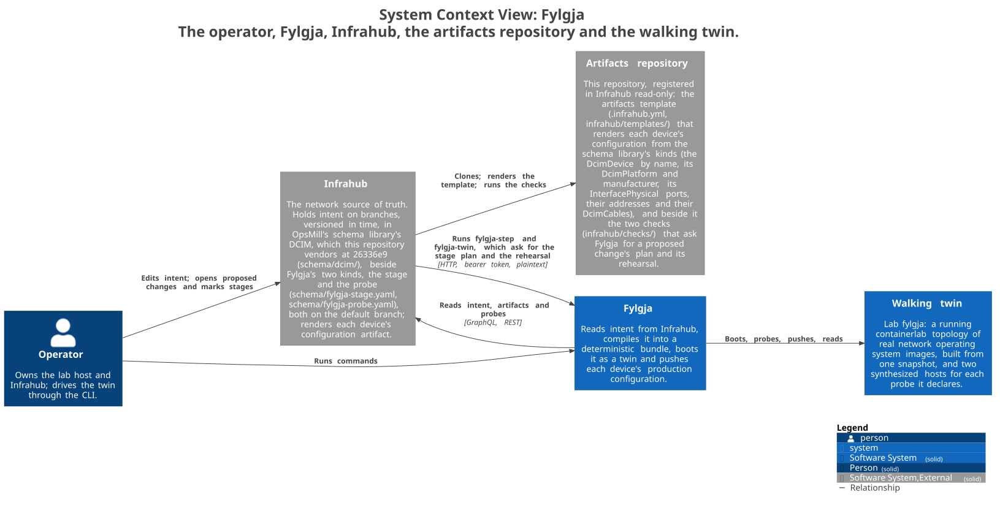
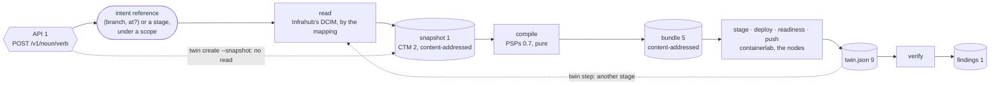
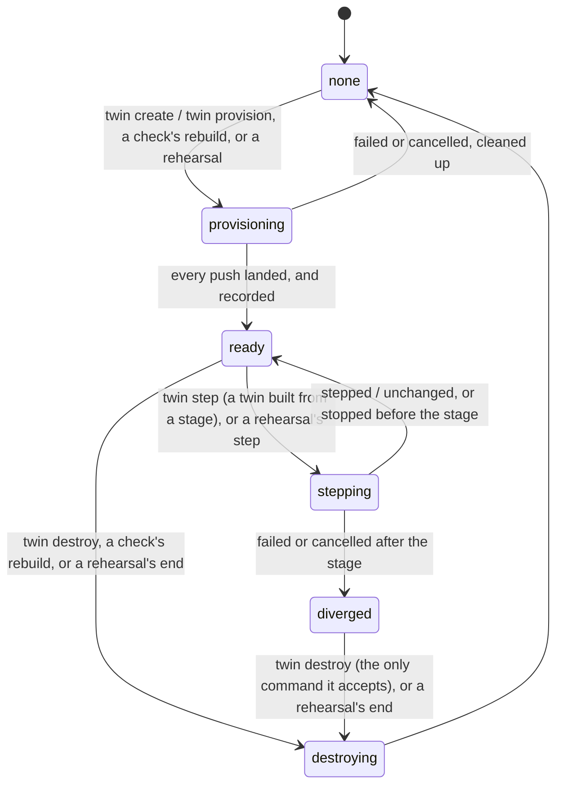
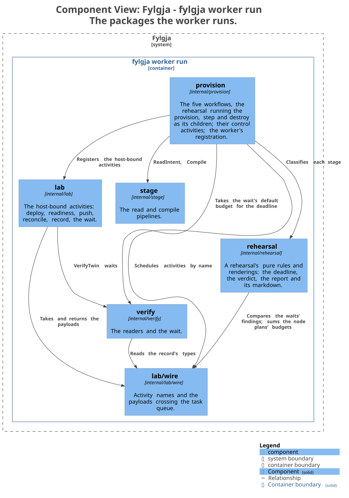
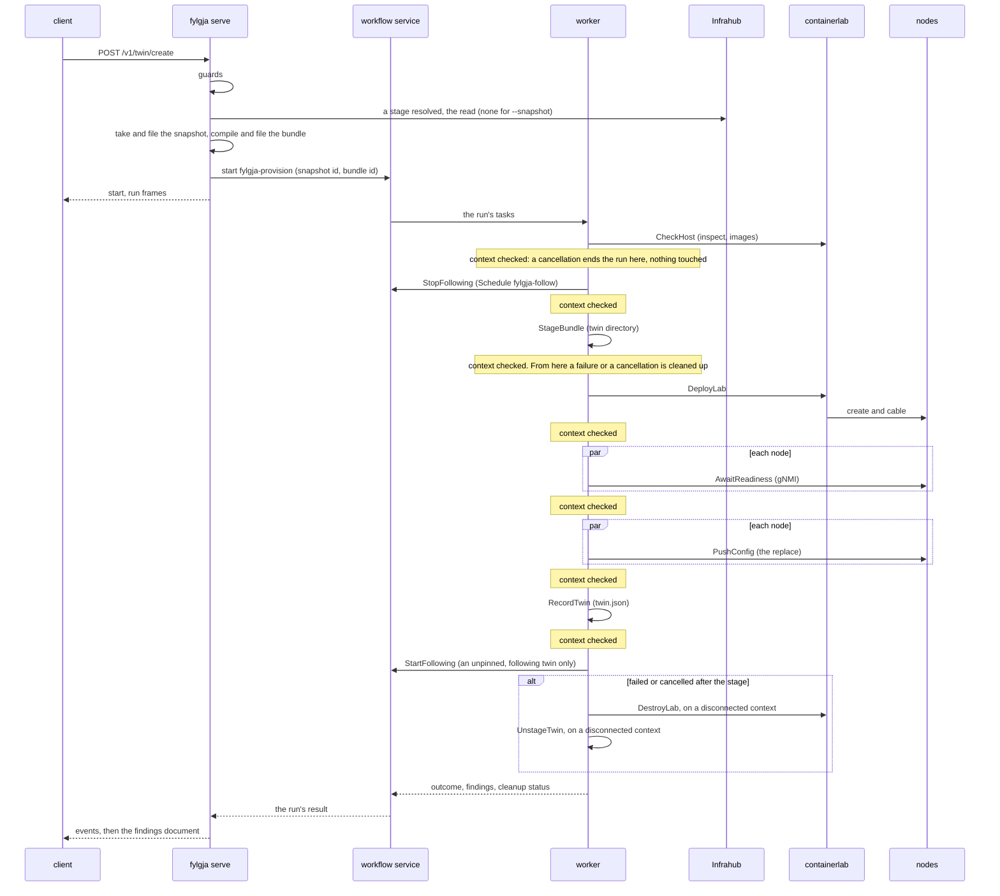
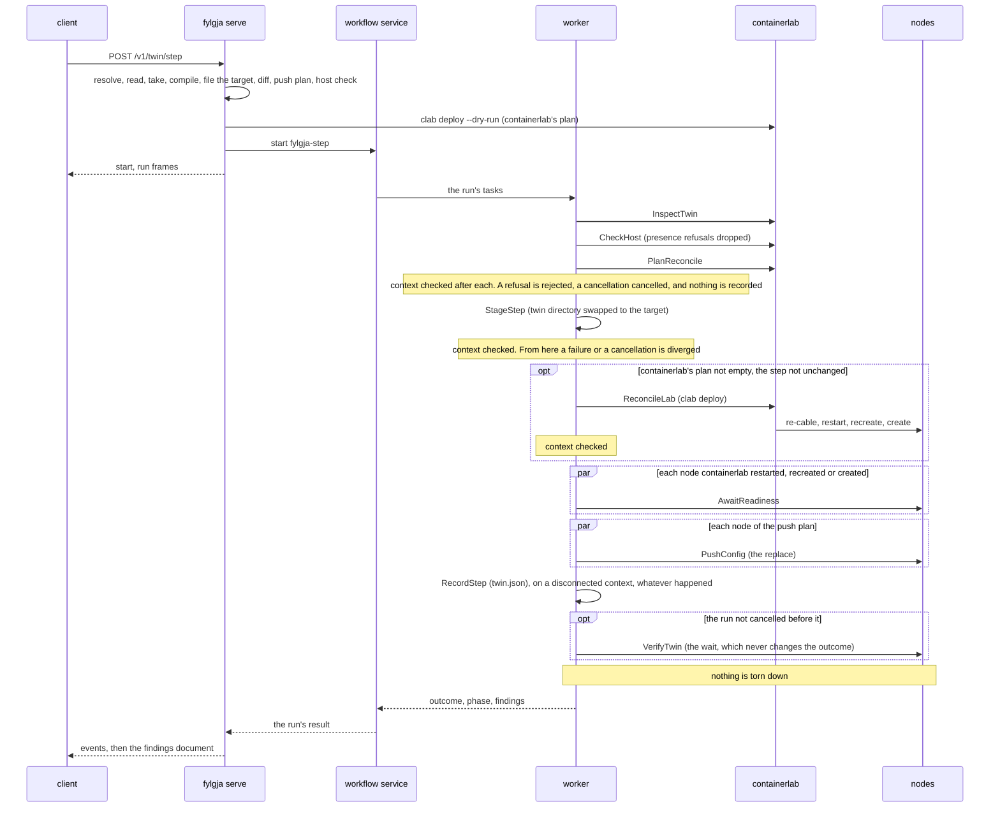
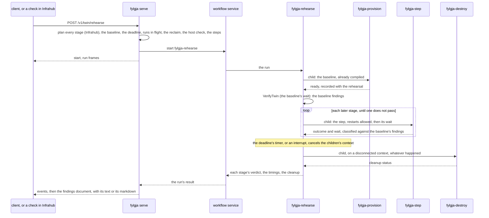
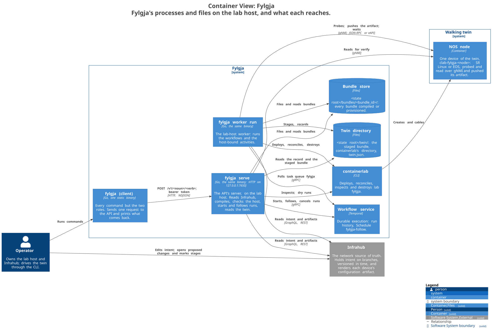
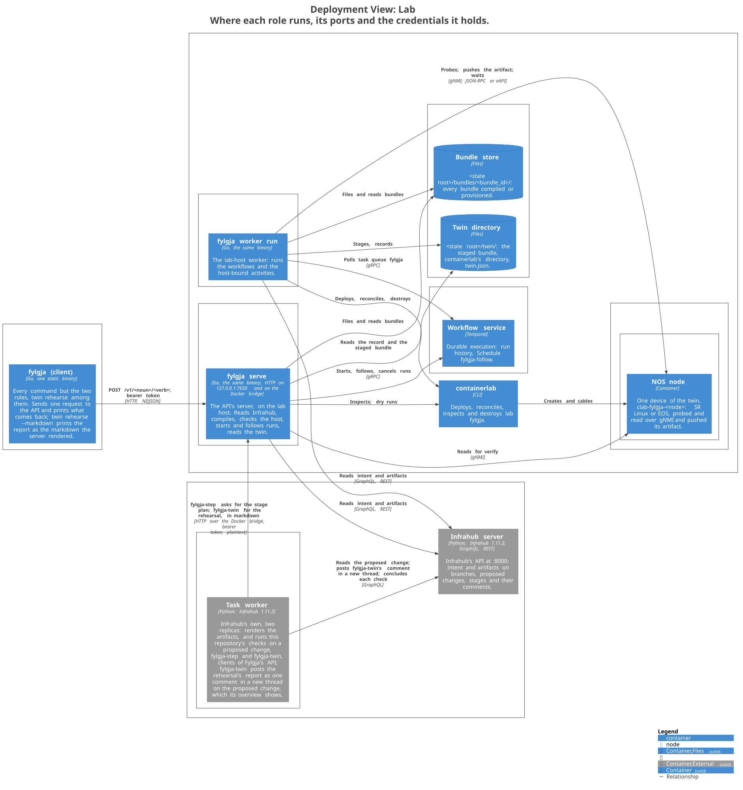
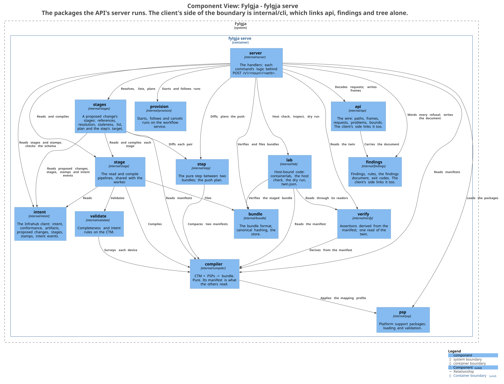

# Fylgja — Architecture

Fylgja reads network intent from [Infrahub](https://opsmill.com/) and builds a
**walking twin** of it: a running virtual topology on real network operating system
images, provisioned with containerlab, built from one Infrahub branch at an optional
point in time. [Temporal](https://temporal.io/) provides durable execution for
provisioning. Fylgja runs one twin at a time.

> Every decision is recorded, with the options it rejected, in the
> [decision log](decisions.md); terms are in the [glossary](glossary.md); conventions in
> the [development guide](development.md).

---

## 1. Claims that shape everything

**The unit of intent is a branch at a point in time.** Infrahub versions the source
of truth itself, so intent has an address: the **intent reference** `(branch, at?)`,
or a **stage** that names one. With `at`, a twin is pinned and reproducible bit for
bit. Without it, Fylgja reads the branch head and records when it looked
([D-012](decisions.md#d-012)). A stage is a moment of an Infrahub proposed change,
`<branch>/<label>`, named by its source branch, and it always resolves to a pinned
`(branch, at)`. Every proposed change has two stages derived, its branch point and its
head, and the operator marks the moments between; a mark's `at` is either the one written
on it or the moment Infrahub recorded its writing. So a proposed change's stages tell the
change as a story whose every chapter can be built again ([D-045](decisions.md#d-045)).

**A walking twin is an environment, not a verdict.** The product is the running
topology. Verification, reporting and proposed-change integration are consumers of it,
and nothing in the core acts on them. From M12 `twin verify` reads the running twin
against the intent it was built from and reports what it found, and no Fylgja operation
reads that report ([D-039](decisions.md#d-039)). From 015 a **rehearsal** builds a proposed
change's stages on one twin in turn, verifies each and destroys the twin, and a check of
Infrahub's posts its report on the proposed change; its verdicts are advisory too, and only
the check's conclusion, which Infrahub's own merge rule reads, gates anything
([D-051](decisions.md#d-051), [D-052](decisions.md#d-052)). There is one twin at a time, and
its state lives where it already is — in containerlab and on disk — not in a database
of Fylgja's own ([D-013](decisions.md#d-013), [D-014](decisions.md#d-014)).

**A walking twin walks.** A pinned twin is frozen at its instant. A twin built from an
unpinned reference follows its branch: every interval a check reads the branch, compiles
it, and rebuilds the twin when its `bundle_id` has moved
([D-026](decisions.md#d-026)). That is what makes the twin live with respect to intent,
and it is the behaviour the name promises: a fylgja is the spirit that accompanies a
person. `--no-follow` builds a frozen twin instead ([D-027](decisions.md#d-027)).

**Fylgja never renders configuration.** A twin fed by a Fylgja-owned template tests a
different artifact than the one production receives. Per-node bootstrap — hostname,
cabled ports enabled, discovery on — comes from the platform support package;
everything else a node runs is an artifact Infrahub rendered for the branch under test
([D-009](decisions.md#d-009)). Those artifacts enter the bundle at read time, so
`bundle_id` covers configuration ([D-028](decisions.md#d-028)).

**Platforms are data, and any single twin is heterogeneous.** A slice of a real
network spans vendors. Adding a platform is a data change — a Platform Support
Package — never a compiler change, and no component may assume all nodes share a
vendor ([D-016](decisions.md#d-016)).

**Intent is not reality; the control plane is faithful and the hardware data plane is
not.** Infrahub describes what the network *should* be; hardware drifts. Containerized
NOS images run the real routing stack and reproduce no silicon. Every bundle carries a
**fidelity manifest** — modelled exactly, approximated, stubbed, omitted, and
software- versus hardware-forwarding per platform — and every result carries the
unstated precondition "assuming production matches intent"
([D-022](decisions.md#d-022), [§6](#6-known-limitations)). The manifest asserts
forwarding per platform, one entry for each package in the bundle, so a twin of two
vendors states each vendor's answer ([D-025](decisions.md#d-025)).

---

## 2. The pipeline

**Who touches what.** The operator edits intent in Infrahub, opens proposed changes and
marks their stages there, tags the devices a twin is of, and runs Fylgja's commands. Fylgja
reads intent, the tagged devices of the schema library's DCIM by one documented mapping
([§4.1](#41-intent-reader)), and the rendered artifacts from Infrahub over GraphQL and REST,
then boots the walking twin, probes it,
pushes each node its artifact and reads it back. Infrahub renders each artifact from the
artifacts template, which it clones from the artifacts repository: this repository,
registered there read-only ([§4.1](#41-intent-reader), [D-044](decisions.md#d-044)). From
the same registration its task workers run this repository's two checks on every proposed
change, clients of Fylgja's API that ask for the plan and the rehearsal, and the second
posts the rehearsal's report on the proposed change ([§4.6](#46-operator-surface),
[D-053](decisions.md#d-053)).



*The system context, derived from [`c4/workspace.dsl`](c4/workspace.dsl) by `make diagrams`.*

**The pipeline's stages and their formats.** Every command enters through the API. A
twin's reference is read under its scope, by the reader's mapping, into a CTM; the server
takes the CTM as a **snapshot**, the core's one input, content-addressed and filed
([D-061](decisions.md#d-061)); the snapshot's CTM is compiled into a bundle, the bundle is
provisioned into a twin and recorded in `twin.json`, and `twin verify` reads the twin
against it. A twin can also be built from a snapshot alone, by its id or as a file, with
no read. Every command's answer ends in the findings document. Each format carries its
version; a step takes a twin built from a stage to another stage of its proposed change by
the same read, take and compile, then reconciles and pushes instead of rebuilding.



| Stage | Input | Output | Pure? |
|---|---|---|---|
| Read | intent reference and scope | CTM, with provenance, the reader's fidelity list and each device's configuration artifact; or findings and no CTM | no — reads Infrahub |
| Take | CTM | snapshot: the CTM wrapped with an empty probe list, its `snapshot_id` the hash of that body without the read's `observed_at`; filed by id in the snapshot store, never overwritten | the id is; the filing writes the store |
| Compile | a snapshot's CTM + PSPs | bundle: deployable topology, bootstrap and configuration artifact per node, manifest | **yes** |
| Provision | bundle | a ready twin on the lab host, each node running its artifact | no — drives containerlab, pushes to the nodes |
| Operate | the twin | show, destroy; reconcile from M4; step from M11, to another stage's bundle without a rebuild; verify from M12, which reads the twin against intent and changes nothing; rehearse from 015, a proposed change's stages built, stepped and verified in turn on one twin, which is then destroyed | no |

Every stage is runnable on its own from the CLI ([§4.6](#46-operator-surface)), through
the API's server, on the same code path as its tests.

---

## 3. Core objects

```
 intent reference ──read──▶ CTM ──take──▶ snapshot ──compile──▶ bundle ──provision──▶ walking twin
   (branch, at?)             (envelope:    (the CTM and an       (manifest:            (lab "fylgja" +
   under a scope              branch, at?,  empty probe list;     branch, at?,          twin directory:
                              observed_at,  snapshot_id =         schema_hash,          twin.json adds
                              schema_hash,  hash without          scope, mapping;       observed_at and
                              scope,        observed_at)          bundle_id = hash)     snapshot_id)
                              mapping,
                              fidelity)
```

| Object | Identity | Reproducible from | Lives in |
|---|---|---|---|
| Intent reference | `(branch, at?)` as given, or as a stage resolves it | — | CTM and manifest; a stage's name only in `twin.json` |
| Scope | `tag:<name>`, the request's or the server's default | — | CTM, manifest and `twin.json`, beside the reference |
| CTM | its envelope: `(branch, at?, observed_at, schema_hash, scope, mapping)` and the reader's fidelity list | Infrahub, when pinned | a snapshot's body |
| Snapshot | `snapshot_id`, the hash of its body's canonical bytes without the read's `observed_at` | Infrahub, when pinned, while the branch's history stands | snapshot store, `snapshots/<snapshot_id>.json` |
| Bundle | `bundle_id`, hash of canonical bytes | its snapshot's CTM and PSPs, always | bundle store, `bundles/<bundle_id>/` |
| Walking twin | there is one; `fylgja twin show` describes it | never — it is live | containerlab (lab `fylgja`) + the twin directory |
| Lab host | the machine running the worker | — | — |

Rules that follow:

- **A twin is of a scope** ([D-057](decisions.md#d-057)): `tag:<name>`, every device on the
  branch carrying the tag of that name, whatever its status; its ports and cables follow it, and no
  device outside the scope is read. The request names it (`--scope`), or the server's `FYLGJA_DEFAULT_SCOPE`
  does when it names none; every stage a command resolves, reads or plans is read under
  that one scope, and `twin step` and a following twin read under the scope their record
  carries.
- **A snapshot is the core's one input** ([D-061](decisions.md#d-061)). Every create the
  server starts, every stage it plans, steps to or rehearses, and every `intent read
  --out` is taken as a snapshot and filed before anything is compiled, so every workflow
  the core runs but the reconcile is started with a snapshot id and a bundle id, never a
  branch. The same intent read twice, or one stage resolved twice, has one id while the
  branch's history stands ([§6](#6-known-limitations)). A twin built from a snapshot is
  **frozen by rule**: its reference is a document, which does not move.
- **A bundle is deployable as emitted.** It carries the fixed lab name and relies on
  containerlab's default management network; nothing host- or twin-specific is added
  after compilation ([D-011](decisions.md#d-011)).
- **The twin is what containerlab says it is.** Its provenance is the manifest staged
  in the twin directory beside it. There is no registry to fall out of sync
  ([D-014](decisions.md#d-014)).
- **Bundles accumulate; twins do not.** The bundle store keeps every compile by hash,
  so the compile-time diff between two references is always available without a
  second twin. `stage plan` prints that diff between each pair of consecutive stages of a
  proposed change, and `twin step` applies it to a running twin built from a stage.

---

## 4. Components

### 4.1 Intent reader

Typed Go generated by `genqlient` from Infrahub's GraphQL SDL
(`GET /schema.graphql?branch=`, fetched from the default branch, because that
branch carries the schema library's DCIM, the stage kind and its extension). Queries go to `POST /graphql/<branch>`,
with `at` appended as a query-string parameter only when the operator supplied one,
directly or through a stage.

**The mapping** ([D-057](decisions.md#d-057)). The CTM is the contract between a source
of truth and the compiler ([§4.2](#42-canonical-topology-model-ctm)), and a reader maps
one source's model onto it by one documented mapping: which kinds and fields it reads,
what each becomes, with what fidelity, what it refuses and what it omits. It reads nothing
the mapping does not name, and names the reader and the model version in every CTM's
envelope. The Infrahub reader, `infrahub-dcim`, reads OpsMill's
[schema library](https://github.com/opsmill/schema-library)'s DCIM at commit `26336e9`,
vendored byte for byte under `schema/dcim/` with its licence
([`schema/README.md`](../schema/README.md)), by the mapping in
[`specs/017-dcim-reader/contracts/mapping.md`](../specs/017-dcim-reader/contracts/mapping.md).
Nothing is added to anyone's model to key a package or a scope: a DCIM user loads nothing
of Fylgja's but the stage kind. The mapping, in short:

| CTM | Read from | Fidelity |
|---|---|---|
| the scope | every `DcimDevice` carrying the `BuiltinTag` the scope names, whatever its `status` | — |
| a device's name | `DcimDevice.name` | exact |
| its package | the platform's `DcimPlatform.name` and its manufacturer's `OrganizationManufacturer.name`, matched exactly against each package's `platform.matches` ([§4.7](#47-platform-support-packages)) | exact |
| its platform's version | nothing: the library's platform carries none | omitted |
| its artifact | its artifacts, through `CoreArtifactTarget` (below) | exact |
| its ports | every `InterfacePhysical` of the device, by name; an `InterfaceVirtual` is never read | exact |
| a port's `mgmt_only` | its `role` is `management` | approximated |
| a port's `enabled` | its `status` is not `disabled` | approximated |
| a link | a `DcimCable` with exactly two ends, each an `InterfacePhysical` of a device in the scope | exact |

Two queries read the scope, paged by 100: `Devices`, the `DcimDevice`s by the tag's name,
with their platform, its manufacturer and their artifacts; then `Ports`, the
`InterfacePhysical`s by those devices' ids, each with its `role`, its `status` and its
cable through its `connector`, whose `connected_endpoints` give the far ends. The tag is
read by that filter alone, never selected. A cable reached from a port in the scope is
judged once, by its id, and is a link only with exactly two ends, each a physical port of a
device in the scope; any other cable, and any connector that is not a `DcimCable`, is
omitted, never refusing the read, with the first reason that applies: a connector that is
not a `DcimCable` (`omit.cable.kind`), other than two ends (`omit.cable.ends`), an end not
on a physical port (`omit.cable.endpoint`), an end outside the scope
(`omit.cable.outside_scope`). Each is an `info` finding naming the ends it knows, and a
row of the envelope's **fidelity list**, beside three rows every read writes: the two
approximations above and the platform's absent version. The compiler copies the list into
the manifest unchanged and holds no table of any source's rows (Constitution III). What
survives of [D-003](decisions.md#d-003) and [D-004](decisions.md#d-004), which D-057
superseded with
[D-002](decisions.md#d-002)'s generics contract: wiring is derived by the compiler from
what the reader mapped, never declared in a schema ([§4.3](#43-compiler)), and a reader
never claims a meaning the source does not carry, and says so where it approximates.

**Read validates two things before projecting.** Schema conformance: `GET /api/schema`
holds every kind and field the mapping reads as the pinned commit loads them, per kind and
per field (an attribute's kind and optionality, a relationship's peer, kind, cardinality
and optionality, the dropdown choices `management` and `disabled`, the generic
`DcimConnector`'s own `connected_endpoints`, which the read selects through it, and the
generics' `used_by`), each difference a rejection naming the commit (`schema.kind.missing`,
`schema.field.missing`, `schema.field.mismatch`, `schema.choice.missing`,
`schema.used_by.missing`), and nothing beyond the table reported, so a branch may carry
kinds and fields of its own. Then data completeness, strict inside the scope: a scope that
selects no device (`scope.empty`), a device with no platform or a platform with no
manufacturer (`platform.missing`), and one whose pair no package names
(`platform.unmatched`). Every finding comes in one pass, and a failing read produces no
CTM. `fylgja schema check` runs the conformance half alone and, on success, says
`conformant with opsmill/schema-library@26336e9: DcimDevice, DcimPlatform,
OrganizationManufacturer, InterfacePhysical, DcimCable, DcimConnector`, the last the generic
whose `connected_endpoints` the read selects through its interface.

**The read fetches each device's configuration artifact** ([D-028](decisions.md#d-028)).
The `Devices` query lists the device's artifacts through a fragment on the
`CoreArtifactTarget` interface, which conformance holds the device kind to inherit. The
device's support package names the one artifact
that is its configuration and the content types it accepts. The read takes the one
artifact of that name, requires it `Ready`, fetches its bytes from
`GET /api/storage/object/<storage_id>`, and verifies them against Infrahub's own
checksum, the MD5 of the content. A device with no such artifact, with several, with
one not `Ready`, of a type the package does not accept, not served, or whose bytes do
not match is refused, naming the device and the artifact and never a byte of the
content. Fylgja never generates an artifact: that is a write to Infrahub. Infrahub
1.11.2 regenerates nothing on its own either, so whoever changes the branch generates, and a change not yet generated is invisible to the read.

**Time semantics** ([D-012](decisions.md#d-012)). With `at`: passed verbatim on
every query, the artifact listing and the content fetch included; the reference is
pinned, and a pinned read fetches each artifact as it stood at `at` or refuses. Without: no `at` is sent — Infrahub filters on
`created_at <= at`, and pinning a read to a second-granularity local "now" silently
hides objects written that second, a lesson verified against Infrahub 1.11.2.

`observed_at` (UTC, local clock, read start) is recorded on **every** read, pinned or
not, in the CTM file's envelope and, later, in `twin.json` — never in the bundle, so
that the same intent hashes the same whenever it was read
([D-023](decisions.md#d-023), constitution VI). It is informational in every case and
governs nothing when `at` is supplied; on an unpinned read it is the only record of
when the intent was seen, and reproducing that reference via `--at <observed_at>` is
best-effort, which `fylgja twin show` says. The bundle manifest's provenance block records branch,
`at` if supplied, the schema hash Infrahub reports for the branch
(`GET /api/schema/summary`, field `main`), the scope, and the mapping
(`{reader, model, version}`), which is what the retired contract version became
([D-057](decisions.md#d-057)).

**Stages** ([D-045](decisions.md#d-045), [D-046](decisions.md#d-046)). A stage is a
moment of a proposed change, the one unit of change in Infrahub 1.11.2 that a user kind
may relate to. `FylgjaStage` (`schema/fylgja-stage.yaml`) is a Fylgja-owned kind beside
the library, not read by the mapping, loaded on `main`: branch-agnostic, so a mark lands in no branch's
diff; related to its `CoreProposedChange`, required; with a `label` unique within it,
holding no `/` and no whitespace, an optional `as_of` and an optional description. An
extension gives `CoreProposedChange` its `fylgja_stages`. A stage has no branch of its
own: its branch is the proposed change's source, and since Infrahub allows one open
proposed change per source branch, `<branch>/<label>` finds it. Only an open proposed
change's stages are read, draft or not. The operator marks stages; Fylgja only reads them.
Stages replaced M10's waypoints, a branch-agnostic kind that named its branch by free text,
in a series of its own ([D-032](decisions.md#d-032), superseded by D-045).

The stage reader uses the default branch's unnamed endpoints, and every method of it
names no branch but `IntentEvents`, which reads the source branch's event log
(`InfrahubEvent(branches:)`) and that branch's schema (`GET /api/schema?branch=`), to map
each event's kind: `GET /api/schema` first, to check the kind, its attributes and the extension, then
`POST /graphql`. Beside Fylgja's own kind and the mapping's, the stages read five roots
that are Infrahub's and nobody's model, each by a query: `CoreProposedChange` (the open
ones, with their stages), `Branch` (`branched_from` and `created_at`),
`CoreArtifactValidator` (the proposed change's artifact validation, pinned at a mark's or
the branch point's `at` and unpinned for the head), as Constitution III allows from 1.2.1,
`InfrahubEvent` (the source branch's event log since `branched_from`, pinned to nothing),
as it allows from 1.3.0 ([D-048](decisions.md#d-048)), and `CoreGraphQLQueryGroup` (the
template query's internal groups, read on the stamps' branch at their `at`, for the
account that created them: the source branch, or `main` for the branch point and for
`stage.main.moved`, as [mapping.md](../specs/017-dcim-reader/contracts/mapping.md) §6
says), as it allows from 2.1.0 ([D-060](decisions.md#d-060)); the
read-only test names each with its reason, and every operation is still a query.
An event is intent's when its primary node's kind is one the stamps read (`DcimDevice`,
an implementer of `DcimInterface` or of `DcimConnector`, mapped through the branch
schema's `used_by` and never queried, `DcimPlatform` or `OrganizationManufacturer`), and
it creates or deletes the node or changes any attribute, or any relationship but
Infrahub's own (`member_of_groups`, `subscriber_of_groups`, `artifacts`, `profiles`,
`object_template`), which it writes after every generation, its own churn and never
intent; an event with no primary node is skipped.

**The stamps** ([D-058](decisions.md#d-058), [D-060](decisions.md#d-060)). A device's
**intent stamp** is the latest node stamp among the device, every one of its interfaces,
virtual ones included, its platform, its platform's manufacturer and every cable one of
its physical ports is an end of, read under the scope by two queries shaped like the
read's, which select stamps and ids and no value of intent but the names that pick the
package. A node's stamp is its `node_metadata.updated_at`, the latest write among its
current attributes and edges, or its `created_at` when the account that wrote it last is
Infrahub's own: the account that created the internal `CoreGraphQLQueryGroup`s of the
queries the scope's artifacts render through, read by a third query at the stamps'
branch and `at`, and with no such group nothing is left out. A generation adds every node
it reads for the first time to its query's group as that account, seconds after the
checksum moves, and that join is never intent. An intent write by any account, Infrahub's
own included, is still seen by the events. A branch whose schema lacks the kind cannot query
it at all, so the stages are read from `main` and every other read stays on its branch.

A proposed change's stages, in order: the **branch point**, `main` read pinned at the
source branch's `branched_from`, verbatim; the **marks**, each at its `as_of` as written
(`given`) or, when none is written, its label's `updated_at` as Infrahub returned it
(`written`), ordered by `at`; and the **head**, the branch pinned one microsecond after
the later of the latest of every device's intent stamp and every artifact's
`checksum.updated_at`, and the `occurred_at` of its latest intent event, in
Infrahub's own layout, since a read pinned at exactly a stamp sees the node and not the
value. A cable re-ended, a port deleted and a relationship unset move no stamp, and a
cable's delete stamps its two end ports ([verified facts](verified-facts.md)); the event is how the
head moves past the rest ([D-048](decisions.md#d-048)). An event lands in
the log a few seconds after its write, a varying time (half a second to over six were
seen), so a head read in that window is the stamps' and does not see the removal yet; a
mark is judged by each event's `occurred_at` against its `at`, whenever the event lands. `branch-point` and `head` are reserved labels. Every
stage is pinned, and no `at` is composed from a clock of Fylgja's own: each is a stamp
Infrahub returned, or the first instant after one (Constitution VI).

`--stage <branch>/<label>` is resolved before any run starts, by the API's server at step
`resolve`, to a pinned `(branch, at)` and where the `at` came from. The read that follows
is the pinned read above, unchanged, with that `at` verbatim on every query. A refused
resolution reads stamps and never a value of intent: the kind or its extension absent
(`stage.kind.absent`); no open proposed change on the branch, or no such stage of it
(`stage.unknown`); a branch whose schema does not conform, the source branch or the
destination, with the read's own findings (`schema.*`), each branch checked once per command
before its stamps are first read, since they select the library's kinds; a mark carrying a
reserved label (`stage.label.reserved`); the head of a scope that selects no device on its
branch, with no intent event to name its `at` (`scope.empty`); a stage with no `at` at all
(a mark with neither `as_of` nor its label's stamp, a head whose devices carry no stamp and
no intent event, a branch point with no `branched_from`), or a given one later than now
(`stage.at.unresolved`); more than six fractional digits (`intent.at.precision`); an `at`
before the branch point (`stage.at.before_branch_point`), which names the rebase when
`branched_from` has moved past the mark while `created_at` has not, since a rebase
re-stamps the branch, discards its history from pinned reads and so refuses every earlier
mark at once. The server's
clock is read once per resolution and compared with a given `as_of` alone, never with a
stamp Infrahub returned, and never sent.

**A stale stage is refused** ([D-046](decisions.md#d-046), [D-048](decisions.md#d-048),
[D-058](decisions.md#d-058)), per device: a device is stale at a stage when its intent was
written later than its generation stamp. Its intent was written at the later of its intent
stamp (above), pinned at the stage's `at`, and the latest intent event no later than the
`at` that names it (by the id of the device, one of its interfaces, its platform, its
manufacturer or one of its cables as read at the stage, as the event's node or a peer of
its relationships). Its generation stamp is the later of its artifact's
`checksum.updated_at` (the artifact its package's `config.artifact_name` names) and the
proposed change's artifact validator's `completed_at` value. `stage.artifact.stale` names each such device and both remedies, a
generate or the proposed change's checks, and says to mark again. The validator counts
because a regeneration to identical bytes moves no checksum, while a run-check completes
the validator either way. Two warnings refuse nothing: `stage.main.moved`, when `main`'s
latest stamp is later than `branched_from`, read as the head is; and `stage.orphaned`, a
stage that names no proposed change. On a `main` that holds the library and no device
carrying the scope's tag, as the development host's does, the branch point is refused
`scope.empty`, like any read whose scope selects no device, and a plan goes on. A stage's name enters neither the CTM
nor the bundle. Without the kind, only the stage surfaces refuse, and `schema check`
reports whether the default branch has the kind and its extension.

**What an install loads.** On a greenfield Infrahub, the fixture tool's `-prepare-main`
loads the vendored library on a `main` that holds none of its kinds, then the stage kind;
a `main` that already holds any of the library's kinds is its operator's, and is refused,
loading nothing. `fylgja schema check` says whether a branch's DCIM is the one the reader
reads. The library calls itself experimental, so the commit is pinned, and moving it is a
change to the mapping's table, verified against the running Infrahub; a DCIM that has
diverged from the commit needs a reader of its own ([D-057](decisions.md#d-057)).

### 4.2 Canonical Topology Model (CTM)

The body of the core's input, the snapshot (below), and, from 017, **the contract**
between a source of truth and the compiler ([D-057](decisions.md#d-057)): a thin,
branch-addressed projection of intent,
versioned by `ctm_version`, `2` from 017, which a reader fills by its mapping
([§4.1](#41-intent-reader)). A device is its name, its platform as a package (the
package's `platform.id`, and a version the Infrahub reader never writes), its ports (name,
`mgmt_only`, `enabled`, `link`) and its artifact; a link is two ends, each a device and a
port. The envelope carries `(branch, at?, observed_at, schema_hash, scope, mapping)` and
the reader's fidelity list, every approximation and omission the mapping made, which the
compiler copies into the manifest unchanged. `twin compile` refuses a CTM of another
version, or declaring none (`ctm.version.unsupported`, naming both), and nothing converts a
`1`; a file leaving out its fidelity list, its links or a device's interfaces is refused
naming it, never read as `[]`. Two jobs
justify it ([D-010](decisions.md#d-010)): **synthesized nodes** — boundary stubs, service
mocks, later traffic generators are not in any source and cannot live in types generated
from one — and **insulation** of the compiler from each source's model. Every
object carries **provenance**: `intent`, `observed`, or `synthesized`. Everything is
`intent` today. From M5 each device carries
its configuration artifact: name, content type, Infrahub's checksum and the content,
but no Infrahub identifier or generation time, so a regeneration to identical bytes
moves nothing. The artifact reaches the compiler only this way, which keeps it pure.

**The snapshot** ([D-061](decisions.md#d-061)). From 018 the CTM travels wrapped, CTM `2`
unchanged inside a snapshot, version `1` ([`snapshot.schema.json`](../contracts/snapshot.schema.json)):
`snapshot_version`, `snapshot_id`, the take's `observed_at`, equal to the CTM's, the `ctm`,
and `probes`, a list required and empty until probe declarations are defined. The
**snapshot id** is the SHA-256 of the body's canonical bytes, `{"ctm": …, "probes": []}`
with the CTM normalised and its envelope's `observed_at` left out, indented two spaces and
ending in a newline, by the rule the manifest uses for `bundle_id`
([D-023](decisions.md#d-023)). Nothing else is left out: the branch, the `at`, the schema
hash, the scope, the mapping, the fidelity list, every artifact and the probe list are
hashed, so two reads of one intent share an id whenever they were read, and any change of
intent moves it. The bytes hashed are not the bytes stored, which carry the id and
`observed_at`; the schema gives the recipe that recomputes the id by hand. A snapshot is
read strictly, its version first: one of another version, or declaring none, is
`snapshot.version.unsupported`; an unknown key, a missing `ctm` or a non-empty `probes` is
`snapshot.invalid`; a declared id the body does not hash to is `snapshot.id.mismatch`,
naming both; and the inner CTM is refused under its own rules, its object prefixed
`ctm.`, and for its `observed_at`, none recorded (`data.required.missing`) or one not of
its form (`snapshot.invalid`), before anything is filed, since the id leaves `observed_at`
out and such an entry could not be read back. The server files each snapshot under its id in the **snapshot store**
(`snapshots/<snapshot_id>.json`, [§4.5](#45-lab-host-containerlab-and-the-twin-directory)),
behind an interface of the bundle store's shape that never overwrites: two takes of one
intent keep one document, the first. `fylgja intent read --out` writes the read as a
snapshot and files it too; a bare CTM is compiled by wrapping it by hand, `{"snapshot_version":
"1", "ctm": …, "probes": []}`, its id and `observed_at` left for the server to fill. A
snapshot holds the configuration artifacts its CTM holds, so it lives in the store and
crosses as a file, never in a finding, a log line or a document, which name its id alone.

### 4.3 Compiler

A snapshot's CTM → bundle. **A pure function**: no I/O, no clock, no environment, enforced by a
test ([D-011](decisions.md#d-011)). It compiles the CTM inside the snapshot and nothing
of the wrap, so the three fixture CTMs, wrapped under `testdata/snapshot/`, compile to the
three goldens byte for byte, as the bare CTMs do. Purity is what makes the highest-risk logic
in the system — interface mapping — golden-file testable with zero infrastructure.

A bundle is one directory:

| File | Contents |
|---|---|
| `topology.clab.yml` | lab name `fylgja`; every node with platform and image; every cabled link between node ports; containerlab's default management network |
| `configs/<node>.<startup_format>` | bootstrap per node from the PSP: hostname, cabled ports enabled, link-layer discovery on, under the package's comment marker. No addresses, no production configuration. From M7 the package says how it reaches the node — containerlab applies it at deploy, or the push sends its lines ahead of the artifact's ([§4.4](#44-provisioner--temporal)) |
| `configs/<node>.<artifact_name>` | from M5, the node's configuration artifact as Infrahub rendered it, bytes unchanged (`configs/n1.device-config`). Pushed after boot; never rendered or reordered by Fylgja |
| `manifest.json` | bundle format version (`5` from 017, `4` from M12, `3` from M7); the provenance block `(branch, at?, schema_hash, scope, mapping)` — never `observed_at`; platform per node, its `artifact` entry (name, content type, checksum, size, file) and its `bootstrap` entry (the file, and whether it is applied at deploy or pushed); the interface mapping table (production name → node port, the node's own name for the port as `node_name` on every row and `null` on a row with no port, `mgmt_only`, from M12 intent's `enabled`, disposition: cabled / management / configured-not-cabled / omitted); the fidelity manifest, which states that fidelity is asserted, not measured, and carries `production_forwarding` as one entry per platform in the bundle; everything omitted and why; `fidelity.lossy`, every lossy mapping and every shared port with the rule that decided it and the interfaces it shares with; from 017 `fidelity.read`, the reader's fidelity list copied from the CTM unchanged |

The bundle is **deterministic** (same CTM and PSPs → byte-identical files, stable
ordering everywhere), **self-describing** (provisioning needs nothing outside the
directory), **deployable as emitted** (no binding step), and therefore
**content-addressed**: `bundle_id` is the hash of its canonical bytes, and a changed
`bundle_id` is the drift signal for reconcile. The artifacts are among those bytes, so a
configuration change moves `bundle_id` as a topology change does. `twin provision`
refuses a bundle of any other format than `5` (`bundle.version.unsupported`, naming both):
a `1` carries no artifacts, a `2` asserts one forwarding value for every node in it and
names no bootstrap entry, a `3` carries no `enabled`, so `twin verify` would assert a
port intent disables, and a `4` names the retired contract version where a `5` names the
scope and the mapping. Every mapping row carries `node_name`, `fidelity.lossy` and
`fidelity.read` are always present, and an empty list is written `[]`; `fidelity.production_forwarding` has one entry
per platform ([D-025](decisions.md#d-025)), and each node a `bootstrap` entry naming its
bootstrap file and how that file reaches the node.

Sub-problems, in the order they kill projects like this:

- **Interface mapping** (M6). Production `Ethernet1/49/1` on a chassis with breakouts
  must become a port on a container with no linecards. The PSP's Interfaces facet is a
  declarative **mapping profile**: an ordered list of named rules, each a `match`
  pattern over the production name with per-placeholder `ranges`, the containerlab
  `port` it renders, the `node_name` the node's operating system calls that port, a
  `lossy` flag checked against the placeholders `port` drops, and optionally a
  `breakout.parent` naming the parent from the child's values. One rule is the
  management rule; it decides the `mgmt_only` interface whatever it is called. The
  first rule whose `match` fits decides, and a value outside a range is out of range
  under that rule, never passed to a later one. One-to-one, one-to-one under another
  name, many-to-one, spreading and collapsing breakout and management are all data.
  The lossy paths are proved by a test-only package with EOS-style naming
  (`testdata/psp/lossy/chassisos.yaml`): cEOS is **not** the lossy case, since it
  carries production's names one to one, so neither shipped platform is lossy
  ([D-021](decisions.md#d-021)).
  - The compiler applies the profile per device in one function that validation calls
    too, so both word every refusal alike, and branches on nothing a package is; a test
    greps its sources for platform names.
  - Interfaces of one device that render one port share it. With one of them cabled
    the others are omitted (`omit.interface.shared`); with none cabled they all keep
    the port; two cabled is `interface.port.collision`. A cabled breakout parent
    beside a cabled child is `interface.breakout.parent_cabled`. A name no rule matches
    is refused (`interface.rule.unmatched`, or `interface.unmappable.linked` when it
    terminates a link); a name matched out of range is omitted when uncabled
    (`omit.interface.unmappable`) and refused when cabled. Every refusal comes in one
    pass with every other, and no bundle is written.
  - Every interface a lossy rule decided and every shared port is recorded in
    `fidelity.lossy`. Bootstrap's `{interface}` renders the node's own name for the
    port. Unmappable interfaces are reported, never dropped.
- **Wiring derivation** ([D-057](decisions.md#d-057)). Every interface is a port, since
  the reader reads physical ports alone: cabled when it terminates a link,
  configured-not-cabled otherwise, and the `mgmt_only` one maps onto the PSP's management
  interface name, a second omitted (`omit.mgmt.extra`). A link with a `mgmt_only`
  endpoint is omitted and recorded (`omit.link.mgmt_only`). No interface kind reaches the
  CTM, so nothing is rejected for one: the `iftype` discriminator, its loopback, SVI and
  subinterface values and their rejections were retired at 017 with
  [D-003](decisions.md#d-003).
- **Image selection.** The device's package → image reference with a fidelity rating
  (*exact*, *near*, *approximated*, *stub*) from the PSP; the platform's version, which the
  Infrahub reader leaves out, selects nothing. A locally imported image is
  supplied through the PSP override directory, not through a bundle parameter.
- **Synthesized nodes.** Added to the CTM before compilation; never looked up by the
  compiler; always in the fidelity manifest.
- **Secrets.** No credential appears in a bundle or a finding. The Infrahub token
  comes from the process environment and is never persisted. A configuration
  artifact's bytes are treated as a secret outside the places they must be: the
  snapshot (the store's, and the file `intent read --out` writes), the bundle store, the
  staged bundle and the node. No finding, log line,
  workflow payload, `twin.json` or `twin show` output carries them.

### 4.4 Provisioner — Temporal

Provisioning is long, multi-step, and holds real resources: containers, veth pairs,
host memory. A run that dies at step five of eight must resume, and what it created
must be reclaimed. Temporal supplies durability, retries, heartbeats and history
([D-006](decisions.md#d-006)). Fylgja uses it for exactly that and no more: **short
workflows with fixed IDs** ([D-007](decisions.md#d-007)): `fylgja-provision` and
`fylgja-destroy`, the `reconcile` check, `fylgja-step`, which waits for the twin to
settle after its record, and `fylgja-rehearse`, which runs the other three as its children
under a deadline and ends in the destroy ([D-051](decisions.md#d-051)).

**The twin's states.** There is one twin or none, and what a command may do depends on
which state it is in:



`twin create` and `twin provision` start only from `none`, and are refused otherwise,
naming the twin, the lab or the run that holds the host. `twin show` and `twin verify`
answer in every state; with no twin, `verify` refuses as `verify.twin.absent`. `twin step`
starts only from `ready`, and only on a twin built from a stage. `twin destroy` takes a
`ready` or `diverged` twin down, and during `provisioning` or `stepping` cancels the run
and waits for its cleanup or its record first. A following twin's check rebuilds it by a
destroy and a provision of its own. A rehearsal starts from `none`, or from a twin its own
dead run left behind, which it reclaims first, and ends in `none`; while it runs, its
children hold the twin, `twin create`, `twin provision` and `twin step` are refused, and
`twin destroy` cancels it and waits for its destroy. `twin show` names the state: a `ready` twin by its kind
(pinned, frozen, following, or from a bundle), a diverged one as kind `diverged`, no twin
as `none`, and a run in flight by its step.

```
 provision  (workflow ID fixed: fylgja-provision; started by twin create with the snapshot taken, compiled and filed)
   CheckHost ─▶ StopFollowing ─▶ StageBundle ─▶ DeployLab ─▶ AwaitReadiness ─▶ PushConfig ─▶ RecordTwin ─▶ StartFollowing
        (every run starts already compiled, at CheckHost: a create's from a branch, a stage or a
         snapshot, with its snapshot id and bundle id; twin provision <bundle-dir>'s with the stored
         bundle; a rebuild's with the check's bundle. A history recorded before 018 begins
         ReadIntent ─▶ Compile, a branch the workflow keeps so that it replays;
         AwaitReadiness and PushConfig run once per node, concurrently;
         StartFollowing only for a twin that follows its branch)
        on failure or cancellation from StageBundle on: DestroyLab + UnstageTwin on a disconnected context

 destroy    (workflow ID fixed: fylgja-destroy)
   PlanTeardown ─▶ DestroyLab ─▶ UnstageTwin

 reconcile  (M4; a check, started every interval by Schedule fylgja-follow; workflow ID fylgja-reconcile-<scheduled time>)
   InspectTwin ─▶ RunsInFlight ─▶ ReadIntent ─▶ Compile ─▶ compare bundle_id with twin.json's
     ─▶ if changed: CheckHost on the new bundle (presence refusals dropped)
     ─▶ child destroy (fylgja-destroy) ─▶ child provision (fylgja-provision, already compiled)
        on a failed rebuild: StopFollowing on a disconnected context

 step       (M11; workflow ID fixed: fylgja-step; started by twin step with the target read, taken, compiled and filed)
   InspectTwin ─▶ CheckHost on the target (presence refusals dropped) ─▶ PlanReconcile
     ─▶ StageStep ─▶ ReconcileLab ─▶ AwaitReadiness ─▶ PushConfig ─▶ RecordStep ─▶ VerifyTwin
        (ReconcileLab skipped when containerlab's plan is empty or the step is unchanged;
         AwaitReadiness once per node it restarted, recreated or created; PushConfig once
         per node of the push plan, concurrently)
        from StageStep on, on failure or cancellation: RecordStep on a disconnected context,
        the record diverged; nothing is torn down
        VerifyTwin (M12, under GetVersion("verify")): after every record, stepped,
        unchanged or diverged, on the run's own context; skipped when the run was
        cancelled before it; never changes the step's outcome

 rehearse   (015; workflow ID fixed: fylgja-rehearse; started by twin rehearse with every stage resolved, taken, compiled and filed)
   child provision (fylgja-provision, already compiled: the baseline stage) ─▶ VerifyTwin (the baseline's wait)
     ─▶ child step (fylgja-step, restarts allowed, the default wait), one per later stage in order,
        until a stage does not pass
     ─▶ child destroy (fylgja-destroy), on a disconnected context, whatever happened
        a timer on the run's clock, the deadline, cancels the children's context, and the destroy follows;
        each stage's verdict is internal/rehearsal's, from the child's result and its wait
        against the baseline's; no activity of its own but the baseline's VerifyTwin
```

**Inside the worker.** `internal/provision` holds the five workflows, the five control
activities (`ReadIntent`, `Compile`, `RunsInFlight`, `StartFollowing`, `StopFollowing`)
and the worker's registration. It schedules every activity by the name
`internal/lab/wire` gives it, registers the fifteen host-bound activities `internal/lab`
holds, and its `ReadIntent` and `Compile` read and compile through `internal/stage`, on the
server's code path. From 018 they are the reconcile's alone ([D-061](decisions.md#d-061)):
the read's CTM waits under `bundles/.reads/` between the two, the `Compile` removes it,
and it files no sidecar beside the bundle. A check's read is taken as no snapshot, so a
rebuilt twin names none, until [F-026](roadmap.md#f-026) removes following from the core. The host-bound activities take and return wire's payloads, the only
types that cross the task queue, and `VerifyTwin` waits on the twin through
`internal/verify`, which reads the record's types from wire. The rehearsal classifies each
stage through `internal/rehearsal`, a pure package the server shares for the deadline and
the report.



*The worker's components, derived from [`c4/workspace.dsl`](c4/workspace.dsl) by `make diagrams`.*

- **Singleton by construction.** The fixed workflow IDs mean a second concurrent
  `provision` is refused, naming the run in flight, and a second `destroy` attaches to
  the one in flight and reports its result. `CheckHost` refuses when lab `fylgja` already
  exists — provisioned or orphaned — and says how to clear it
  ([D-013](decisions.md#d-013)).
- **Cleanup survives everything.** Teardown runs on a disconnected context from every
  failure and cancellation path. There is no sweeper: an orphan lab is detected at
  `create` and at worker start, and `fylgja twin destroy` clears it whether or not a
  twin directory exists. For a step, cleanup is the record, not a teardown: a step that
  fails or is cancelled after its stage leaves the twin up and records it diverged
  ([D-036](decisions.md#d-036)). For a rehearsal, cleanup is its destroy child, started
  on a disconnected context from every path.
- **Activities are idempotent and small.** `DeployLab` checks for the lab before
  deploying; `DestroyLab` tolerates absence; activities pass paths and hashes, never
  bundle bytes — Temporal caps payload size.
- **Slow activities heartbeat.** `DeployLab` and `AwaitReadiness` run for minutes,
  with start-to-close budgets and readiness timeouts from the PSP, never a global
  constant. `PushConfig` heartbeats too, under the package's push budget.
- **Workflow code is deterministic.** No I/O, no `time.Now`, no randomness.
- **One task queue, `fylgja`,** until the host move. Host-bound activities live in
  their own package so the boundary stays visible in code
  ([D-015](decisions.md#d-015)).

**Readiness** ([D-029](decisions.md#d-029)). Each node is probed on its
management plane by the probe its package declares — gNMI, with or without TLS, on the
port and under the encoding the package names. A package may also declare that
readiness waits for the transport its push will use: once the probe answers, the step
opens a connection to `<scheme>://<address>:<port>` and closes it. Only a scheme and a
port cross the wire for that, never a login. cEOS asks for it because its gNMI server
answers a second before its eAPI endpoint does, and on that platform the push is how
bootstrap reaches the node at all; SR Linux does not, because its push transport is up
when its probe answers. Both waits live inside the package's one readiness timeout, and a
transport that never opens fails under `readiness.timeout`, naming which of the two did
not come up.

**The push** ([D-028](decisions.md#d-028), [D-033](decisions.md#d-033)). Once every node is ready, the run pushes each node its
artifact from the staged bundle, all nodes at once. The activity takes the twin
directory, the node's address and the artifact's file and checksum, never the bytes. It
re-verifies the staged file's checksum, then delivers it by the mechanism, commit style
and mode the node's package declares, under the package's `push_timeout_s`. Two
mechanisms are implemented, each keyed by the package's `delivery` value and by nothing
else the package is, and both shipped packages declare `mode: replace`. A **replace**
resets the candidate to the baseline containerlab left on the node, sends the bundle's
bootstrap, then the artifact, asks the device for its diff and commits, in one request
with one atomic commit; the device computes the difference, and Fylgja reads none of the
node's configuration back:

- SR Linux (`json_rpc`): one JSON-RPC `cli` request over HTTPS — `enter candidate
  private`, `load startup`, the bootstrap's lines, the artifact's lines, `diff flat`,
  `commit now`.
- EOS (`eapi`): one eAPI `runCmds` request over HTTPS, `format: text`, in a named
  configuration session — `enable`, `configure session`, `rollback clean-config`, `copy
  startup-config session-config`, the bootstrap's lines, the artifact's lines, `show
  session-config diffs`, `commit` — with the session aborted before the next attempt
  when a line is refused.

At create the node holds only its baseline, so a replace lands what a merge would. A
package on `merge` (the artifact merged over bootstrap) still creates, but cannot step. The device's diff is the push
activity's result and lives in the run's history alone: no record, finding, document or
log line carries it. A replace on `json_rpc` whose refusal is cut before its reason asks
the node once more with `commit validate`, which commits nothing
([D-034](decisions.md#d-034), [D-035](decisions.md#d-035)). The twin is `ready` only
when every push succeeded, and `twin.json` records each node's artifact and how long its
push took. A push the node refuses (`push.refused`, not
retried: the same bytes would be refused again) or one that could not be made
(`push.failed`, three attempts in all where a retry can help) fails the run at step
`push`. It names
every node's outcome, then runs the same cleanup as any failure after the host check. A
cancellation during a push waits for it (`WaitForCancellation`), and a push that
finishes after its run's cancellation still ends the run cancelled. The step was added
under `workflow.GetVersion("push")`, so histories recorded before M5 replay without it.
A rebuild pushes too, inside its provision child, and a refused push there is
`rebuild_failed`, which stops following.

**Following** ([D-007](decisions.md#d-007), [D-026](decisions.md#d-026)). A `--branch`
create without `--at` or `--no-follow` ends its provisioning run with one more step, `StartFollowing`,
which creates Schedule `fylgja-follow`. The Schedule holds the branch and the interval
and nothing else. It starts a check every interval, one at a time (overlap `SKIP`), and
never replays intervals missed while the service was down. A worker away for hours costs
one pending check, not one per interval. A create or provision stops any following that
exists once its own host check has passed, so a provisioned twin never inherits one and a
refused create leaves following as it was. `twin destroy` deletes the Schedule first, then
cancels a check in flight and waits for its cleanup. Deleting a Schedule does not stop a
check it already started.

A check always completes, with one of seven outcomes:

- **`unchanged`**: the ids are equal, and nothing is touched.
- **`rebuilt`**: the destroy and the provision ended ready. The new `twin.json` names a
  real `fylgja-provision` run and the check's `observed_at`, and no snapshot.
- **`rejected`**: the read, the compile, or the host check on the new bundle refused.
  Every refusal a host-free check can make runs before the old twin is destroyed.
- **`error`**: a step before the destroy could not run.
- **`skipped`**: there is nothing to compare against (no twin, an orphan, a twin of
  another branch, a pinned twin or one from a bundle), or an operator's run is in flight.
  A check never provisions a twin where there was none.
- **`rebuild_failed`**: the destroy left something, or the provision did not end ready.
  This outcome **stops following**. The host is as the child's cleanup left it, and
  nothing follows until the operator creates again.
- **`cancelled`**: `twin destroy` cancelled the check. The cancelled child cleans up first
  (`ParentClosePolicy: ABANDON`, `WaitForCancellation`), and following is stopped by that
  destroy.

The children run under the operator's fixed IDs, so a create during a rebuild is refused
as `run.in_flight` and a destroy during one cancels it.

`CheckHost` also sums the PSP memory budgets of the bundle's nodes against the host
budget the operator configured (`FYLGJA_HOST_MEMORY_MB`) and refuses with a reason
rather than failing slowly at boot; with no budget set it reports the sum as a warning
and proceeds. The budget is never derived from the host's free memory.

**How a run ends.** A provisioning run always completes, including when provisioning did
not. It returns an outcome — `ready`; `rejected`, refused before the host was touched
(read or compile findings, the host check, a bundle that fails verification); `failed`,
after it; `cancelled`; or `error`, a step that could not run — together with every
finding and the cleanup's status: teardown and unstage each `done`, `nothing`, `failed`
or `skipped`, and anything that remains. Temporal records the run as completed, and the
outcome becomes the document's status, by which the CLI exits. A destroy run reports the
same cleanup status.

**A create, end to end.** The server makes the command's refusals, resolves a stage,
reads, takes and files the snapshot, compiles and files the bundle (or, for `--snapshot`,
fetches the snapshot from the store or files the one sent, with no read), and starts
`fylgja-provision` with the two ids; the worker runs every step from the host check. A
read or compile refusal is the server's document before any run, and an Infrahub that
fails during the read is `operation.failed` at once, with no retry of the worker's. After each step the workflow
looks at its own context, since `CheckHost`, `StopFollowing`,
`StageBundle` and `RecordTwin` do not heartbeat and finish even when the run was cancelled
while they ran. A failure or a cancellation before the stage ends the run with nothing
touched; one from the stage on runs the cleanup:



**Two start options, both silent when missing.** `fylgja-provision` starts with
`WorkflowExecutionErrorWhenAlreadyStarted`: without it the Go SDK swallows the server's
already-started error, and a second `create` would wait on the first run and report that
run's result as its own. `fylgja-destroy` starts with the `USE_EXISTING` conflict policy,
which is what makes a second destroy attach. A destroy that finds a provision in flight
cancels it and waits for its cleanup first. Cleanup waits for a cancelled activity to
stop (`WaitForCancellation`) before tearing anything down. Tier-1 tests pin all three
options; the ordering itself shows only against a live service, because the SDK's test
suite ignores `WaitForCancellation`; each default was seen to misbehave against a live
service. `fylgja-step` starts as `fylgja-provision` does, with
`WorkflowExecutionErrorWhenAlreadyStarted`, pinned by the same kind of test.

**Stepping** ([D-036](decisions.md#d-036), [D-045](decisions.md#d-045)). `twin step`
takes a twin built from a stage to another stage of the same proposed change without a
rebuild. The target is the next stage after the record's, found in the proposed change's
order by the record's label, or the one `--stage` names, forward or back, the head
included once it has moved since the record. A stage of another branch, or of another
proposed change on the same branch, is `step.target.foreign`; nothing after the record's
stage, or its label gone, is `step.target.unknown`; a target that resolves to the record's
own `(branch, at)` is `step.target.current`; and the marks the step passes over are the
warning `step.stage.skipped`, and a record whose stage has moved under it is `stage list`'s
warning `stage.twin.moved`, neither refusing the step. The command's request does
everything that touches nothing first, in the API's server: it reads the host, chooses and resolves the target, reads it, takes and files its
snapshot, compiles it on `stage plan`'s code path, files it, computes the step (`step.Diff`) and the push plan,
runs the host check on the target with the presence refusals dropped, and reads
containerlab's plan (`clab deploy --dry-run --format json` on the store's copy of the
target, with `CLAB_LABDIR_BASE` at the twin directory, which reads containerlab's state
there and writes nothing). Every refusal is made there, before any connection to the
workflow service but one: since 015 it first asks the workflow service whether a rehearsal
is running, whose twin and host the step would otherwise misread as an orphan or a
diverged twin, and is refused `run.in_flight` naming it; its dry run asks nothing. Then it
starts `fylgja-step`, which re-applies the host-bound rules
as second locks and runs:

1. **`inspect`, `host check`, `plan reconcile`**: reads only. A refusal is `rejected`,
   exit 1, and a cancellation is `cancelled`, exit 2; nothing is recorded.
2. **`stage`**: the twin directory's bundle is swapped to the target's. From here the
   host is touched, and every failure or cancellation is **diverged**.
3. **`reconcile`**: `clab deploy` on the target topology, without `--reconfigure`, so
   containerlab applies the change to the running lab: SR Linux re-cables live, a cEOS
   node restarts in place, a node whose image or kind changed is recreated, a new node is
   created. Skipped when the plan is empty or the step is unchanged.
4. **`readiness`**: the readiness probe for every node containerlab restarted, recreated or
   created, all at once, under each node's package's budget.
5. **`push`**: the replace on every node whose artifact or bootstrap changed and every
   node containerlab restarted, recreated or created, all at once. Every push is awaited,
   so the record names each node's outcome.
6. **`record`**: `twin.json`, on a disconnected context,
   whatever happened after the stage.
7. **`observe`** ([D-039](decisions.md#d-039)): the **wait**. `VerifyTwin` reads the
   twin as `twin verify` does, once a second, until every assertion read from a node
   holds (**settled**) or the budget is spent (`expired`, or `incomplete` when a node was
   still unread), and writes how it ended into the record's `step.wait`. The budget runs
   from the record's time: 120s by default, `twin step --wait <duration>` otherwise. It
   runs after every record, a diverged one included, and never waits on the record's
   claims. A `twin destroy` during it cancels it (`cancelled`, recorded), and a run
   cancelled before it skips it. It was added under `workflow.GetVersion("verify")`, so
   M11's step histories replay without it.

A step ends `stepped` or `unchanged` (exit 0), `rejected` (1), `cancelled` before the
stage (2), or `diverged` (4): the twin stays up, the record keeps where it came from and
names where it was going, the phase, and which nodes the push reached, and it accepts only
`twin destroy`. A step whose plan restarts or recreates a node needs `--allow-restart`. No
step tears anything down. **The wait never changes the outcome, exit, status, phase or
timings**: a wait that did not settle adds the warning `verify.wait.unsettled` and nothing
else, and the timings stop at the record. The phases reuse the existing budgets: the
deploy budget for the reconcile, `readiness.timeout_s` for each awaited node,
`push_timeout_s` for each replace; the wait's is the operator's, and its activity is
bounded by it plus 30s.

**A step, end to end.** Before the stage a cancellation ends the run `cancelled` with
nothing recorded; from the stage on, every failure or cancellation is recorded diverged,
and nothing is torn down:



**Rehearsing** ([D-051](decisions.md#d-051), [D-052](decisions.md#d-052)). `twin rehearse
--branch <b>` builds an open proposed change's stages on one twin in turn, verifies each,
and destroys the twin, in one run. The server does everything that touches nothing first:
it plans the proposed change as `stage plan` does, every stage resolved, read, taken,
compiled and filed; takes the first compiled stage as the **baseline stage**, passing over a branch
point refused `scope.empty` alone, as on a `main` with no device in the scope, and refusing
the rehearsal for any other refused stage; sums the deadline (below) and refuses one over
the ceiling (`rehearsal.deadline.unfit`); refuses beside any run in flight; reclaims a
dead rehearsal's twin (below); runs the host check of the baseline's bundle in its own
process; and builds each step's input from the plan's bundles, leaving containerlab's plan
for the run to read. Then it starts `fylgja-rehearse`, whose children are the three short
workflows under their own fixed IDs, so one twin at a time holds as it does by hand:

1. **The baseline**: a `fylgja-provision` child from the baseline's bundle, already
   compiled, as a rebuild's child is, its record naming the rehearsal; then `VerifyTwin` on
   the children's context, so the deadline cuts it too, the wait under its default budget,
   writing nothing into the record. What it still finds failing are the **baseline findings**: the twin before the
   change, reported as warnings and failing nothing.
2. **Each later stage**, in order: a `fylgja-step` child, restarts allowed, with the
   default wait, which reads containerlab's plan itself. Its **verdict** is a pure function
   of the child's result and its wait's failing assertions against the baseline's, by rule
   and object (`rehearsal.Classify`): `passed` when it stepped or was unchanged and its wait
   found nothing the baseline did not; `failed` when it diverged or its wait found
   something new; `error` when the step could not run, was refused by its locks or
   cancelled before its stage, or its wait left a node unread, since nothing was then
   learned about the change. The run stops at the first stage that does not pass, and the
   stages after it are `not reached`.
3. **The destroy**: a `fylgja-destroy` child on a disconnected context, from every path
   but one: a baseline whose `fylgja-provision` could not start because another run holds
   its id touched nothing, and the destroy would tear down that run's lab.

The **deadline** is the stages' budgets summed from their node plans, each the largest of
its package's deploy, readiness, push and destroy budgets over the stage's nodes, plus the
mechanism constants that already bound each activity and the wait's default: 1,980 s for
the three SR Linux stages the fixture tool composes, of which a rehearsal on the
development host uses about 70. A timer on the run's clock enforces it: it cancels the
children's context, a step so cut records the twin diverged
([D-036](decisions.md#d-036)), and the destroy follows. The **ceiling**, 3,600 s, is a constant of Fylgja's own, the operator's patience
as the wait's budget is, and only refuses a rehearsal before any run. The operator's first
interrupt cancels the run as the deadline does and waits for its destroy. The run returns
one result in every case, never an error, and the server makes it the document: `ok` when
every rehearsed stage passed, `nonconforming` (5) when one failed, `error` (2) for an
`error` verdict, the deadline or an interrupt, `failed` (3) when the baseline could not be
built, `unclean` (4) when the destroy left something, whatever the stages did, and
`rejected` (1) when the baseline's provision could not start, another run holding its id,
with `run.in_flight` and no destroy. Nothing
in Fylgja acts on it; a check of Infrahub's maps its status to a conclusion
([§4.6](#46-operator-surface)).

**The reclaim.** The record names the rehearsal whose provision built the twin
([§4.5](#45-lab-host-containerlab-and-the-twin-directory)). A rehearsal that finds a twin
whose record names a `fylgja-rehearse` run no longer running destroys it first, through
the destroy workflow, and says so (`rehearsal.twin.reclaimed`); unlike `twin destroy`, that
destroy cancels nothing: a rehearsal, provisioning or step run begun since the rehearsal
read the runs in flight refuses it (`run.in_flight`, naming the run, no `reclaimed` block).
Any other twin, lab or orphan refuses it as it refuses a create. A rehearsal's run whose
worker is gone does not end by itself: it holds the host, and the next is refused
`run.in_flight`, until the worker returns and it ends in its destroy, or the operator
terminates it and the next reclaims its twin.

**A rehearsal, end to end.** Every refusal is made before the start; from the start the run
ends in its destroy, whatever happened, but when its baseline's provision cannot start
because another run took its id since the server looked: that run touched nothing, starts no
destroy, which would tear down the other's lab, and is `rejected`, `run.in_flight`:



### 4.5 Lab host, containerlab, and the twin directory

The lab host is a machine with Docker, containerlab, the NOS images it needs, one
`fylgja worker run` process and, from M13, one `fylgja serve` process beside it
([D-041](decisions.md#d-041)). The development host is the only lab host until M9
([D-020](decisions.md#d-020)). Fylgja **drives the `clab` CLI with structured
output and does not link containerlab** ([D-008](decisions.md#d-008)).

State lives in containerlab, in three directories under the state root, and in Temporal,
and nowhere else. There is no database ([D-014](decisions.md#d-014),
[D-026](decisions.md#d-026)):

**What runs, and what each part reaches.** The operator runs the client, `fylgja`, whose
every command is one request to `fylgja serve`: `POST /v1/<noun>/<verb>` over HTTP with
the bearer token, answered in NDJSON frames. The server reads intent and artifacts from
Infrahub (GraphQL, REST); starts, follows and cancels runs on the workflow service
(gRPC); takes snapshots and files them in the snapshot store; files bundles in the
bundle store and reads them back; reads a snapshot back for `twin create --snapshot`; reads the record and the
staged bundle in the twin directory; asks containerlab to inspect the lab and for its dry
runs; and reads the nodes over gNMI for `twin verify`. The worker polls the workflow
service's task queue `fylgja` (gRPC); reads intent and artifacts from Infrahub for a
following twin's check alone; files and
reads bundles in the store; stages and records in the twin directory; has containerlab
deploy, reconcile and destroy lab `fylgja`; and probes each node over gNMI, pushes it its
artifact over JSON-RPC or eAPI, and waits on it after a step. containerlab creates the
nodes and cables them. The operator also edits intent in Infrahub and marks stages
there. Infrahub's task workers run this repository's two checks on every proposed change,
and each reaches the server as a client does, over the host's Docker bridge with the API's
token ([§4.6](#46-operator-surface)).



*Fylgja's containers, derived from [`c4/workspace.dsl`](c4/workspace.dsl) by `make diagrams`.*

| | Holds | Read by |
|---|---|---|
| containerlab | whether lab `fylgja` exists, its nodes, their state | `fylgja twin show`, `CheckHost`, `twin verify` |
| the twin directory (`<state root>/twin/`) | the staged bundle, containerlab's working directory, and `twin.json` | `fylgja twin show`, `reconcile`, `twin step` (and containerlab's dry run, for its own state), `twin verify` and the step's wait |
| the bundle store (`<state root>/bundles/<bundle_id>/`) | every bundle ever compiled or provisioned | `fylgja twin provision`, diffing |
| the snapshot store (`<state root>/snapshots/<snapshot_id>.json`) | every snapshot taken or sent, each as first filed | `fylgja twin create --snapshot <id>` |
| Temporal | run history; Schedule `fylgja-follow` (the followed branch and the interval) | the Temporal UI, `fylgja twin show` (following, the last check, runs in flight) |

No database. The bundle store and the snapshot store are directories, each behind a
small interface of one shape, so that object storage can replace them at M8.

The three directories live under one **state root**: `FYLGJA_STATE_ROOT`, by default `local/`
under the working directory, resolved to an absolute path once at start. The worker
prints its root, and from M13 so does the server, so two roles started from different
directories are visibly apart rather than silently looking at different stores. A client
has no state root: it reads no store and no twin directory of its own.

```
<state root>/
├── bundles/
│   ├── <bundle_id>/            a bundle exactly as compiled; hashes to <bundle_id>
│   └── .reads/                 a following twin's check's CTM, between its ReadIntent and its Compile, which removes it
├── snapshots/                  made by the first snapshot filed, never at start
│   └── <snapshot_id>.json      a snapshot as first filed, never overwritten; its body hashes to <snapshot_id>
└── twin/                       present exactly while a twin is provisioned or being provisioned
    ├── bundle/                 a copy of the stored bundle, verified to hash to its bundle_id before deploy;
    │                           a step swaps it for the target's (through .bundle.next and .bundle.prev)
    ├── clab-fylgja/            containerlab's working directory, placed here with CLAB_LABDIR_BASE; root-owned;
    │                           its .state.clab.yaml is what containerlab's plan for a step reads
    └── twin.json               written last (version 9): provenance (the reference read, its
                                schema hash, the scope and the mapping that read it), observed_at
                                (or why it is unknown), snapshot_id (or null), bundle_id, the run, the worker's version, the stage it
                                was built from (its proposed change's id and branch, its label,
                                description and where its at came from; or null), the rehearsal
                                whose run built it (or null), each node's address, its artifact
                                (name, content type, checksum, size; never the bytes), how long
                                its push took and the bundle it holds; the state (ready or
                                diverged), the last step (or null) and the step's wait (or null
                                until it ran)
```

**Where each role runs.** The client runs on the operator's machine with
`FYLGJA_API_TOKEN`, and reaches the server at `FYLGJA_API_ADDRESS` or through an SSH
tunnel to the lab host. The lab host (Ubuntu, Docker, containerlab and the NOS images) runs three
processes: `fylgja serve` on `127.0.0.1:7650` and on the host's Docker bridge,
`172.17.0.1:7650` by Docker's default ([D-050](decisions.md#d-050)), holding the API's
token, Infrahub's token and both node logins; `fylgja worker run`, holding Infrahub's token and both node logins
and no API token; and the workflow service, Temporal's development server (`temporal
server start-dev`) on `:7233`, its UI on `:8233`. The state root (`FYLGJA_STATE_ROOT`)
holds `bundles/`, `snapshots/` and `twin/`, and containerlab runs as a command. Docker runs lab
`fylgja`'s privileged containers, `clab-fylgja-<node>`, each with gNMI on `:57400` over
TLS (SR Linux) or on `:6030` in plaintext (EOS), and JSON-RPC or eAPI on `:443`. Infrahub
runs under Docker Compose on `:8000`, on the lab host or another machine; the checks need
it on the lab host, where its task workers, on Compose's own network, reach the server on
the bridge as `host.docker.internal:7650`, a name the Compose override's `host-gateway`
entry resolves to the bridge's address, given them with the token by that override.



*The deployment, derived from [`c4/workspace.dsl`](c4/workspace.dsl) by `make diagrams`.*

A snapshot holds the artifacts' content, as the bundle does; `twin.json` names them and
holds none. The CTM sidecar, `<bundle_id>.ctm.json`, which every create, dry run and plan
filed beside its bundle until 018, is retired ([D-061](decisions.md#d-061)): no build
writes one, and those already on disk are never read. Stage creates `twin/bundle/`; deploy adds
`clab-fylgja/`; the push reads the staged artifacts; record writes `twin.json`.
Teardown (`clab destroy --cleanup`) leaves nothing root-owned behind, so unstage removes
the directory whole without privileges. A twin directory present in any state is a host
check refusal, except to a step's host check, which drops the two presence refusals
because the twin is there by design.

**A step moves the record** ([D-014](decisions.md#d-014)). Its stage swaps
`twin/bundle/` for the target's, so after a stepped or unchanged step the staged manifest
and `twin.json`'s top level (`bundle_id`, provenance, `observed_at`, stage) are the
target's, and `run` is still the create's. After a diverged step the top level stays the
previous record's, the `step` block names the target, the run and the phase, and each
node's `holds` says which bundle it is last known to run: the target's where its push
landed, `null` for a node containerlab restarted, recreated or created whose push did not
land, and the previous everywhere else. That is not a claim that a push which did not
land left the node untouched. Only `refused` is the node's own answer, and a refused
replace is atomic. A `failed` push (no answer within the budget, a lost heartbeat, a
cancellation) may have committed, as a replace that darkens a node does. So a later
rollback reads each node's `step.pushed[].outcome` beside its `holds`; none is built. A
`3` record reads as a ready twin that has not stepped.

**The record says how the step's wait ended** ([D-014](decisions.md#d-014)).
`twin.json` `5`'s step block carries `wait`: its outcome, budget, reads, `after_s` (seconds
from the record to the end of the read that settled, or of the last read), when it began
and ended, and the assertions still failing, or `null` until `VerifyTwin` writes it. The
activity writes it only when the record's step names its own run, and leaves the rest of
the record as `RecordStep` wrote it. A `4` record reads with its wait unknown.

**The record names the stage** ([D-045](decisions.md#d-045)). `twin.json` `6` carries
`stage` where `5` carried M10's reference, an object or `null`: the proposed change's id
and branch, the label, the description and `at_source` (`given`, `written`,
`branch_point` or `head`), on a pinned, intent-sourced record alone; the step's two sides
carry the same shape. `provenance.at` is the `at` itself and `provenance.branch` the
branch read, `main` for a twin built from a branch point. A record of `5` or earlier reads
as before with no stage: `twin show` calls the twin pinned, and `twin step` refuses it as
unsteppable, saying `fylgja twin destroy` clears it. One that stepped or diverged names each
stage of its step, in `twin show`, `twin verify` and `step.twin.diverged`, as the waypoint
it was, in the refusal's words, never `none`.

**The record names the rehearsal** ([D-051](decisions.md#d-051)). `twin.json` `7` carries
`rehearsal`, `{workflow_id: fylgja-rehearse, run_id}` or `null`: the rehearsal whose
provision child built the twin, kept by each step's record. `twin show` names it on its
kind line and `twin verify` on its first, with the workflow service down too, and it is
how a rehearsal tells a twin its own dead run left, which it reclaims, from the
operator's, which refuses it. A record of `6` or earlier reads with no rehearsal.

**The record names its scope** ([D-057](decisions.md#d-057)). `twin.json` `8` carries the
bundle `5` manifest's provenance verbatim: the branch, the `at` when pinned, the schema
hash, the scope the read was made under and the mapping that read it, `{reader, model,
version}`, in place of the retired contract version. `twin show` ends its record line with
both, and `twin create` prints the same line for the twin it made; `twin step` resolves,
judges and reads its target under the record's scope, a following twin's checks read
under it too, and `stage list` under another scope judges the twin's stage under it for
`stage.twin.moved`, resolving a head record's head once more. A record of `7` or earlier reads with no scope and no mapping: `twin show`
shows its scope unknown, `twin step` refuses it `step.twin.unsteppable`, `twin destroy`
clears it, and `twin rehearse` reclaims it when its own dead run left it. An `8` whose scope
is not `tag:<name>`, which no build writes, is read alike for `twin show` and `twin step`,
naming the value; one whose mapping `twin.json` 8 cannot hold, which no build writes
either, `twin show` shows read by an unknown reader, naming each field it fails, and `twin
step` refuses alike, since a step that diverges keeps the record's mapping in the record it
writes. A following twin
created before 017 keeps a Schedule whose input names no scope: each of its checks' reads is
refused before any connection, `operation.failed` naming `fylgja twin destroy`, since the
read holds every scope to `tag:<name>`.

**The record names its snapshot** ([D-061](decisions.md#d-061)). `twin.json` `9` carries
`snapshot_id`, the snapshot the twin was built from, or `null` for a twin `twin provision`
built from a bundle or a following twin's check rebuilt, neither of which takes one; its
`source` is `intent` for a create from a branch or a stage, `snapshot` for `twin create
--snapshot`, and `bundle` for `twin provision`. `observed_at` is the run's input's read
time: a create's own read, the stored first take for a twin from a snapshot, a check's
read for a rebuild. A step's record names the target's snapshot at its top level, and
each side of its `step` block names its own. A record of `8` or earlier reads with no
snapshot: `twin show` says `snapshot none (record 8)`, `twin step` steps it with a from
side naming none, and `twin destroy` clears it.

**What `twin verify` reads** ([D-038](decisions.md#d-038)). It reads containerlab, the
record and the staged manifest, and writes nothing. Its assertions are derived from the
manifest, whose mapping rows carry intent's `enabled` from bundle `4`: a port intent
disables is still cabled and still enabled by bootstrap, since intent's disabling reaches
the node through the artifact, so verify skips that port and its link and records the
skip rather than asserting either. A node's address is the record's, else containerlab's.
What the record says each node holds is reported as the record's claim, never as a read.
A `3` manifest staged under a twin built before M12 reads with every row enabled.

Image acquisition varies by vendor — public registry, account-gated download plus
`docker import`, licensed, VM-based via vrnetlab — and the PSP records the method
alongside the image. SR Linux is first because its image is public
([D-021](decisions.md#d-021)).

**That method has a run-time meaning.** `public_registry` means the deploy may pull,
under the deploy budget. Any other value says
the image cannot be fetched, so the host check asks the host whether it is there
(`docker image inspect`, once per distinct reference) and refuses the run before
anything is staged when it is not — `host.image.absent`, a rejection naming the
reference, the package, the nodes that need it, how the image is obtained and that
Fylgja will never pull or tag it. **Nothing is ever pulled or tagged on the operator's
behalf**: an imported image is the operator's to place, under exactly the reference the
package names, and the same image under another tag is absent. The worker says at start
whether each such image is present and serves either way, so the state is visible before
a create rather than at the deploy. A bundle whose packages all say `public_registry`
makes no call at all.

### 4.6 Operator surface

CLI first, noun-verb, every stage exposed ([D-019](decisions.md#d-019)). The CLI is a
client of the API, and the API is the boundary of the core
([D-040](decisions.md#d-040), Constitution XI):

```
fylgja serve         [--listen <host:port>]... [--psp-dir <dir>]
                                                  # the API's server, on the lab host beside the worker; serves
                                                  #   every command below but worker run; --listen repeated, on
                                                  #   the lab host loopback and the Docker bridge
fylgja twin create   --branch <b> [--at <ts>] [--no-follow] [--interval <d>] [--scope tag:<name>]
                                                  # all stages; refused while a twin exists; follows unless --at or --no-follow
fylgja twin create   --stage <branch>/<label> [--scope tag:<name>]
                                                  # the same run, pinned to what the stage resolves to; never follows
fylgja twin create   --snapshot <id|file> [--no-follow]
                                                  # the same run from a snapshot, a filed one by its id or a file
                                                  #   sent; no read; frozen by rule, never follows; takes no
                                                  #   --branch, --stage, --at, --scope or --interval
fylgja twin step     [--stage <branch>/<label>] [--allow-restart] [--wait <duration>] [--dry-run]
                                                  # a twin built from a stage to another stage of its proposed change
                                                  #   (the next by default) without a rebuild; --allow-restart when containerlab
                                                  #   would restart or recreate a node; --wait bounds the wait for
                                                  #   the twin to settle after the record (2m0s by default; 0 reads
                                                  #   once); --dry-run changes nothing; reads under the record's
                                                  #   scope and takes no --scope
fylgja twin verify   [--wait[=<duration>]]        # reads the twin against intent: host names, cabled ports,
                                                  #   adjacencies, and the record's claim of what each node holds;
                                                  #   --wait reads again until it conforms (2m0s bare); no run, no
                                                  #   worker; changes nothing; exit 5 when it does not conform
fylgja twin show                                  # the host, twin.json, the kind (pinned, frozen, from a bundle,
                                                  #   following, diverged), the stage a twin was built from and
                                                  #   the step that brought it there with how its wait ended, each
                                                  #   node's artifact, the last and next check, runs in flight;
                                                  #   changes nothing
fylgja twin rehearse --branch <b> [--scope tag:<name>] [--markdown]
                                                  # an open proposed change's stages in turn on one twin: the first
                                                  #   compiled built and verified, each later stepped and verified,
                                                  #   stopped at the first that fails, then destroyed and reported;
                                                  #   --markdown prints the report as markdown
fylgja twin destroy                               # stops following first, cancels a step and waits for its record,
                                                  #   or a rehearsal and waits for its destroy, then removes the twin

fylgja intent read   --branch <b> [--at <ts>] [--scope tag:<name>] --out snapshot.json
fylgja intent read   --stage <branch>/<label> [--scope tag:<name>] --out snapshot.json
                                                  # writes the read as a snapshot, and files it
fylgja twin compile  --snapshot snapshot.json --out <bundle-dir>
                                                  # the pure function on the snapshot's CTM, same code path as the
                                                  #   golden tests; files nothing (--ctm retired at 018)
fylgja twin provision <bundle-dir>                # starts the provision workflow from an existing bundle

fylgja stage list    [--branch <b>] [--scope tag:<name>]
                                                  # every open proposed change's stages, or one's, and what each
                                                  #   resolves to; marks the twin's row, and where a diverged twin
                                                  #   was going
fylgja stage plan    --branch <b> [--scope tag:<name>]
                                                  # reads, takes and compiles each stage; the step between each pair

fylgja schema check  --branch <b>                 # the branch's schema against the mapping's table of the schema
                                                  #   library's DCIM at its commit, kind by kind and field by
                                                  #   field; also says whether the default branch has the stage
                                                  #   kind and its extension
fylgja psp validate  <file>...
fylgja worker run    [--psp-dir <dir>]
```

**Where each command runs.** One binary carries three roles
([D-018](decisions.md#d-018)). `fylgja serve` and `fylgja worker run` run on the lab
host, each a process of its own, from one state root and one environment, to which the
server adds the API's token ([D-041](decisions.md#d-041)). Every other command above is
a **client's command**: one request to the server, `POST /v1/<noun>/<verb>`, which
prints what comes back and exits by the document's status. A client's whole
environment is `FYLGJA_API_ADDRESS` (default `127.0.0.1:7650`) and `FYLGJA_API_TOKEN`
([D-042](decisions.md#d-042)). It reads no Infrahub variable, no login, no state root and
no package directory, and `--psp-dir` is a flag of the two roles alone. The package that
holds the client's commands, `internal/cli`, links `internal/api`, `internal/findings`
and `internal/tree` and nothing else of the module, and
`TestClientReachesTheCoreThroughTheAPIAlone` holds it so. So no flag or variable can make
a client run the core.

- **The server does the work.** Each handler holds a command's logic: the guards, the
  stage's resolution, the read, the take and the compile, the filing, the host check,
  containerlab's dry run, the start, the follow and the closing report. Every refusal is
  the server's, and one made "before any connection" is made before the server connects
  to Infrahub or the workflow service. The server reads containerlab, the twin directory, the bundle
  store and the nodes in its own process, not through the task queue, until M9 moves the
  host. It loads the packages, dials the workflow service and reads Infrahub per request,
  and keeps nothing between two requests.

  **Inside the server.** The handlers, `internal/server`, decode each request and write
  each frame through `internal/api`, which carries the document `internal/findings`
  defines; they word every refusal and write that document through `findings`, and load
  the packages through `internal/psp`. A read and a compile go through `internal/stage`,
  which reads with `internal/intent`, validates with `internal/validate`, compiles with
  `internal/compiler` and files with `internal/bundle`. The handlers take, validate and
  file each snapshot with `internal/snapshot`, which imports the CTM and nothing else of
  the module. `internal/stages` resolves, lists
  and plans: it reads the proposed changes, their stages, the branch point and the stamps
  with `intent`, reads and compiles each stage through `stage`, takes each stage's
  snapshot through the function the handlers hand it, diffs each pair with
  `internal/step` and reads manifests from `compiler`; it also chooses a step's target.
  The handlers also read stages and stamps and check the schema with `intent`, diff a step
  and plan its push with `step`, verify and file a sent bundle with `bundle`, read
  manifests from `compiler`, check the host, inspect the lab and run containerlab's dry
  run with `internal/lab`, read the twin with `internal/verify`, and start and follow runs
  with `internal/provision`'s client. A rehearsal's handler sums its deadline and builds
  the report's block, its stage lines and its markdown with `internal/rehearsal`, which
  imports `findings`, `lab/wire` and `step` alone and holds no I/O, and which the worker's
  workflow imports for each stage's verdict. `lab` verifies the staged bundle with `bundle`,
  reads the manifest from `compiler` and reads the nodes through `verify`'s readers;
  `verify` derives its assertions from the manifest, `validate` surveys each device as the
  compiler does, `step` compares two manifests, and the compiler applies each package's
  mapping profile from `psp`. Every arrow in the view below is an import but `stages`' to
  `snapshot`, which is that function. `findings` and
  `psp`, which nearly every package imports, are drawn from the handlers, the API and the
  compiler alone, and `provision`'s own imports serve the workflows the worker runs; the
  [development guide](development.md#repository-layout)'s import graph has every edge. On
  the client's side of the boundary, `internal/cli` links `api`, `findings` and `tree` and
  nothing else.

  

  *The server's components, derived from [`c4/workspace.dsl`](c4/workspace.dsl) by `make diagrams`.*
- **A read is made under a scope** ([D-057](decisions.md#d-057)). The five commands that
  read intent from a reference, `twin create`, `twin rehearse`, `intent read`, `stage
  plan` and `stage list`, take `--scope tag:<name>`, sent as the request's `scope`; not
  given, the server's `FYLGJA_DEFAULT_SCOPE` stands, which the server alone reads and
  reports at start (`default scope: tag:fylgja`). The server refuses a value that is not
  `tag:<name>` `scope.invalid`, and a request naming none beside a server with no default
  `scope.unset`, both at `start` and before any connection. Every stage one request
  resolves, reads or plans is read under that one scope, and the document's
  `subject.scope` names it. `twin step` takes none: it, and a following twin's checks,
  read under the scope the twin's record carries. Nor does `twin create --snapshot`, which
  reads nothing: the scope is the snapshot's, and `--scope` beside it is
  `snapshot.flags.conflict`, as `--branch`, `--stage` and `--at` are. The checks `fylgja-step` and
  `fylgja-twin` send none, so theirs is the default of the server they reach.
- **An answer is frames**: one JSON object a line (`application/x-ndjson`), the last
  always the findings document. With nothing asked, a command that is one answer is the
  document alone, after the `files` frame that `intent read` and `twin compile` send
  first; a run is its `start`, its `run`, its `event`s and its document, and `twin
  destroy` its `start`, its `event`s and its document, with no `run`. The CLI asks the
  server to render the text as well, and prints each line as it arrives. `twin rehearse
  --markdown` asks for the markdown instead, a third rendering only the rehearsal has, which
  the `document` frame carries beside the text; asked of another operation, it answers as
  the text does. A command that
  ran is a success of the transport, whatever it decided. The transport's own statuses are
  for its own faults: `401` for the token, `404` for a version, a stream, a path under
  `/v1/` that names no operation or is asked with another method than `POST`, a path not
  in its clean form (`//v1/twin/show`) or `/v1` without its slash, never a redirect, `413`
  for the bound, `400` for a request the server cannot read, `409` for a stream already
  open.
- **A run is two requests.** A create, a provision, a step or a rehearsal is one request
  that starts the run and stays open as its progress: a `start` frame, the run's identity,
  its events (a rehearsal's children's among them)
  and its document. The operator's interrupt is the second request,
  `POST /v1/streams/{stream}/interrupt`, delivered to the open one. The first abandons a
  start still waiting for a worker or cancels the run, and the second stops waiting.
  While that request is open, the server holds the channel its interrupts arrive on, and
  nothing else ([D-014](decisions.md#d-014)). A client that goes
  away, or a server that stops, leaves the run running, a start still waiting for a worker
  included. The client then says the API stopped answering and that the run was not
  cancelled, or was asked to cancel once an interrupt had been delivered, and `twin show`
  names the run.
  `twin destroy` is followed the same way and takes no interrupt: its `start`, written
  just before the destroy run is started, opens no stream.
- **The pipeline's stage commands need a server.** `psp validate` and `twin compile` still
  need neither Infrahub nor the workflow service, but the server checks and compiles what
  the client sends it, against the server's packages ([D-019](decisions.md#d-019)). The
  operator's files cross whole, as base64, under a 32 MiB bound. `intent read --out` and
  `twin compile --out` write what comes back to the operator's own disk: the snapshot the
  server took and filed, and the bundle it compiled and did not file. `twin compile
  --snapshot` and `twin create --snapshot <file>` send the snapshot file, which the
  second files. `twin provision
  <bundle-dir>` sends the directory's regular files, which the server verifies and files
  in its store. `psp validate` sends each package. A dry run or a plan files its snapshot
  and its bundle in their stores on the lab host, and nothing fetches either back; `twin
  create --snapshot <id>` reads a filed snapshot there.
- **A client has failures of its own**: `api.unreachable`, `api.token.refused` and
  `api.version.unknown` between it and the server, and `api.transfer.too_large` for a
  request over the server's bound or a frame of the answer over the client's. Each is status `error`, exit 2, with no step. A client whose
  build differs from the server's says so in one line on stderr and goes on.

`twin show` runs in the server's process on the lab host: containerlab and `twin.json` as
the host check reads them, then the workflow service, best-effort under a five-second
budget. With the service unreachable it still reports the host and the record, says
following and runs in flight are unknown, and exits 0. Its record line names the snapshot
the twin was built from beside its bundle, `snapshot none` for a twin `twin provision`
built or a following rebuild made, and `snapshot none (record 8)` for an older record. A
twin built from a snapshot is `pinned at <at>` or `frozen` as its envelope says, never
following, and its kind line ends `built from snapshot <id>`.

`stage list` and `stage plan` run in the server too, and need no lab, worker or
workflow service. The list reads every open proposed change's stages, or the one of the
branch `--branch` names, each with the `(branch, at)` it resolves to and where its `at`
came from, or a warning beside it when nothing names its `at`; it marks the twin's row,
lists orphaned stages after, and refuses nothing but the kind's absence and a reserved
label. The plan reads each stage of one proposed change, takes and files its snapshot,
compiles it on the code path `twin create` uses, files each bundle in the store, and
prints each `snapshot_id` and `bundle_id`; a stage that is refused, a stale one among them, is reported with
its reason and the plan goes on. Between each consecutive pair it prints the **step**:
the nodes, links, bootstraps and artifacts that differ, by presence and checksum, with
`provenance` left out of the comparison. So two stages of an unchanged branch read
`unchanged`, although their ids differ by their `at`s, as the step from a mark made after
the last regenerate to the head always does ([D-045](decisions.md#d-045)); two stages at one
`(branch, at)`, two marks with one `as_of`, share one snapshot and one bundle, since the
label enters neither the CTM nor the bundle, and read `unchanged; the two are one bundle`. Either way `unchanged`
means identical content. A step beside a refused
stage is not computed. The step is a pure function of the two bundles (`internal/step`),
and `twin step` applies it to a running twin.

`twin step` prints the twin it starts from, the target's stage line, the step, then
containerlab's plan with each touched node's package declaration beside it (`reconcile:
restart e1 (added link; arista_eos declares restart); live s1 (added link; nokia_srlinux
declares live)`, or `nothing to apply`) and the push plan with each node's reasons. Its
dry run prints the same lines, the host check's `memory:` and `host:` lines and a verdict,
and changes no lab, container, twin directory or run; like every dry run it files the
target's snapshot and bundle. Every refusal it can make, it makes before any connection to the
workflow service, but a rehearsal in flight, which it asks the service for before reading
anything (015). `twin show` keeps the kind `pinned` for a stepped twin and names the
step on its kind line and in its record block (`stepped from change-1/cabled by run
fylgja-step …; reconcile 3.9s (restart e1); readiness e1 54.8s; push e1 1.6s, s1 2.4s`). A
diverged twin is the kind `diverged`, in one line: where it was going, the run, the phase,
the nodes landed and not landed, where it is, and `fylgja twin destroy clears it`. A step
in flight is named on the kind line, as a rebuild in flight is. From M12 the step line
ends with how its wait ended (`; settled after 2.4s`, `; wait expired after 120.0s (3
failing)`, `; wait not run`), and a step at `observe` is listed under `in flight:` alone,
since its record is already written. `twin step` prints `step observe: settled after 2.4s
(1 read)` after `step record:`, and its closing line ends with the same clause; the dry
run prints the budget (`wait: after the record, until the twin conforms, at most 2m0s`).

`twin verify` ([D-037](decisions.md#d-037)–[D-039](decisions.md#d-039)) runs in the
server's process on the lab host, as `twin show` does, with no run and no worker. It reads
the twin, asks the workflow service best-effort for runs in flight, refuses before any
node is read when there is no twin (`verify.twin.absent`, in the host check's phrase), when a
package cannot be read (`host.psp.missing`, `verify.package.unreadable`) or when a probe
login is unset, then derives its assertions from the staged manifest and reads each path
once, over each node's own package's transport. It reports one finding per failed
assertion and per record claim not held, counts the held ones and names the skips. It
ends `ok` (0), `nonconforming` (5) when every node was read and something failed, or
`operation.failed` (2) when a node could not be read. A diverged twin is verified against
its staged bundle, the target, with its divergence on the first line. `--wait` reads
again every second until every assertion read from a node holds or the budget expires.
Nothing acts on the report: no command, check or step reads it.

`twin rehearse` ([D-051](decisions.md#d-051)) runs in the server as a create does, with the
rehearsal's run in place of the provision ([§4.4](#44-provisioner--temporal)). It prints
the plan's stage lines with the baseline named, then the run as every run prints it, each
stage's child's lines under a `stage <ref>:` line and the destroy's under `destroying the
twin`, then what the destroy removed, one line per stage with its verdict and a closing
line; on a failure, the commands that reproduce it by hand, from `twin create --stage <baseline> --scope <scope>`, the scope every stage was read under, through each `twin step --stage <ref>
--allow-restart` to the failed stage, then `twin verify` and `twin destroy`. Its document
carries a `rehearsal` block: the proposed change, when its stages were resolved, the
deadline and the time used, the reclaim, the run, the baseline findings, each stage's
role, snapshot, bundle, step, wait, verify counts, new findings and verdict, the destroy's cleanup
and the reproduce commands. Its **markdown** is rendered from the document and the plan's
steps between the stages, which the drawing's edges name: a heading
naming the proposed change and the run, a table of the stages, whose column `new
verification failures` holds the wait's failing assertions the baseline's did not have, a
Mermaid drawing, top to bottom, with one box per stage, a failed or erred one outlined red
by a class, and one edge per step naming what it changed and never a line of
configuration, the stages, the warnings, the baseline findings, the reproduce commands
and the fidelity caveat. It is never longer than the 4,092 bytes Infrahub keeps of a
comment: a longer report names each finding by its identifier and object alone, then
leaves whole sections out by rank, and says what it shortened. `twin show` names a
rehearsal in flight with its child and the stage it is at, and a twin by the rehearsal
that built it.

**The checks, inside Infrahub** ([D-049](decisions.md#d-049), [D-052](decisions.md#d-052),
[D-053](decisions.md#d-053)). Beside the artifacts template this repository registers two
checks (`.infrahub.yml`, `infrahub/checks/`), and Infrahub's task workers run both on
every proposed change, draft or not, at its creation and on a re-run of its user checks.
Each is Python glue on Infrahub's runtime and a client of the API, run in no process of
Fylgja's: it finds the open proposed change by its source branch, sends one request to
`FYLGJA_API_ADDRESS` with `FYLGJA_API_TOKEN`, both from the task worker's environment,
reads the frames to the document, and concludes from its status. **`fylgja-step`**
(timeout 300 s) asks for `stage.plan` and logs its text as its message. It fails when a
stage is refused as intent, a branch point refused `scope.empty` excepted, the one rule
the Python holds, when the stages cannot be listed, when the source branch has no
open proposed change, when Fylgja cannot be asked: a variable unset, the API
unreachable, or its token or version refused, and when the plan has not answered by the
check's own deadline, 120 s before its timeout. It writes nothing. **`fylgja-twin`** (timeout 4,260 s) passes a draft, saying it skipped it.
Otherwise it asks for `twin.rehearse` in markdown, passes on `ok` and fails on every other
status, with the report's text as its message either way, and posts the markdown on the
proposed change as one new thread (`CoreChangeThread`, labelled `Conversation`, holding
one `CoreThreadComment`), which the proposed change's overview shows, through the task
worker's own Infrahub client. A thread that cannot be posted is logged and fails nothing.
A host held by a run or a twin (`run.in_flight`, `host.lab.present`, `host.twin.present`)
is asked again every 30 s until the check's own deadline nears. The timeout exceeds the
ceiling by the destroy's budget, the work before the start and a margin, so the run's
destroy ends inside it; when its deadline nears, or Infrahub cuts or cancels it, the check
sends the run's interrupt by a blocking call, since an awaited one does not survive
Infrahub's cut. Infrahub's merge rule reads the conclusion, so a failed stage blocks the
merge, and nothing in Fylgja acts on the rehearsal. The server listens on the host's
Docker bridge so that the task workers reach it
([§4.5](#45-lab-host-containerlab-and-the-twin-directory), [D-050](decisions.md#d-050)).

The API exposes what its clients need and nothing more: no re-attach to a run, no listing
of runs, no fetch of a filed snapshot or bundle. A UI is item 21 of the roadmap's
[backlog](roadmap.md#backlog), and another client of the same API. Infrahub's
proposed-change integration is the two checks above, consumers of the twin outside the
core.

### 4.7 Platform Support Packages

A **PSP** is the declarative bundle that makes one platform supported
([D-016](decisions.md#d-016)). The format is `0.7`, and [`psp/README.md`](../psp/README.md)
documents each field:

| Facet | Contents |
|---|---|
| Identity | vendor, platform family, OS versions covered (the boot half checks the version a node reports against them); and `platform.matches`, the manufacturer and platform name pairs the package is, which the read matches each device against exactly ([§4.1](#41-intent-reader)) |
| Image | containerlab node kind, image reference, acquisition method (read at run time by the host check, [§4.5](#45-lab-host-containerlab-and-the-twin-directory)), memory budget, deploy and destroy budgets |
| Interfaces | the mapping profile ([§4.3](#43-compiler)): ordered named rules (`match`, per-placeholder `ranges`, `port`, `node_name`, a checked `lossy`, optional `breakout.parent`) and exactly one management rule; and the declared mappings, one per kind the profile handles, that the conformance suite holds it to |
| Config | bootstrap template and the `comment_prefix` its generated header is written under; how a deploy delivers the bootstrap (`bootstrap_via`: `startup_config`, containerlab applies it, or `push`, its lines go ahead of the artifact's; under `mode: replace` the push sends it after the reset either way); the artifact that is a device's configuration (`artifact_name`, `artifact_content_types`); how it is pushed after boot (`delivery`, `commit`, `mode`, `push_timeout_s`, and `push`: scheme, port and the names of the login's environment variables). `mode` is `replace`, [D-033](decisions.md#d-033)'s reset to the node's baseline for the delivery, then the bootstrap and the artifact, in one atomic commit, which both shipped packages declare; or `merge`, which creates but cannot step |
| State | collection transport and model mapping (later verification work) |
| Readiness | how to tell the node answers on its management plane: probe, path, encoding, port, `tls` (`false` is plaintext gRPC, which cEOS serves), the names of the login's environment variables; timeout; and `await_push_transport`, whether readiness also waits for the push's endpoint to accept a connection ([D-029](decisions.md#d-029)) |
| Conformance | optional: what the suite's boot half, `twin verify` and the step's wait read over the readiness probe's transport, and the values it expects: the host name and version paths, and per cabled port the admin state, the discovery state and the neighbour list with the leaves naming the far node and port, the port given by its node name. A neighbour leaf may be a path relative to one neighbour entry, and a checked value may declare what the node means by reporting nothing at all (`absent`), since OpenConfig reports no default. Never reaches a bundle |
| Capabilities | what this container can and cannot do relative to hardware |
| Fidelity | declared approximations; software- or hardware-forwarding; `link_change`, required: what containerlab's reconcile does to a node of the kind when a link of its is added or removed, `restart` (restarted in place, its push lost) or `live` (re-cabled, its push kept). Asserted by the package, measured by containerlab's plan at each step, both recorded, and a difference warned (`step.restart.undeclared`); the step acts on containerlab's plan |

**A device's package is the one that names its pair** ([D-057](decisions.md#d-057)). The
read takes each device's platform name and its platform's manufacturer's name, and the
package whose `platform.matches` names that pair exactly, letter case and spacing
included, is the device's; the CTM then names the package (`platform.package`), not the
source's names. No package naming it is `platform.unmatched`, which names the pair and
every package's pairs; a device with no platform, or a platform with no manufacturer, is
`platform.missing`. The pairs are data, so a platform added is a package added, never an
arm in the reader. A package with no pair, or a pair with an empty name, is
`psp.matches.missing`, and two packages naming one pair are `psp.matches.duplicate`,
which also refuses `serve` and `worker run` at start, as two declaring one `platform.id`
(`psp.identity.duplicate`) do, since the CTM names a package by id; the suite's pure half
holds every package meant to load to pairs of its own.

Readiness, the budgets and the probe login are consumed from the worker's own packages
at provision time, looked up by each node's manifest `psp.id`, and never reach the
bundle, so a package change that moves a timeout does not move `bundle_id` (a
node whose package is not on the worker is a host check refusal). The Config
facet's push fields are consumed the same way, on the worker at provision time: a
change to the mode or the push budget moves no `bundle_id`, and neither does
`fidelity.link_change`, which travels on the wire beside them. Its artifact name and
content types are consumed by the read, wherever it runs, and a change to the name
moves `bundle_id` on the next read, because the name is in the bundle and selects the
bytes. A package whose
`delivery` names a mechanism this build does not push by is refused at load
(`psp.config.delivery.unimplemented`, naming the ones there are), never skipped at push
time; `json_rpc` and `eapi` are the two implemented.

**A mechanism is code keyed by a format value; a platform is data**
([D-031](decisions.md#d-031)). The driver implements a fixed, named set of ways to reach
a node — two push mechanisms, each with its reset under `mode: replace`, a probe that
dials with TLS or without, a bootstrap that is applied at deploy or sent in the push, a
presence check for an image that cannot be pulled — and a package selects among them by
declaring a value. Nothing in
`internal/compiler`, `internal/psp`, `internal/lab`, `internal/provision`,
`internal/stage`, `internal/bundle`, `internal/validate`, `internal/step`,
`internal/stages` or `internal/verify` may branch on a platform's id,
vendor, kind or image reference; a test greps every non-test source in those
packages for the platform names the tree knows, comments included. A platform that needs
a mechanism this build lacks is a format change and a new arm, never a branch — and
until that arm exists the package is refused at load rather than silently skipped.

The declared mappings are read by the suite alone, and the Conformance facet by the suite,
by `twin verify` and by the step's wait, so a change to them moves no
`bundle_id`; a change to a rule that alters a port, a node name or a
rule's lossiness does, and a following twin is rebuilt for it at its next check.

PSPs and the schema (the vendored library and the stage kind) are embedded in the binary,
the packages with a runtime override directory
([D-018](decisions.md#d-018)). A platform is supported only when its PSP passes
the **conformance suite** (M6): `go test` in `internal/conformance`, a package no product
code imports, in two halves.

- **The pure half** runs in tier 1 on every package meant to load, shipped or test: the
  package validates, it declares at least one pair and shares none with another, every
  declared mapping maps as declared and round-trips back to its production name, and
  bootstrap renders for it.
- **The boot half** runs inside tier 3's run, against case 1's ready twin, and reads each
  node once over the readiness probe's transport, by the paths the Conformance facet
  declares, through the readers in `internal/verify`, which product code shares with it
  ([D-037](decisions.md#d-037)). It checks that the node booted, that readiness came within the package's
  budget, that bootstrap applied (the host name; every cabled port enabled and
  discovering), that every cabled port sees the far node and port the bundle's link
  names, under the far node's own name for it (the round trip through a booted node),
  and that the node's version is one the package lists. It boots, pushes and retries
  nothing. A package without the facet, or whose probe is not gNMI, cannot pass it, and
  the suite says so.

`psp/README.md`'s Supported packages table records each pass: the version read and the
tier-3 run whose twin the boot half read. A shipped package without a row is not
supported. Nothing at run time consults the table, and `twin verify` changes nothing about
what supported means: it holds a twin to intent, where the suite holds a package to what
it declares. If a new platform needs a compiler
change, the abstraction is wrong and the change is rejected until the abstraction is
fixed.

---

## 5. Stack

| Layer | Choice | Why |
|---|---|---|
| Everything Fylgja runs | **Go**, one static binary of three roles: the client's commands, the worker and, from M13, the API's server | one toolchain, one test framework, one artifact per host; no second runtime ([D-005](decisions.md#d-005), [D-018](decisions.md#d-018)) |
| Infrahub's checks | **Python**, as Infrahub's task-worker image carries it: `infrahub-sdk`'s `InfrahubCheck` and `httpx`; from 015 | glue on Infrahub's runtime, as the template is: run by Infrahub's task workers, never by a process of Fylgja's, and deciding nothing but how a status maps to a conclusion; proved inside a running Infrahub by a Go contract test, with no Python test framework ([D-049](decisions.md#d-049), [D-052](decisions.md#d-052)) |
| Durable execution | **Temporal**, self-hosted; `temporal server start-dev` until M8 | durable, resumable, inspectable provisioning; Go SDK and test suite ([D-006](decisions.md#d-006)) |
| Source of truth | **Infrahub** 1.11.2, operator-provided; Fylgja only reads it | branches and points in time give a twin its reference; the reader reads the OpsMill schema library's DCIM at a pinned commit by one documented mapping, and a DCIM that diverges from it needs a reader of its own; it renders each device's configuration ([D-001](decisions.md#d-001), [D-028](decisions.md#d-028), [D-057](decisions.md#d-057)) |
| Intent interface | GraphQL via `genqlient`, plus REST for the schema and artifact content | branch- and time-scoped queries typed at build time against the library's kinds; schema drift fails the build, and a branch whose schema is not the mapping's is refused at the read, before any device is read |
| Lab runtime | containerlab, driven as a CLI | the interface operators already know ([D-008](decisions.md#d-008)) |
| State | containerlab, files and Temporal; no database | nothing to keep in sync ([D-014](decisions.md#d-014), [D-026](decisions.md#d-026)) |
| CLI | Cobra, noun-verb; from M13 a client of the API alone | ([D-019](decisions.md#d-019), [D-040](decisions.md#d-040)) |
| API | Go's `net/http`, HTTP/1.1 on loopback by default and, on the lab host, on the Docker bridge as well; JSON requests answered in NDJSON frames; one bearer token from the environment; no TLS, roles or second token | no dependency added; a remote client comes through an SSH tunnel or a proxy the operator runs, and Infrahub's task workers reach it on the bridge ([D-040](decisions.md#d-040), [D-042](decisions.md#d-042), [D-050](decisions.md#d-050)) |

---

## 6. Known limitations

To be stated in the product surface, not buried here.

- **Intent-conformant, not production-faithful.** `twin verify` measures the twin against
  intent (M12): each node's host name, every cabled port intent enables, and every link
  as an adjacency seen from both ends. Intent is the scope as the mapping read it: what
  the read approximated or omitted, a cable without two physical ends inside the scope
  among them, is named in the manifest's `fidelity.read` and is not in the twin, and
  verify does not look for it ([D-057](decisions.md#d-057)). Fidelity to production is
  still asserted by the manifest and never measured (Constitution X): nothing compares the
  twin with the network it models, and a node's configuration is reported from the
  record's claim of what it holds, not read back.
- **No hardware data plane.** No ASIC, TCAM, buffers, hardware QoS or line rate.
  Where production forwards in software the twin is more faithful; the PSP says which.
- **Timing differs** in containers: convergence, BFD, control-plane policing.
- **One twin at a time.** Runtime A/B between two live twins is out of scope;
  compile-time diffs between references are not.
- **Unpinned references are approximate.** `observed_at` is a local clock reading.
  Pin with `--at`, or build from a stage, when reproducibility matters.
- **Reconcile is rebuild** (M4) until incremental apply exists; a following twin
  loses runtime state on every rebuild, and has no twin between the destroy and the
  provision.
- **Walking a proposed change is one step at a time** (M11), and only for a twin built
  from a stage. Each `twin step` takes the twin to one stage of its own proposed change,
  forward or back; the pause between two steps is the operator's and, from M12, ends with
  a wait for the twin to settle, recorded; the records' timings mark it.
  A twin built from a branch, or one that follows, cannot step: following still rebuilds.
  Two proposed changes cannot be stepped between, and a story along `main`'s own history
  has no stages, since a proposed change cannot have `main` as its source: it is
  `--branch main --at`. A rehearsal walks every stage in turn, with no pause but each
  step's wait.
- **A rebase ends a proposed change's story until it is marked again**
  ([D-045](decisions.md#d-045)). Infrahub re-stamps a rebased branch's whole content and
  discards its earlier history from pinned reads, so every mark made before the rebase
  falls before the new branch point and is refused. A twin built from one keeps what it
  was built from.
- **A snapshot's id holds only while the branch's history stands**
  ([D-061](decisions.md#d-061)). The same intent read twice has one id, and so does one
  stage resolved twice, but a rebase re-stamps the branch's content, so a stage resolved
  after it reads differently, or empty, and gets another id; and an artifact Infrahub
  re-rendered to different bytes for unchanged data, never seen, would move the id as a
  change of intent does. Both are stated and neither is tested.
- **The branch point needs a tagged device on `main`.** It is `main` at `branched_from`,
  read under the request's scope, so on an install whose `main` holds the library and no
  device carrying the scope's tag, as the development host's does, it is refused
  `scope.empty`, and a twin starts from the first mark.
- **Infrahub's proposed-change view does not show stages.** They are listed by `stage
  list`, in the UI as objects of their own, and in each rehearsal's thread.
- **A rehearsal is bounded by its deadline** ([D-051](decisions.md#d-051)): its stages'
  budgets summed, under a ceiling of an hour. A proposed change whose stages need more is
  refused before any run, and a stage still running when the deadline passes is cut,
  reported `error` (`rehearsal.deadline.cut`), and the twin destroyed. The deadline bites
  only when something hangs: the three stages the fixture tool composes use about 70 s of
  their 1,980 s.
- **A rehearsal leaves no twin to look at.** Its twin is destroyed whatever happened, so
  a failed stage is looked at by hand: the report gives the commands that reproduce it,
  from a create of the baseline through each step to the failed stage, and the stages
  outlive the rehearsal.
- **A rehearsal's run needs its worker to end.** It has no execution timeout of its own,
  and its destroy is a child the worker runs, so a rehearsal whose worker died holds the
  host, the next refused `run.in_flight`, until the worker returns or the operator
  terminates the run; the next rehearsal then reclaims its twin. A client still following
  a run ended outside Fylgja answers only once its abandoned children close.
- **A check's change reaches Infrahub only when imported.** Infrahub runs the checks its
  registration imported from `origin`'s `main`, which the operator pushes and imports
  (`InfrahubReadOnlyRepositoryImportLastCommit`). Each task worker fetches the commit some
  15 s after the import, a run-check before both have fetched fails, and a branch created
  before the import never runs the new checks until it is rebased or made again.
- **A check Infrahub times out leaves its validator `in_progress` for ever**, which
  blocks the merge and reads as still running in the proposed-change view. `fylgja-twin`'s
  own deadline ends inside its timeout so that this does not happen, a check cut all the
  same still sends its run's interrupt, and the rehearsal's deadline covers a check that
  reached no server at all.
- **A restarted node loses its push.** When a step adds or removes a link of a cEOS node,
  containerlab restarts it in place, and it returns about a minute later on its startup
  configuration. The step waits for it and
  replaces its configuration again, so a topology step costs that node's minute and its
  running state, and needs `--allow-restart`. A node whose image or kind changes is
  recreated, and loses everything.
- **A failed step leaves a diverged twin** ([D-036](decisions.md#d-036)). The twin stays
  up, part on the old stage and part on the new, and the record says which node runs
  which. It accepts only `twin destroy`; rolling back from it is later work.
- **A commit-time refusal on SR Linux gives no reason under the replace**
  ([D-035](decisions.md#d-035)): the
  node cuts its message inside the echo of the commands sent, and `commit validate` does
  not run the checks a commit makes. The finding says so, and names the node, the
  artifact and its checksum.
- **Following is a poll.** A change is seen at the next check, never sooner; a quiet
  interval still costs one read and one compile ([D-026](decisions.md#d-026)). A failed
  rebuild stops following, and the operator creates again.
- **Configuration is only as current as its last generation.** Infrahub 1.11.2
  regenerates no artifact on its own, and marks none stale. An intent change
  nobody generated for leaves the artifact, the bundle and the twin as they were, and
  a following twin's checks read `unchanged`. A template commit changes a branch's
  artifacts only once Infrahub has imported it, the branch carries it (a branch without
  git sync needs a rebase) and someone generates. A proposed change's pipeline
  regenerates at its creation and on a run-check, never as the branch is edited, so **a
  stage marked after an intent change and before the regenerate is refused stale**,
  naming the device and both remedies ([D-046](decisions.md#d-046),
  [D-058](decisions.md#d-058)): mark after the branch's writes and after their artifacts
  have moved. A stamp that only the template query's group join moved, which Infrahub's own
  account writes a few seconds after a generation first reads a node, is read as the
  node's creation, so a generate is not undone by its own churn
  ([D-060](decisions.md#d-060)). The rule is per device, so a
  neighbour's change that alters a device's rendered lines is not named on that device
  while none of the device's own stamps moves and no intent event names the device, one
  of its interfaces, its platform, its manufacturer or one of its cables, as the event's
  node or a peer ([D-048](decisions.md#d-048)): a cable removed between them names both ends, an edit of the neighbour's own attributes does
  not. The proposed change's checks cover it, since a run-check re-stamps the validator
  for every device. The rule also over-reports, on purpose: a platform or a manufacturer
  is a node every device on it reaches, and its stamp counts its reverse edges. So an
  untagged device created on, moved onto or off, or deleted from, the tagged devices'
  platform, or a platform or a device type created under, or moved onto or off, their
  manufacturer, moves that shared node's stamp or names it in an event, and every tagged
  device's mark on it reads stale until a regenerate. A write that adds an edge, or a
  delete, does both. A move off takes the edge away and leaves no stamp, so the event
  alone shows it.
- **A lossy mapping loses interfaces.** Where a container has fewer ports than the
  production device has interfaces, an interface that shares a port with a cabled one is
  omitted, and the manifest names it (`fidelity.lossy`, `omit.interface.shared`). An
  artifact that still configures it names a port the node does not have, and the push
  refuses it. The compile says so first: a warning
  (`artifact.interface.unrepresented`) names every line of an artifact that names an
  interface the twin omitted, or one the node calls by another name, and the line is
  pushed exactly as production wrote it either way. **It never refuses, and it does not
  catch everything.** It reads the artifact for interface names intent also carries, so
  a name the artifact configures and intent does not know is invisible to it: on cEOS
  such a line is accepted with a warning the node counts if the port is within the
  platform's range, and refused at the push if it is beyond it. Neither platform shipped is lossy — cEOS carries production's names one
  to one — so the warning is exercised by the test-only package, and by the two vendors'
  differing management names in a mixed twin.
- **The API has one token, no roles and no TLS** ([D-042](decisions.md#d-042)). Whoever
  holds the token can do everything the operator can. On an address off loopback the
  token crosses unencrypted, and the server's start-up report says so. On the lab host the
  server listens on the Docker bridge as well, for Infrahub's task workers
  ([D-050](decisions.md#d-050)): every container on the host reaches it there, the twin's
  nodes included, the token is in the task workers' environment as well as in
  `local/.env`, and the bearer check is what guards it ([SECURITY.md](../SECURITY.md)). A
  client on another machine comes through an SSH tunnel or a proxy the operator runs.
  Nothing re-attaches to a run whose client went away: `twin show` names it, and `twin
  destroy` cancels it.
- **RAM bounds everything.** Infrahub, Temporal and the twin share one development
  host. Scoped slices, not whole networks.
- **Image availability gates coverage.** SR Linux is public; most others are not. cEOS
  is account-gated: the operator downloads and imports it, and a host that does not hold
  it is told so before anything is staged rather than at the deploy.

---

## 7. Open questions

1. ~~**Where are configs rendered?**~~ Closed by [D-028](decisions.md#d-028): in
   Infrahub, from the template this repository carries (`.infrahub.yml`, `infrahub/`;
   [D-044](decisions.md#d-044)); the external pipeline is rejected, and artifacts enter
   the bundle at read time.
2. ~~**Infrahub `at` edge cases.**~~ Closed by [D-045](decisions.md#d-045)'s
   verification: a read pinned before the branch's creation answers with `main` as it
   then stood, back to the default branch's creation, and is refused before that; a read
   pinned at exactly a stamp sees the node and not the value, so the head is pinned one
   microsecond after the latest of its devices' intent stamps and its artifacts'
   checksums, or after its latest intent event, when that is later
   ([D-048](decisions.md#d-048), [D-058](decisions.md#d-058)); there is no server-side marker for the
   read time ([D-012](decisions.md#d-012)).
3. ~~**Change detection for following.**~~ Closed by [D-026](decisions.md#d-026): a
   scheduled read and compare. Neither the event stream nor the branch diff decides
   when a check runs.
4. **Opt-in coupling** of twin lifetime to branch lifetime. Deferred.
5. **The lab runtime M9 targets**: containerlab on remote hosts, as planned, or
   clabernetes (recommended), or KNE. It has to be decided before M9's spec, because a
   Kubernetes runtime makes M9's per-host queues, scheduler and image shipping redundant
   (the decision log's [open questions](decisions.md#open-questions)).
