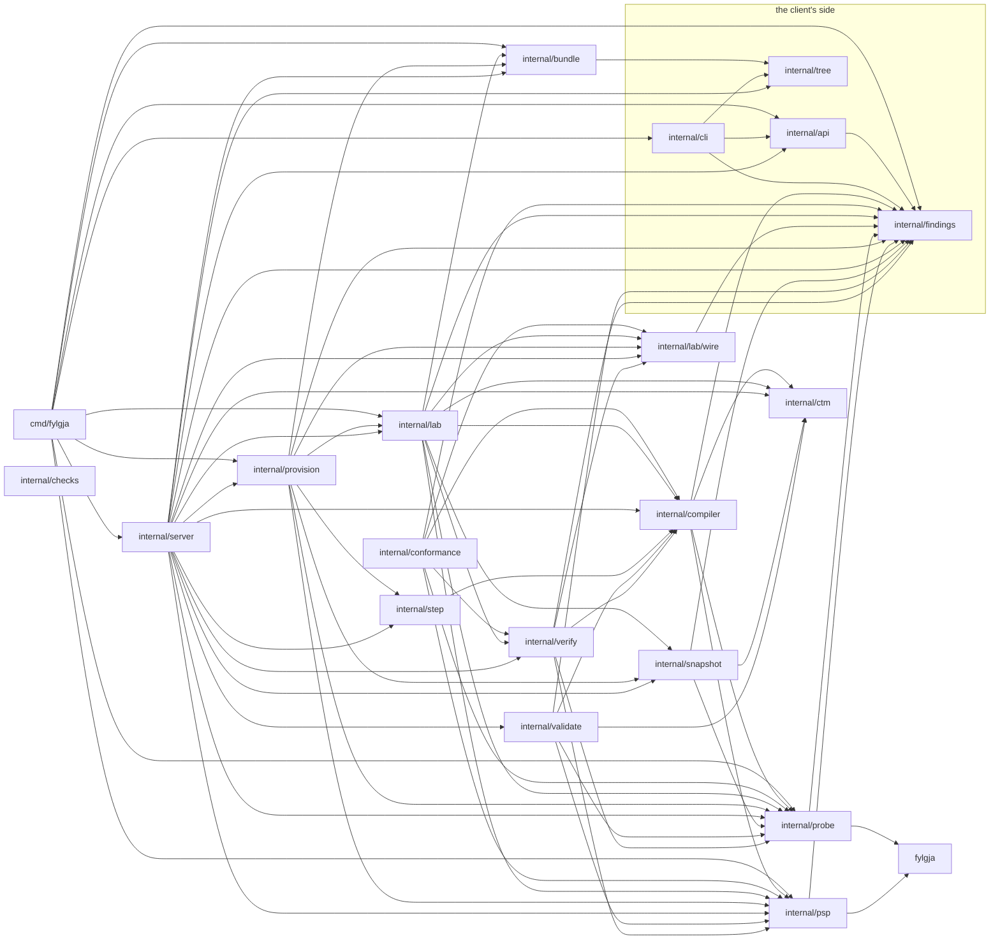

# Fylgja — Development

Engineering conventions: the local environment, repository layout, tests, Temporal
usage, and how work flows through Spec Kit. The reasoning lives in
[architecture.md](architecture.md) and the [decision log](decisions.md); this
document says what to do.

---

## Local environment

One lab host, the development host: Ubuntu 26.04.1 LTS, kernel 7.0, as a QEMU/KVM guest
with 10 vCPUs, 32 GiB and 8 GiB of swap, set up by the bring-up script below. Ubuntu 26.04
is the one release the script supports. Every component below was verified there;
re-verify after any upgrade, since every wrong assumption so far has been about how a
dependency actually behaved ([verified facts](verified-facts.md)).

**The bring-up script** stands a host up: `scripts/bring-up.sh [--ceos-tar PATH] [--part
NAME]... [--help]`, run from the clone by the user who will run Fylgja, never root. A
preamble, then five parts in order, `toolchain`, `lab`, `infrahub`, `orchestrator` and
`fylgja`; `--part` (repeatable) runs the named ones alone. Each item is verified, installed
when it is missing and verified again, and prints one line, `bring-up: <part>: <item>:
present`, `installed` or `skipped (<why>)`; every wait names what it waits for and its
bound, and fails naming both on expiry. Exit 0: every part run completed and the last
report printed. Exit 1: an item or a tier failed, named in the output. Exit 2: refused in
the preamble, before any change. It never prints, logs or passes as an argument a value of
`local/.env` and never uses `set -x`, so its output can go into a CI log. A second run on a
host it set up installs nothing, keeps `local/.env` and the running Infrahub, runs both
tiers again and ends the same way. On a fresh VM of the development host's shape a first
run took 28 minutes with the cEOS tar and 20 without, most of it the images' pulls and
import, before 020 added the orchestrator's part; a second run takes about 7, most of it
tier 2. Its contract is
[specs/013-launch/contracts/bring-up-script.md](../specs/013-launch/contracts/bring-up-script.md).

- **The preamble** changes nothing until `local/.env`. It refuses a release other than
  Ubuntu 26.04, an unknown flag, a cEOS tar whose sha256 is not the recorded one, and port
  8000 held by anything but the Compose project `fylgja-infrahub` (point
  `INFRAHUB_ADDRESS` at that Infrahub and run `--part fylgja` instead). It asks for `sudo`
  at most once, and not at all when a credential is cached or the user's commands need no
  password, and keeps the credential alive for the run, so no second prompt comes. It
  looks for the cEOS tar (below). When `local/.env` is absent it writes it, mode `0600`,
  every name `.env.example` documents filled: the tokens and Infrahub's Compose secrets
  made then, `FYLGJA_STATE_ROOT` the absolute `local/`, `FYLGJA_HOST_MEMORY_MB` the host's
  memory less 8 GiB, each login its image's published default, `FYLGJA_DEFAULT_SCOPE`
  `tag:fylgja`, the fixtures' tag, `FYLGJA_PSP_DIR` empty on purpose, and from 020 the
  orchestrator's four: `FYLGJA_ORCHESTRATOR_ROOT` the absolute `local/orchestrator`,
  `PREFECT_API_URL` `http://<the bridge's address>:4200/api`, and one `fylgja:<password>`
  made then as both `PREFECT_API_AUTH_STRING` and `FYLGJA_ORCHESTRATOR_AUTH`. A present file
  is kept byte for byte, and read by name alone: one that names no `FYLGJA_DEFAULT_SCOPE` is
  reported, saying to add `FYLGJA_DEFAULT_SCOPE='tag:fylgja'`, since the orchestrator then
  reads with no default scope and refuses a read that names none, the checks' among them;
  one that lacks the orchestrator's names is reported, saying what to add, since the
  `orchestrator` part cannot start its platform without them. Then the first report: the
  host, the parts, where the tar was found or looked for, the platforms the host can run,
  and the memory, with a warning under 24 GiB, since tier 3 was proved with 32.
- **`toolchain`**: Ubuntu's `make`, `git`, `curl`, `jq`, `xz-utils`, `file`, `golang-go`,
  `python3-venv` and `shellcheck`, in one `apt-get install` of those missing; Go (its row
  below); golangci-lint 2.14.0 into `/usr/local/bin`; the Temporal CLI 1.9.1 into
  `~/.temporalio/bin`; gnmic 0.49.0; and `.venv/` at the root with `infrahub-sdk[ctl]`
  1.23.2 and a `.gitignore` of `*` inside it.
- **`lab`**: Docker, by containerlab's setup script; containerlab 0.79.0 from its package;
  the user in `docker` and `clab_admins`; the AppArmor lines SR Linux's `rsyslogd` needs,
  each appended when missing and the profile reloaded; the SR Linux image pulled; the cEOS
  image imported from the tar when one was found. A running session does not see a group
  added to its user, so when the session lacks either group the script says so and
  re-executes itself once through `sudo -u "$USER" -i`, a fresh login session, with the
  remaining parts. Every process it leaves running carries both groups. A shell that began
  before the run (an editor's terminal, an agent's session, the user's `systemd --user`)
  lacks them until the next login: run Docker and containerlab from it through `sg docker`,
  which is all containerlab needs.
- **`infrahub`**: Infrahub 1.11.2's published Compose file, fetched by version from
  `https://infrahub.opsmill.io/1.11.2` into `local/infrahub/docker-compose.yml`
  (git-ignored), with this repository's `scripts/infrahub/docker-compose.override.yml`
  copied beside it; the project `fylgja-infrahub` started with `local/.env` as its
  environment file (and `up -d` run even with every service up when the override was
  copied or replaced, so the task workers are recreated with it) and awaited, up to
  600 s, until `infrahub-server` is healthy and `/api/info` answers 1.11.2;
  `fylgja-fixture -prepare-main`, which prepares `main` (What Infrahub needs, below):
  `installed` when it loaded the library, and `present` when it refused a `main` already
  holding the library's kinds and `main` is read to hold the stage kind, the group and the
  registration, which the refusal never reached (any of them missing fails the part,
  naming it); then the fixture branch, `present` when it holds three `Ready`
  artifacts, seeded when absent, cleaned and seeded when incomplete, the seed run once
  more on `graphql: None`. It runs alone on any host with `docker`, `go`, `curl` and `jq`
  on the `PATH`, and is what CI's contract job runs.
- **`orchestrator`** (020, [D-065](decisions.md#d-065)): `orchestrator/.venv` by `make
  orchestrator-venv`; the orchestrator's platform, `prefect server start` on the host's
  Docker bridge, where Infrahub's task workers reach it, under `PREFECT_HOME`
  `local/orchestrator/prefect`, logging to `local/prefect.log`, awaited until it answers
  `local/.env`'s auth string as the venv's Prefect; and the runner, `fylgja-orchestrator
  serve`, logging to `local/orchestrator.log`, read to report serving the six deployments
  on the platform. Each is started detached and verified, and one already running is kept
  only when it is this venv's, writes to its log under `local/` and answers as it should,
  the runner also only when no file of `orchestrator/src` is newer than it and the platform
  was not started by this run; any other is restarted, saying why. It recreates nothing of
  Infrahub's: a changed override reaches the task workers by the `infrahub` part's `up -d`.
- **`fylgja`**: `make build`, checked static with `file`; then the dev server, the worker
  and the API's server, started detached as the five-process paragraph below starts
  them, logging under `local/`; then tier 1 and tier 2, each timed. A process already
  running from this tree's `bin/fylgja` is `present` when its output is its log under
  `local/` and, for the server, it listens on loopback alone and holds no Infrahub
  variable, since the core reads no source of truth (020); one on a replaced or
  `(deleted)` binary, writing elsewhere (`make worker`, `make serve`) or started otherwise
  is restarted, saying why. Each report is read: the dev server `SERVING`, and the
  worker's and the server's naming every package the host can run with its login set, the
  server's naming `127.0.0.1:7650`.
  The last report gives each part's counts, the tar and the platforms again, both tiers'
  times, how to run tier 3, the five processes with their pids and logs, the platform's
  address and that its auth string crosses the bridge in the clear, the server on
  `127.0.0.1:7650` alone, how to stop them (`pkill -f '<venv>/bin/fylgja-orchestrator
  serve'`, `pkill -f '<venv>/bin/prefect server start'`, `pkill -x fylgja`, `pkill -f
  'temporal server start-dev'`), and `DONE` with the run's time.

**The cEOS tar.** The operator downloads `cEOS-lab-4.32.0.2F.tar` from Arista's software
downloads, which need an account; the portal may name it `.tar.xz`, and the file is
xz-compressed under either name, which `docker import` reads as it is. The script looks
for either name at `--ceos-tar`, then in `local/`, then in the clone's parent directory,
and **never in the clone's root**, which `.gitignore` does not cover and from which the
converge loop commits. It imports a file only when its sha256 is the recorded
`89a567d52f85e5f0e4650fe8e097e0226f78346d5a13d26bcab2a5623e888778`, the file the proven
image came from, and refuses any other before any part, naming both checksums. When
`ceos:4.32.0.2F` is already present the tar is not needed, and the lab part says whether
the image's one layer is the recorded tar's.

**A host without the tar runs SR Linux alone.** The cEOS item reads `skipped (no cEOS tar:
SR Linux alone)`, both reports name `nokia_srlinux` alone and where the script looked, and
the worker and the server serve that package. Everything but EOS and mixed twins works,
and every walk-through in the README is SR Linux. Tier 3 there is `PLATFORMS=nokia_srlinux
make test-e2e`, which skips cases 6 and 8 and ends `E2E-PARTIAL` ([Test
architecture](#test-architecture)); a default run refuses before any case, naming
`ceos:4.32.0.2F`.

| Component | State | Notes |
|---|---|---|
| Go | 1.26.0 | `CGO_ENABLED=0`; the binary must stay static. Ubuntu 26.04's `golang-go` is go1.26.0, the release `go.mod` names, so nothing is fetched. An older `go`, such as 24.04's 1.22.2, fetches go1.26.0 on first use, because `go.mod` says `go 1.26.0` (`GOTOOLCHAIN=auto`); a newer one runs as it is |
| containerlab | 0.79.0 | from its `.deb`; `/usr/bin/containerlab` is setuid root. Its package creates `clab_admins` and puts the installing user in it, and members run it without sudo. A guest that does not nest has no `/dev/kvm`, which only a `vrnetlab_vm` package would need. **SR Linux needs the host's rsyslog AppArmor profile widened**: `/opt/srlinux/** mr,`, `/run/srlinux/** rw,` and `/run/syslogd.pid* rw,` in `/etc/apparmor.d/local/usr.sbin.rsyslogd`, reloaded with `apparmor_parser -r`, or every `nokia_srlinux` deploy fails on `log_mgr`. The lab part writes them |
| Docker | 29.8.1, Compose 5.6.0 | from Docker's repository: the release containerlab's setup script pins for Ubuntu 26.04. Privileged containers work; cgroup v2. `docker` must be on the `PATH` of both the worker and the API's server, which makes every dry run |
| Infrahub | 1.11.2, running | the Compose project `fylgja-infrahub`, from `local/infrahub/`: the published file and the committed override, which pins the three Infrahub services to 1.11.2 (the published file reads `${VERSION}`, so a stray variable would move the image) and caps Neo4j (heap 1g/2g, page cache 1g). `local/.env` is its environment file. It serves http://localhost:8000, published on every interface, as the published file has it. By hand, from the repository root: `docker compose -p fylgja-infrahub --env-file local/.env -f local/infrahub/docker-compose.yml -f local/infrahub/docker-compose.override.yml <command>`. Its volumes persist across `down` |
| Temporal CLI | 1.9.1 (Server 1.32.0) | in `~/.temporalio/bin`, where its installer puts it and which no login shell's `PATH` names: `make temporal-dev` and `scripts/e2e.sh` look there when the `PATH` has none. `temporal server start-dev` on `:7233`, UI `:8233`; see below |
| Temporal Go SDK | v1.49.0 (`go.temporal.io/api` v1.63.5) | in `go.mod` with `openconfig/gnmi` v0.14.1 and `grpc` v1.83.2, all pure Go. Its `testsuite` is the tier-1 workflow harness |
| gnmic | 0.49.0 | a hand tool for asking a node something, or for disabling a port outside Fylgja; **not** a dependency. The readiness probe and `twin verify` are in-process gNMI clients, so nothing Fylgja runs shells out to gnmic |
| golangci-lint | 2.14.0 | must be the v2 line: `.golangci.yml` declares `version: "2"`, which v1 rejects |
| Python | 3.14.4 | two venvs. `.venv/` at the root holds `infrahub-sdk[ctl]` 1.23.2, whose `infrahubctl` is the operator's hand tool for marking stages and connects as Admin. `orchestrator/.venv/` (020, `make orchestrator-venv`) holds the orchestrator at `orchestrator/pyproject.toml`'s pins: Prefect 3.8.8 with `fastapi` 0.150.0 beside it (3.9.0 and the SDK need disjoint ranges of `whenever`, and 3.8.8's server fails at start on a later FastAPI), `infrahub-sdk` 1.23.2, `whenever` 0.9.5, `pydantic` 2.14, `httpx` 0.28, `pytest` 9.2.0 and `ruff` 0.17.3, the package installed editable, so its `fylgja-cli` and `fylgja-orchestrator` run this tree's code. The repository does not ignore either: the `.gitignore` of `*` inside each keeps the tree clean, and a venv made by hand needs one too |
| ShellCheck | 0.11.0 | Ubuntu 26.04's package. The lint job runs the runner's over both scripts |
| SR Linux image | `ghcr.io/nokia/srlinux:24.7.1` | public, 5.19 GB as Docker counts it. Its package says `acquisition: public_registry`, so a deploy may pull it; the lab part pulls it. Boots once AppArmor allows its `rsyslogd` (containerlab row) |
| cEOS image | `ceos:4.32.0.2F`, imported | **account-gated: never vendored, never pulled.** Imported from the tar above, `docker import cEOS-lab-4.32.0.2F.tar ceos:4.32.0.2F`: one layer, whose digest is the sha256 of the decompressed tar (`sha256:09ab9635…` for the recorded one), and no `Cmd`, as `docker import` leaves it; containerlab's `ceos` kind supplies the command. 2.91 GB as Docker counts it. Its package says `acquisition: account_gated`, so the host check verifies presence under exactly that reference and **refuses the run rather than pulling**; the same image under another tag is absent |

**Credentials.** `local/.env` (git-ignored, mode `0600`) is the only file that holds a
value: the preamble writes it, and `.env.example` documents every name and no value. It
holds the Infrahub address and token, both node logins — `FYLGJA_SRLINUX_USERNAME`/`_PASSWORD`
and `FYLGJA_EOS_USERNAME`/`_PASSWORD`, each its image's published default — the API's
token `FYLGJA_API_TOKEN`, and from 020 the orchestrator's platform's basic-auth string, as
`PREFECT_API_AUTH_STRING` for the platform and its clients and as
`FYLGJA_ORCHESTRATOR_AUTH` for the Compose override, which hands it to the task workers.
It also holds Infrahub's Compose values, which Compose reads
through `--env-file` and Fylgja never reads: `COMPOSE_PROJECT_NAME` (`fylgja-infrahub`),
`INFRAHUB_INITIAL_ADMIN_TOKEN` (`INFRAHUB_API_TOKEN` carries the same value),
`INFRAHUB_INITIAL_ADMIN_PASSWORD`, `INFRAHUB_INITIAL_AGENT_TOKEN` and
`INFRAHUB_SECURITY_SECRET_KEY`. The published Compose file carries defaults for the last
four that anyone can read, so a host never keeps them. Infrahub's volumes keep the admin
token they were created with, which is why a present `local/.env` is never re-made. Load
it with `set -a; . local/.env; set +a`. Fylgja reads the process environment only — never
a file — and never echoes, persists, or embeds a credential in a bundle, a finding, or a
log line.

**Environment variables.** The core's binary runs in three roles, and each reads its own
([D-040](decisions.md#d-040)); the orchestrator reads its own beside them (below). **A
client's command** of the core's (every `fylgja` command but the two roles) reads the
API's two variables and nothing else of Fylgja's, Infrahub's or a node's
(`TestTheClientReadsTheAPIsTwoVariablesAlone`, `internal/cli`):

| Variable | Default | Read by |
|---|---|---|
| `FYLGJA_API_ADDRESS` | `127.0.0.1:7650` | a client alone, and the orchestrator as one: `host:port`, or an `http://` or `https://` URL for a proxy the operator runs. The server's address is `fylgja serve --listen`, which has no variable |
| `FYLGJA_API_TOKEN` | none | a client, which sends it with every request and sends nothing when it is unset, holds a character no request header can carry, such as a carriage return, or ends in a space or a tab (`api.token.refused`); the orchestrator, as a client; and the server, which compares it and refuses to start without it; never the worker. Never printed, logged or persisted ([D-042](decisions.md#d-042)) |

**The server and the worker** read the rest, at start or when a request needs them, and
never a client:

| Variable | Default | Read by |
|---|---|---|
| `FYLGJA_TEMPORAL_ADDRESS` | `localhost:7233` | the server, for every command that starts, follows, reads, interrupts, cancels or lists runs (`twin show` and `twin verify` best-effort); `worker run` |
| `FYLGJA_TEMPORAL_NAMESPACE` | `default` | the same |
| `FYLGJA_STATE_ROOT` | `local` under the working directory, made absolute at start | the server and the worker, each resolving it once at start: start both from the repository root, or set it (`make worker` and `make serve` set it absolute). The conformance suite's boot half reads the twin under it and refuses it unset or relative, since `go test` runs in the package's directory (`scripts/e2e.sh` exports it absolute) |
| `FYLGJA_HOST_MEMORY_MB` | unset: the host check warns with the memory sum and proceeds | the worker's host check; the server's dry runs and `twin step`'s host check; both roles' start-up reports |
| `FYLGJA_SRLINUX_USERNAME`, `FYLGJA_SRLINUX_PASSWORD` | unset: the host check refuses | the worker's readiness probe and configuration push; the conformance suite's boot half; `twin verify`'s reads, which the server makes; the dry runs and both roles' start-up reports check presence only. The names are the SR Linux package's `readiness.login` and `config.push.login` data, not code |
| `FYLGJA_EOS_USERNAME`, `FYLGJA_EOS_PASSWORD` | unset: the host check refuses a bundle with an EOS node | the same, for a node whose package is `arista_eos`. The names are that package's data too: a host check reads the login names of each node's own package, so a twin of SR Linux alone never asks for these |
| `FYLGJA_PSP_DIR` | none: embedded packages only | the server and the worker, each also taking `--psp-dir`, and the boot half; the orchestrator's adapter too, for the overrides' `platform` alone. A client's command has no `--psp-dir` (`unknown flag: --psp-dir`, exit 2, nothing sent), and is checked against the server's packages |

From 020 neither role reads `INFRAHUB_ADDRESS`, `INFRAHUB_API_TOKEN` or
`FYLGJA_DEFAULT_SCOPE` ([D-065](decisions.md#d-065)): a worker or server started from
`local/.env` carries them and reads none, and the bring-up script starts the server without
them. The server needs `containerlab` and `docker` on its `PATH`. A client needs neither.

**The orchestrator** reads these, each where a request needs it
([contracts/orchestrator.md](../contracts/orchestrator.md), "Environment"):

| Variable | Default | Read by |
|---|---|---|
| `INFRAHUB_ADDRESS`, `INFRAHUB_API_TOKEN` | none: a read is refused `operation.failed` before anything is read | the adapter, in `fylgja-cli`'s flows, the runner's and the adapter as a tool; the rehearse flow's post. Never the core, never the checks |
| `FYLGJA_DEFAULT_SCOPE` | none: a read that names no scope is refused `scope.unset` | the adapter: the scope, `tag:<name>`, a request that names none is read under (`twin create`, `twin rehearse`, `intent read`, `stage plan`, `stage list`, each also taking `--scope`; `twin step` with no twin recorded; the checks, which send none, through the runner). A value that is not `tag:<name>` is `scope.invalid` naming the variable. The bring-up script scaffolds `tag:fylgja` |
| `FYLGJA_ORCHESTRATOR_ROOT` | `local/orchestrator` under the working directory | `fylgja-cli` and the runner: the orchestrator's store and record (`make orchestrator-serve` sets it absolute) |
| `PREFECT_API_URL`, `PREFECT_API_AUTH_STRING` | unset: `fylgja-cli` runs its flow on Prefect's ephemeral server; the runner refuses to start | `fylgja-cli` and the runner: the platform, `http://<bridge>:4200/api`, and its `<user>:<password>`; `make prefect-server` starts the platform with the second as its `PREFECT_SERVER_API_AUTH_STRING` |
| `PREFECT_HOME` | Prefect's own, under the home directory | the platform's database (`local/orchestrator/prefect`, as the make targets set it), and `fylgja-cli`'s ephemeral server when `PREFECT_API_URL` is unset |
| `FYLGJA_PSP_SHIPPED` | the repository's `psp/`, found from the editable install | the adapter, when the package is installed elsewhere than this tree |
| `FYLGJA_ORCHESTRATOR_ADDRESS`, `FYLGJA_ORCHESTRATOR_AUTH` | none: each check fails naming the unset one | the two checks alone, in Infrahub's task workers, from the Compose override: `host.docker.internal:4200` and `local/.env`'s auth string |

**Temporal.** The toolchain part installs the CLI (`curl -sSf
https://temporal.download/cli.sh | sh -s -- --version 1.9.1`), and the `fylgja` part runs
the dev server file-backed, so history survives a restart:

```
temporal server start-dev --db-filename local/temporal.db
```

Web UI at http://localhost:8233. `make temporal-dev` wraps the command.

**Five processes on the lab host.** The core's three: the dev server (`make
temporal-dev`), the worker (`make worker`) and the API's server (`make serve`,
[D-041](decisions.md#d-041)); and the orchestrator's two: its platform (`make
prefect-server`) and its runner (`make orchestrator-serve`) ([D-065](decisions.md#d-065)).
The script's `orchestrator` and `fylgja` parts leave all five running. Start each from a
shell that loaded `local/.env`, from the repository root, so the core's two share one state
root and one environment, the server adding `FYLGJA_API_TOKEN`, and the orchestrator's two
one root, `local/orchestrator`. **The server listens on loopback alone**, `127.0.0.1:7650`,
as `make serve` and `CLAUDE.md`'s start line start it; from 015 until 020 it listened on
the host's Docker bridge as well, for Infrahub's task workers ([D-050](decisions.md#d-050),
superseded in its listener by D-065). Its report names the address. The part keeps a
running worker or server only when its output is `local/worker.log` or `local/server.log`,
so that the log's last report is its own, and restarts any other, saying why, so one from
`make worker` or `make serve` is replaced. **The platform listens on the bridge**:
`PREFECT_API_URL`'s address, `http://<bridge>:4200/api`, the bridge's address read with
`docker network inspect bridge -f '{{(index .IPAM.Config 0).Gateway}}'` (`172.17.0.1` by
Docker's default); the host's own processes reach it there too, so one listener serves
both. Its basic-auth string crosses the bridge in the clear. Infrahub's task workers, where
the checks run as its clients, reach it as `host.docker.internal:4200`: the Compose override
gives them the `host-gateway` entry that name resolves to, `FYLGJA_ORCHESTRATOR_ADDRESS` and
`FYLGJA_ORCHESTRATOR_AUTH`, which Compose reads from `local/.env`, and no API token. A
changed override reaches the task workers only when they are recreated: `compose up -d`
with the project's flags, which recreates the services whose configuration moved and leaves
the rest and the volumes, and which the script's `infrahub` part runs whenever it copies or
replaces the override.
Every `fylgja` command is a client of the server: from a shell that holds `FYLGJA_API_TOKEN`
alone (and `FYLGJA_API_ADDRESS` off `127.0.0.1:7650`), on the lab host or, through
`ssh -N -L 7650:127.0.0.1:7650 <lab host>`, on another machine with a binary built from
this tree. `fylgja-cli` is `orchestrator/.venv/bin/fylgja-cli`, run with `local/.env`
loaded, on the lab host. The server dials nothing at start and keeps nothing between two
requests, so it starts before or after the dev server and Infrahub, and a restart loses
nothing but the answers it was sending, whose runs go on. **Restart the worker and the
server after every rebuild**: each keeps serving from a binary replaced under it, which
`/proc/<pid>/exe` then reads as `(deleted)`. The runner runs the editable install's code as
it was when it started, so restart it after a change under `orchestrator/src`.

**What Infrahub needs.** The orchestrator's adapter reads intent and each device's
configuration artifact from Infrahub, and the core never reaches it
([D-065](decisions.md#d-065)); the fixture tool (`cmd/fylgja-fixture`) is the one binary
that writes to it. The rehearse flow writes one thing, a thread on the proposed change it
rehearsed, through the adapter's client ([D-053](decisions.md#d-053), its thread kept by
D-065); the two checks this repository registers write nothing. Infrahub's `main`
carries:

- **the schema**: the schema library's DCIM at `opsmill/schema-library@26336e9`,
  vendored byte for byte under `schema/dcim/` ([D-057](decisions.md#d-057)), and the stage
  kind with its extension of `CoreProposedChange` (`schema/fylgja-stage.yaml`), loaded on
  `main` so that every branch created afterwards has them ([D-028](decisions.md#d-028)).
  The library's `DcimDevice` inherits `CoreArtifactTarget`, and Fylgja adds no kind to the
  library and implements none of its kinds. `-prepare-main` loads the stage and probe
  kinds wherever absent, then the library only on a `main` holding none of its kinds, and
  refuses one holding any, writing nothing of the library, since a library already there
  is its operator's: `fylgja-cli schema check` says whether it is the
  one the adapter reads;
- **the empty group `fylgja-devices`**, the artifact definition's target; a device renders
  only once it joins it;
- **the artifacts template**, which this repository carries: `.infrahub.yml` at the root,
  `infrahub/queries/device_config.gql` and `infrahub/templates/device_config.j2`. It
  declares one Jinja2 transform, `srlinux_device_config`, and one artifact definition
  naming the artifact `device-config`, `text/plain`, targeting `fylgja-devices`, with the
  device's name as its parameter. The registration is `fylgja`, a
  `CoreReadOnlyRepository` on `main` at this repository's HTTPS location, `ref main`, with
  no credential ([D-044](decisions.md#d-044)), made by `fylgja-fixture -prepare-main`
  together with the schema and the group, which the script's `infrahub` part and CI's
  contract job run: it tracks one `ref`, imports at creation, and never pushes. The import
  took 22–48 s on the hosts it was proved on;
- **the two checks**, in the same registration beside the template (015,
  [D-049](decisions.md#d-049), [D-052](decisions.md#d-052)): the query `fylgja_branch`
  (`infrahub/queries/branch.gql`, `{ Branch { name } }`, which an `InfrahubCheck` must name
  and the checks ignore) and two global check definitions, `fylgja-step`
  (`infrahub/checks/fylgja_step.py`, `FylgjaStep`, timeout 300 s) and `fylgja-twin`
  (`fylgja_twin.py`, `FylgjaTwin`, timeout 4,260 s), beside their shared glue,
  `fylgja_api.py`, which each imports relatively. Infrahub's task workers run both on every
  proposed change at its creation and on a re-run of its user checks, each reaching the
  orchestrator's platform on the bridge (the five-process paragraph above) and triggering
  a flow there, `stage-plan` or `twin-rehearse`. The registration imported them
  from `origin`'s `main` at `999456e` on 2026-10-19, and at `d70ad24` on 2026-10-20, when
  `fylgja-twin`'s report moved from a comment to a thread ([D-053](decisions.md#d-053));
  it reads `c006bf9`, imported on 2026-10-26 (017), whose template query reads the
  library's kinds and whose checks pass over a branch point refused `scope.empty`.

**A template or check change reaches Infrahub by asking for it.** A commit pushed to `main`
is not imported on its own: neither the minute sync nor rewriting `ref` moves the
registration's `commit`. `InfrahubReadOnlyRepositoryImportLastCommit(data: {id: <the
registration's id>})` on `main` imports the head of `ref` within seconds ([verified
facts](verified-facts.md#infrahub-1112)). The import renders nothing: a branch created
afterwards sees the new template, an existing one only after `BranchRebase`, and each
artifact changes only when it is generated again (`-generate`, or the seed). A check
changed this way also has to reach the task workers, each of which fetches the imported
commit in a flow of its own (Prefect's `Fetch git repository fylgja on <worker>`), both
about 15 s after the import's own flow ends; a run-check before both have fetched fails,
so wait for both. A branch sees `main`'s check definitions as they were at its creation,
so one made before the import never runs the new checks until it is rebased or made again;
the fixture branch, made before them, never runs them, which is harmless. A session never
pushes: until the operator pushes and imports, the tree's checks run on this host only
under tier 2's own registration ([Test architecture](#test-architecture)), and tier 3's
case 9 runs the registered ones.

**One template renders both platforms.** The transform branches on the device's platform
and emits that vendor's syntax, so a mixed branch renders through the one artifact
definition and every device's artifact is still `device-config`. An Infrahub branch sees
`main` as it was when the branch was created, so a branch made before the schema, the
group or the template existed on `main` cannot render, and one made before the template
carried its EOS body renders no EOS text: `TestMixedSeedReads` then fails, its read no
longer `testdata/ctm/mixed.json` below the envelope.

**Infrahub fixture.** `make infrahub-seed` creates the `fylgja-fixture` branch with
the three-node SR Linux topology in the library's kinds (the tag `fylgja`, Nokia's
`SR Linux` platform, the lab site and the three levels above it, the devices, each with
`mgmt0` as its management port, two cabled ports and, from 016, two probe-ready ports,
`ethernet-1/10` and `ethernet-1/11`, uncabled, each with one `IpamIPAddress`, and the three
cables; every device's
description the marker `FYLGJA-MARKER-fixture`), joins the three devices to
the target group `fylgja-devices`, asks Infrahub to generate their artifacts, and waits
until all three are `Ready` (bounded at 90s). Infrahub 1.11.2 regenerates nothing on its
own, so the seed generates explicitly. `make infrahub-clean` deletes the branch. The
fixture branch is written once, by its seed, and by no test afterwards. If the seed fails
with `graphql: None` just after a delete, run it again. Contract tests make their own
throwaway `fylgja-test-*` branches. On this install the fixture branch's schema hash is
`main`'s, `8a4f3bee…`, and it compiles to `c3872f5c…`.

**A host from before 017 migrates `main` once** ([research
R-14](../specs/017-dcim-reader/research.md#r-14), §5.10), with the demo window closed and
nothing else running against Infrahub: `infrahubctl schema check` then `schema load
--branch main` of
[`migration/1-reference-kinds-absent.yaml`](../specs/017-dcim-reader/migration/1-reference-kinds-absent.yaml)
(the reference schema's four kinds and the contract kind) and then of
[`migration/2-generics-absent.yaml`](../specs/017-dcim-reader/migration/2-generics-absent.yaml)
(the four generics), about 50 s each: two documents, since one naming the generics and
their implementers together is refused. Then `-prepare-main` from the new tree loads the
library, finding the stage kind, the group and the registration present; the template
commit, once on `origin`'s `main`, is imported (the operator's gate: until then no
artifact renders, so the fixture cannot be re-seeded and tier 2 cannot run, while tier 1
can); `make infrahub-clean` and `make infrahub-seed` re-seed the fixture in the library's
kinds, since it is never rebased; and, until 020 removed both, `make sdl` and `make
generate` refetched the SDL and the client from the migrated `main`. The development host's `main` was migrated on
2026-10-26, its hash moving from `e43a1cde…` to `7c413536…`. A fresh install, CI's among
them, never had the removed kinds: `-prepare-main` loads the library on its empty `main`.

**Proposed changes and stages.** The stage kind (`schema/fylgja-stage.yaml`) is on `main`,
branch-agnostic, and stages are read there whatever branch their proposed change is from
([D-045](decisions.md#d-045)). A test opens proposed changes only from its own
`fylgja-test-*` branch, through `testsupport`, and deletes what it wrote, stages first. The
contract tier leaves none behind: after `make test-contract`, `fylgja-cli stage list`
prints `no open proposed change`. `fylgja-fixture` has no proposed change, and the fixture tool
refuses to open one on it. A stage outlives its branch, so a throwaway branch's stages and
proposed changes are deleted with it, by `-delete`; a proposed change's threads, their
comments and its validators go with it. An operator's own proposed changes and
stages are the operator's, marked by object file, the UI or `infrahubctl`
([schema/README.md](../schema/README.md)), and nothing here touches them. Once the
registration has imported the checks, every proposed change opened on this host runs
`fylgja-step` and `fylgja-twin` at its creation, and once it is ready for review a re-run
of its user checks rehearses it on a twin, through the orchestrator's platform and runner: mark a proposed change ready only after its
creation's user checks have concluded, as tier 3's case 9 does, and never re-run a ready
one's checks while tier 2 runs.

---

## Repository layout

The core is a single Go module, `github.com/happypathnetworking/fylgja`, one binary
([D-018](decisions.md#d-018)); the orchestrator is one Python project under
`orchestrator/`, with its own venv, tests and linter, in the same repository
([D-065](decisions.md#d-065)).

```
cmd/fylgja/            main: the root command, `--json`, `--version` (the Makefile's `-X main.version`); the two roles, `fylgja serve` and `fylgja worker run`
cmd/fylgja-fixture/    build tag `fixture`: the schema load (the library, then the stage and probe kinds), the seeds in the library's kinds (group join, generate), `main`'s preparation and a demo's window, delete, the tiers' changes to a throwaway branch, and its proposed change and stages; a declaration's probes written into `FylgjaProbe` on `main` and deleted (`-probes`, `-delete-probes`). The only binary that writes to Infrahub
embed.go               package fylgja: //go:embed of schema/*.yaml, schema/dcim/*.yml with the library's LICENSE.txt, psp/*.yaml, psp/*.json, probes/*.yaml, probes/*.json
internal/api/          the API's wire (version, paths, headers, request, frames, event, files, problem, the bound) and the client that speaks it; imports internal/findings alone
internal/server/       the API's server: the handlers of the core's eleven operations, the token, the per-request console, the streams and the log; `server.Compile` (`compile.go`), every compile's one path; imports the core
internal/cli/          the client's commands: each builds one request, prints what comes back and exits by the document; imports cobra, internal/api, internal/findings and internal/tree and nothing else of the module (test-enforced)
internal/tree/         a directory of regular files read into and written from a map, shared by internal/bundle and the client
internal/ctm/          Canonical Topology Model types and JSON
internal/validate/     completeness and intent rules on the CTM, and the probes' placement through the compiler's; run by `twin compile`, a create, a step and `twin diff` (on a snapshot's CTM)
internal/compiler/     CTM and probes → bundle; pure; `PlaceProbes` (`synthesize.go`), each probe's two synthesized hosts placed before the survey (016)
internal/bundle/       bundle format, canonical hashing, bundle store
internal/snapshot/     the snapshot (018, D-061): the document wrapping a CTM and, from 016, its probes, its take, its id over the hashed bytes, its strict reading (a `1` as a `2` with no probe) and the snapshot store; imports internal/ctm, internal/probe, internal/findings and the standard library alone (test-enforced)
internal/psp/          PSP loading, validation, embedded packages; the mapping profile (`profile.go`)
internal/probe/        the one definition of a probe (016, D-064): the declaration and its rules, the probe packages (loading, the override directory's probes/, validation, rendering) and the pure reading of ping's output; imports internal/findings, the module's embedded files, the two decoders and the standard library alone (test-enforced)
internal/conformance/  the conformance suite: the pure half (the probe packages' check among it), the boot half, the version rule; imported by no product code (test-enforced); reads nodes through internal/verify's readers
internal/verify/       the readers of a booted node; the assertions derived from a manifest, each probe's burst among them (016), the record's claims, one read of the twin, the bounded wait and the report. Imports compiler, psp, probe, findings and lab/wire, never internal/lab (which imports it) or internal/conformance; walked by the platform grep
internal/findings/     Finding, rule identifiers, the --json document, text and JSON rendering, exit codes
internal/step/         the step between two bundles, a pure function of the two, held pure by a test; the push plan and the unapplied changes a step acts on
internal/testsupport/  build tag `contract || fixture`: the contract-test harness the fixture tool and internal/checks use; never imported by product code (test-enforced)
internal/checks/       tier 2's proof of the two Infrahub checks inside a running Infrahub (build tag `contract`): the tree's infrahub/checks/ served from the Docker bridge under test-only names, reaching the orchestrator's platform; no product code
internal/provision/    Temporal workflows (provision, destroy, step), each started with a snapshot id and a bundle id, none reading a source of truth; the workflow service's client, which the server uses to start, follow, read and interrupt runs; worker registration and start-up report
internal/lab/          host-bound activities: containerlab shell-out, host check and image presence, staging, deploy, the gNMI readiness probe (TLS or plaintext) and a probe's host's exec readiness, the configuration push (json_rpc, eapi; merge or replace), twin.json; containerlab's plan and the reconcile, the step's stage and record, the step's flows (StartFlows, ReadFlows) and the step's VerifyTwin; the burster, `docker exec` of a probe's burst, which the server's `twin verify` uses too
internal/lab/wire/     types only: activity names and the payloads crossing the task queue; workflow files import it, never internal/lab
internal/*/testdata/contracts/<feature>/
                       frozen copies of older formats' schemas, which additivity tests read; never edited
orchestrator/          the orchestrator (020, D-065): pyproject.toml (the package fylgja_orchestrator, its console scripts fylgja-cli and fylgja-orchestrator, its pins: Prefect 3.8.8, fastapi 0.150.0, infrahub-sdk 1.23.2; pytest's markers; ruff's rules), its venv .venv (git-ignored by a .gitignore of * inside, made by make orchestrator-venv)
orchestrator/src/fylgja_orchestrator/
                       adapters/infrahub/ (the Infrahub adapter, a tool of its own: the client, the mapping, conformance, the read, stamps, events, stages, probes, the snapshot and its id, intrinsic validation, the report's post), documents/ (the stages, plan and rehearsal blocks, their text and markdown, the deadline, the findings document, rules.py), flows/ (the six flows and stage list's body), core.py (the core's client), record.py (the store and the record), cli.py (fylgja-cli), serve.py (the runner)
orchestrator/tests/    unit/ (tier 1), contract/ (tier 2, marked `contract`), golden/ (the stages, plan and rehearsal renderings captured from the Go renderers before they left, 020's T003), data/ (copies of the core's fixtures and Infrahub's schema and answers, each README saying where it came from)
contracts/             the current formats' contracts: the core's CLI and API (cli.md, api.md), the orchestrator's (orchestrator.md), the checks' (checks.md) and every JSON schema (findings, show, twin, manifest, CTM, snapshot, probes, PSP, step, verify, stages, rehearsal, API frames); the tests read them here
schema/                dcim/, the schema library's six DCIM files at opsmill/schema-library@26336e9, vendored byte for byte with its licence and a README of their SHA-256s, fylgja-stage.yaml, the stage kind, and fylgja-probe.yaml, the probe kind (016); README, with the guide to marking a stage. The SDL, infrahub.graphql, left with genqlient at 020
psp/                   platform support packages (YAML) + JSON schema; README's Supported packages table; read by the core embedded and by the orchestrator's adapter as files
probes/                probe packages (YAML), one per format, + JSON schema (format 0.1); ping.yaml, the one shipped (016)
.infrahub.yml          the artifacts template's manifest and the two checks' registration, which Infrahub reads at the repository root
SECURITY.md            the threat model (the core's bearer token on loopback, the orchestrator's platform credential on the Docker bridge, what each process holds) and how to report a vulnerability
infrahub/              the template's query and Jinja2 body (queries/, templates/), and the two checks, fylgja-step and fylgja-twin, Python glue Infrahub's task workers run as clients of the orchestrator's platform (checks/)
testdata/              golden bundles, fixture CTMs and the same three wrapped as snapshots (testdata/snapshot/), with the three-node one wrapped with a probe beside them (three-node-probed.json), probe declarations (probes/: n1-loop, n2-loop, e1-loop, and invalid/, one file per refusal), test-only packages (psp/heterogeneous, psp/lossy, psp/defects; never embedded), the boundary test's leaky fixture
scripts/bring-up.sh    the bring-up script: a fresh Ubuntu 26.04 host to tiers 1 and 2 and the five processes; its `infrahub` part alone is CI's contract job (Local environment, above)
scripts/infrahub/      docker-compose.override.yml, copied beside Infrahub's published Compose file under local/infrahub/: the 1.11.2 pin, the Neo4j cap, and the task workers' host-gateway entry and the orchestrator's platform's two variables, the auth string read from local/.env
scripts/e2e.sh         the body of `make test-e2e`
scripts/diagrams.sh    writes the import graph below and docs/diagrams/topologies.md; run by `make diagrams`
scripts/linkcheck.py   checks every relative link and anchor in the tracked Markdown; run by `make linkcheck`, by hand
scripts/converge-loop.sh  the feature chain and the converge loop (Spec Kit workflow, below)
scripts/converge-plan.py  the loop's route planner: tasks.md's Recommended route as the runs still to implement, with each run's lane partner
scripts/merge-tasks.py  git's merge driver for specs/*/tasks.md (.gitattributes), which resolves a lane's ticks and notes and nothing else
scripts/tests/         the Python scripts' tests (the planner, the merge driver, the command-log hook): `python3 -I -m unittest discover -s scripts/tests`
docs/                  brief, architecture, decisions, roadmap, glossary, development, verified-facts, ideas, and how-it-was-built, the one-page write-up of how Fylgja was built
docs/recording/        session.cast, the README's recorded session (stage list, then twin rehearse: a proposed change's stages rehearsed on one twin; recorded at v0.1.0 with waypoints and remade at v0.2.0), session.gif, rendered from it, and four screenshots of what the checks post in Infrahub
docs/c4/               workspace.dsl, the C4 model, and its six views exported as .puml and .svg
docs/diagrams/         the fixture topologies (generated) and the schema's entity diagram
docs/templates/        section lists for the documents Spec Kit has no template for: a feature's brief, a decision entry, research.md, quickstart.md, data-model.md and a contract's feature section (Spec Kit workflow, below)
specs/                 Spec Kit features (NNN-slug), created by the first feature here
commands/              git-ignored: the command log the hooks publish (see below)
local/                 git-ignored, the default state root: .env, temporal.db, bundles/ (its .reads/, a following twin's check's CTMs, written by nothing since 019), snapshots/, twin/, command-log/; orchestrator/, the orchestrator's root (its snapshots/, twin.json and prefect/, the platform's home); infrahub/, the Compose project's two files; converge-loop/, one directory per loop run (its summary, events, reports and gate logs); lanes/, a lane's worktree while it runs or when its merge stopped the loop; the five processes' (prefect.log and orchestrator.log among them) and the bring-up script's logs
.specify/              the constitution (memory/constitution.md, amended only by citing a decision-log entry), the amended plan template, templates/overrides/ (this repository's tasks template, which Spec Kit's resolver prefers to its own) and extensions.yml; Spec Kit's own scripts, templates and install metadata are installed per host and git-ignored (Spec Kit workflow, below)
.claude/               Claude Code: the project settings, the command-log hook, and the two project skills, feature-open and converge-loop; the speckit-* skills are installed per host and git-ignored
.github/workflows/     ci.yml (the lint and unit jobs; the contract job on pushes to main), pull-requests.yml (comments the Contributing sentence on a pull request and closes it) and release.yml (a tag's draft release); Test architecture, below
```

`internal/lab` is the host-bound boundary: everything that must run where the
containers are lives there, so per-host task queues are a dispatch change, not a
refactor ([D-015](decisions.md#d-015)). PSPs and the schema are compiled in with
`embed` and overridable from a directory at runtime; the orchestrator reads the same
`psp/*.yaml` from the tree.

`internal/cli` is the API's boundary on the client's side ([D-040](decisions.md#d-040),
Constitution XI). `TestClientReachesTheCoreThroughTheAPIAlone`
(`internal/compiler/purity_test.go`) follows its non-test files' imports, package by
package, to a fixed point, and fails unless the set reached is exactly `internal/api`,
`internal/findings` and `internal/tree`, or when `internal/api` or `internal/tree` imports
anything of the module but `internal/findings`, or `internal/findings` anything at all. A
second case walks `testdata/boundary/leaky`, whose one file imports `internal/server`, and
passes only when the walk names it. So the package that holds the client's commands does
not link the core, and no flag or variable can make it run the core. On the core's side,
`TestTheCoreLinksNoReader` (the same file, 020) holds that of `go list -deps ./cmd/fylgja`
no package is genqlient's or names `infrahub` in its path, that the module walk from
`cmd/fylgja` reaches none of the four packages that left with the reader
(`internal/intent`, `internal/stages`, `internal/stage`, `internal/rehearsal`), and that
none of their directories exists. The orchestrator reaches the core through the same API
and is no Go: it is in neither walk. Test files are not
walked: test code may call the core directly. A helper the client needs from the core is a
sign the work belongs in a server handler.

**The import graph.** The client's side (`internal/cli`, `internal/api`, `internal/tree`,
`internal/findings`) reaches the core only through the API; nothing on it imports a
package outside it. `scripts/diagrams.sh` draws every package of the module and every
import between them from `go list`, the two build-tagged test tools
(`cmd/fylgja-fixture`, `internal/testsupport`) aside; regenerate it with `make diagrams`.
The orchestrator's modules are drawn in the C4 model's `OrchestratorComponents` view
([architecture §4.7](architecture.md#47-the-orchestrator)), not here.

<!-- import-graph -->

<!-- /import-graph -->

---

## Build and make targets

| Target | Does |
|---|---|
| `make build` | `bin/fylgja`, `CGO_ENABLED=0`. `VERSION=…` stamps `fylgja --version`; it identifies the binary and reaches no bundle ([D-024](decisions.md#d-024)) |
| `scripts/bring-up.sh` | not a target: stands a fresh Ubuntu 26.04 host up, from the toolchain to tiers 1 and 2 and the five processes; `--part infrahub` alone brings Infrahub up and prepares it, as CI does (Local environment, above) |
| `make orchestrator-venv` | `orchestrator/.venv` on the host's `python3` (3.14), with `pip install -e 'orchestrator[dev]'` at `pyproject.toml`'s pins and a `.gitignore` of `*` inside it; a second run reinstalls nothing current. `make test`, `make lint` and `make test-contract` run from it |
| `make test` | tier 1: Go's unit, golden and workflow tests, then `orchestrator/.venv/bin/pytest -q orchestrator -m 'not contract'`, the orchestrator's (about 1,120 in about 18 s). Under 90 s wall uncached (`go clean -testcache` first), raised from 65 s on 2026-10-30 by the operator's answer (020's T047 note) when 020's Run 17 measured 68.0 s and 67.0 s at a load of 2.1–4.7 with the orchestrator's 710 Python tests beside Go, `internal/cli` 42.2–43.2 s of it; from 45 s on 2026-10-29 when 016's close measured 53.6–60.9 s in three runs at a load of 3–4, `internal/cli` 43.8–44.5 s of it. Since 020's removal of the reader it measured 49.95–61.1 s, `internal/cli` about 22 s. No infrastructure |
| `make test-contract` | tier 2: real Infrahub. Needs `local/.env`. Minutes. Runs `go test -count=1`, so it always asks the Infrahub in front of it: a cached result keys on the test binary, the environment and the files read, never on what a service answers. Three runs, each whatever the one before answered, the target failing if any failed: the Go packages under the tag `contract` (from 020 their tier-1 tests again, no package but `internal/checks` holding a contract test), `internal/checks` alone in a second `go test`, since its registration on `main` makes every proposed change opened while it lives run its two checks and its waits are an otherwise idle Infrahub's, then `pytest -q orchestrator -m contract`, the orchestrator's, alone against the same Infrahub. Its `-timeout 30m` is there because packages that share one Infrahub slow each other well past the time each takes alone |
| `make test-e2e` | tier 3: builds, then runs `scripts/e2e.sh`, nine cases and nine twins in one run (the [Test architecture](#test-architecture) describes them). Needs `make temporal-dev` and `make worker` running from the repository root, `orchestrator/.venv`, Docker, containerlab, **both** images, the probe package's image (`alpine:3.24.2`, which nothing pulls: `docker pull` it) and Infrahub, with `FylgjaProbe` on `main` holding no probe; it starts its own core server for its commands, so `make serve` need not run, and runs every `fylgja-cli` command on Prefect's ephemeral server, but case 9 needs the lab host's platform and runner from this tree and its core server, started as the five-process paragraph starts them, and the two checks imported on `main`, all checked before any case. `WORKER_LOG=<file>` adds the worker's log to its credential and marker greps. `PLATFORMS=<list>` narrows it to the cases a list of shipped packages can run, ending `E2E-PARTIAL` when it skipped one. Never in CI |
| `make worker` | builds, then `fylgja worker run` on queue `fylgja` with the state root made absolute. Load `local/.env` in its shell first: it carries **both** node logins, and a worker started without them fails a create at the host check or the push; Infrahub's address and token, which it carries too, the worker reads no longer ([D-062](decisions.md#d-062)). `docker` must be on its `PATH`, for the image-presence check. **Restart it after every rebuild** |
| `make serve` | builds, then `fylgja serve` on `127.0.0.1:7650` with the state root made absolute, as `make worker` does. Load `local/.env` in its shell first: the server reads **both** node logins and `FYLGJA_API_TOKEN`, without which it refuses to start, and from 020 no Infrahub variable or scope. `containerlab` and `docker` must be on its `PATH`. It prints where it listens (API version and build), its state root, that the workflow service, Docker, containerlab and the nodes are dialled when a request needs them, the memory budget and each package as the worker prints them, and one line a request on stderr. **Restart it after every rebuild** |
| `make prefect-server` | the orchestrator's platform: `prefect server start --no-ui` at `PREFECT_API_URL`'s host and port, with `PREFECT_HOME` `local/orchestrator/prefect` made absolute and `PREFECT_API_AUTH_STRING` as its `PREFECT_SERVER_API_AUTH_STRING`; refuses without both variables (load `local/.env` first). Its first start takes about 30 s |
| `make orchestrator-serve` | the runner: `fylgja-orchestrator serve` with the same `PREFECT_HOME` and `FYLGJA_ORCHESTRATOR_ROOT` `local/orchestrator`, serving the six deployments; refuses with no `PREFECT_API_URL` or a platform that does not answer its credential. Restart it after a change under `orchestrator/src` |
| `make lint` | `gofmt`, `go vet`, `golangci-lint`, then `make lint-python`. Runs with build tags `contract,fixture,e2e` (`.golangci.yml`), so the tagged files — `cmd/fylgja-fixture`, the contract tests and the boot half's tier-3 entry (`internal/conformance/boot_e2e_test.go`) — are linted too rather than only when Infrahub or a twin is up. `go vet -tags contract,fixture,e2e ./...` checks the same set |
| `make lint-python` | `ruff check` over `orchestrator` and `infrahub/checks` with the orchestrator's configuration (`orchestrator/pyproject.toml`: E, F, W, B, SIM, line length 120); CI's lint job runs it beside the golangci-lint action |
| `make linkcheck` | `scripts/linkcheck.py`: every relative link and anchor in the tracked Markdown resolves as a public clone sees it (a git-ignored file on disk counts as missing; headings are slugged as GitHub slugs them). Prints each broken link as `path:line: target [why]` and exits 1 on any. A hand tool, run before a docs commit; not a CI step |
| `make diagrams` | validates the C4 model `docs/c4/workspace.dsl` and regenerates every committed diagram: the six views as C4-PlantUML and SVG under `docs/c4/`, the import graph above and `docs/diagrams/topologies.md`. Two images, pinned by digest in the Makefile (`STRUCTURIZR_IMAGE`, `PLANTUML_IMAGE`) and pulled on first use, do the model's part; `scripts/diagrams.sh` needs `go`. Needs Docker; no tier needs it, and a second run changes nothing. `make sdl` and `make generate`, which fetched the SDL and regenerated the reader's `genqlient` client, left with the reader at 020 |
| `make temporal-dev` | start the file-backed dev server, with the Temporal CLI on the `PATH` or else `~/.temporalio/bin/temporal`, where the bring-up script installs it |
| `make command-log` | publish the command log the hooks kept (Spec Kit workflow, below) |
| `make infrahub-seed` / `infrahub-clean` | fixture branch lifecycle. The seed loads the schema (the library, then the stage kind), writes the three-node topology in the library's kinds, joins the devices to `fylgja-devices`, generates their artifacts and waits for `Ready`. `go run -tags fixture ./cmd/fylgja-fixture -branch <b>` seeds a throwaway branch the same way, and changes one with `-add-link`, `-generate` (generate and wait), `-set-description <v>` (every `DcimDevice`'s description, which the template's header prints, so it moves the artifact only) or `-disable-port <dev>:<if>` (one `InterfacePhysical`'s status `disabled`). The identical-bytes case, an edit the template does not render, is a serial number, `-set-serial <dev>[,<dev>…]=<serial>` (020). Every change flag refuses `fylgja-fixture`. The seed and `-add-link` render and wait for `Ready` themselves; `-set-description` and `-disable-port` change intent only, so `-generate` must follow them, since Infrahub 1.11.2 regenerates nothing on its own. `-mixed` seeds one SR Linux node and two EOS, two `DcimPlatform`s under their manufacturers. A throwaway branch's proposed change ([D-045](decisions.md#d-045)): `-propose` opens a draft from `-branch` into `main`, waits up to 180s until its validators have concluded, its artifact validator among them when the branch's devices render, and prints its id; `-stage <label>` marks one stage on the branch's open proposed change, with `-at <t>` for a given `as_of` and `-description <s>`, and prints its `at` and whether it was written or given (`head` and `branch-point` are written too, so a test can write what Fylgja refuses); `-run-check` asks the open proposed change's artifact checks and waits up to 120s for its artifact validator's `completed_at` to move; `-run-checks artifact` is the same, and `-run-checks user` asks its user checks, waits up to 4,500s until each check definition the branch sees of a registered repository has run again to `completed`, naming any validator still `in_progress` at the bound, and prints each check's name, conclusion and message length (a branch that sees none returns at once, saying so); `-ready` sets `is_draft` false, which starts no check; `-close` closes it, its stages staying. Each refuses `fylgja-fixture`, which has no proposed change, and any branch outside `fylgja-test-`, before any request, and `-at` or `-description` without `-stage` is refused, as is a `-run-checks` kind other than `artifact` or `user`. `-add-interface <dev>:<name>` writes one `InterfacePhysical`, active and uncabled, on a `fylgja-test-` branch's device and renders nothing, so `-generate` must follow it; it refuses any other branch and a value that is not `<dev>:<name>` before any request. The reader's tier-2 changes (020), which the orchestrator's tests make through the tool since `internal/testsupport` is not ported: `-add-device <name>:<port>[,<port>…]` writes one `DcimDevice` with no tag, no platform and no group, and its `InterfacePhysical` ports, printing its id; `-add-cable <label>=<dev>:<port>,<dev>:<port>[,…]` one `DcimCable` joining any number of ports; `-set-platform <dev>=<manufacturer>/<platform>` moves a device onto a `DcimPlatform` under its manufacturer, each made where absent, and `<dev>=` takes its platform away; `-load-schema-file <path>` loads one schema file and waits until its kinds are exposed and the ones it removes (`state: absent`) are gone. None renders; each refuses `fylgja-fixture`, any branch outside `fylgja-test-`, a second of them and a value not of its form, before any request. `-add-device` takes `-device-platform <manufacturer>/<platform>`, `-device-tag <tag>`, `-device-management <port>` and `-device-group` (joins `fylgja-devices`, rendering nothing), each refused without it. The stages' tier-2 changes (020, T021), each refusing the same branches and malformed values before any request, combining with no flag but `-branch`, and rendering nothing: `-set-serial <dev>[,<dev>…]=<serial>`; `-describe device:<name>=<text>`, `platform:<name>=<text>`, `manufacturer:<name>=<text>` or `virtual:<dev>:<name>=<text>`; `-set-cable-status <label>=<status>`, printing the cable's stamp; `-re-end-cable <dev>:<port>=<dev>:<port>[,…]`; `-delete-link <dev>:<port>`, printing when the delete returned; `-add-virtual-interface <dev>:<name>`; `-tag-devices <dev>[,…]` (the tag `fylgja`); and `-rebase`, which waits for the rebase. Beside the proposal flags, `-update-stage <label>:<field>=<value>` edits one mark's `label`, `as_of` or `description`, and `-delete-stages` deletes the open proposed change's marks, leaving it open. `-mixed` refuses `fylgja-fixture` before any request. `-add-fourth-node <peer>` adds the `DcimDevice` n4 to a three-node `fylgja-test-` branch, with `mgmt0` and `ethernet-1/1`, cabled by a `DcimCable` to the peer's new `ethernet-1/3`, and renders every artifact; it refuses `fylgja-fixture`, any other branch outside the prefix and a peer that is not a plain device name before any request, and a second n4 or a peer whose `ethernet-1/3` exists after reading the branch. A demo cables n4 to n2, since `-add-link` takes n1's and n3's `ethernet-1/3`, and awaits n4's artifact and n2's checksum before marking. Compose a story by marking each stage after the writes it seals and after their generate has moved the artifacts: seed, `-propose`, `-stage seeded`, `-add-link`, the checksums of n1 and n3 awaited, `-stage third-link`. `-probes <file>` writes each probe of a declaration file as one `FylgjaProbe` on `main`, which every read with no probe file then carries, and `-delete-probes` deletes every `FylgjaProbe` there (016), each taking no other flag. `-delete` removes every stage of every proposed change whose source is the branch, whatever its state, then those proposed changes, then the branch, printing the counts: Infrahub refuses a proposed change's delete while a stage names it, and a branch deleted first cancels its open proposed change. `-add-mixed-link` adds `s1:ethernet-1/3`, `e1:Ethernet3` and the link between them to a branch seeded with `-mixed`, and generates; it refuses `fylgja-fixture` and a second add on one branch. A mixed story is composed the same way: `-mixed`, `-propose`, `-stage seeded`, `-add-mixed-link`, `-stage mixed-link`. Composing a rehearsal for a test (015) goes on from the story's two marks: `-ready` and `-run-checks user` so that `fylgja-twin` rehearses, then `-add-interface n1:ethernet-1/99`, `-generate` with n1's checksum awaited, `-stage bad-port` and `-run-checks user` again for a stage that fails at the push, then `-delete`, which takes the proposed change's comments and validators with it. A demo's window ([D-054](decisions.md#d-054)): `-seed-main` writes the three-node seed onto `main` in the library's kinds (the devices' description `FYLGJA-MARKER-main`), joins the devices to `fylgja-devices` and renders their artifacts, refusing a `main` that holds anything of the baseline's kinds (the tag, the manufacturer, the platform, the four locations, the devices, their ports and cables); `-clear-main` deletes exactly that, cables first, then any of the devices' artifacts Infrahub left, printing the counts, and refuses while any `fylgja-test-*` branch exists or when `main` holds anything beyond the baseline, deleting nothing. Each takes no other flag. While the window is open no tier 2 or tier 3 runs, since a test branch made from `main` would hold the baseline's devices and not its own. `-prepare-main` acts on `main` alone and takes no `-branch`, nor any flag but `-schema-dir`, `-repository-name`, `-repository-location`, `-repository-ref` and `-wait`: it loads the schema library only on a `main` holding none of its kinds, and on one holding any it refuses, exit 1, writing nothing, the group and the registration included, naming how many and which (`main holds <n> of the schema library's kinds (…): -prepare-main is the development host's and CI's tool, which loads the library on an empty main alone; …`); after the library it loads the stage kind and, from 016, the probe kind, creates the group `fylgja-devices` and registers this repository read-only with no credential, each only when absent, then waits up to `-wait` (300s) for the import. So a second run is that refusal, which the bring-up script reads as `present` once `main` holds the stage kind, the group and the registration |
| `go test ./internal/compiler -update` | regenerate golden bundles after an intended compiler change. **Review the diff**: goldens enshrine bugs as readily as fixes. Four goldens, each with its `bundle_id` asserted in `golden_test.go`: `testdata/golden/three-node/` (SR Linux, `c70589c3…`), `testdata/golden/lossy/` (the design-case package beside SR Linux, `10099944…`), `testdata/golden/mixed/` (SR Linux beside two EOS nodes, `44ac283f…`) and, from 016, `testdata/golden/three-node-probed/` (the three-node snapshot wrapped with the probe `n1-loop`, its two `linux` hosts on n1's `ethernet-1/10` and `ethernet-1/11`, `5222063b…`), each re-baselined at 016's formats (CTM `2`, bundle `6`), and the three-node, mixed and probed ones again for the fixtures' probe-ready ports. Prefer `-run TestGoldenLossy -update` so nothing else moves. A diff in the three-node or lossy golden from a change to the mapping profile or how it is applied is a defect in that change, never a re-baseline; a change meant to move them, such as a new bundle format, says so in its spec, and its re-baseline is a commit of its own |

---

## Test architecture

Fylgja's dependencies are expensive to test against: Infrahub is a multi-service
stack, containerlab needs privileged Docker, a NOS boots in minutes, Temporal is a
server. The highest-risk logic is pure so most of the suite needs none of them
([D-017](decisions.md#d-017)). Tests read the current formats' schemas from `contracts/`;
a test that holds an older format to the schema a consumer compiled at the time reads a
frozen copy under its package's `testdata/contracts/<feature>/`, named for the feature that
last wrote it, and `TestFrozenContractCopiesAgree` holds the copies of one schema equal and
counts them all, 72 from 016. 016 froze sixteen under `019-following-removed/`, as 019 left
the tree, before the probes moved the formats: the snapshot `1` in `internal/snapshot`, the
bundle manifest `5` in `internal/bundle` and `internal/compiler`, `twin.json` `10` in
`internal/lab`, and the findings contract with its `step`, `verify` and `rehearsal` blocks
in each of `internal/findings`, `internal/server` and `internal/cli`. 019 froze seven under `018-snapshots/`, as 018 left the
tree, before following left the formats: `twin.json` `9` in `internal/lab`, and the
findings and `show` contracts, with their following blocks, in each of
`internal/findings`, `internal/server` and `internal/cli`. 018 froze sixteen under `017-dcim-reader/`, as 017 left the
tree: `twin.json` `8` in `internal/lab`, and the findings contract with its `show`,
`stages`, `step` and `rehearsal` blocks in each of `internal/findings`, `internal/server`
and `internal/cli`, beside 017's own two there, the bundle manifest `4` in
`internal/bundle` and the CTM `1` in `internal/ctm`.

| Tier | Covers | Runs | Needs |
|---|---|---|---|
| 1 — Unit + golden + workflow | **The compiler and its formats**: the four goldens, each fact asserted by name, and the lossy golden's shuffled fixture; two fidelity rows tying on disposition and object compiling to one bundle in either order; every mapping kind, shared port, omission and refusal, worded alike by validation and the compiler; every `psp.*` rule from its fixture under `testdata/psp/defects/`, the two `psp.matches.*` among them, and the registry's exact match, its load refusing an override sharing an embedded package's pair or its id (`psp.identity.duplicate`), and `serve` refusing either at start; a CTM of another version, or declaring none, refused `ctm.version.unsupported`, and one leaving out its fidelity list, its links or a device's interfaces `data.required.missing`, by `twin compile` inside a snapshot, the version at the file and a missing field at its name prefixed `ctm.`, and a device with no port written `"interfaces": []`; bundle hashing and verification, a bundle of another format refused naming both; `step.Diff`, `PushPlan` and `Unapplied`, pure. **The snapshot** (`internal/snapshot`): its id over every fixture, `observed_at` and list order left out of the hashed bytes and an artifact byte, a fidelity row and each envelope field moving it (`TestObservedAtIsNotHashed`, `TestOrderIsNotHashed`, `TestAnArtifactByteMovesTheID`, `TestEnvelopeFieldsMoveTheID`), the hashed envelope and CTM held to the CTM's fields by reflection, the package importing the CTM, the probe and the findings alone (`TestSnapshotImportsTheCTMAndTheProbeAlone`); `Unmarshal`'s refusals in their order; the stored form and its round trip; the store filing under the id, keeping the first take (`TestPutKeepsTheFirstTake`) and refusing a corrupt entry; every document against `contracts/snapshot.schema.json`; the three fixtures wrapped under `testdata/snapshot/` (`TestWrappedFixtures`), each compiling to its golden byte for byte; and two files the orchestrator's tests read, written by Go with `-update` (`TestTheOrchestratorsEscapesFixture`, `internal/validate`'s `TestTheOrchestratorsIntrinsicCases`). **The probes** (016): the declaration's every rule from its file under `testdata/probes/invalid/`, every fault in one pass, and the contract and the kind's schema saying one thing (`internal/probe`); the probe package's every refusal, an override shadowing the embedded one by format and refusing the load when invalid, and the PSP loader skipping `probes/`; `ParsePing` on busybox's output; the package importing `findings`, the embedded files and the decoders alone; `PlaceProbes` on one device and across two, in any declaration order, and every placement refusal in one pass, worded alike by validation (`internal/compiler`'s `synthesize_test.go`); the fourth golden (`TestGoldenThreeNodeProbed`), whose hosts' names, kind and image the compiler's sources never spell (`TestCompilerNamesNoPlatform`'s `probeNames`); the snapshot `2`, a `1` read as a `2` with none, the probes moving the id (`TestProbesMoveTheID`) and the wrapped probed fixture as a fresh take (`TestProbedFixture`); the host check planning a host from its probe package, its image absent whatever its acquisition and its package missing; a host's `exec` readiness; `StartFlows`, `ReadFlows` and the burster against a recorded runner; the step's flows over every path, started and read, not started, not read, interrupted by a cancellation or a failure after the stage, and none when the step stops before it (`internal/provision`'s `workflow_step_flows_test.go`); `twin verify`'s burst held, short and not run, through the harness's server (`TestVerifyAProbedTwin`). **The node**: each push mechanism, merge and replace, against an `httptest` node (the request in order and in one call, a refusal's reason cut with no configuration line kept, `commit validate` after a cut refusal, the device's diff in the result and in no log line); the gNMI readers and the readiness probe against in-process gNMI servers, TLS and plaintext; `twin verify`'s every assertion and claim outcome against a faked reader; the conformance suite's pure half over every package meant to load, its `matches` check among them, and the boot half's every check and wording against a faked reader, on a probed twin its devices alone, a synthesized link's neighbour skipped in verify's words (`TestBootHalfOnAProbedTwin`). **The workflows**, on the Temporal Go SDK test suite with mocked activities: every outcome of provision, destroy and step, the step's wait among them, and a provision naming no bundle ending `operation.failed` with no activity scheduled (`TestProvisionWithNoBundleSchedulesNothing`); the worker registering the three workflows and the lab's seventeen activities, and neither `Reconcile` nor `Rehearse` (`TestWorkerRegistersEveryScheduledActivity`); a follow of a history holding a child, which an earlier build's rehearsal left, read to its close with the child's history never asked for (`TestFollowFollowsNoChild`); and seven histories recorded from the dev server replayed with `worker.WorkflowReplayer` where the test suite departs from the service. **The API and the commands**: every client's command run through a server in the test's own process (`internal/cli`'s harness: one `httptest` server over a `server.Server`, a token made for the run, every byte the server writes recorded, no `INFRAHUB_*` set); every refusal made before any connection, with nothing dialled; each operation's answer under each rendering, every frame valid against `contracts/api.schema.json`; a run started, followed, interrupted and left by its client; a run started detached (`TestCreateDetachedEndsAtTheRun`), then read and interrupted by its identity (`TestADetachedRunIsReadAndInterruptedByItsIdentity`, `TestRunReadReplaysEachRecordedHistory`, `TestARunNoneHasIsUnknown`); `twin diff` between two snapshots, building nothing (`TestTwinDiffPrintsTheStepBetweenTwoSnapshots`, `TestTwinDiffRefusesWhatItCannotSend`); `twin create --snapshot` by id and by file, its guards before any connection, `snapshot.unknown` and `snapshot.id.mismatch`, and its twin of kind `snapshot`, its kind line naming the envelope's branch and its `at` or its read time (`TestShowSnapshotTwin`); `twin compile --snapshot`, `--ctm` unknown with no request; `twin step --snapshot` by id and by file (`TestStepToASnapshot`), each refusal at resolve or compile before any run (`TestStepToASnapshotRefused`), a target of another scope or mapping refused `step.twin.unsteppable` (`TestStepTargetKeepsScopeAndMapping`); the five commands the orchestrator took unknown, and each of their five flags on every command left (`TestTheOrchestratorsCommandsAreUnknown`, `TestTheOrchestratorsFlagsAreUnknown`), and their paths `404` and arguments `400` at the server (`internal/server`'s `gone_test.go`); every rule the orchestrator took absent from the core and present in its `rules.py` (`TestTheOrchestratorsRulesAreRetired`); the client's own failures and environment; `fylgja serve`'s refusals and report, `--listen` repeated, and no `INFRAHUB_*` or scope read; `.infrahub.yml` registering both checks with their files present (`TestInfrahubYAMLRegistersTheChecks`); the two boundary tests. **Secrets**: the marker proof (an artifact's bytes reach the bundle and no finding, log line, payload, record or answer) and the token in nothing the server writes. **The orchestrator's**, `pytest` under `orchestrator/tests/unit/` (about 1,120 cases): the adapter against Infrahub's answers recorded under `tests/data/` and the SDK run whole through its own requester hook (the client and its worded failures, conformance case by case on a copy of the pinned schema, the read, its artifacts and cables, the stamps, the intent events, the stage reader and every resolution refusal, the probes, the packages, the intrinsic rules held to the Go-written cases), the snapshot id held to every Go-written fixture byte for byte and to `0940db93…`; the documents held to the Go renderers' goldens byte for byte (`test_plan.py`, `test_rehearsal.py`, `test_stages.py`, `test_deadline.py`, `test_findings.py`, every document valid against `contracts/findings.schema.json`); the core's client (`test_core.py`); each flow's body with the adapter and the core stubbed (`test_flows.py`, `test_rehearse.py`, the golden rehearsal replayed from the core's answers); the record and its trust (`test_record.py`); `fylgja-cli` and the runner (`test_cli.py`); and the checks' glue imported by its path alone, against a stub platform, both checks run through the SDK's `InfrahubCheck` (`test_checks_glue.py`) | CI's unit job, on every push to `main` and every pull request; seconds | nothing |
| 2 — Contract | **The orchestrator's**, `pytest -m contract` under `orchestrator/tests/contract/`, against a real Infrahub with the vendored library, the stage kind and the probe kind loaded on `main`, each case carried over from the Go reader's contract tests with its assertions when the reader left the core (020): the SDK the pinned one and Infrahub answering the token (`test_infrahub.py`), the client against the host's Infrahub (`test_client.py`); the fixture reading to its snapshot and to `testdata/ctm/three-node.json` below the envelope, the cables the read cannot place, the platforms it refuses, a scope selecting nothing, a pinned and an unpinned read, and a wrong credential not leaking (`test_read_fixture.py`); conformance and a `DcimCable` removed by a `state: absent` document (`test_read_conformance.py`); a seeded branch's defects in one pass (`test_read_defects.py`); `FylgjaProbe` as the second source of a request's one list (`test_read_probes.py`); `schema check` (`test_schema_check.py`); the snapshot id of the core's filed `0940db93…` (`test_snapshot_id.py`); a draft proposed change's stages listed and planned, every resolution and staleness refusal, each write a tagged device owns or reaches making the next mark stale on exactly the devices that reach it, a removal seen by the intent events (`test_stages.py`); a seeded branch's artifacts, a mixed branch's read and a pinned read reproducing its bundle (`test_stage_take.py`); a stage taken twice to one snapshot, and a step's target built from that snapshot by the core with no request to Infrahub (`test_snapshot_of_a_stage.py`); and the flows on Prefect's test harness, each against a core server the test starts with no `INFRAHUB_*`: a create's dry run from the fixture filing `0940db93…` and the core compiling `c3872f5c…` (`test_flows_create_from_fixture.py`), a rehearsal refused on a stale mark and its report posted (`test_rehearse_refused_on_a_stale_mark.py`), a throwaway change's plan (`test_stage_plan_of_a_throwaway_change.py`), and a rehearsal's composition by the fixture tool, a draft's, a ready change's plan and a held host's (`test_rehearse_composed_by_the_fixture_tool.py`). The read's files took 363.5 s alone, the stages' 1,501.9 s, the flows' 583.5 s, each file run alone on 2026-10-29 and 2026-10-30; the tier's whole time under `make test-contract` is measured at 020's close. **Go's**: the two checks inside Infrahub's pipeline (`TestChecksInsideInfrahub`, `internal/checks`, below), and every package's tier-1 tests again under the tag. Every branch either writes is `fylgja-test-*`, and the test that wrote it deletes its stages, then its proposed changes, then the branch; afterwards `Branch` lists `main` and `fylgja-fixture` alone, and `CoreProposedChange`, `FylgjaStage`, `FylgjaProbe`, `CoreChangeThread` and `CoreUserValidator` count 0. Every wait for an artifact's generation is bounded at 180 s (`testsupport.ArtifactWait`, and the orchestrator's `ARTIFACT_WAIT_S` beside it), since 90 s lapsed under the whole tier with each test green alone; the schema waits keep 90 s. Until 020 the Go reader's packages held these cases, `internal/stages` the longest at 1,690–1,713 s of a tier of about 33 minutes. The token case has no live oracle, because this Infrahub reads anonymously | CI's contract job, on every push to `main`; locally before merge | Infrahub in Docker, and `orchestrator/.venv` |
| 3 — End-to-end | nine cases and nine twins in one run, every `fylgja` command through a core server the script starts and every command that names a branch or a stage through `fylgja-cli` on Prefect's ephemeral server, three of them probed (016), and the ninth a proposed change rehearsed by the checks inside Infrahub through the orchestrator's platform (below) | on demand (`make test-e2e`), never in CI | dev server, worker, privileged Docker, **both** NOS images (the cEOS one imported from the operator's tar), or a `PLATFORMS` list for fewer, and the probe image `alpine:3.24.2`; `orchestrator/.venv`; Infrahub, with the checks imported on `main` and `FylgjaProbe` there holding no probe; for case 9 the lab host's platform, runner and core server from this tree |

**CI** (`.github/workflows/ci.yml`) runs three jobs on GitHub's hosted `ubuntu-26.04`
runner, named rather than `ubuntu-latest` because the bring-up script supports that release
alone. Each sets up Python 3.14 (`actions/setup-python`) and runs `make orchestrator-venv`
beside Go. The **lint job** and the **unit job** run on every push to `main` and every pull
request: the lint job golangci-lint by its action, `shellcheck` over
`scripts/bring-up.sh` and `scripts/e2e.sh`, and `make lint-python`, ruff over the
orchestrator and the checks; the unit job `make build` and `make test`, Go's tests then the
orchestrator's. The **contract job** runs after both on pushes to `main` alone, never on a
pull request: `scripts/bring-up.sh --part infrahub` brings Infrahub 1.11.2 up on the runner,
prepares `main` with this repository registered read-only and seeds the fixture branch;
then `make test-contract` with the job's `local/.env` loaded, the orchestrator's contract
tests among it. The `go generate ./... && git diff --exit-code` step, which held the
reader's committed client to the committed SDL, left with them at 020. It needs no
secret: the script makes Infrahub's admin token on the runner, keeps it in that file and
never prints it, and the repository holds none. Its first run took 6 min 55 s, the
script's part 229 s of it. The README's badge shows the last run on `main`; a pull
request's run does not move it. `pull-requests.yml`, on `pull_request_target` with no
checkout and the job's own token alone, comments the README's Contributing sentence on
each pull request and closes it, and is the repository's one use of that trigger.
`release.yml` builds a pushed `v*` tag's draft release: the static binary and its
checksum, from the tagged commit, once that commit's `ci` run succeeded, after its own
`make orchestrator-venv` and `make test`; the operator pushes the tag and publishes the
draft.

**The checks are proved twice** (`internal/checks`, research R-18 of 015; 020's §5.21).
They are Python glue on Infrahub's runtime, so the OpsMill skill's YAML test definitions
and `infrahubctl check` are not used. In tier 1 the orchestrator's `test_checks_glue.py`
imports `infrahub/checks/` by its path alone, holds its names to the flows' and the twin
check's deadline to the rehearse flow's, and runs both checks through the SDK's
`InfrahubCheck` against a stub platform. In tier 2, from Go,
`TestChecksInsideInfrahub` copies the tree's `infrahub/checks/` and
`infrahub/queries/branch.gql` into a scratch repository whose own `.infrahub.yml` names
them under test-only names, `fylgja-test-step`, `fylgja-test-twin` and the query
`fylgja_test_branch`, since Infrahub holds each check's and each query's name once on
`main` and the host's registration already holds the real ones. It serves that repository
from the Docker bridge, registers it read-only as `fylgja-test-checks-<pid>`, waits for the
import and both task workers' fetches, seeds a throwaway branch and opens a draft:
`fylgja-test-twin` skips it and triggers nothing, and `fylgja-test-step` passes with the
plan; two marks and a re-run pass again; a stale mark fails `fylgja-test-step` naming
`stage.artifact.stale`; marked ready with the stale mark standing, `fylgja-test-twin`
fails, the rehearse flow refusing the rehearsal before any boot and posting the report in
a thread the overview lists. Every message is searched for each token, password and secret
key. It deletes the branch, with its proposed change, threads and validators, and the
registration, with its definitions, however it ends. **Where the task workers reach no
platform**, as in CI's contract job, which runs none, it skips once the draft's skip is
proved, saying why: from inside each task worker, on the worker's own Python, a probe reads
the two variables and asks the platform's `/api/health` and, with the credential, the
deployment `twin-rehearse/main`, and anything but `200` and `200` is the reason
(`platformReached`). On the development host it needs the platform and the runner from
this tree. From 015 until 020 it reached the core's server on the bridge instead, and
compared that server's binary with this tree's. It took 199.5 s within the tier on
2026-10-19, 309.4 s alone on 2026-10-20 with its seventh step, the ready proposed change,
278.8 s in the tier's second `go test` on 2026-10-26, 310.0 s on 2026-10-28, and 151.2 to
170.3 s on 2026-10-30, skipping for task workers that did not yet carry the override's new
variables.

**Tier 3, as `scripts/e2e.sh` runs it.** Before anything runs the script checks the cEOS
image is present under the reference `psp/arista_eos.yaml` names, and stops saying to
import it, since it is never pulled; from 016 it checks the probe package's image,
`alpine:3.24.2`, present too, saying to `docker pull` it, since nothing pulls it, and
`FylgjaProbe` on `main` holding no probe, since every read with no file carries what it
holds. That is a default run, and its `E2E-OK` means all
nine cases; it took about 29.5 minutes before 019 (1,769.0 s on 2026-10-26, 1,758.0 s on
2026-10-27), and with case 5's frozen wait about 31.5 minutes (1,894.1 s on 2026-10-28),
against the script's estimate of 32 to 33 (019's research R-18); 016's probes put it at
about 37 minutes (2,236.6 s on 2026-10-29, against its research R-25's 34), and case 5's
boot half on its probed twin adds about 10 s (2,171.8 s whole the same day, the boot half
10.0 s). 020 moves every command that names a branch or a stage to `fylgja-cli`, each
paying its ephemeral server's start (about 17 s warm), and its run is measured at 020's
close. Every case reads under the orchestrator's default scope, `tag:fylgja`, which every
fixture's devices carry, but case 5's create, which names it: `local/.env` must name
`FYLGJA_DEFAULT_SCOPE=tag:fylgja`, or the run fails before any case, saying to add it.
Case 9's needs are checked before any case too: `fylgja-step` and `fylgja-twin` among
`main`'s check definitions at this tree's commit; from inside each task worker, on its own
Python, the platform's `/api/health` and, with the credential, the deployment
`twin-rehearse/main` both `200`, and the core's `POST
host.docker.internal:7650/v1/twin/show` answering nothing, since the core listens on
loopback alone; the platform from the host at `local/.env`'s `PREFECT_API_URL` with its
auth string; the runner, `fylgja-orchestrator serve` of this venv under
`PREFECT_HOME=local/orchestrator/prefect`, started after `orchestrator/src`'s last change,
reading under `FYLGJA_DEFAULT_SCOPE=tag:fylgja` and reaching the core at
`127.0.0.1:7650`; and the operator's core there, this tree's binary and build, logging to
`local/server.log` and holding none of `INFRAHUB_ADDRESS`, `INFRAHUB_API_TOKEN` and
`FYLGJA_DEFAULT_SCOPE`. Without any of them it fails before any case, saying what to do. **`PLATFORMS=<list> make test-e2e`** narrows a run to a list of shipped
package names (the stems of `psp/*.yaml`, comma- or space-separated). A case runs when the
list names every package it needs (cases 1–5, 7 and 9 `nokia_srlinux`; 6 and 8 also
`arista_eos`, in one table at the top of the script) and each account-gated image among
them is present; otherwise it prints `e2e: case N: skipped (<why>)`. The list selects by
package, never by image. A name no package has, or a list that selects no case, is refused
before anything starts. A list that skipped nothing ends `E2E-OK`; one that skipped a case
and passed every case it ran ends `E2E-PARTIAL: platforms <list>; ran <cases>; skipped
<case> (<why>) …`, exit 0, and never prints `E2E-OK`. Narrowed to `nokia_srlinux` it runs
cases 1–5, 7 and 9 and took about 19 minutes before 019, which adds case 5's frozen wait
to it too (1,027.7 s on 2026-10-19, 1,042.9 s on 2026-10-20, 1,156.3 s on 2026-10-26,
1,156.1 s on 2026-10-27). After the workflow service's health check it
makes a token for the run (never exported), starts `bin/fylgja serve --listen 127.0.0.1:0`
from the tree with every `INFRAHUB_*`, `FYLGJA_DEFAULT_SCOPE` and the platform's auth
string unexported, logging to `$OUT/server.log`, and reads the port the system chose. Every
`fylgja` command, the trap's destroy included, runs with `PATH`, `HOME` and the API's two
variables alone, as `env -i` would; every `fylgja-cli` command with those, Infrahub's two,
`FYLGJA_DEFAULT_SCOPE`, `FYLGJA_ORCHESTRATOR_ROOT=$OUT/orchestrator` and
`PREFECT_HOME=$OUT/prefect` alone, so no `PREFECT_API_URL` reaches it and each flow runs
on Prefect's ephemeral server; `gnmic`, Docker, containerlab, `twin.json`, the store, the
boot half, the fixture tool and case 3's short-lived worker stay direct. At the end the
script's core log, and the operator's from where case 9 began, are held to name none of the
five operations the orchestrator took and at least one `twin.create`. From 018 every create asserts its snapshot filed under
`snapshots/<snapshot_id>.json`, named in `twin.json`, and no `bundles/*.ctm.json` newer
than the case's start, since the host's store keeps the retired sidecars of every read
before it; the read-then-compile helper reads with `fylgja-cli intent read --out`, a
snapshot, and compiles with `fylgja twin compile --snapshot`. From 020 every create is sent
its snapshot, so every record's `source` is `snapshot`, and a stage is read from the
orchestrator's record under `$OUT/orchestrator`, since `twin.json` `12` names none. The
cases:

1. **A create.** `fylgja-cli twin create` from `fylgja-fixture`, to three ready SR Linux
   nodes with the snapshot and the `bundle_id` that `intent read | twin compile` gives;
   each node read back over gNMI (its `ethernet-1/1` description is the one its staged
   artifact sets, and `twin.json`'s checksums are Infrahub's); the conformance suite's boot
   half against it; `twin verify --json` (three host names, six ports, six link ends and
   three record claims held, nothing skipped); `twin show` naming the snapshot beside the
   bundle, `snapshot <id>, bundle_id <id>`; `twin.json`'s provenance and `twin show` naming
   `scope tag:fylgja, read by infrahub-dcim from opsmill/schema-library@26336e9`; a second
   create refused naming the twin; destroy.
2. **Another reference.** A read at `T`, T taken once the fixture's three artifacts are
   `Ready` (`fylgja-cli intent read --at T --out`), and `fylgja twin create --snapshot` of
   it, since `fylgja-cli twin create` takes no `--at`, with the snapshot and the
   `bundle_id` that `intent read --at T | twin compile` gives, the record's provenance
   naming `T`; destroy.
3. **An orphan.** A one-node lab `fylgja` deployed by hand, named an orphan by a
   short-lived worker of the script's own and by a dry run, and cleared by destroy.
4. **Reproducibility.** The read at `T` and its create again, holding case 2's snapshot
   and `bundle_id`; destroy.
5. **A frozen twin, stepped** (019), **with a probe** (016). A throwaway branch
   `fylgja-test-e2e-<pid>-<n>` is seeded; its dry run with `--probes
   testdata/probes/n1-loop.json` lists the probe's two hosts among the nodes, and a twin is
   created from it by `--branch` with that file, the create naming `--scope tag:fylgja`,
   which `twin.json`'s provenance records, its snapshot a `2` carrying the probe and the
   twin its two hosts, `n1-loop-a` and `n1-loop-b` on n1's `ethernet-1/10` and
   `ethernet-1/11`; its document has no `following` key, `twin
   show` gives kind `snapshot`, its kind line `kind: snapshot <8>… (branch <b>, read at
   <t>)`, and `twin verify` holds the burst (`burst 1 held`). An artifact-only change (`-disable-port n1:ethernet-1/2 -generate`), n1's
   checksum awaited, then 330 s from that moment (`FROZEN_WAIT_S`, longer than the default
   interval of the check a following build ran): `twin.json`, the three containers and
   the kind line have not moved, and the workflow service lists no run started since the
   create's answer. `fylgja-cli intent read --out` and `twin compile --snapshot` give the
   changed branch's snapshot and bundle, and `twin step --snapshot <file>` steps to them: the
   record names that snapshot and bundle, no stage and `source` `snapshot`, n1 reads
   `disable`, and `twin verify` (5a) skips that port and both ends of its link, and the
   probe's two links at both ends, holds the burst and names the snapshot. A link change
   (`-add-link`), n1's and n3's checksums awaited, is read by `fylgja-cli intent read
   --out`, filed beside the twin by a dry run of `twin step --snapshot <file>`, which
   leaves `twin.json` unchanged, and stepped to by its id, the link re-cabled live, and `twin show` names that snapshot,
   stepped from the first by run `fylgja-step`. Each step's document and `twin.json` carry
   the probe's loss, alike, on basis `container`, `measured`, more than none sent, its
   figure printed and never asserted. Destroy; the branch is deleted.
6. **Two vendors.** A throwaway branch seeded with `-mixed` (one SR Linux node, two EOS),
   created to three ready nodes, each read back over its own package's transport (SR Linux
   over TLS gNMI on 57400, EOS plaintext on 6030); the boot half and `twin verify` (both
   cross-vendor links held); `twin show --json` asserting each node's package; destroy, and
   the branch deleted.
7. **A proposed change's stages.** A throwaway branch `fylgja-test-e2e-st-<pid>-<n>`:
   seed, `-propose`, `-stage seeded`, `-add-link`, n1's and n3's checksums awaited,
   `-stage third-link`. `fylgja-cli stage plan --json` lists four stages and three steps, exit 1: the
   branch point refused `scope.empty`, since the development host's `main` holds no
   device tagged `fylgja`, its snapshot and bundle ids null and its step not computed;
   `seeded`, `third-link` and the head taken and compiled to three snapshot ids and three
   bundle ids; a link added with n1 and n3 changed, their artifacts included; and
   `unchanged` to the head. `stage list --json` lists the four with no twin. `fylgja-cli
   twin create --stage …/seeded` deploys the plan's `seeded` snapshot and bundle, the
   orchestrator's record names the stage and the proposed change, `twin show` gives kind
   `snapshot`, naming the plan's snapshot, and `stage list` marks it; it is read back against the artifacts Infrahub held when `seeded` was marked.
   A `fylgja-cli twin step` with no target takes it to `third-link`, the link re-cabled live on n1
   and n3 and both pushed, n2 untouched; a second, to the head, is `unchanged` and moves
   the record, and the list's mark follows each. Each step's sides, its document and the
   record it leaves name the plan's snapshot and bundle ids for their stages. Destroy,
   after which the record is not trusted; `-delete` reports two stages, one proposed
   change and the branch, after which `stage list --branch` lists nothing but
   `record.twin.stale`, exit 0, and `stage plan --branch` is refused `stage.unknown`,
   exit 1.
8. **A step.** A throwaway mixed branch `fylgja-test-e2e-step-<pid>-<n>`: `-mixed`,
   `-propose`, `-stage seeded`, `-add-mixed-link`, `-stage mixed-link`. The probe
   `e1-loop` is written into `FylgjaProbe` on `main` (`-probes`), which every read from then
   on carries with no file (016). A create from `seeded`, every node holding its id, its
   snapshot carrying the probe and the twin its two hosts on `e1`. `twin step --dry-run` and `twin step` without
   `--allow-restart` are each refused `step.restart.required` naming `e1`, with `twin.json`
   and the containers unchanged. `twin step --allow-restart` takes it to `mixed-link`:
   `e1` restarted in place, `s1` and `e2` untouched, both pushes landed, every node holding
   the target's id, the new link seen from both ends over gNMI, `s1`'s `ethernet-1/3`
   description the one `mixed-link`'s artifact sets, the step's wait `settled` in both
   `twin.json` and the step's document with the burst held, the probe's loss across `e1`'s
   restart more than none in both, and `twin show` of kind `snapshot`. The step back with
   `--stage …/seeded`, settled too, leaves that description path answering no value and no
   error, since the replace removed what `mixed-link`'s artifact added. Destroy; the probe
   deleted from `main` (`-delete-probes`), which then holds none; and `-delete`.
9. **A proposed change, rehearsed** (015), **with a probe** (016). A throwaway branch
   `fylgja-test-e2e-rh-<pid>-<n>`: seed, the probe `n1-loop` written into `FylgjaProbe` on
   `main`, which the checks read since they send no file, and `-propose`. At the draft's creation the checks
   ran, `fylgja-twin` skipping it and `fylgja-step` passing with the plan, and no thread
   was posted. `-stage seeded`, `-add-link`, n1's and n3's checksums awaited, `-stage
   third-link`, `-ready`, `-run-checks user`: `fylgja-twin` rehearsed it on a twin and
   passed, its message ending `rehearsal ok` and naming `third-link`'s loss, with one
   thread in the proposed change's overview holding one comment, the table (with its
   `snapshot` and `loss` columns), the drawing and the stages, and no twin left.
   Then `-disable-port n1:ethernet-1/10`, the probe's first port, `-generate`, n1's
   checksum awaited, `-stage probe-port-down`, `-run-checks user`: `fylgja-twin` failed,
   naming `probe-port-down`'s burst (`verify.burst`), the earlier stages passed with their
   loss figures, with a second thread holding the commands that reproduce it and `head`
   `not reached`. `-delete`, after which the threads, their comments and the user
   validators are gone, and the probe is deleted from `main`. `probe-port-down` took 015's
   `bad-port`'s place: a stage that fails stops the run, so a push refused at a fourth
   stage would never be reached. The two rehearsals are no command of the script's: each
   check triggers the rehearse flow on the lab host's platform, whose runner drives the
   operator's core on loopback. The run named in each thread, `fylgja-rehearse <id>`, is
   the flow run, read on the platform `COMPLETED`, of the deployment
   `twin-rehearse/main` with the case's branch; its log, read as the checks read it, names
   the core's runs, a provision and a destroy among them, whose histories are fetched for
   the greps; and each reproduce line of the report names `fylgja-cli`.

Every seeded device's `description` carries `FYLGJA-MARKER`, which the template writes
into its artifact's header comment, and the script finds it, and
the API's token, `local/.env`'s token and both passwords, in no output, record, document,
decoded run history, server log (or the worker's, with `WORKER_LOG`), check message or
comment, nor, when case 9 ran, in `local/server.log`, `local/prefect.log`,
`local/orchestrator.log` and the platform's home; the platform's auth string is searched
as its password and as the basic-auth header's base64 of the whole. The tokens and
passwords are in neither the bundle store nor either snapshot store: the marker only in a
read's snapshot (the directories named `snapshots`, the orchestrator's under `$OUT` among
them) and a compiled bundle, as the stores hold it by design. The server is stopped before the greps, and one that
does not exit 0 on SIGTERM fails the run. After every destroy no probe's host container,
`clab-fylgja-<probe>-a` or `-b`, is left. The script leaves the host clean: a leaked lab,
twin directory, probe's host container or Schedule `fylgja-follow` exits 99, the last one a following build's,
which this build never makes and a host upgraded with a following twin up may keep
([D-062](decisions.md#d-062)), and the trap deletes the throwaway
branches with their stages and proposed changes, and the probes cases 8 and 9 wrote on
`main`, after a narrowed run too. Its closing
lines give the wall time and the timings of each case that ran.

**The conformance suite** (`internal/conformance`) is `go test` in two halves, and
decides whether a package is supported. Its wordings are held by its own tests, and
`psp/README.md` records which packages pass:

```
go test ./internal/conformance -run 'TestPureHalf|TestProbePackages' -v   # the pure half; tier 1, part of make test
set -a; . local/.env; set +a                              # both probe logins, for the boot half
FYLGJA_STATE_ROOT=$PWD/local go test -count=1 -tags e2e ./internal/conformance -run '^TestBootHalf$' -v
```

The pure half needs nothing and runs on every package meant to load: `psp/*.yaml` (read
from disk and held equal to what the binary embeds), `testdata/psp/heterogeneous/` and
`testdata/psp/lossy/`, never `testdata/psp/defects/`. From 016 its check `probe_package`
(`CheckProbes`) runs over every shipped probe package, `probes/*.yaml` read from disk and
held equal to the embedded registry (`TestProbePackagesPass`): each validates as the probe
registry validates an override, and each template renders from its own field's
placeholders with no brace left; `TestProbePackagesNameAFailure` holds its wordings. The
boot half needs a twin that ended
`ready` under that state root, and reads it: it boots nothing, and with no twin it fails
saying so. On a probed twin it reads the devices alone: a probe's host has no package to
read it by, and a device's end of a synthesized link is not held to a neighbour, since the
host speaks no discovery protocol; each such end is a note in verify's words, counted on
the device's line, and the hosts are named as not read. `scripts/e2e.sh` runs it in cases 1, 5 (a
probed twin) and 6; by hand, run it against a twin made
with `twin create`. The `-run` is anchored, because `TestBootHalf` alone also
matches `TestBootHalfFaked` and the other tier-1 tests of the half, whose faked nodes'
lines would sit beside the real ones. A new shipped package gets its README row only from
a tier-3 run on the final binary.

Rules:

- **Compiler purity is enforced by a test**: compile the fixture twice and compare
  bytes; compile with a poisoned clock and environment. A test also holds that no product
  code imports `internal/conformance`, and that no non-test source names a platform,
  comments included, for every platform name the tree knows, and from 016 that the
  compiler's own sources spell nothing a probe package names (`linux`, `alpine`, the
  literal `"ping"`). The grep
  (`TestCompilerNamesNoPlatform`) walks named directories, not the whole of `internal/`:
  the compiler, `psp`, `lab`, `provision`, `bundle`, `validate`, `step`, `verify`, `api`,
  `server`, `cli` and `tree` (`stage`, `stages` and `rehearsal` left with the reader at
  020). A new package joins it only by being added to that list. `internal/step` is also
  held pure by a test in the compiler's shape. That grep is how
  [D-031](decisions.md#d-031) is enforced: a mechanism is keyed by a format value, never
  by which platform is being provisioned.
- **Contract tests use a real Infrahub, never a fake**, Go's and the orchestrator's alike.
  The mapping over the library's kinds, as Infrahub's schema endpoint and GraphQL report
  them, and time-travel are the integrations most likely to surprise us.
- **Workflow tests use Temporal's `testsuite`**: retry, timeout, cancellation and
  cleanup-on-failure paths, without a server. Where the testsuite departs from the
  service — it settles a cancelled activity at once — a history recorded from the dev
  server is replayed with `worker.WorkflowReplayer` instead, still without a server. A
  recorded history is scrubbed of the host's name, the state root and the device's diff
  before it is committed.
- **End-to-end never gates a PR.** Its job is catching what the other tiers
  structurally cannot.
- **Tier 3 and the hand checks run on a quiet host.** A twin boot must not overlap
  `make test-contract` or other heavy work: a starved worker misses heartbeats, so its
  deploys are cut short and retried until the step fails, and Infrahub times out the
  contract tier. Tier 3 takes about 31.5 minutes on the development host (1,894.1 s on
  2026-10-28, case 5's frozen wait among them, against the script's estimate of 32 to 33),
  and took about 29.5 minutes before 019 (1,758.0 s on
  2026-10-27 with 018's snapshots, 1,769.0 s on 2026-10-26 over the library's kinds, 1,619.1 s on 2026-10-19 and 1,536.9 s on
  2026-10-20, against 1,198.9 s before 015's case 9): nine
  twins, three of them probed, six steps, two of which restart a cEOS node, case 5's frozen wait of 330 s, three proposed
  changes' pipelines, two rehearsals inside Infrahub's checks and an orphan boot. Read `free -m`
  before it, give the host room and rest it between runs. It starts and stops a worker of
  its own to see orphan detection at start; the stopped worker stays listed as a poller
  for about five minutes, which is harmless. Restart the worker after every rebuild,
  before the run: the refusals are worded by the worker's binary, and a stale worker
  fails case 1.
- **Every finding, rejection and skip has a stable identifier** and a test that
  produces it.

---

## Temporal conventions

Workflow code and activity code follow different rules; keep them in different files
and keep the workflow files short.

**Workflows are deterministic.** No I/O, network, filesystem or environment.
`workflow.Now` and `workflow.Sleep`, never `time.Now` or `time.Sleep`.
`workflow.SideEffect` for anything random. No map iteration where order affects a
decision. `workflow.Go` and `workflow.Selector`, not goroutines and `select`. Changing
a workflow's logic uses `workflow.GetVersion`; since every workflow is short, the
exposure is small.

**Activities are idempotent and small.** Deploy checks for the lab before deploying;
destroy tolerates absence; the host check only reads. Activities take and return
paths, hashes and IDs, never bundle bytes. `DeployLab` and `AwaitReadiness` heartbeat
and carry start-to-close budgets from the PSP.

**Activities by name.** Workflows schedule activities by the names in
`internal/lab/wire` and pass its payload types; workflow files import `wire`, never
`internal/lab`, and a tier-1 test holds them to their imports. The worker registers each
activity method under its name (`lab.Activities.Names`).

**Cleanup.** `provision` runs `DestroyLab` and `UnstageTwin` on a disconnected context
from every failure and cancellation path after the host check. There is no sweeper; a
leaked lab in end-to-end is a bug, not a flake. A step tears nothing down: its cleanup is
`RecordStep`, run on a disconnected context from every path after its stage, which
writes the twin `diverged` when the step failed or was cancelled
([D-036](decisions.md#d-036)). A rehearsal's cleanup is the rehearse flow's
`twin.destroy`, from its `finally`, outside the core ([D-065](decisions.md#d-065)).

**Cancellation waits for the activity.** Host-bound activities are scheduled with
`WaitForCancellation: true`, and the worker sets `MaxHeartbeatThrottleInterval: 10s`
beside `lab.HeartbeatInterval: 10s` ([D-030](decisions.md#d-030)): a shorter window lost
working deploys to heartbeats a loaded host could not answer, and the price is that a
cancellation arrives on the next 10s heartbeat. Without the first, cleanup starts while a
cancelled `clab deploy` is still running; without the second, the cancel reaches a
heartbeating activity only on its next throttled heartbeat, at 80% of the heartbeat
timeout. The SDK's `testsuite` ignores `WaitForCancellation`, so no workflow test can show
the ordering: the options test pins the option instead.

**A step can finish after its cancellation.** Under `WaitForCancellation`, an activity
that does not see the cancellation — `CheckHost` and `RecordTwin` never heartbeat; a deploy
can finish before its next heartbeat — returns its result with no error. `Provision`
checks `ctx.Err()` after each host-bound step returns, so such a run still ends cancelled:
untouched at the host check, cleaned up after it. The testsuite cannot show this either,
so tier 1 replays histories recorded from the dev server
(`internal/provision/testdata/*.history.json`) through `worker.WorkflowReplayer`, which
runs the SDK's own event handlers.

**Start options are pinned, because their absence is silent.** `fylgja-provision` starts
with `WorkflowExecutionErrorWhenAlreadyStarted: true`; without it the SDK swallows the
server's already-started error and a second `create` attaches to the first and reports
its result as its own. `fylgja-destroy` starts with the `USE_EXISTING` conflict policy,
so a second destroy attaches to the one in flight. `fylgja-step` starts as
`fylgja-provision` does (`stepStartOptions`), so a second step is refused naming the
first. All three are asserted in tier 1; `fylgja-rehearse`'s, the fourth, left with its
workflow at 020.

**An interrupted start terminates its run.** A command starts nothing while no worker polls
the queue. It then sends the start request where an interrupt does not reach it, under
`provision.StartRequestBudget` (10s): cut short, the request could leave a run the service
had accepted with no run id to terminate it by. It waits `DefaultFirstTaskGuard` (10s) for
a worker to take the run's first task, since a worker that stopped in the last five
minutes is still listed as polling. An interrupt during that wait, like no worker within
it, terminates the run before anything in it has run; the terminate is itself sent on a
context the interrupt does not reach, bounded by 10s (`awaitFirstTask`). All three bounds
are mechanism constants, not platform budgets.

**Provision returns a result rather than failing.** A run that was refused, failed or
was cancelled still completes, returning its outcome, findings and cleanup status
(`provision.ProvisionResult`); Temporal records it as completed, and the outcome becomes
the document's status, by which the CLI exits. Progress lines come from the run's event
history, never a query or a signal.

**A `clab` left running by a killed worker is stopped before the retry acts.**
containerlab runs in its own process group, and cancelling the activity kills the group.
It is also started with `Pdeathsig: SIGKILL` from an OS thread locked for the child's
lifetime, but that signal never reaches containerlab: it is installed setuid root, and the
kernel clears the parent-death signal when a setuid binary starts, so a `clab deploy`
outlives a worker killed under it and carries on. `DeployLab` and `DestroyLab` therefore
first stop any `clab` still deploying or destroying lab `fylgja` (`Clab.StopStrays`), and
only then act, so two deploys of the lab never overlap. A retry after a killed deploy finds
a partial lab and deploys with `--reconfigure`, since a plain re-deploy skips
containerlab's post-deploy and leaves the bootstrap unapplied. `StopStrays` waits up to
10s for the killed `clab` to exit, looking every 100ms (`lab.StrayStopTimeout`,
`strayPollInterval`), then gives up and names its pid; the runner itself waits 5s for a
killed child's output pipes to close (`lab.childWaitDelay`, set as `exec.Cmd.WaitDelay`).
Both are mechanism constants, not platform budgets.

**A lost heartbeat is named.** The SDK abandons an activity attempt at the first
heartbeat call that fails, cancelling its context with that call's error as the cause. A
call fails once it has gone unanswered for about half of `MaxHeartbeatThrottleInterval`,
whether the service is unreachable or only slow. A host-bound step cut short this way
reports the cause under its own rule and stays retryable; a cancellation the workflow
asked for is still returned as a cancellation.

**The push is versioned, and its budget is the package's.** The provisioning run's push
step is under `workflow.GetVersion(ctx, provision.PushVersionID, workflow.DefaultVersion,
1)`, with the change id `"push"`: a history recorded before the step existed carries no
marker, replays at `DefaultVersion` and skips the step. That branch is a replay path only.
The same way is open to every later change to a workflow's steps.
`provision.PushOptions(node, plan)` gives each node's `PushConfig` its own package's
`push_timeout_s` plus `provision.PushMargin` (15s) as start-to-close, a 30s
`HeartbeatTimeout`, `WaitForCancellation` and three attempts (a retry sends the same
bytes). Its schedule-to-start is `provision.PushStepBudget(plan)`, the largest
`push_timeout_s` among the bundle's platforms plus the margin, so a push no worker takes
still fails, as readiness's step budget does. The margin, heartbeat and retry are
mechanism constants; every duration a platform decides is `config.push_timeout_s`. The
push request's own deadline is the activity's remaining budget, not a constant. The push
reads at most `lab.jsonRPCAnswerLimit` (4 MiB) of a node's answer, a mechanism constant
too: an answer echoes the command list, so it is about the artifact's size, and SR Linux
caps its own error message. An answer cut at the limit is not parsed for a refusal; it is
reported `push.failed` ("a body that is not a JSON-RPC answer") and retried.

**Two mechanisms deliver a push**, each selected by the package's `config.delivery` and
by nothing else about the platform ([D-031](decisions.md#d-031)). `json_rpc` is JSON-RPC
`cli` over HTTPS. `eapi` is one eAPI `runCmds` request over HTTPS to `/command-api`, in a
**named configuration session** — `enable`, `configure session fylgja-<attempt>-<ns>`,
the lines, `commit` — because a committed session name cannot be reused, and a refused
session is **aborted before the next attempt** so no candidate is left dirty. Where the
package says its bootstrap arrives that way (`config.bootstrap_via: push`), the bootstrap
file's lines go ahead of the artifact's in the same request, and a refusal's line number
is re-based onto whichever file the line came from. The node may answer a line with a
**warning** rather than a refusal; the push logs the count and the line numbers and
**never the line's text**, since an eAPI error echoes every command it was sent. A push
that finishes after its run's cancellation still ends the run cancelled: two histories
recorded from the dev server (`cancel-during-push`, `push-after-cancel`) pin it in tier 1.

**The push is a replace** ([D-033](decisions.md#d-033)). Both shipped packages declare
`config.mode: replace`, and the arm each `delivery` selects resets the candidate to the
baseline containerlab left on the node, sends the bootstrap (whatever `bootstrap_via`
says), then the artifact, asks for the device's diff and commits, in the one request:
`enter candidate private`, `load startup`, …, `diff flat`, `commit now` on `json_rpc`;
`rollback clean-config`, `copy startup-config session-config`, …, `show session-config
diffs`, `commit` on `eapi`, sent with `format: text`, since the diff command has no JSON
model. A package on `merge` sends the bootstrap and the artifact over what the node runs,
and creates but cannot step. The diff is `wire.PushResult.Diff`, cut at `lab.DiffLimit`
(256 KiB, a mechanism constant: an activity result must stay under the service's payload
limit); the step workflow strips it before any other input or result is built, and
`PushConfig` logs its length alone (`diff_bytes`), so the run's history is its only home.
A JSON-RPC refusal's reason is cut at its first empty line and loses any `insert /`,
`delete /`, `update /` or `replace /` line, since under a replace the node appends the diff
to its error. SR Linux cuts its error message at about 1 KiB, inside its echo of the
commands, so a replace's refusal often carries no reason. The arm then asks once more,
`enter candidate private`, `commit validate`, on the same deadline, and a refusal is told
before the budget, so a second request cut by the deadline cannot turn `push.refused` into
a retried `push.failed` ([D-034](decisions.md#d-034), [D-035](decisions.md#d-035)).
`pushByHand`'s debug line follows the same lists.

**A step is a third short workflow** ([D-036](decisions.md#d-036)). `twin step` makes
every refusal before any connection to the service, in the API's server: the host as
`twin show` reads it, whose record must name a snapshot (019), the target snapshot,
`--snapshot`'s, resolved, compiled (`server.Compile`) and filed as a create's, held to the
twin's filed snapshot's scope and mapping, the from bundle from the store, the host check in-process with
the two presence refusals dropped, and containerlab's plan (`Clab.DeployPlan`: `clab
deploy --dry-run --format json` on the store's copy of the target, with
`CLAB_LABDIR_BASE` at the twin directory, which writes nothing). Then `StartStep` starts
`fylgja-step`, which runs `InspectTwin`, `CheckHost` and `PlanReconcile` as second locks,
then `StageStep` (the swap of `twin/bundle` through `.bundle.next` and `.bundle.prev`),
`ReconcileLab` (`clab deploy` **without** `--reconfigure`), `AwaitReadiness` for each
restarted, recreated or created node, `PushConfig` for each node of the push plan, and
`RecordStep`. Its activities are registered under their `wire.Act*` names, and every
budget is an existing one: `InspectTwinOptions` (`provision.InspectTwinBudget`, 30s, a
read), `CheckHostOptions` for the plan, `StageOptions`, `DeployOptions` for the reconcile,
`ReadinessOptions`, `PushOptions`, `RecordOptions`. `ctx.Err()` is checked after every
step: a cancellation before the stage records nothing (exit 2), one after it lets the
activity finish and records the twin diverged (exit 4). `twin destroy` cancels a running
step after the provisioning run, waits for its record, then destroys. The SDK's test
suite settles every cancelled activity at once, so two recorded histories
(`step-diverged`, `step-cancelled`) pin the cancellation and the diverged record in
tier 1.

**A step waits for the twin to settle after its record** ([D-039](decisions.md#d-039)).
`Step` schedules `VerifyTwin` after `RecordStep` under `workflow.GetVersion(ctx,
provision.VerifyVersionID, workflow.DefaultVersion, 1)`, change id `"verify"`, so a step
history recorded before the wait existed replays at `DefaultVersion` and schedules
nothing. It runs after every record, stepped, unchanged or diverged, on the run's own
context (never a disconnected one), and is skipped when the run was cancelled before it.
`provision.VerifyOptions(budgetS)` gives it the budget (`StepInput.WaitS`, from `twin step
--wait`, 120s by default, `verify.DefaultBudget`) plus `provision.VerifyMargin` (30s) as
both start-to-close and schedule-to-close, the provisioning run's heartbeat and
`WaitForCancellation`, so a `twin destroy` that cancels the step during the wait has the
activity record `cancelled` and return its result. Its input carries the record's time as
`From`, so a retried attempt computes the same deadline. The activity writes `step.wait`
into `twin.json` only when the record's step names its run, returns the record it finds
already written on a retry, and records `cancelled` only for a cancellation the run asked
for. Any other cut writes nothing: a lost heartbeat or a stopped worker is retried inside
the one window, from the same `From`, and the end of the window is not retried, so the run
gives `could not complete: <the timeout's finding>; the record's wait is null`. The
workflow touches nothing of the step's outcome, phase, findings or timings for it; a wait
that did not settle adds the warning `verify.wait.unsettled`. `verify.ReadInterval` (1s,
the readiness probe's pause), the budget and the margin are mechanism constants, and every
duration a platform decides is still the package's probe. A recorded history
(`step-wait-cancelled`) pins a destroy during the wait in tier 1.

**A step measures its probes' flows** ([D-064](decisions.md#d-064), 016). `Step` schedules
`StartFlows` after `StageStep` and `ReadFlows` after the wait, both under
`workflow.GetVersion(ctx, provision.FlowsVersionID, workflow.DefaultVersion, 1)`, change id
`"flows"`, so the seven recorded histories replay at `DefaultVersion` and schedule neither.
`StartFlows` runs on the run's own context, `ReadFlows` on a disconnected one, as
`RecordStep` does, so a step cancelled or failed after its stage still reads its flows,
every one `interrupted`. `provision.StartFlowsOptions` and `ReadFlowsOptions` bound each by
the largest `start_timeout_s` or `read_timeout_s` among the step's flows, every one its
probe package's, plus `provision.FlowsMargin` (15s), as both start-to-close and
schedule-to-close, heartbeating; a retry kills the stray flow and starts it again inside
the one window. A flow that cannot start or be read is an entry of the loss and a warning,
never the activity's error; only the activity's own failure stops the step at the phase
`flows`. `internal/provision`'s `workflow_step_flows_test.go` holds every path on the test
suite.

**A rehearsal was a fourth short workflow, a parent of the three, from 015 until 020**
([D-051](decisions.md#d-051)): `fylgja-rehearse` ran the baseline as a `fylgja-provision`
child, each later stage as a `fylgja-step` child and always a `fylgja-destroy` child on a
disconnected context, under a deadline timer that cancelled the children's context, and
returned one result in every case. It left the core at 020 with `internal/rehearsal`,
`StartRehearse`, `StartReclaim`, `ChildOptions` and the in-flight reads of a child: the
rehearsal is the orchestrator's flow `twin-rehearse`, which drives the three workflows
through the API as any client does, each run started detached and read by its identity
([D-065](decisions.md#d-065), architecture [§4.7](architecture.md#47-the-orchestrator)).
`StepResult.WaitCounts` stays, since the step's document carries it and the flow reads it.
No workflow of the core starts a child now, so `Follow` never follows one, and a history an
earlier build's rehearsal left is read to its close with the child's history never asked
for (`TestFollowFollowsNoChild`).

**Naming.**

| Thing | Name |
|---|---|
| provision workflow ID | `fylgja-provision` (fixed) |
| destroy workflow ID | `fylgja-destroy` (fixed) |
| step workflow ID | `fylgja-step` (fixed; `wire.StepWorkflowID`, `provision.WorkflowStep`) |
| the step's wait | activity `VerifyTwin` (`wire.ActVerifyTwin`), version change id `verify` (`provision.VerifyVersionID`), findings step `observe` |
| rehearsal workflow ID | `fylgja-rehearse`, from 015 until 020; the rehearse flow's report names its flow run `fylgja-rehearse <id>` |
| task queue | `fylgja` |
| containerlab lab name | `fylgja` |
| twin directory | `<state root>/twin/` |
| bundle store | `<state root>/bundles/<bundle_id>/` |
| snapshot store | `<state root>/snapshots/<snapshot_id>.json` (`lab.Paths.Snapshots`) |

---

## CLI conventions

Noun-verb ([D-019](decisions.md#d-019)). `twin create` is the front door; every stage
has its own command sharing code with its tests.

- Stage commands read and write files an operator can inspect and diff: CTM JSON,
  bundle directory. The files are on the client's disk and cross the API whole.
- **Every command but the two roles is a request to the API**
  ([D-040](decisions.md#d-040)). Its logic is a handler in `internal/server`, and its
  command in `internal/cli` builds one request, prints the frames that come back and exits
  by the document's status. A new command is a new operation: a path, a handler, a
  client's command, and tests that run it through the harness's server. Every refusal with
  a rule is the server's; the client words only its own transport failures, a file on its
  own disk and its argument parser's errors. `--psp-dir` is a flag of `serve` and
  `worker run` alone.
- Human output on stdout; `--json` on every read command; errors on stderr with the
  stable finding identifier.
- `twin create`, `twin provision` and `twin step` say what they will do under `--dry-run`.
- Credentials are never flags; environment only. A client holds one, the API's token.

**The API's mechanism constants** (`internal/api/wire.go`, `internal/server/streams.go`,
`internal/server/follow.go`, `cmd/fylgja/serve.go`), none a platform's budget:
`api.Version` (`"1"`, the first element of every path); `api.DefaultAddress`
(`127.0.0.1:7650`, where the server listens and a client looks unless told);
`api.MaxRequestBytes` (32 MiB of request body, refused `413` before anything is decoded or
filed); `api.MaxFrameBytes` (64 MiB, one frame a client will read); `api.DialTimeout` (5s,
the client's connection); `api.HeaderTimeout` (30s, from a request sent to its answer's
headers, which the server sends before it works); `api.ExpectContinueTimeout` (1s, how long
a request carrying files waits for `100 Continue` or a refusal before it sends its body, so
a `401` arrives before any of the body is sent); `api.MaxProblemBytes` (64 KiB, what a client
reads of a transport fault's body); `api.StreamBytes` (16, the random bytes of a stream
identity, in hex) and `api.MaxStreamLength` (128, the characters of a `Fylgja-Stream` the
server takes); the server's `ReadHeaderTimeout` (10s) and `IdleTimeout` (120s);
`streamCapacity` (2, the interrupts held for a handler); `cancelRequestBudget` (10s, the
start's terminate budget's: the request that asks a run to cancel once an interrupt was
delivered, which the client's departure does not end); and `provision.ShowServiceBudget`
(5s, `twin show`'s whole conversation with the workflow service, past which the service is
reported unreachable), a field of the server. The server sets no write timeout: an answer
lasts as long as its run. It sets `DisableGeneralOptionsHandler`, so `OPTIONS *` reaches the token's check
and the log as every other request does, rather than `net/http`'s own `200`.

---

## Spec Kit workflow

Each [roadmap](roadmap.md) feature (`F-NNN`) is one or more specs, each a directory
`specs/NNN-<slug>/` whose number Spec Kit assigns and which is not the feature's. The
sequence is `/speckit-specify` → `clarify` → `plan` → `tasks` →
`analyze` → `implement` → `converge`, repeating `converge` until nothing is added. From
2026-10-28 it runs as **one chain** (below): the operator writes the feature's `brief.md`
to its template and settles everything it leaves open in `/feature-open`, then
`/converge-loop --from specify --feature specs/NNN-slug` runs every command as a headless
session, each on its row's model and effort and gated on the tree before the next, and the
attended session shows the operator each session's report as it lands and carries the
questions. Before that, 013 to 019 were run command by command with `/clear` and `/model`.
`specify` begins by creating the feature's branch, through the one extension hook
registered in `.specify/extensions.yml` (the git extension's `speckit.git.feature`, from
2026-10-25; 014 and 015 were built on `main`): the prompt names the branch with
`GIT_BRANCH_NAME=<NNN-slug>`, the spec directory's own name, since left to itself the
script would number the branch past the directory the brief already made, and the feature's
directory with `SPECIFY_FEATURE_DIRECTORY=specs/<NNN-slug>`, which the command writes to
`.specify/feature.json`. The hook fetches `origin` once, which is a read. Auto-commit hooks
stay off; the loop commits each stage's artifacts and each run's work, and a hand session
commits with a conventional-commit message whose body says *why* (Conventions, below).

**Spec Kit's own files are installed, not tracked.** The `speckit-*` skills under
`.claude/skills/`, the scripts under `.specify/scripts/`, Spec Kit's templates and its
install metadata (`.specify/integrations/`, `.specify/workflows/`, `init-options.json`,
`integration.json`) are GitHub's, under the MIT licence, and git-ignored here
([D-056](decisions.md#d-056)). A fresh clone installs them first: `uv tool install
specify-cli` (Spec Kit's README), then `specify init --here --integration claude --script
sh`, which writes the current release's files, then `specify extension add git`, which
installs the branch hook's extension under `.specify/extensions/` (git-ignored, with the
`.specify/.gitignore` the CLI writes) and rewrites `.specify/extensions.yml` with every
hook the extension offers, auto-commits among them: restore the tracked copy with `git
checkout -- .specify/extensions.yml`, which registers the branch hook alone. This project
was built with Spec Kit 0.14.4.dev0, installed 2026-09-12, and runs the release
`.specify/init-options.json` records (1.1.2 on 2026-10-28); the ten commands, `converge`
included, are still upstream, and the prompt text a newer release writes differs in
detail. What this repository keeps is its own: the constitution,
`.specify/templates/plan-template.md` (Spec Kit's plan template with the Constitution
Check amended here, under `.specify/LICENSE.spec-kit`),
`.specify/templates/overrides/tasks-template.md` (this repository's tasks template, which
Spec Kit's resolver prefers to its installed one, so a reinstall clobbers nothing) and
`.specify/extensions.yml`. The documents Spec Kit has no template for have section lists
under `docs/templates/`: a feature's brief, a decision entry, `research.md`,
`quickstart.md`, `data-model.md` and a contract's feature section; each is one line per
section on what belongs there, never a form to fill, so a document is as long as its
content. Without the installed files, the command-log hook runs and records no feature
directory, and `scripts/converge-loop.sh` stops at its first line.

**The specify prompt carries decisions, not restatement.** Every command starts from
`CLAUDE.md`'s reading list — brief, architecture, decision log, roadmap, this document —
and the constitution, and a feature's spec can point at the previous one, so a prompt that
repeats them adds nothing, and a longer prompt does not buy a longer or better spec. A
feature's `brief.md` can hold the full reading list, so the prompt itself is one line.
Write, in this order:

1. The feature and where its shape is fixed: `F-017 — Object storage and Temporal
   cluster, as docs/roadmap.md defines it`, the architecture sections and decisions that
   decide it, and "specify what the operator gets, not a new design".
2. Every behaviour change, named, so that any other difference from what is built is a
   defect.
3. **Decided:** what you have already chosen, one sentence each, with the reason when it
   is not on disk.
4. **Open, for clarify:** what you have not settled, each question with its options.
   Clarify asks at most five.
5. **Exit:** what each tier proves, and anything owed before the work starts.

Leave out what is already on disk: the item's goals, what is built, the out-of-scope list.
Cut restatement, never a decision: a choice you have made but do not write down does not
reach the spec, and at best clarify asks you for it again.

**Commands are logged automatically.** Two Claude Code hooks in `.claude/settings.json`
run `.claude/hooks/command-log.py`; nothing depends on the model. When a `/speckit-*`
command is typed, `UserPromptSubmit` snapshots git `HEAD` and the feature's `tasks.md`
checkboxes to `local/.command-start/`. After every turn, `Stop` reads the session
transcript from that command to the next one and keeps one record in the git-ignored
`local/command-log/pending.jsonl`, with the directory it belongs in:
`specs/NNN-slug/commands/` when a feature resolves, otherwise `commands/`. The hooks write
no tracked file, so a turn that ends after a commit leaves the tree clean. **The command
log is git-ignored here**: `make command-log` (`command-log.py flush --commit`) publishes
each pending record into its directory's `runs.jsonl`, with its human-readable entry in
`log.md` beside it, under `commands/` and `specs/*/commands/`, and commits nothing, since
both are ignored. The loop's stopping rule reads `tasks.md`'s tags, never the log. Run it
after `/clear` or when closing a session, so the last turn's entry is in; pending records
wait in `local/` until then, and are never lost by waiting.
`scripts/converge-loop.sh` publishes whatever is pending before it starts, and after each
session.

A run is split into segments at each prompt the operator types: segment 0 is the command,
each later prompt a follow-up. Segment 0 keeps the command's own prompt verbatim; **a
follow-up's text is never recorded**, since it is the operator's answer (2026-10-28), only
its report, models, effort, active time, context before and after, and tokens
(de-duplicated by request; subagents apart). The record sums them three ways: `command`
(segment 0, the number for estimates and model comparisons), `follow_ups`, and `total`;
time spent waiting on the operator is in none of them. For `/speckit-clarify` the operator's
answers are follow-ups, so use `total` there. The run also records tool calls and errors,
files edited, `HEAD` before and after, and the tasks checked and added. `log.md` carries the
command's metrics, one follow-up summary line, the command's prompt and a placeholder per
follow-up, not the reports. The pending entry is rewritten after each turn until the next
`/speckit-*` command, and a publish replaces the published one in place.
`command-log.py replay <transcript> --out <dir>` runs the same logic over a saved
transcript; `command-log.py scrub` rewrote the records published before the rule, once, on
the development host. The transcript format is Claude Code's and undocumented (verified on
2.1.272); a missing field is reported as a problem, shown in the session, never written as
zero. The hook's tests are under `scripts/tests/`.

**Model and effort per command.** Every command but `clarify` runs in a fresh context, and
`clarify` runs in `specify`'s, because its input is the spec that context just wrote and
staying warm skips the re-read. The table is **set by the script** (`scripts/converge-loop.sh`'s
`MODEL` and `EFFORT`), so a chain run cannot drift from it; a hand session matches a row
with `/clear`, then `/model`. Each command reads its inputs from disk and the command log
keeps the prompts, so nothing in the transcript is needed by the next command, and a
switch on an empty context costs nothing. Switching mid-session re-reads the whole context
uncached under the new model, because prompt caches are model-scoped; the same is true of
an effort change. Both models write at about the same rate, so a command takes the same
time on either; the choice is price against judgement. Fable 5.1 costs 2.5 times Opus 5.5
per input and output token ($10/$50 against $4/$20 per million) and 1.25 times per cache
read ($0.25 against $0.20), and a long session's cost is mostly cache reads, so the ratio
of a session is nearer 1.5 than 2.5. The rows were settled on 2026-10-28 from the logs of
013 to 019 (98 sessions of 017 to 019 alone), with the figures that decided each change.

| Command | Model | Effort | Why |
|---|---|---|---|
| specify | Fable 5.1 | high | the spec is what every later command reads; one session of about 8 minutes |
| clarify | the model specify used, in specify's context, by `--resume` | high | staying warm skips a re-read; headless, it ends `CLARIFY-DONE` or asks through the attended session |
| plan | Fable 5.1 | `--plan-effort`: xhigh for new design (default), high for a port | the largest single command (18–46 minutes, 600–760k context at xhigh); live verification and the Constitution Check happen here; 7% of a feature's cost |
| tasks | Fable 5.1 | high | was Opus high: the route now carries the grouping, the read lists and the lanes, and `tasks.md` was the weakest artifact of 017, 018 and 019 (runs of five packages, a records run that exhausted its budget); once per feature, about +$6 |
| analyze | Fable 5.1 | high | read-only, then the fixes it can settle are applied; headless, it ends `ANALYZE-DONE` or asks |
| checklist | Sonnet 5 | medium | optional, by hand |
| implement, planned runs | Opus 5.5 | `--implement-effort`, high by default | was xhigh: 139 of 142 logged implement sessions ran at xhigh and none comparable at high, so nothing measured the difference; 017–019 at xhigh ran 7.3, 6.0 and 5.2 minutes a task, 23k, 18k and 21k output tokens a task, 0.7–0.9 tool errors a run, and xhigh prevented none of the 26 behaviour gaps converge found. 016 measures high against those figures, and the flag flips the default if xhigh wins |
| implement, live runs and converge-appended runs | Opus 5.5 | xhigh | a live run debugs the host and the tiers (017's Run 19 took four attempts); an appended run is one or two tasks, so xhigh costs little |
| converge | Fable 5.1 | high | was Opus xhigh: a review whose judgement varied pass to pass (018 skipped FR-024's mismatch in pass 1 and raised it in pass 4); about +$5 a pass |
| `/feature-open` and `/converge-loop` (the attended session) | Opus 5.5, the settings default | high | neither implements anything: the loop's own sessions are the table's. Their judgement is a reading — which option to recommend, the `continue` or `hold` verdict, where an answer belongs — not a design |

Project settings that back this (`.claude/settings.json`): `model: "opus"` (an alias, Opus
5.5), `effortLevel: "high"` (Opus 5.5's own default is `medium`, so the setting matters),
`promptCacheTtl: "1h"` so the cached governance documents survive a review pause between
commands. The settings are the attended session's row; the chain's rows are the script's.

**Stopping rule for converge.** Convergence ends after two consecutive passes that
change no behaviour — passes whose every appended task is a test, a doc line or a named
constant with the code under test unchanged — or after a pass that appends nothing,
whichever comes first. Implement what the last pass appended, run the pure gates, and
stop: the gates verify those tasks, not another pass, and the live tiers are the close's. A
pass that changes behaviour resets the count.

**The feature chain** (`scripts/converge-loop.sh --from specify --feature specs/NNN-slug`,
started by `/converge-loop` after `/feature-open`). The script runs the five commands before
the implement runs as headless sessions too, one stage each, every stage gated on the tree
before the next starts, its artifacts (the feature directory alone, which is the one place a
stage may write) committed by the script as `docs(NNN): <stage>`:

- **specify**: its prompt is the brief's fenced line, with "ask nothing; the brief settles
  every decision". The git extension's hook creates the branch inside the session, the one
  remote fetch the loop allows; afterwards the branch must be the feature's and
  `.specify/feature.json` must name it. Gate: `spec.md` exists with no `[NEEDS
  CLARIFICATION]` and no checklist under `checklists/` has an open box.
- **clarify**: the same session, by `--resume`. It cannot ask, so it ends its report with
  `CLARIFY-DONE`, or with `CLARIFY-WAIT` above every question it would have asked, each with
  options and its recommendation. Attended, that is one **text question**: the attended
  session puts the questions to the operator and writes the reply verbatim to
  `reply-<n>` (or `skip-<n>`: "take your recommendations"), and the script resumes the
  session with it; unattended it is the `operator` stop. A brief finished in
  `/feature-open` ends `CLARIFY-DONE` first time.
- **plan**: a fresh session at `--plan-effort`, told to write `research.md`,
  `data-model.md` and `quickstart.md` to their section lists under `docs/templates/`.
  Gate: `plan.md` and `research.md` exist, every Constitution Check row has a Status, no
  `NEEDS CLARIFICATION`, and `research.md` has the template's numbered sections.
- **tasks**: told the template's rules. Gate: the planner (`scripts/converge-plan.py`) lists
  at least one run and the route names every unchecked task; every route line that is not
  an `[operator]` or `[live]` run says what to read first; every `[operator]` task carries
  its reason ("since …" or "because …"); the lane marks parse.
- **analyze**: writes its read-only report, applies every fix the artifacts settle, judges
  each `[operator]` task, and ends `ANALYZE-DONE` or `ANALYZE-WAIT` like clarify; the tasks
  gate runs again.

`--to` stops after a stage (`done`, exit 0; after the implement runs, `planned`); `--from`
picks up at any stage, `implement` by default, so the loop below is the chain's tail.
`--from clarify` without `specify` in the same run starts a fresh session, since there is
none to resume. The dry run (`--dry-run`) stands a stub in
for every session, so the chain's mechanics run on a throwaway spec with no model; both
were exercised on 2026-10-28, and the real chain to clarify and a real lane pair after it.

**The converge loop** (`scripts/converge-loop.sh`) runs a feature from its tasks to
convergence unattended, in two stages.

1. **The planned runs.** The runs come from `tasks.md`'s "Recommended route"
   (`scripts/converge-plan.py` reads it before every session), and each line is its run's
   prompt, as when it was typed, less its lane mark. After them comes each phase's unchecked
   tasks the route does not name. A run whose tasks are all `[X]` is skipped, so a stopped
   loop resumes where it stopped. **Lanes**: two runs that mark each other `[∥ Run M]` run
   at once, up to `--lanes` (2), each as a headless session in its own worktree under
   `local/lanes/` on a branch `lane/<run>`, seeded with the git-ignored files Spec Kit needs
   and both venvs, the root's `infrahubctl` and `orchestrator/.venv`, whose `pytest` and
   `ruff` `make test` and `make lint` run (directories by symlink, files by copy, since git
   refuses a symlinked `.gitignore`), with
   `local/.env` and the command log's two directories linked so the hook writes the pending
   file this tree shares. A lane is told to run the tests of the packages it touched, not
   the whole tier, since two `make test` at once trip tier 1's wall bound; the merged tree
   runs the whole tier once, and to add the files it edited by name, never `git add -A`,
   since the seeded symlinks must not be committed. The script merges the lanes that
   succeeded back in route order (`tasks.md` by `scripts/merge-tasks.py`, named in
   `.gitattributes`, which resolves a conflict made of ticks and notes alone and leaves
   anything else), removes each worktree and branch, and settles the merged tree once; a
   lane whose session failed stops the loop afterwards, its worktree kept, so nothing a
   sibling built is stranded. A loop refuses to start while a lane's worktree or branch is
   left from an earlier stop: the operator merges or discards it first. Only pure runs are
   laned: never a live one, nor one that names tier 2, which shares one Infrahub.
2. **Convergence.** Converge tags every task it appends `[behaviour]`, `[pin]` or
   `[operator]` (attended, also `[live]`), and the stopping rule is applied from the tags.

Each command is a headless `claude -p` session on its row's model and effort, so the
fresh-context rule holds. **The loop commits and never pushes**, the one exception to
committing by hand:

- Each implement session commits its own work, as Conventions says.
- The script commits each chain stage's artifacts, converge's phase and each lane's merge,
  and publishes each session's command-log entry, which commits nothing here.

After each implement, or each merged group of lanes, the pure gates run: build, static,
`make test` and `make lint`. Every session's end, gate, merge, pass, stage, question, pause
and stop is one JSON line in the run's `events.jsonl`, which the attended session watches.
The loop stops, and hands back, at the first of these:

- the stages `--to` asked for ran (`done`);
- the rule is met, or a pass appends nothing;
- a run the operator owns (attended, below, each of these is a question instead):
  - its line names tier 3, the hand scenarios or a quiet host (or tier 2, when the sessions
    have no Infrahub credentials);
  - it carries an `[operator]` tag, or (unattended) a `[live]` one;
  - or implement left one of its tasks unchecked;
  - or a chain stage would have asked the operator;
- a run that moved `testdata/golden/`, the golden-diff split point: review that commit, then
  run the loop again;
- a lane whose branch does not merge back mechanically (`merge`): its worktree and branch
  are kept under `local/lanes/` for the operator to merge by hand, commit, remove, and run
  the loop again;
- a session that broke its contract:
  - converge writing outside `tasks.md`, or above its new phase;
  - a chain stage writing outside the feature directory, or specify leaving the tree off
    the feature's branch;
  - implement ticking another run's task;
  - a lane committing a seeded path (a symlink to this tree's ignored Spec Kit files);
  - uncommitted changes left behind, in this tree or a lane's;
  - a change of branch;
  - a moved remote-tracking ref;
  - a commit, the session's or the script's, that would carry the Infrahub token's value;
- a failed gate, which is never retried;
- a session that exited non-zero, its budget reached among the causes (`error`);
- `--max-passes` (7).

Unattended, it never runs tier 3, a twin or the worker, because no one is watching a
headless session: tier 3 can need several attempts for the host's sake, a failed attempt
can leave a twin someone must judge and clean up, a gate is never retried, and a hand check
is read by someone present. So unattended, a run that needs the host is the operator's: a
hand session with the operator present, where Claude runs the worker, the tiers and the
checks itself. Attended, a *live session* does it (below). **It runs tier 2**: the script
loads `local/.env` and its sessions get `INFRAHUB_ADDRESS` and `INFRAHUB_API_TOKEN`, so an
implement session runs the tier-2 tests its tasks name, and converge does not count tier 2
as `[operator]` work. Unattended, the sessions never get the node logins, so a task that
needs a twin stops the loop. Without the two Infrahub variables tier 2 is the operator's
too. Do not boot a twin by hand while the loop runs: the loop's host check and a live
session's twin would collide. No commit may carry the token's value: the script searches
every commit a session makes, and each commit it makes itself, and stops at `contract` on a
match; nothing is pushed, so such a commit can still be rewritten. Every run leaves a tree
snapshot for its own `git diff`, and the summary is under `local/converge-loop/`. The
hook's own Stop fires before a headless session's reply reaches the transcript (verified on
Claude Code 2.1.280), so the script runs the hook's `stop` mode again once each session
exits.

**The attended loop** (`scripts/converge-loop.sh --attended` and the project skill
`/converge-loop`). The converge loop stops at the first thing only the operator can
answer. The attended loop keeps the script as it is, deterministic and headless, and adds
one interactive session in front of it that carries each question to the operator and the
answer back, while the script goes on with what does not wait on it. Three rules decide the
shape, and the rest follows from them:

1. **A headless session cannot ask.** `claude -p` runs to its checkpoint; a task it cannot
   take leaves its box unchecked and its report says what it needs. So every question is
   first a report on disk, and the only session that can put it to the operator is the
   interactive one that invoked the skill. The skill never runs under `claude -p`.
2. **The script's checks stay the script's.** The per-row model and effort, the budget cap,
   the per-session command-log entry, the tree snapshots, the stray-tick, token and golden
   checks all live in shell under `set -euo pipefail`, and the attended session re-implements
   none of them. It is a relay with judgement at two points: whether the loop may go on while
   a question is open, and where the answer belongs.
3. **The tree is written by one party at a time.** The script owns the tree from a session's
   start to its post-run checks; an edit or commit from the attended session inside that
   window would be blamed on the run and fail its contract check. So an answer lands only at
   a pause point between sessions, under a handshake, never while a session runs, or once
   the loop has stopped.

*Live sessions.* A run that needs the host (its route line names tier 3, the hand checks
or a quiet host, or a task is tagged `[live]`) is not a question: attended, it runs as a
headless session like any other, except that it keeps both node logins, gets
`--live-budget-usd` (default twice the session budget) and is told the host is its by
`CLAUDE.md`'s rules — restart the worker and the API's server from this tree, read
`free -m`, run tier 3 and the checks its tasks name, leave the host clean. It is also told
never to end its turn while a command it started still runs, and how to wait for tier 3
instead: start it detached with its exit status in `local/converge-e2e.out`, then wait in
foreground calls of under ten minutes. A headless session that ends its turn exits, and
what it started dies with it, and tier 3 outlasts one Bash call. Every implement session,
live or not, is told the same of a subagent or background task it starts: 020's Run 10
ended its turn with four subagents fixing tests, and the headless runtime stopped them ten
minutes later, leaving its lane uncommitted and the loop stopped at `contract`
(2026-10-29). Converge, attended, tags
what needs the host `[live]` and keeps `[operator]` for what needs a decision; unattended
both are `[operator]`. The attended session itself never runs tier 3, a twin or the worker.

*The protocol* is files under `local/converge-loop/<started>/attended/`, each a line or a
flag, so either side can be read with `ls` and `cat` and nothing is in memory alone:

- `questions.jsonl`: one line per question, appended by the script: `id`, `kind`
  (`unchecked`: an implement session left these tasks; `operator-tagged`: a convergence pass
  appended `[operator]` tasks; `clarify` and `analyze`: a chain stage would have asked), the
  run, pass or stage, the task ids, the report path, the sentence the unattended stop would
  have given, and the time. The four hard stops stay hard (`gate`, `contract`, `golden`,
  `merge`): each needs a review of the tree.
- `events.jsonl`, beside the summary: one JSON line per event the script writes (`session`
  with its stage, run, model, effort, exit and report path; `stage`, `gates`, `merge`,
  `pass`, `question`, `paused`, `resumed`, `stopped`). It is what the attended session
  watches, whole, so it wakes on every session's end and shows the operator the report
  verbatim; before 2026-10-28 it tailed the summary for a question, a pause or a stop, and
  woke on nothing else but its Monitor's expiry.
- `reply-<id>`: the operator's reply to a `clarify` or `analyze` question, verbatim, written
  by the attended session; the script resumes the stage's session with it. `skip-<id>` in
  its place means "take your own recommendations". No verdict and no handshake: the stage's
  session is still the one party writing the tree.
- `verdict-<id>`: `continue`, `hold` or `stop`, written by the attended session **before**
  it asks the operator, within a minute. `continue`: the script plans the next run with the
  question's tasks excluded and goes on. `hold`: the script waits for the answer. `stop`: the
  loop ends as `operator`. No verdict within `--verdict-timeout` (900s) is taken as `hold`:
  the attended session may be restarting, and a held loop runs and spends nothing until an
  answer or a `stop` lands. Stopping there instead, as unattended would, lost two of 014's
  six questions to an attended session that could not take a turn: blocked in a question to
  an absent operator, or restarted with its editor.
- `pause`, `paused`, `resume`: the handshake. The attended session writes `pause` once it
  has an answer; the script, at its next between-sessions point (after the gates and the
  command log of the session that was running), writes `paused` and waits; the attended
  session edits, commits and writes `resume`; the script removes all three, checks the tree
  as it checks a session's (on the branch, clean, no token in a commit) and plans again.
- `answer-<id>` or `skip-<id>`, written with `resume`. An answer lifts the question's
  exclusion, so the run's leftover tasks are listed again, as the planner lists any
  part-ticked run. A skip keeps it: the tasks stay unchecked, with a note under each saying
  why, and the loop goes on without them. A `converged` or `rule` stop names what is still
  open or skipped. The script keeps skips in memory, so the skill starts the next run of the
  feature with `--skip` and the previous run's skipped tasks that are still unchecked; 014's
  closing review ran three times as a live session for want of it.
- `stop`: ends the loop at its next check, as `operator`.

*What `--attended` changes in the script*: the planner runs before every session and takes
the open and skipped tasks as an exclusion list; a stop that unattended would hand back
becomes a question; a convergence pass with `[operator]` tasks asks about them and, on
`continue`, implements the rest of the pass around them (unattended it stops before
implementing anything); `[live]` tasks of a pass run as a live session; and a live session
keeps the logins; and `--skip` is accepted. `--attended` refuses to start without both node
logins and both Infrahub variables: its converge tags take tier 2 as the sessions', which
unattended depends on whether the variables are there. Without `--attended` the script
behaves as the unattended loop above.

*An answer that lands late is still built.* The script records every task it asks about.
Before each convergence pass, and once more before it stops at `cap`, it lands a pending
pause and implements each asked task that has been answered and is still unchecked, as an
ordinary run of that task's phase, under the usual gates. This covers an answer that
arrives while a session runs, after the pass that asked has already started implementing
the rest, since a pass implements only what it appended. It ends any `[pin]` streak, since
the answer may change behaviour. Such a task is live only if it is tagged `[live]`: its
`[operator]` tag no longer counts, because its question has been answered. A stop names
any task that has been answered and not built.

*Which runs go on* is the attended session's judgement, not the script's, because the
route's runs are a dependency chain by design and `tasks.md` records dependencies in prose
a script cannot read. The rule it applies: `continue` when no unchecked task of the next
planned run names the blocked task's identifiers, files or types in its text and the
Dependencies section does not name its phase; `hold` otherwise, and `hold` when unsure. A
run started on a wrong `continue` is self-limiting: its session finds the prerequisite
missing, leaves its own task unchecked, and that becomes the next question. `[P]` tasks
inside a run proceed as they always have, around the blocked sibling.

*The skill* (`.claude/skills/converge-loop/SKILL.md`, beside the Spec Kit ones, with
`state.py`, which reads the run's state from disk) tells the attended session to refuse a
dirty tree, a branch other than the feature's (or than `main`, from `specify`), a held lock,
a missing login or Infrahub variable, or the wrong model; start the script detached with
`--attended`, the stage asked for and the carried skips; watch the run's `events.jsonl`
with `Monitor`, and on every wake read `state.py` before acting, so a question that arrived
while nothing watched still gets its verdict and a report not yet shown is shown; on a
session's end, show the operator its report verbatim; on a question, read the report, write
the verdict, then ask in plain text and end the turn (the report's options plus `skip these
tasks` and `stop the loop`), never with `AskUserQuestion`, which blocks the session while
the loop goes on, or, for a stage's text question, put its questions and write the reply to
`reply-<id>`; on an answer, show the operator any wording or value they did not give before
landing it, then pause, wait for `paused` in the background, apply it where the
repository's rules put it (a decision entry, a spec or plan edit, a note under the task, a
tick), commit by hand, write `answer-<id>` or `skip-<id>` and `resume`; and on `## Stopped`
report the outcome, the commits and what is still open, and offer a restart from the stage
the stop left. `/converge-loop stop` touches the stop flag. A `claude -p` started from
inside an interactive session, its `CLAUDE_*` variables inherited, runs and writes its
transcript under the project as any session does. `Monitor` wakes a session reliably over
hours while the session takes turns; it expires every 30 minutes, an expiry during a
blocked tool call goes unseen, and it dies with the editor's process (observed
2026-10-17), which is why the skill reconciles on every wake rather than trusting the
event stream.

*What it does not change.* Nothing is pushed, and the attended session boots nothing. The
command log stays one entry per headless session; the attended session itself is logged
like any hand session, and `/converge-loop` is not a `/speckit-*` prompt, so the hook keeps
no command record for it. Two agents in one tree were considered and rejected: the loop's
value is that nothing in it judges. Worktree isolation with a merge after was rejected on
2026-10-17 on the same ground, that a merge is a judgement, and taken up on 2026-10-28
([D-063](decisions.md#d-063)) once the merge was made mechanical: the lanes' branches
merge back by git, `tasks.md` by a driver that resolves ticks and notes and nothing else,
and a merge that would need a judgement stops the loop for the operator instead of making
one.

**The runs, and their lanes** (`.specify/templates/overrides/tasks-template.md`, which
`tasks` reads and whose rules it follows). `implement` runs as several fresh-context runs,
and `tasks.md`'s "Recommended route" lists them, one line each, which is the run's prompt:

```
N. **Run N** [∥ Run M] — <what the run builds> (T0xx–T0yy, T0zz). Read first: path/a.go, path/b_test.go. Only these; stop and report.
```

- **The grouping rule.** A run is the tasks that share one context: one package with its
  tests, or one document set. Its ids need not be contiguous. It names at most eight files
  under `Read first:`, and a records run at most four documents; a run that would exceed
  either is split. Until 2026-10-28 runs were contiguous id ranges cut along user story and
  phase, which gave 019 a run of five packages at 524k context and 017 a run of nine record
  tasks that exhausted its budget.
- **The lane rule.** `[∥ Run M]` after `**Run N**` says Run N may run beside Run M. It is
  earned when the two runs edit disjoint files and read disjoint `Read first:` sets, no edge
  in Dependencies joins them, neither names tier 2, tier 3, a hand scenario or the host, and
  neither carries `[operator]` or `[live]`. `analyze` checks each mark; the planner lanes a
  pair only when both are still pending and neither is live.
- **The operator rule.** Operator work that can precede the chain is the brief's
  (`/feature-open`). An `[operator]` task is allowed in the route only where it could not: the
  review, a push, an import that waits on the pushed tree. It is kept to a minimum, carries
  its reason on its line ("since …" or "because …", which the tasks gate greps), and sits at
  the latest point its dependents allow.
- **Every run's prompt says three things**, so the run does not drift: only its tasks; stop
  at the checkpoint and report, do not start the next group; who commits (a hand run leaves
  its work for the operator, a loop run commits its own).

The command log records each run. `converge` follows the last run.

**Constitution gates.** Every plan's Constitution Check cites the principle number
for each gate it passes or justifies; the plan template carries the checklist. The default simplicity gate
will flag three layers; each is blessed with its reason in the decision log and is not
re-litigated per plan: the CTM ([D-010](decisions.md#d-010)), the PSP abstraction
([D-016](decisions.md#d-016)), and the mapping, one per reader, from a source's model onto
the CTM ([D-057](decisions.md#d-057), Constitution 2.1.0's III), in place of the generics
contract ([D-002](decisions.md#d-002)), which it superseded.

### Verification is just-in-time

Before an implementation task depends on how Infrahub, containerlab, a network operating
system or Temporal behaves, verify it against the running system and record the result in
the feature's `research.md`. What has been verified, with its version and date, is in
[verified-facts.md](verified-facts.md); re-verify a fact there on any upgrade of the system
it names, and add a new one in the same change that relies on it.

---

## Keeping the documents true

- **A new term** goes in the [glossary](glossary.md) in the same change that
  introduces it.
- **A changed decision** is a new entry in the [decision log](decisions.md) that
  supersedes the old one, in the same change. Then grep
  [architecture.md](architecture.md) for the old position — prose lags decisions.
- **The constitution** (`.specify/memory/constitution.md`) is amended only by citing
  a decision-log entry, with a version bump per its own rules.
- **A verified fact** about a dependency goes in the feature's `research.md` and in
  [verified-facts.md](verified-facts.md).
- **A changed package, import or component** is redrawn in the same change: edit
  `docs/c4/workspace.dsl` beside the prose it illustrates, then `make diagrams`.
- Documents cite decisions by their `D-NNN` anchor. Entries are append-only once
  ratified, and the log begins at this repository's first commit.

### Conventions

The forms the documents and the code follow, written down on 2026-10-28 so that a session
reads the rule once instead of inferring it from the neighbours. Where a document has its
own template under `docs/templates/`, the template is the rule.

- **Commits.** A conventional commit, `type(scope)!: subject`: `feat`, `fix`, `test`,
  `refactor`, `docs`, `chore`; the scope a package directory (`fix(server)`,
  `test(stages)`), a spec number (`docs(019)`) or a document (`docs(c4)`, `docs(roadmap)`);
  `!` when a contract breaks. The body says *why*, in prose, wrapped at about 72 columns,
  and ends with the one trailer the session reminder gives. A loop run's commit of its
  ticks is `docs(NNN): Run N, Txxx–Tyyy done`, its body the run's report; a chain stage's
  is `docs(NNN): <stage>`; a lane's merge is `merge(NNN): Run N`. A golden re-baseline is a
  commit of its own. Nothing under `local/` is ever committed.
- **A note under a task** in `tasks.md`: an indented bullet, `- 2026-10-28: <who said what,
  or what the run found>`, under the task's line; the merge driver carries it through a
  lane's merge. A task is ticked `[X]`.
- **A schema's version history** is its `description`: each feature prefixes what it moved
  as `NNN: <what moved>; …`, so the field reads newest first, and the file's `title` names
  the current version.
- **A verified fact** is one bullet under its dependency's heading in
  [verified-facts.md](verified-facts.md), bold lead, the date in italics at its end,
  as that file's preamble says; **a glossary term** is `**Term** — definition` with links,
  as [the glossary](glossary.md)'s preamble says.
- **Code.** A package's doc comment names what the package holds, the decision it rests on
  and what it may import; a test's name is a sentence (`TestARefusedCompileNamesTheSnapshotInText`);
  a finding's rule id is dotted lowercase, `noun.noun.verb` (`step.twin.unsteppable`); a
  tier-3 case begins `# --- case N: <what it shows> ---`; a CLI command's `Short` is one
  sentence naming what the operator gets.
- **The register.** Every document says what runs, in the present tense, and names the
  decision or date behind a change rather than the session that made it; a sentence
  carries one claim; a list is for parallel items; a number stands on its own line or in a
  table; a term is the glossary's; and a rejected alternative is named where the choice is,
  never left implicit.
