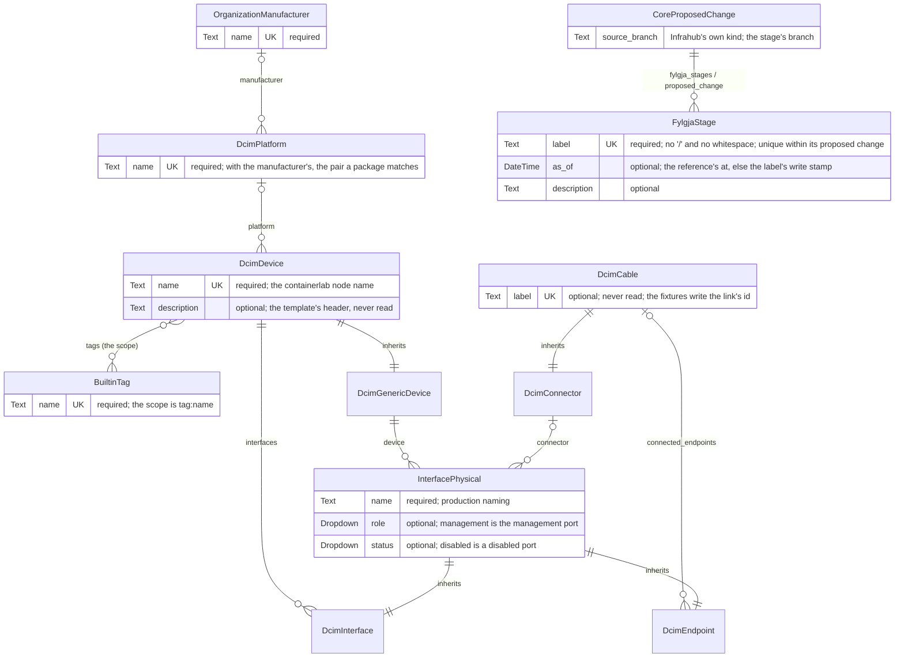

# The schema's entities

Fylgja's Infrahub reader reads OpsMill's schema library's DCIM at commit `26336e9`, whose
six files `schema/dcim/` vendors byte for byte with the library's licence
([its README](../../schema/dcim/README.md)), by one documented mapping
([`mapping.md`](../../specs/017-dcim-reader/contracts/mapping.md);
[D-057](../decisions.md#d-057)). Fylgja adds nothing to the library and implements none of
its kinds; the one kind of its own is the stage (`schema/fylgja-stage.yaml`). The diagram
shows, of the library's kinds, the five the mapping reads and the four generics their
relationships pass through. Each of the five carries the attributes the mapping reads,
typed by their Infrahub kind, and the relationships its conformance table checks, each to
the peer the table names, with their cardinalities. Most of them the library declares on
a generic and the kind inherits, as Infrahub's schema endpoint reports them for the pinned
commit. Beside them stand Infrahub's own `BuiltinTag`, which carries the scope, and the
stage with the proposed change it belongs to. Names are as the YAML spells them;
"inherits" marks a kind's `inherit_from`, which the endpoint reports as the generic's
`used_by` and the conformance check reads.

A twin is of a scope, `tag:<name>`: every `DcimDevice` carrying the tag is read, whatever
its `status`, and nothing outside the scope is. A device's platform is a `DcimPlatform`
under its `OrganizationManufacturer`, and the pair of names picks the support package
whose `platform.matches` names it, letter for letter. Its ports are the
`InterfacePhysical`s whose `device` is the device: `role: management` is the management
port and `status: disabled` a disabled one, each an approximation the read records; an
`InterfaceVirtual` is never read. A link is a `DcimCable` reached through a port's
`connector` whose `connected_endpoints` are exactly two physical ports of devices in the
scope; any other cable is omitted and recorded, never a refusal. `DcimDevice` inherits
Infrahub's `CoreArtifactTarget`, through which the read finds the device's rendered
configuration. The template that renders it reads the device's `description` too, which
the fixtures' marker fills; the reader never reads it.

Nobody implements `FylgjaStage`: a stage, branch-agnostic and loaded on the default branch,
marks a moment of Infrahub's own `CoreProposedChange`, whose `fylgja_stages` the same file
adds, by a label unique within it ([D-045](../decisions.md#d-045)); the proposed change's
source branch is the branch a mark's read is on.

