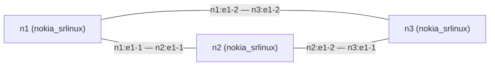
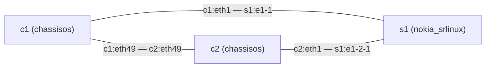
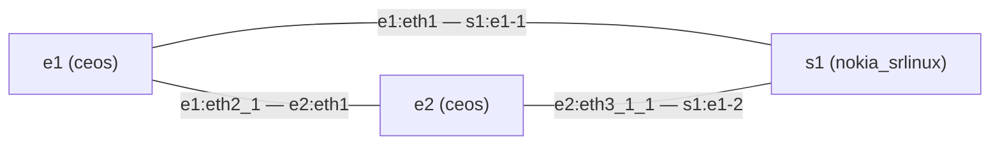

# The fixture topologies

Generated by `scripts/diagrams.sh` from each golden bundle under `testdata/golden/`:
its `topology.clab.yml` and its `bundle_id`. Regenerate it with `make diagrams`;
never edit it by hand. Each node is labelled with its containerlab kind, and each link
with its two endpoints as the topology names them.

## three-node — `43d917158d2b601cd2cdeb6aafd56d367224d757c4ce3f67fdf3c206e2c5a386`

## lossy — `4213b3cfd532f896d476c67c21f54e5375effdbec18f4376360471fd03f50b03`

## mixed — `ecb665f58ffc9882024a06e29b01e681ee38ce40f55b76994d470fe3272a2aec`

