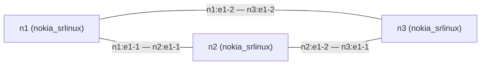
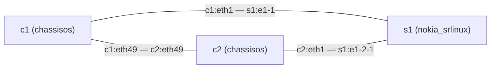
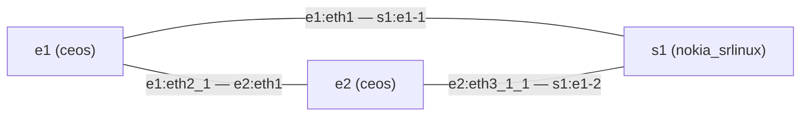
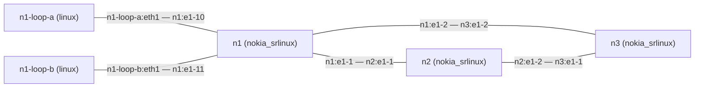

# The fixture topologies

Generated by `scripts/diagrams.sh` from each golden bundle under `testdata/golden/`:
its `topology.clab.yml` and its `bundle_id`. Regenerate it with `make diagrams`;
never edit it by hand. Each node is labelled with its containerlab kind, and each link
with its two endpoints as the topology names them.

## three-node — `c70589c35899378b8343abd1ebc12ab476e2f08a33a14449eb585d21cefd9672`

## lossy — `10099944520a548145d2d8dc45eb9a2ddec950a0ec2c9be48c572bb66fc48c31`

## mixed — `44ac283f65333103a5f4c6557e648c7c0bccd9e023f1babf55b1541577f33834`

## three-node-probed — `5222063bac574cf7ba031a0cb7a04dc0ae8b40cca84403215bf5356c50dfcde9`

