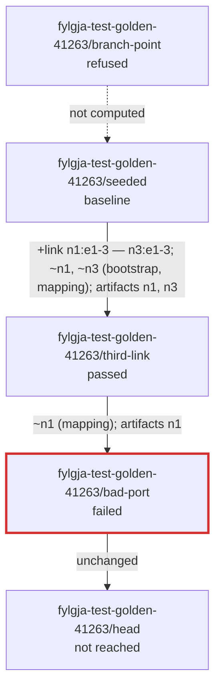

## Fylgja rehearsed proposed change "fylgja-test-golden-41263" on fylgja-test-golden-41263, scope tag:fylgja

Run `fylgja-rehearse 01a188df-b883-70f8-8999-bc18b484dc1f`, stages resolved at 2026-10-29T18:15:11Z. Status **nonconforming**. 74.5s of the 2580s deadline (ceiling 3600s).

| stage | at | snapshot | bundle | step | wait | verify | loss | new verification failures | verdict |
|---|---|---|---|---|---|---|---|---|---|
| fylgja-test-golden-41263/branch-point | 2026-10-29T18:09:04.039194Z | — | — | | | | — | | refused (scope.empty) |
| fylgja-test-golden-41263/seeded | 2026-10-29T18:11:38.471611+00:00 | 78232019… | ce705cdb… | created | settled after 4.4s | 15 held, 0 failed, 0 skipped | — | — | baseline |
| fylgja-test-golden-41263/third-link | 2026-10-29T18:11:50.425111+00:00 | 5cbbe593… | 61665b99… | stepped 5.1s; push n1, n3 | settled after 5.5s | 19 held, 0 failed, 0 skipped | — | none | passed |
| fylgja-test-golden-41263/bad-port | 2026-10-29T18:12:11.745240+00:00 | cc81016f… | 0b8af687… | diverged at push 6.5s; not landed n1 (push.refused) | settled after 5.5s | 19 held, 0 failed, 0 skipped | — | none | failed |
| fylgja-test-golden-41263/head | 2026-10-29T18:12:10.636975+00:00 | 8b986a10… | 4215a6c2… | | | | — | | not reached |



**Findings**:

- `push.refused` n1: node n1 refused artifact device-config (checksum 52e8a7ff4e883e85310df284840aefde): the node's message ends before any reason Fylgja can read, and the candidate it refused passes \`commit validate\`, which does not run every check a commit does (D-035); no node was pushed
- `rehearsal.stage.failed` fylgja-test-golden-41263/bad-port: diverged at phase push: landed none; not landed n1 (push.refused)
- `scope.empty` tag:fylgja: scope tag:fylgja selects no device on branch main at 2026-10-29T18:09:04.039194Z
- `step.diverged` 01a188e0-a0b7-78e2-9cb0-2c7bf655c46f: step run 01a188e0-a0b7-78e2-9cb0-2c7bf655c46f towards stage fylgja-test-golden-41263/bad-port (bundle 0b8af687…) stopped at phase push: landed none; not landed n1 (push.refused); the twin is up and diverged at stage fylgja-test-golden-41263/third-link (bundle 61665b99…), its record says so, and it accepts only fylgja twin destroy

**Stages** (Infrahub's view does not show them):

- `fylgja-test-golden-41263/branch-point` main at 2026-10-29T18:09:04.039194Z (branch point)
- `fylgja-test-golden-41263/seeded` fylgja-test-golden-41263 at 2026-10-29T18:11:38.471611+00:00 (written) "seeded"
- `fylgja-test-golden-41263/third-link` fylgja-test-golden-41263 at 2026-10-29T18:11:50.425111+00:00 (written) "third link"
- `fylgja-test-golden-41263/bad-port` fylgja-test-golden-41263 at 2026-10-29T18:12:11.745240+00:00 (written) "a port SR Linux refuses"
- `fylgja-test-golden-41263/head` fylgja-test-golden-41263 at 2026-10-29T18:12:10.636975+00:00 (head)

**Warnings**:

- `artifact.interface.unrepresented` n1:ethernet-1/99: artifact device-config names interface ethernet-1/99 at line 27, which the twin does not represent: omitted (omit.interface.unmappable: rule ethernet matched, but {port} is 99, outside its range 1..58; no such port on the node) (stages bad-port, head)

**Baseline findings** (reported, failing nothing): none

**Reproduce by hand**:

```
fylgja twin create --stage fylgja-test-golden-41263/seeded --scope tag:fylgja
fylgja twin step --stage fylgja-test-golden-41263/third-link --allow-restart
fylgja twin step --stage fylgja-test-golden-41263/bad-port --allow-restart
fylgja twin verify
fylgja twin destroy
```

*Fidelity is asserted, not measured: the twin's containers forward in software and keep their own timing; a loss figure is the container's, never a hardware forwarder's.*
