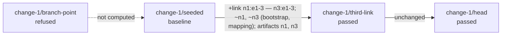

# Contract: `twin rehearse`, the operation `twin.rehearse`, the report, `twin.json` 7

Extends [contracts/cli.md](../../../contracts/cli.md) and [contracts/api.md](../../../contracts/api.md)
as 014 leaves them; at the close each gains a section "015: the rehearsal" that says what
this file says. **Everything not named here is as 014 left it.** Identifiers, exit statuses
and the JSON documents are the contract; text is illustrative except where quoted.

## The command

```
fylgja twin rehearse --branch <b> [--markdown] [--json]
```

A client's command: one request, `POST /v1/twin/rehearse`, the frames printed, the exit by
the document. It needs a server, Infrahub, the bundle store, the workflow service, a worker,
Docker and containerlab on the server's and the worker's `PATH`, and both images where the
stages need them: everything `twin create`, `twin step`, `twin verify` and `twin destroy`
need. Every refusal with an identifier is the server's. `--branch` is required (`--branch
is required`, exit 2, no request); an empty `--branch=` is `stage.ref.invalid` at `start`.
`--markdown` prints the markdown rendering alone on stdout, nothing else there, and exits by
the document; `--json` prints the document alone; both together are cobra's own refusal,
exit 2, with no request. No `--allow-restart`, `--wait` or `--dry-run`: a rehearsal's twin
is its own, each wait is the step's default budget, and `stage plan` is its dry run.

### What the server does, in order

Each step's refusal ends the request with its document and nothing started:

1. **The plan**: the open proposed change whose source branch is `b` is found and every
   stage resolved, read, compiled and filed in the store, as `stage plan` does, with 014's
   refusals and warnings (`stage.kind.absent`, `stage.unknown`, `stage.artifact.stale`,
   `stage.label.reserved`, …; `stage.main.moved` as a warning). A stage refused refuses the
   rehearsal with the plan's findings: status `rejected`, exit 1 (`error`, 2, for
   `operation.failed` and `intent.at.precision`), the host untouched. **The one exception**:
   a branch point whose one rejection is `contract.node.missing` at `read` is kept as a row
   (`role`, `verdict` `refused`) and passed over.
2. **The baseline**: the first compiled stage in order. When it is the only one, the
   warning `rehearsal.steps.none` is filed and the rehearsal goes on.
3. **The deadline**: the stages' budgets summed from the node plans (data-model.md §4);
   over the ceiling it is `rehearsal.deadline.unfit`, exit 1, at `start`, naming the time
   the stages need and the ceiling.
4. **The runs in flight**: `fylgja-rehearse`, `fylgja-provision`, `fylgja-step` or
   `fylgja-destroy` running is `run.in_flight`, exit 1, naming the run.
5. **The host**: a twin whose record's `rehearsal` names a `fylgja-rehearse` run that is not
   running is **reclaimed**: the destroy run is started and followed as `twin destroy`
   does, its events in the answer after the notice `reclaiming the twin of rehearsal run
   <id>`, the warning `rehearsal.twin.reclaimed` filed, the report's `reclaimed` block set;
   a destroy that leaves something refuses the rehearsal with `cleanup.incomplete`, exit 4.
   Then the host check of the baseline bundle, in this process as a dry run makes it: a
   lab or a twin directory (`host.lab.present`, `host.twin.present`, naming what holds the
   host and that `twin destroy` clears it), the memory sum, an unset login, an absent image,
   a package not loaded, each under its identifier at `host_check`, exit 1.
6. **The start**: `start` frame with `fylgja-rehearse`, the run started
   (`WorkflowExecutionErrorWhenAlreadyStarted`; `run.in_flight` by the fixed id; no worker
   `run.worker.absent`), the `run` frame, then the follow.
7. **The follow and the report**: every event of the run and of its children, each child
   announced by the notice `run <workflow> <id>` and preceded by a `stage <ref>: …` line;
   after the run closes, the stages read again for `rehearsal.stage.moved` and
   `rehearsal.change.closed`; then the document.

### The run, `fylgja-rehearse`

Children under their fixed ids, each refused beside any other run: `fylgja-provision` for
the baseline (already compiled, as a rebuild's child is; `StopFollowing: true`; its record
carrying the rehearsal), then `VerifyTwin` (the baseline's wait, the default budget, from the
record's time, written into no record), then `fylgja-step` per later stage in order
(`--allow-restart`'s behaviour; the default wait; the run reads containerlab's plan itself),
then `fylgja-destroy` on a disconnected context, always. The run stops at the first stage
whose verdict is not `passed`. The deadline is a timer on the run's clock: when it passes, the
children's context is cancelled (a provision cleans up; a step records diverged, D-036), and
the destroy follows. The operator's first interrupt cancels the run the same way and waits
for its destroy; the second stops waiting (`run.cancelled`, the run goes on to its destroy).
A client that goes away leaves the run running to its destroy.

### Status and exit

| Status | Exit | When |
|---|---|---|
| `ok` | 0 | every rehearsed stage passed; the baseline's findings and the warnings notwithstanding |
| `rejected` | 1 | refused before any run: a stage refused, the deadline unfit, a run in flight, the host held |
| `error` | 2 | a stage's step could not run, was rejected by its locks or cancelled before its stage; its wait incomplete; the deadline cut the rehearsal; the operator's interrupt; `operation.failed`; after the destroy |
| `failed` | 3 | the baseline could not be built and the provision cleaned up |
| `unclean` | 4 | the destroy left something; `cleanup.incomplete` says what and that `twin destroy` clears it |
| `nonconforming` | 5 | a stage failed: diverged, or a finding the baseline did not have; the twin destroyed |

No status, step, operation or exit is new beyond the operation.

### The text

```
rehearsal of proposed change "third link" (18df…) on branch change-1, draft: 4 stages; deadline 32m0s (ceiling 1h0m0s)
change-1/branch-point: refused (contract.node.missing)
  rejection contract.node.missing [step read] main: branch defines FylgjaContract but holds no instance of it
change-1/seeded: branch change-1 at 2026-10-16T17:25:30.118244+00:00 (written), "after the link is cabled"; baseline
change-1/third-link: branch change-1 at 2026-10-16T17:30:00.000000+00:00 (given), "third link"
change-1/head: branch change-1 at 2026-10-16T17:30:11.884302+00:00 (head)
run fylgja-rehearse 01a1…
stage change-1/seeded: creating the twin
run fylgja-provision 02b2…
step host check: begins
…
step record: done in 0.1s
stage change-1/seeded: verify: settled after 3.2s (2 reads); 15 held, 0 failed, 0 skipped
stage change-1/third-link: stepping
run fylgja-step 03c3…
…
step observe: settled after 6.1s (4 reads)
stage change-1/third-link: stepped in 4.5s (push n1 2.5s, n3 2.6s); settled after 6.1s; 19 held, 0 failed; passed
stage change-1/head: stepping
…
stage change-1/head: unchanged in 0.9s; settled after 1.0s; passed
destroying the twin
run fylgja-destroy 04d4…
…
removed lab fylgja (3 containers)
removed twin directory /srv/fylgja/local/twin
rehearsal ok: 3 stages rehearsed, every one passed; the twin is destroyed; 118.4s of the 1950s deadline
```

A failed stage's line names why (`diverged at phase push: landed n3; not landed n1
(push.refused)`, or `failed: verify.neighbor n1:ethernet-1/3`), and the lines after it
read `not reached`; the closing line says `rehearsal nonconforming: stage change-1/bad-port
failed at phase push; the twin is destroyed; reproduce it by hand:` followed by the
commands, one per line, indented. A refusal prints the plan's lines and the findings. The
reclaim prints `reclaiming the twin of rehearsal run <id>` and the destroy's lines before
the run. The findings, with the baseline's as warnings prefixed by the stage, print as every
document prints them, on stderr.

### The markdown

Rendered from the `rehearsal` block alone (`rehearsal.Markdown`), GitHub-flavoured:

```markdown
## Fylgja rehearsed proposed change "third link" on change-1

Run `fylgja-rehearse 01a1…`, stages resolved at 2026-10-17T14:02:11Z. Status **ok**. 118.4s of the 1950s deadline (ceiling 3600s).

| stage | at | bundle | step | wait | verify | new findings | verdict |
|---|---|---|---|---|---|---|---|
| change-1/branch-point | 2026-10-16T17:20:19.944651+00:00 | — | | | | | refused (contract.node.missing) |
| change-1/seeded | 2026-10-16T17:25:30.118244+00:00 | 5c6c1d96… | created | settled after 3.2s | 15 held, 0 failed, 0 skipped | — | baseline |
| change-1/third-link | 2026-10-16T17:30:00.000000+00:00 | d05dc990… | stepped 4.5s; push n1, n3 | settled after 6.1s | 19 held, 0 failed, 0 skipped | none | passed |
| change-1/head | 2026-10-16T17:30:11.884302+00:00 | cc1ca493… | unchanged | settled after 1.0s | 19 held, 0 failed, 0 skipped | none | passed |



**Stages** (Infrahub's view does not show them):

- `change-1/branch-point` main at 2026-10-16T17:20:19.944651+00:00 (branch point)
- `change-1/seeded` change-1 at 2026-10-16T17:25:30.118244+00:00 (written) "after the link is cabled"
- …

**Warnings**: stage.main.moved … (none when there are none)

**Baseline findings** (reported, failing nothing): none

**Reproduce by hand** (on a failure alone):

```
fylgja twin create --stage change-1/seeded
fylgja twin step --stage change-1/bad-port --allow-restart
fylgja twin verify
fylgja twin destroy
```

*Fidelity is asserted, not measured: the twin's containers forward in software and keep their own timing.*
```

A Mermaid label is quoted; `"` in a name is written `#quot;`, `<` and `>` as `#lt;` and
`#gt;`; a line break is `<br/>`. An edge's label is the step's text with no content: nodes
and links added or removed, nodes changed with their reasons, artifacts changed by node;
a step not computed is a dotted edge. Under 1.11.2 a comment renders through react-markdown
with `remark-gfm` (tables), `remark-breaks` and `rehype-mermaid` (research §1.2).

## The API

| Operation | Path | `args` | Files in | Files out | Takes an interrupt |
|---|---|---|---|---|---|
| `twin.rehearse` | `/v1/twin/rehearse` | `branch` | | | from `start` |

- `branch` present and empty is `--branch=`, refused `stage.ref.invalid` at `start`;
  absent is `--branch is required`, `operation.failed`, exit 2; both before the server
  connects to Infrahub.
- **`render` gains `"markdown"`**: the `out` and `err` frames are as under `"text"`, and
  the `document` frame carries `markdown` beside `text` on an operation that has a
  markdown rendering, `twin.rehearse` alone; every other operation answers `markdown` as it
  answers `text`, with no `markdown` field. [api.schema.json](../../../contracts/api.schema.json)'s
  `render` enum and `$defs/frame`'s `document` frame move; `start.workflow_id`'s enum gains
  `fylgja-rehearse`.
- A refusal before the start is the `document` frame alone, with no `start`. A reclaim's
  destroy is followed inside the answer before the `start` frame, with no `run` frame of
  its own, as `twin.destroy`'s is.
- The interrupt is `POST /v1/streams/{stream}/interrupt`, as for a create.
- `api.Version` stays `1`: a new operation, a new render value and a new frame field,
  which a client of M13 ignores.

### `twin show`, `twin verify`, `twin destroy`, `stage list` beside a rehearsal

- `twin show`'s kind line for a rehearsal's twin: `pinned at …, stage change-1/seeded, of
  rehearsal run fylgja-rehearse 01a1…; not following`; its `show.record.rehearsal` carries
  `{workflow_id, run_id}` or `null`. While the run is in flight: `in flight: run
  fylgja-rehearse 01a1… at step step (run fylgja-step 03c3… at step push), stepping towards
  stage change-1/third-link`, and the kind line ends `; rehearsal run fylgja-rehearse 01a1…
  is at stage change-1/third-link, step push`.
- `twin verify`'s first line names the rehearsal's run after the stage; its `verify.twin`
  carries `rehearsal`.
- `twin destroy` during a rehearsal prints `cancelling rehearsal run 01a1…; waiting for its
  destroy`, follows it, then its own destroy, which finds nothing; a create or a step beside
  a rehearsal is `run.in_flight` naming it.
- `stage list` marks nothing of a rehearsal: its twin is gone when it ends.

## `twin.json` 7

`contracts/twin.schema.json`, `$id https://fylgja.dev/contracts/twin/v7`, `twin_version`
`"7"`: `rehearsal` is required, `{"workflow_id": "fylgja-rehearse", "run_id": "…"}` or
`null`; everything else of `6` stands. A create's record writes it from its input, a step's
record keeps it. The `6` schema is frozen under
`internal/lab/testdata/contracts/014-proposed-change-stages/`, and a `6` record reads with no
rehearsal.

## Identifiers

| Rule | Severity, exit, step | When |
|---|---|---|
| `rehearsal.deadline.unfit` | rejection, 1, `start` | the stages' summed budgets exceed the ceiling; names the time needed and the ceiling |
| `rehearsal.twin.reclaimed` | warning, 0, `destroy` | a twin of a rehearsal whose run was no longer running was destroyed before the start; names the run and what was removed |
| `rehearsal.steps.none` | warning, 0, `resolve` | one stage alone compiled: it was built, verified and destroyed, and no step was rehearsed |
| `rehearsal.stage.failed` | rejection, 5 (`nonconforming`), the phase's step for a divergence, `observe` for a finding | the stage failed; names the phase and the nodes landed and not landed, or the finding by rule and object |
| `rehearsal.stage.error` | rejection, 2, the step reached | the stage's step could not run, was rejected by its locks or cancelled before its stage, or its wait could not complete |
| `rehearsal.baseline.failed` | rejection, 3, `provision` | the baseline could not be built; the provision child's own findings stand beside it |
| `rehearsal.deadline.cut` | rejection, 2, the step reached | the deadline passed: names the stage in progress, each finished stage's time and the deadline |
| `rehearsal.stage.moved` | warning, 0, `resolve` | after the run, a rehearsed stage no longer resolves to the `(branch, at)` it was rehearsed at, or is gone; the head included |
| `rehearsal.change.closed` | warning, 0, `resolve` | after the run, the proposed change is no longer open |

`run.cancelled` (an interrupt; at the step reached), `run.in_flight`, `run.worker.absent`,
`run.service.unreachable`, `host.*`, `cleanup.incomplete`, every `stage.*`, `step.*` and
`verify.*` keep their identifiers. The baseline's and each rehearsed stage's verify
findings are in the document as **warnings**, their object prefixed by the stage
(`change-1/seeded: n1:ethernet-1/2`), since a rejection would end the document `rejected`
and the baseline's fail nothing; a new finding fails its stage through
`rehearsal.stage.failed`, which names it.

## Workflows and activities

One workflow is added, `fylgja-rehearse` (Constitution VIII, D-051); no activity, budget
or version marker is added or changed, and the nine recorded histories replay. `StepResult`
gains `wait_counts` and `wire.VerifyResult` `counts`, both omitted when absent.

## Formats and versions

| Format | Version | Change |
|---|---|---|
| the API | `1` | `twin.rehearse`; `render: markdown`; `document.markdown`; `start.workflow_id` `fylgja-rehearse` |
| findings | `1` | operation `twin.rehearse`; the `rehearsal` block by `$id` in `rehearsal.schema.json`; `show.record.rehearsal`, `verify.twin.rehearsal` |
| `twin.json` | `7` | `rehearsal` |
| bundle manifest, PSP, CTM, contract | `4`, `0.6`, `1`, `0.2` | none |
